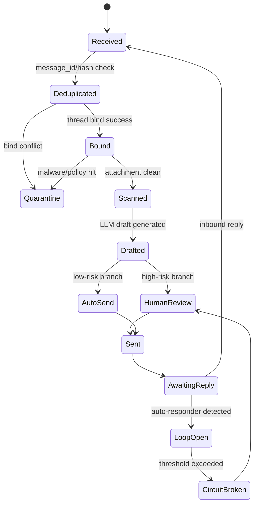

# Async Email-Thread Agent Channel Selection FAQ: Graph Mail Webhook vs ACS Email vs Inbound Parse vs CRM Email-to-Case
> 🌐 **Language / 语言切换**: **[🇬🇧 English](async-email-thread-agent-channel-graph-mail-webhook-vs-acs-email-vs-inbound-parse-selection-faq.en.md)** | **[🇨🇳 中文版](async-email-thread-agent-channel-graph-mail-webhook-vs-acs-email-vs-inbound-parse-selection-faq.md)** | **[📚 Back to Catalog](README.en.md)**
> Evidence tags: `measured` / `synthetic` / `anonymized_reported`
> Retrieval date: 2026-11-21
> Scope boundary: enterprise asynchronous multi-party email-thread agent channels, thread reconstruction, injection defense, auto-reply storm circuit breaking, and attachment claim-check patterns; this guide does not cover IM-chat or voice contact-center runtime design

## 1) Executive summary: treat enterprise email as a governed asynchronous control plane, not as plain text I/O
Enterprise email-agent programs usually fail for control-plane reasons,
not because the model cannot draft text.
In production,
email is a long-lived legal channel,
crosses organizational boundaries,
and carries approval and accountability signals.
A single case can span days or weeks,
with external suppliers,
legal reviewers,
finance approvers,
and customer stakeholders participating in one thread.
So the architecture question is not only “can we send email”.
The real questions are:
can we reconstruct threads reliably,
can we stop auto-responder loops,
can we prevent unauthorized recipient expansion,
and can we keep attachment plus token costs auditable.
This guide compares four routes:
1. `Microsoft Graph Mail Change Notifications + Exchange Online shared mailbox`;
2. `Azure Communication Services (ACS) Email + isolated sender-reputation subdomain`;
3. `Programmable SMTP inbound-parse gateway (SendGrid/Postmark/self-hosted)`;
4. `CRM/ITSM native Email-to-Case bridge`.
Primary SA recommendation:
- choose Route A when M365 compliance inheritance is mandatory;
- choose Route B when automated sender reputation must be isolated from corporate executive domains;
- choose Route C when you need high-scale dynamic email addresses and heavy-attachment ingress;
- choose Route D when your incident lifecycle and SLA clocks already live inside CRM/ITSM workflows.
Most large enterprises end up with a layered hybrid:
Graph for core mailbox governance,
ACS for high-volume outbound automation,
Inbound Parse for large/heterogeneous ingress,
and CRM for final case-state orchestration and human takeover.

## 2) Verifiable source set and evidence levels
The following references are used for platform boundaries and parameter constraints.
Source 1 (`measured`): Microsoft Graph Change Notifications for Outlook resources — https://learn.microsoft.com/graph/change-notifications-for-outlook
Source 2 (`measured`): Microsoft Graph subscription lifecycle notifications — https://learn.microsoft.com/graph/webhooks-lifecycle
Source 3 (`measured`): Microsoft Graph `message:createReply` API — https://learn.microsoft.com/graph/api/message-createreply
Source 4 (`measured`): Azure Communication Services Email overview — https://learn.microsoft.com/azure/communication-services/concepts/email/email-overview
Source 5 (`measured`): ACS email domain onboarding with SPF/DKIM — https://learn.microsoft.com/azure/communication-services/quickstarts/email/connect-email-domain
Source 6 (`measured`): Azure Event Grid delivery and retry model — https://learn.microsoft.com/azure/event-grid/delivery-and-retry
Source 7 (`measured`): SendGrid Inbound Parse — https://docs.sendgrid.com/for-developers/parsing-email/inbound-email
Source 8 (`measured`): Postmark inbound email processing — https://postmarkapp.com/developer/user-guide/inbound/overview
Source 9 (`measured`): RFC 3834 auto-responder behavior — https://www.rfc-editor.org/rfc/rfc3834
Source 10 (`measured`): Microsoft Purview DLP and labeling baseline — https://learn.microsoft.com/purview/dlp-learn-about-dlp
Source 11 (`measured`): Defender for Storage malware scanning — https://learn.microsoft.com/azure/defender-for-cloud/defender-for-storage-malware-scan
Source 12 (`anonymized_reported`): anonymized enterprise email-thread operations telemetry.
Source 13 (`synthetic`): controlled stress tests for duplicate delivery, loop storms, and attachment offload.
All percentages, latency bands, and throughput statements are marked by evidence class in-line.

## 3) Workload pain profile: email is a “slow lane” with high blast radius when controls are weak
Email channels differ from chat channels in three structural ways.
Inputs are untrusted and externally mutable.
Replies are asynchronous and can arrive after long delays.
Sender identity and threading metadata are often inconsistent across systems.
The most frequent architecture failures are:
1. missing `In-Reply-To` metadata causing thread split and wrong case linkage;
2. auto-responder loops across partner domains and internal bots;
3. indirect prompt-injection instructions embedded in quoted email text;
4. duplicate message delivery generating repeated case actions;
5. heavy attachments (`25MB–100MB`) overloading queue and function paths;
6. sender-reputation coupling between agent automation and executive mail domains;
7. weak replayability and forensic gaps for approval evidence;
8. fragmented cost ownership across channel, compute, storage, and human review.
These failure modes make “mail security airlock” design a prerequisite,
not an optional hardening pass.

## 4) Threat model and SLO design: move from “can reply” to “can govern”
A practical architecture model separates four outcome layers.
L1 availability:
ingress and egress channel reliability.
L2 thread correctness:
high-fidelity mapping between messages and business cases.
L3 governance integrity:
no unauthorized recipient expansion,
no unsanctioned external data exfiltration.
L4 FinOps discipline:
predictable cost per thread and per resolved case.
Suggested SLO set (`synthetic`):
- `ingress_ack_p95_ms < 200`;
- `thread_bind_success_rate > 99.5%`;
- `auto_loop_incidents_per_10k_threads < 1`;
- `unauthorized_recipient_mutation = 0`;
- `duplicate_delivery_dedup_rate > 99.9%`;
- `attachment_claim_check_success_rate > 99.0%`.
Required audit fields:
`thread_id`,
`conversation_id`,
`message_id`,
`actor_type`,
`approval_decision`,
`recipient_diff`,
`dlp_label`,
`malware_scan_result`.
This control envelope should be approved before model-routing design.

## 5) Route A: Graph Mail Change Notifications with Exchange shared mailboxes
Route A is strongest when enterprises already operate on M365 governance foundations.
Typical pattern:
shared mailbox addresses such as `rfq@corp.com` and `claims@corp.com`
emit change notifications into the integration plane.
Thread binding can combine:
`conversationId`,
`In-Reply-To`,
`References`,
and case-specific business correlation keys.
Strengths:
1. native inheritance of Purview DLP and MIP controls (`measured`);
2. first-class support for draft-first workflows via `createReply` (`measured`);
3. identity and approval context can remain aligned with Entra and enterprise audit controls.
Key implementation requirements:
1. automatic subscription renewal with lifecycle-notification monitoring;
2. idempotent notification ingestion and replay-safe handling;
3. conflict-aware thread binder for forwarded/rewritten message chains.
Trade-offs:
Graph quotas and API budgets must be engineered explicitly,
and very large attachments still require external offload paths.
For M365-centric organizations,
Route A is often the best primary backbone.

## 6) Route B: ACS Email with isolated subdomain reputation and Event Grid delivery telemetry
Route B is optimized for sender-reputation isolation and outbound automation scale.
Common operating model:
human communication remains on `@corp.com`,
automation leaves via `@agent.corp.com`.
This separates risk domains.
If an agent policy regresses,
executive and sales deliverability remains protected.
Strengths:
1. dedicated sender domain and DNS posture per automation channel;
2. Event Grid delivery status enables closed-loop bounce/complaint operations;
3. elastic fit for high-volume reminders, case updates, and escalation digests.
Critical implementation points:
1. enforce SPF/DKIM/DMARC as release gates;
2. persist delivery telemetry and tie it to case state transitions;
3. treat outbound templates as versioned controlled artifacts.
Trade-offs:
if your thread authority lives in Exchange workflows,
Route B still needs Route A coexistence for canonical case context.
In practice,
Route B is usually a specialized outbound engine,
not the only enterprise ingress path.

## 7) Route C: programmable SMTP inbound-parse gateways
Route C is ideal for high-ingress diversity and large attachment handling.
It supports deterministic case routing through dynamic addresses such as:
`case+{id}@parse.corp.com`.
Strengths:
1. cost does not scale linearly with mailbox-seat licensing;
2. dynamic address fan-out can support very large case populations;
3. attachment pipelines can stream to Blob and pass malware scanning before agent wake-up.
Reference flow:
SMTP ingress -> Parse Webhook -> Raw MIME Blob -> Malware Scan -> Claim-Check Queue.
Core engineering requirements:
1. robust MIME decoding and charset normalization;
2. explicit attachment thresholds with split/chunk policies;
3. immutable raw-message archiving with forensic hashes.
Trade-offs:
teams own more protocol and parsing complexity,
and identity mapping with enterprise directory systems requires additional design.
When external source heterogeneity is extreme,
Route C can significantly reduce pressure on primary mailbox channels.

## 8) Route D: CRM/ITSM Email-to-Case bridge (Dynamics 365 / ServiceNow)
Route D emphasizes business workflow continuity over channel purity.
Many enterprises already run:
SLA timers,
escalation ladders,
ownership transitions,
and regulatory reporting within CRM/ITSM.
In that setting,
the highest-value pattern is:
let Email-to-Case normalize inbound events,
then hand structured case updates to agent orchestration.
Strengths:
1. immediate reuse of existing process controls and audit conventions;
2. mature human takeover paths with low change-management overhead;
3. easier alignment with operational KPIs and compliance evidence.
Trade-offs:
initial data-model harmonization can be non-trivial,
and thread semantics may be constrained by product-specific behaviors.
Best-fit industries:
insurance claims,
contract/legal revisions,
high-accountability customer dispute flows.

## 9) 12-dimension architecture comparison matrix
| Dimension | Graph Mail Webhook | ACS Email | Inbound Parse Gateway | CRM/ITSM Email-to-Case |
|---|---|---|---|---|
| 1. Identity and entitlement inheritance | Strong (Entra + M365) | Medium | Medium (custom mapping) | Strong (business-role model) |
| 2. Thread reconstruction fidelity | Strong | Medium | Medium (custom binder) | Medium-strong |
| 3. Auto-responder loop control | Medium-strong | Medium | Strong (programmable ingress) | Strong (workflow gate) |
| 4. Indirect prompt-injection defense | Strong (draft-first) | Medium-strong | Strong (airlock policy) | Strong (human approval gates) |
| 5. Dynamic address scalability | Medium | Medium | Strong | Medium |
| 6. Large attachment handling | Medium (needs offload) | Medium (needs offload) | Strong | Medium |
| 7. Sender-reputation isolation | Medium | Strong | Medium | Medium |
| 8. Existing process reuse | Strong in M365 estates | Medium | Low-medium | Strong in CRM-led estates |
| 9. Time-to-production | Medium | Medium-strong | Medium | Medium |
| 10. Operational complexity | Medium | Medium | High | Medium |
| 11. Cost predictability per thread | Medium | Medium-strong | Medium-strong | Medium |
| 12. Audit completeness | Strong | Medium-strong | Medium | Strong |
Matrix interpretation (`anonymized_reported` + `synthetic`):
single-route purity is rare in mature enterprises.
Two- or three-route composition usually delivers better governance and lower long-term rework.

## 10) End-to-end email-security airlock architecture with thread binding and claim-check

```mermaid
flowchart LR
    A[External Sender] --> B[Email Ingress Plane]
    B --> C{Route Selector}
    C -->|M365 mailbox| D[Graph Change Notification]
    C -->|Agent subdomain| E[ACS Email Event]
    C -->|Dynamic parse address| F[Inbound Parse Gateway]
    D --> G[Thread Binder Service]
    E --> G
    F --> H[Raw MIME Blob Archive]
    H --> I[Defender Malware Scan]
    I --> G
    G --> J[Policy Airlock]
    J --> K[Recipient Allowlist Guard]
    J --> L[RFC3834 Loop Breaker]
    J --> M[Indirect Prompt Injection Sanitizer]
    K --> N[Service Bus Case Queue]
    L --> N
    M --> N
    N --> O[Agent Orchestrator]
    O --> P[Draft Composer]
    P --> Q{Delivery Mode}
    Q -->|Draft only| R[Human Approver]
    Q -->|Auto send| S[Outbound Channel]
    R --> S
    S --> T[Audit + Telemetry + FinOps Lake]
```

The key sequencing principle is strict.
Bind thread first.
Apply policy airlock second.
Generate or send only after governance checks pass.
Skipping this order increases error velocity with scale.

## 11) Thread-state machine and loop circuit breakers

Recommended loop policy (`synthetic`):
1. break if auto-responder count in the same thread reaches `>=3` within `15` minutes;
2. default deny auto-send when `Auto-Submitted` is present and not `no`;
3. enforce stricter posture for unknown external domains lacking suppress headers;
4. after breaker trigger, lock the thread into human queue for at least `30` minutes.
Example policy pseudocode:
```python
def should_auto_reply(mail, state):
    if not recipient_domain_allowed(mail.to, policy=state.allowlist):
        return False, "recipient_not_allowed"
    if mail.headers.get("Auto-Submitted", "").lower() not in ("", "no"):
        return False, "auto_submitted_detected"
    if state.loop_counter(mail.thread_id, window_minutes=15) >= 3:
        return False, "loop_circuit_breaker"
    if mail.risk.prompt_injection_score >= 0.7:
        return False, "prompt_injection_risk"
    return True, "safe_to_draft_or_send"
```

## 12) Scenario decision tree and FinOps model
Use this decision flow before committing to a single platform:
Decision A:
must you inherit M365 compliance and sensitivity labels?
If yes,
Graph should be your primary ingress anchor.
Decision B:
must automation sender reputation be isolated from office domains?
If yes,
add ACS as outbound plane.
Decision C:
do you require very large dynamic addresses and heavy attachment intake?
If yes,
add programmable Inbound Parse.
Decision D:
do SLA timers and escalations already live in CRM/ITSM?
If yes,
add Email-to-Case bridge and keep agents downstream.
Cost model should include at least five buckets:
1. channel spend (mailbox, domain, delivery);
2. parse and scanning spend (functions, storage, malware scanning);
3. model spend (drafting tokens, retries, summarization);
4. human review spend (high-risk branch rate);
5. incident reserve (mis-send rollback and reputation mitigation).
Reference formula (`synthetic`):
`monthly_cost = channel + parse_scan + model + human_review + incident_reserve`.
In production,
cutting duplicate threads and loop storms usually saves more than micro-optimizing per-message token usage.

## 13) Enterprise scenario A: B2B RFQ and supplier negotiation threads
An anonymized manufacturer processes roughly `180,000` RFQ-related emails per month (`anonymized_reported`).
Primary outcomes:
reduce quote-cycle lead time,
preserve contractual consistency,
and keep evidence ready for procurement audits.
Recommended architecture:
Graph as authoritative thread ingress,
ACS for outbound reminders and structured updates,
CRM as state machine of record.
Critical guardrails:
1. auto-reply only for allowlisted supplier domains;
2. price and liability clauses always draft-first with human approval;
3. all BOM/PDF attachments scanned before content extraction.
Observed impact (`anonymized_reported`):
thread mis-binding reduced by ~`42%`,
duplicate reply events reduced by ~`68%`,
manual rework hours reduced by ~`31%`.
This workload is far more sensitive to thread correctness than to raw response speed.

## 14) Enterprise scenario B: underwriting disputes and legal contract revision loops
Insurance and legal channels share two hard constraints.
First,
messages carry heavy historical context and quoted chains.
Second,
recipient mistakes can become immediate compliance incidents.
Recommended architecture:
Graph + Inbound Parse + human draft review gates.
Rationale:
inherit enterprise identity controls,
handle large and varied attachment patterns,
and prevent unsanctioned outbound actions on high-risk content.
Suggested controls:
1. clause revisions default to draft-only mode;
2. `To/CC/BCC` diffs trigger dual-approval checks;
3. external auto-responder chains trigger circuit breaker and manual continuation.
Observed impact (`anonymized_reported`):
high-risk mis-sends dropped to near-zero,
average dispute handling cycle improved by about `18%`.

## 15) Deep FAQ (8 practical decisions for production)
**Q1: Why not let the agent always auto-send to maximize productivity?**  
A1: Email is a high-accountability channel; mis-sends are often irreversible, so high-risk domains and sensitive topics should default to draft-first approval.

**Q2: How do we stop recipient manipulation from indirect prompt injection in email bodies?**  
A2: Treat recipient mutation as a separate policy gate; enforce allowlist plus case-authorization checks on `To/CC/BCC` regardless of model output.

**Q3: What if Graph subscriptions expire and notifications are missed?**  
A3: Run automated renewal jobs, monitor lifecycle notifications, and maintain a bounded compensation pull window.

**Q4: Why create `@agent.corp.com` instead of sending from the main corporate domain?**  
A4: It isolates sender reputation risk, so automation incidents do not directly degrade executive or sales deliverability.

**Q5: Why is Claim-Check mandatory for large attachments?**  
A5: Queueing large blobs directly harms throughput and resiliency; Claim-Check decouples payload transport from orchestration and enables malware gates.

**Q6: When should we introduce Inbound Parse instead of staying mailbox-only?**  
A6: Introduce it when dynamic address cardinality, attachment volume, and source heterogeneity exceed mailbox-centric operating limits.

**Q7: What is the most practical RFC 3834 control in real systems?**  
A7: Honor `Auto-Submitted` suppression by default and combine it with thread-window frequency breakers.

**Q8: Which KPI set best proves ROI for email-native agents?**  
A8: Track thread mis-binding rate, duplicate reply rate, manual rework hours, and high-risk mis-send incidents; sustained improvement across all four demonstrates durable ROI.
