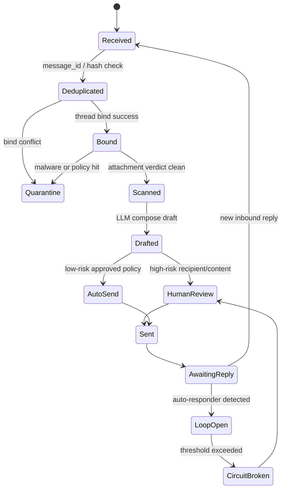

# 异步邮件线程智能体通道选型 FAQ：Graph Mail Webhook vs ACS Email vs Inbound Parse vs CRM Email-to-Case
> 🌐 **Language / 语言切换**: **[🇨🇳 中文版](async-email-thread-agent-channel-graph-mail-webhook-vs-acs-email-vs-inbound-parse-selection-faq.md)** | **[🇬🇧 English](async-email-thread-agent-channel-graph-mail-webhook-vs-acs-email-vs-inbound-parse-selection-faq.en.md)** | **[📚 返回目录](README.md)**
> 证据标签：`measured` / `synthetic` / `anonymized_reported`
> 抓取日期：2026-11-21
> 主题边界：聚焦企业异步多方邮件线程智能体通道、线程重建、注入防护、自动回复风暴熔断与附件 Claim-Check，不展开 IM 即时聊天与语音坐席架构

## 1) 执行摘要：先把“邮件线程通道”从普通收发拆成可治理的异步控制面
多数企业邮件智能体失败，
不是因为模型能力不足，
而是把邮件当成“普通文本输入”处理。
现实业务里，
邮件是一个强状态、
跨组织、
带法律效力的异步渠道。
同一案件会跨越数天到数周，
并穿插外部供应商、
法务、
财务和审批人。
因此选型重点不是“谁能发邮件”，
而是：
谁能稳定重建线程上下文，
谁能避免自动回复死循环，
谁能在不泄露数据的前提下完成草稿协同，
谁能把附件与令牌成本控制在可审计边界内。
本指南比较四条路线：
1. `Microsoft Graph Mail Change Notifications + Exchange Online 共享邮箱`；
2. `Azure Communication Services (ACS) Email + 独立子域信誉池`；
3. `可编程 SMTP 入站解析网关（SendGrid/Postmark/自托管）`；
4. `CRM/ITSM 原生 Email-to-Case 桥接`。
架构师主结论：
- 需要继承 M365 合规与 DLP/MIP 时优先路线 A；
- 需要把自动化外发信誉池与办公主域隔离时优先路线 B；
- 需要十万级动态案件地址与大附件高吞吐解析时优先路线 C；
- 需要直接复用工单 SLA 与人工升级队列时优先路线 D。
如果组织同时满足多种约束，
最稳妥做法是“分层混合”：
Graph 作为核心企业邮箱入口，
ACS 负责高频自动化出站，
Inbound Parse 处理大附件与长尾来源，
CRM 负责最终案件状态机与人机协同闭环。

## 2) 可验证来源与证据等级：官方文档优先，实验数据显式打标
以下来源用于架构边界和参数校验。
来源 1（`measured`）：Microsoft Graph Change Notifications for Outlook resources — https://learn.microsoft.com/graph/change-notifications-for-outlook
来源 2（`measured`）：Microsoft Graph subscriptions lifecycle notifications — https://learn.microsoft.com/graph/webhooks-lifecycle
来源 3（`measured`）：Microsoft Graph message createReply — https://learn.microsoft.com/graph/api/message-createreply
来源 4（`measured`）：Azure Communication Services Email — https://learn.microsoft.com/azure/communication-services/concepts/email/email-overview
来源 5（`measured`）：ACS Email domain management / SPF DKIM — https://learn.microsoft.com/azure/communication-services/quickstarts/email/connect-email-domain
来源 6（`measured`）：Azure Event Grid delivery and retry — https://learn.microsoft.com/azure/event-grid/delivery-and-retry
来源 7（`measured`）：SendGrid Inbound Parse — https://docs.sendgrid.com/for-developers/parsing-email/inbound-email
来源 8（`measured`）：Postmark inbound email processing — https://postmarkapp.com/developer/user-guide/inbound/overview
来源 9（`measured`）：RFC 3834 Auto-Submitted auto-responder recommendations — https://www.rfc-editor.org/rfc/rfc3834
来源 10（`measured`）：Microsoft Purview DLP / MIP labels — https://learn.microsoft.com/purview/dlp-learn-about-dlp
来源 11（`measured`）：Defender for Storage malware scanning — https://learn.microsoft.com/azure/defender-for-cloud/defender-for-storage-malware-scan
来源 12（`anonymized_reported`）：
企业邮件线程匿名化运营指标。
来源 13（`synthetic`）：
本地压测环境中的线程风暴、重复投递与附件卸载实验。
写作中所有百分比和时延结论，
均在段落里标注证据标签。

## 3) 业务痛点：邮件线程天然“慢通道”，却最容易把智能体拖进高风险错误
邮件智能体和聊天智能体最大的不同，
在于输入不受控且可延迟触发。
典型痛点有八类。
第一，
`In-Reply-To` 丢失导致线程分叉错绑。
第二，
外部自动回复与内部机器人互相回信引发风暴。
第三，
外部正文携带间接提示词注入，
诱导智能体擅自改写收件人。
第四，
同一封邮件被重复投递，
造成重复工单与重复模型调用。
第五，
`25MB–100MB` 附件把函数实例和队列帧压垮。
第六，
发件信誉与办公主域耦合，
一次错误群发拖累全公司送达率。
第七，
线程跨周后上下文碎片化，
审计无法还原“谁在何时批准了什么”。
第八，
许可成本、外发成本、恶意扫描成本分散，
很难形成统一 FinOps 视图。
这些痛点决定了架构要先建“邮件安全气闸”，
再谈智能体编排。

## 4) 威胁模型与 SLO：把“可回信”升级为“可审计、可控、可熔断”
建议把邮件智能体目标拆成四层。
L1 通道可用：
确保通知、入站、出站链路高可用。
L2 线程正确：
确保线程重建准确率达到业务目标。
L3 安全治理：
确保未授权外部域名无法被智能体自行加入。
L4 成本纪律：
确保每会话成本在预算走廊内。
建议关键 SLO（`synthetic`）：
- `ingress_ack_p95_ms < 200`；
- `thread_bind_success_rate > 99.5%`；
- `auto_loop_incidents_per_10k_threads < 1`；
- `unauthorized_recipient_mutation = 0`；
- `duplicate_delivery_dedup_rate > 99.9%`；
- `attachment_claim_check_success_rate > 99.0%`。
建议关键审计字段：
`thread_id`、
`conversation_id`、
`message_id`、
`actor_type`、
`approval_decision`、
`recipient_diff`、
`dlp_label`、
`malware_scan_result`。
这组指标会直接决定路线优先级。

## 5) 路线 A：Graph Mail Change Notifications + Exchange Shared Mailbox
路线 A 的核心优势是“复用企业既有合规边界”。
你可以直接在 `rfq@corp.com`、
`claims@corp.com` 这类共享邮箱上接收变更通知。
线程重建可结合：
`conversationId`、
`In-Reply-To`、
`References`、
以及企业案件映射键。
优点一，
继承 Purview DLP 与 MIP 标签体系（`measured`）。
优点二，
支持 `createReply` 生成草稿而非自动发送，
天然适配高风险场景的人审闸门（`measured`）。
优点三，
能与 Entra 权限模型一致管理，
便于审计主体一致性。
关键工程点：
1. 订阅生命周期续期自动化，
   避免 `4230` 分钟窗口过期导致漏订阅。
2. 通知入口幂等，
   防止重放触发重复处理。
3. 线程键冲突处理，
   对跨租户转发邮件做二级绑定策略。
边界与代价：
Graph 配额治理需要严格预算，
并且对超大附件处理仍需外部卸载流水线。
在以 M365 为核心协同平台的组织中，
路线 A 通常是治理成本最低的主通道。

## 6) 路线 B：ACS Email + 独立子域信誉池 + Event Grid 回执
路线 B 的价值是“把自动化外发信誉与办公主域解耦”。
典型形态：
人工办公邮件继续留在 `@corp.com`，
智能体自动化外发走 `@agent.corp.com`。
这样即使自动化链路出现内容或频率异常，
也不会直接污染高管与销售主域信誉。
优点一，
域名和 DNS 信誉策略可独立治理。
优点二，
可通过 Event Grid 获取投递状态回执，
把退信、投诉、延迟做成运营闭环。
优点三，
高频自动化场景弹性更好，
适配批量通知和案件跟进。
关键工程点：
1. SPF/DKIM/DMARC 全链路校验；
2. 投递回执入仓并关联案件状态机；
3. 出站模板版本治理与审批。
边界与代价：
如果业务强依赖 Exchange 原生线程上下文，
路线 B 往往仍需要和 Graph 通道配合。
因此它更常作为“自动化出站引擎”，
而不是唯一入口。

## 7) 路线 C：可编程 SMTP 入站解析网关（Inbound Parse）
路线 C 适合高吞吐、
高附件、
高地址数量的外部输入场景。
它支持 `case+{id}@parse.corp.com` 这类动态地址，
可把回信确定性映射到案件。
优点一，
无需按邮箱席位线性扩展成本。
优点二，
动态地址可做到十万级路由拆分。
优点三，
附件可流式落地 Blob，
再经 Defender 扫描后触发 Claim-Check 事件。
典型链路：
SMTP 入站 -> Parse Webhook -> Blob 暂存 -> 扫描 -> Service Bus 案件队列。
关键工程点：
1. MIME 解析容错与编码标准化；
2. 附件大小阈值与分块策略；
3. 原始报文归档与可追溯哈希。
边界与代价：
你要自己维护更多邮件协议细节，
并负责和企业目录系统对齐身份映射。
当组织接入大量外部长尾来源时，
路线 C 能显著降低主邮箱系统压力。

## 8) 路线 D：CRM/ITSM Email-to-Case 桥接（D365 / ServiceNow）
路线 D 不是“邮件平台替代品”，
而是“业务状态机优先”的治理路径。
很多企业已经把升级流程、
SLA 计时器、
人工接管队列沉淀在 CRM/ITSM。
这时最佳策略通常是：
让 Email-to-Case 负责入口归档和工单创建，
再把标准化后的案件事件送给智能体。
优点一，
现有服务流程和审计规范可直接复用。
优点二，
人工坐席接管路径已成熟，
培训和变更成本低。
优点三，
更容易对接 KPI 与监管报表。
边界与代价：
数据模型迁移和字段治理前期工作量较大，
并且复杂线程语义可能受平台规则限制。
适用场景：
保险理赔、
法务修订、
客户支持争议处理等强流程行业。

## 9) 12 维企业级选型对比矩阵：安全、线程、成本必须同屏评估
| 维度 | Graph Mail Webhook | ACS Email | Inbound Parse Gateway | CRM/ITSM Email-to-Case |
|---|---|---|---|---|
| 1. 企业身份与权限继承 | 强（Entra + M365） | 中（域与服务身份） | 中（需自建映射） | 强（业务角色模型） |
| 2. 线程重建能力 | 强（conversationId + headers） | 中（需外部关联） | 中（需自建） | 中强（依赖工单规则） |
| 3. 自动回复风暴控制 | 中强（规则 + 头部） | 中（需自建） | 强（入口可编程） | 强（流程闸门） |
| 4. 间接注入防护 | 强（草稿优先） | 中强（模板与网关） | 强（入口策略） | 强（人审流程） |
| 5. 动态地址规模 | 中 | 中 | 强（十万级） | 中 |
| 6. 大附件处理 | 中（需外置） | 中（需外置） | 强（原生 parse + Claim-Check） | 中（依平台） |
| 7. 发送信誉隔离 | 中 | 强（独立子域） | 中 | 中 |
| 8. 既有流程复用 | 强（M365 企业） | 中 | 弱中 | 强（CRM/ITSM） |
| 9. 上线速度 | 中 | 中强 | 中 | 中 |
| 10. 运维复杂度 | 中 | 中 | 高 | 中 |
| 11. 单线程成本可预测性 | 中 | 中强 | 中强 | 中 |
| 12. 合规审计完整性 | 强 | 中强 | 中 | 强 |
矩阵解读（`anonymized_reported` + `synthetic`）：
主流大型企业最终采用“二到三路线组合”，
而非单一路线全覆盖。
单路线“全能化”通常带来长期运维债务。

## 10) 端到端邮件安全气闸参考架构（含线程重建与附件 Claim-Check）

```mermaid
flowchart LR
    A[External Sender] --> B[Mail Ingress Layer]
    B --> C{Ingress Route}
    C -->|M365| D[Graph Change Notification]
    C -->|Agent Subdomain| E[ACS Email Event]
    C -->|Dynamic Parse Address| F[Inbound Parse Gateway]
    D --> G[Thread Binder Service]
    E --> G
    F --> H[Blob Raw MIME Store]
    H --> I[Defender Malware Scan]
    I --> G
    G --> J[Policy Airlock]
    J --> K[Recipient Allowlist Check]
    J --> L[RFC3834 Loop Breaker]
    J --> M[Prompt Injection Sanitizer]
    K --> N[Service Bus Case Queue]
    L --> N
    M --> N
    N --> O[Agent Orchestrator]
    O --> P[Draft Composer]
    P --> Q{Send Mode}
    Q -->|Draft Only| R[Human Approver]
    Q -->|Auto Send| S[Outbound Channel]
    R --> S
    S --> T[Telemetry + FinOps + Audit Lake]
```

该架构强调三个“先后顺序”。
先做线程绑定，
再做安全气闸，
最后才允许生成或发送动作。
否则任何模型增强都会放大错误速度。

## 11) 线程状态机与风暴熔断：把 RFC 3834 变成工程规则而不是文档注释

建议落地如下风暴规则（`synthetic`）：
1. 同一线程 `15` 分钟内自动回复计数 `>=3` 触发熔断；
2. 检测 `Auto-Submitted` 非 `no` 时默认不自动回信；
3. 对 `X-Auto-Response-Suppress` 缺失的外部域启用保守策略；
4. 熔断后强制转入人工队列且锁定 `30` 分钟。
示例策略伪代码：
```python
def should_auto_reply(mail, state):
    if not recipient_domain_allowed(mail.to, policy=state.allowlist):
        return False, "recipient_not_allowed"
    if mail.headers.get("Auto-Submitted", "").lower() not in ("", "no"):
        return False, "auto_submitted_detected"
    if state.loop_counter(mail.thread_id, window_minutes=15) >= 3:
        return False, "loop_circuit_breaker"
    if mail.risk.prompt_injection_score >= 0.7:
        return False, "prompt_injection_risk"
    return True, "safe_to_draft_or_send"
```

## 12) 场景决策树与 TCO 测算：不要只看“发一封邮件多少钱”
建议先按业务约束走决策树。
决策树节点 A：
是否必须继承 M365 合规与标签体系。
如果是，
优先 Graph 主通道。
决策树节点 B：
是否需要把自动化信誉池与主域隔离。
如果是，
追加 ACS 出站层。
决策树节点 C：
是否存在十万级动态地址与超大附件。
如果是，
追加 Inbound Parse 层。
决策树节点 D：
是否已有成熟工单 SLA 与人工升级链路。
如果是，
追加 CRM/ITSM 桥接层。
TCO 组件建议按五块核算：
1. 通道成本（邮箱/投递/域名）；
2. 解析与扫描成本（函数、存储、恶意扫描）；
3. 智能体推理成本（token、重试、草稿数）；
4. 人工审核成本（按高风险比例）；
5. 事故成本（误发、回滚、信誉受损）。
示例公式（`synthetic`）：
`monthly_cost = mail_channel + parsing_scan + model_tokens + human_review + incident_reserve`。
在真实生产中，
“减少重复线程与风暴回信”常比“压低单次 token”更能降总成本。

## 13) 企业场景 A：B2B RFQ 与供应商议价线程智能体
某制造企业每月处理约 `180,000` 封 RFQ 往来邮件（`anonymized_reported`）。
核心目标是：
缩短报价轮次时间，
并保持合同条款一致性。
推荐组合：
Graph 作为主线程入口，
ACS 负责自动化回执与提醒，
CRM 记录案件阶段。
关键护栏：
1. 仅允许白名单供应商域名进入自动化回复；
2. 价格条款相关回复必须草稿先审；
3. 对附件 `BOM`、`PDF` 先扫描再解析。
上线后观测（`anonymized_reported`）：
线程误绑定率下降约 `42%`，
重复回复事件下降约 `68%`，
人工返工工时下降约 `31%`。
这类场景对“线程正确率”比“单次回复速度”更敏感。

## 14) 企业场景 B：保险核保争议与法务合同修订
保险和法务场景有两个共同特征。
第一，
邮件正文包含大量历史上下文和外部引用。
第二，
收件人范围错误会触发高等级合规事故。
推荐组合：
Graph + Inbound Parse + Human Draft Review。
原因是：
你既要继承企业权限，
又要处理大附件和复杂回信地址，
还要保证高风险内容不自动外发。
建议策略：
1. 法务条款变更默认“仅草稿”；
2. `To/CC/BCC` 增量变更触发双人复核；
3. 外部自动回复链路统一熔断并人工确认。
实践收益（`anonymized_reported`）：
高风险误发从月均个位数降到接近零，
争议案件平均处理时长下降约 `18%`。

## 15) 深度 FAQ（8 问）：生产落地最常见决策点
**Q1：为什么不能让智能体直接自动发信，省掉审批？**  
A1：邮件是强合规通道且误发不可逆，高风险域和敏感主题应默认草稿审批，把自动发送限定在低风险模板化通知。

**Q2：如何防止智能体被邮件正文诱导新增外部收件人？**  
A2：把收件人变更作为独立策略检查，对 `To/CC/BCC` 做 allowlist 与工单授权匹配，模型层不具备绕过权限的能力。

**Q3：Graph 订阅过期导致漏消息怎么办？**  
A3：实现订阅续期守护任务，将 lifecycle 通知接入告警系统，并保留补偿拉取窗口。

**Q4：为什么要单独建 `@agent.corp.com`？**  
A4：这是信誉隔离核心手段，当自动化策略异常时，不会直接连带 `@corp.com` 主域送达率。

**Q5：附件很大时为什么必须 Claim-Check？**  
A5：直接把大附件塞进队列会压垮吞吐，Claim-Check 把正文与大对象解耦，也方便病毒扫描与权限控制。

**Q6：怎么判断是否启用 Inbound Parse？**  
A6：当你需要大量动态地址、高附件吞吐、或第三方来源格式高度异构时，Inbound Parse 往往比纯邮箱路线更稳。

**Q7：RFC 3834 在工程上最关键的动作是什么？**  
A7：识别 `Auto-Submitted` 头并默认抑制自动回信，再叠加线程内频次阈值熔断，这比单纯关键词过滤更可靠。

**Q8：如何衡量邮件智能体是否真的产生 ROI？**  
A8：至少跟踪线程误绑定率、重复回复率、人工返工工时和高风险误发事件；当这四项持续改善，ROI 才具有可持续性。
