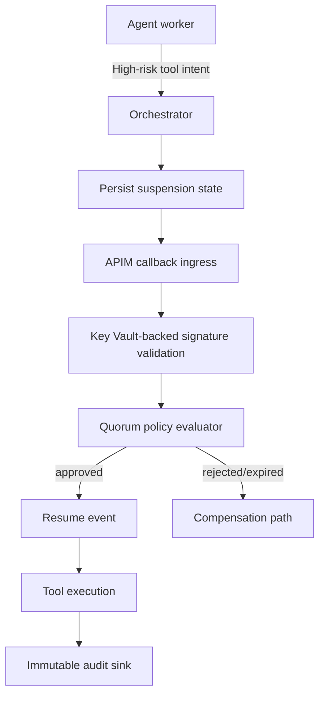
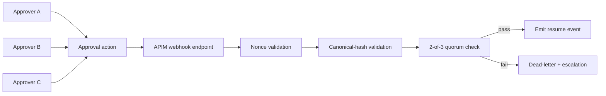

# Async HITL Approval Callback Architecture Selection FAQ: APIM Signed Webhooks + Durable Functions vs Service Bus Sessions + Outbox vs Teams/Outlook Adaptive Cards

> Audience: Cloud & AI Solution Architects, platform engineering leads, security/compliance architects, SRE governance teams, and risk-control operators.  
> Decision problem: when high-risk MCP actions require human approval and may pause workloads for `15 minutes to 14 days`, which architecture gives deterministic resume safety without paying idle compute costs.  
> Design constraints: TOCTOU drift prevention, cryptographic action binding, replay protection, dual-custody quorum, timeout escalation, and audit-grade non-repudiation.

## 1. Executive summary: approval architecture success depends on correct resume semantics

Many implementations treat HITL as a notification problem.

In production, the decisive challenge is resume correctness after long suspension windows.

If parameters change between request and approval, TOCTOU risk appears.

If callback endpoints accept retries without nonce and idempotency enforcement, duplicate execution becomes likely.

This guide compares three architecture families:

- **Option A**: Durable Functions `wait_for_external_event` with APIM JWS/HMAC validation ingress.
- **Option B**: stateless workers with Service Bus message sessions and Cosmos DB transactional outbox.
- **Option C**: Teams/Outlook Adaptive Cards with Logic Apps or Power Automate approval flows.

Short recommendation:

Option A is generally the strongest baseline for high-risk, high-governance enterprises.

Option B is compelling when event-driven infrastructure is already mature and extreme async throughput is needed.

Option C provides fastest collaboration UX but requires additional cryptographic and replay-hardening controls.

## 2. Failure modes in production: why synchronous approval blocking breaks

A common anti-pattern is keeping workers alive while waiting for human approval.

That creates:

- idle compute billing,
- state drift over long waits,
- weak timeout escalation,
- duplicate callback side effects during retries.

In financial, healthcare, and critical-operations domains, these are governance failures, not minor inefficiencies.

Approval architecture must therefore be designed as a suspend-resume state machine with cryptographic guarantees.

## 3. Option definitions: control-plane and data-plane boundaries

### 3.1 Option A: orchestration-native suspension with Durable Functions

`wait_for_external_event` persists workflow state and releases active compute.

Approval callbacks enter through APIM, where signature and nonce policies are enforced before resume events are emitted.

Strength: clear semantics, deterministic restore behavior, centralized governance.

### 3.2 Option B: sessioned messaging and outbox-driven resume

Workers remain stateless.

Approval requests and responses flow through Service Bus sessions, while resume commands are materialized through transactional outbox records.

Strength: high async scalability and component decoupling, with higher state-consistency design complexity.

### 3.3 Option C: collaboration-native approval interfaces

Approvers act through Teams or Outlook cards.

Logic Apps/Power Automate flows propagate decision callbacks into agent control planes.

Strength: user experience and adoption speed, with additional effort required for strong non-repudiation and replay resistance.

## 4. Cryptographic action binding: preventing TOCTOU and confused-deputy paths

Approval tokens should be single-use, short-lived, and unforgeable.

A practical token payload includes:

- `workflow_id`, `state_etag`, and `tool_name`,
- `canonical_tool_args_sha256`,
- `approver_entra_oid` and `quorum_policy_id`,
- `nonce` and `exp`.

Signing should be backed by managed keys, typically with Key Vault.

Resume ingress must validate signature, expiry, nonce freshness, and hash equality before any execution continuation.

Approval text without bound action hash should not qualify as production-grade authorization evidence.

## 5. Suspend-resume lifecycle: deterministic state transitions

Recommended states:

1. `PendingApproval`,
2. `QuorumCollecting`,
3. `ApprovedReady`,
4. `Resumed`,
5. `ExpiredOrRejected`.

Every transition should emit structured audit events and enforce idempotency keys.

Reason codes should be first-class fields, not free-form logs only.

This supports regulator-friendly replay and forensic traceability.

## 6. Quorum and escalation: 2-of-3 custody, SLA deadlines, and role policies

Real-world approvals are often multi-party.

Examples include:

- 2-of-3 dual-custody for high-value transaction release,
- SRE manager + on-call engineer for emergency perimeter changes,
- timed escalation to higher authority when SLA windows expire.

Architecturally, store approval sets as explicit policy objects.

Let policy engines compute release conditions instead of hard-coding them in workflow branches.

This improves maintainability and change safety.

## 7. Twelve-dimension matrix: A/B/C comparative scoring

> Score scale: 1 (weak) to 5 (strong).  
> Use as architecture ranking input, then validate with workload-specific PoC evidence.

| Dimension | Option A Durable + APIM | Option B SB Sessions + Outbox | Option C Teams/Outlook + Logic Apps |
|---|---:|---:|---:|
| Long-horizon suspension semantics | 5 | 4 | 3 |
| Action-binding implementation effort (lower is better) | 4 | 3 | 2 |
| Replay resistance strength | 5 | 4 | 3 |
| Quorum flexibility | 5 | 5 | 3 |
| Audit consistency | 5 | 4 | 3 |
| Resume-latency controllability | 4 | 4 | 3 |
| Massive async throughput | 4 | 5 | 3 |
| Approval UX friendliness | 3 | 3 | 5 |
| Ops complexity (lower is better) | 3 | 2 | 4 |
| Non-repudiation readiness | 5 | 4 | 3 |
| Cost predictability | 4 | 4 | 3 |
| Enterprise standardization potential | 5 | 4 | 3 |

Interpretation:

Option A is strongest for strict governance and high-risk operations.

Option B excels in large event-volume environments with mature messaging discipline.

Option C is excellent at user-facing approval ergonomics but should not be the sole security core.

## 8. Reference architecture I: suspend, approve, validate, resume



The design principle is strict control-plane convergence.

Approval UI can vary, but resume validation rules should remain centralized.

## 9. Reference architecture II: dual-custody and replay defense



This model prevents “double-click” replay from turning into duplicate execution.

Any nonce reuse or hash mismatch is rejected before workflow continuation.

## 10. Production snippet: APIM inbound JWS and replay controls

```xml
<policies>
  <inbound>
    <base />
    <set-variable name="jws" value="@(context.Request.Headers.GetValueOrDefault(&quot;X-Approval-JWS&quot;,&quot;&quot;))" />
    <set-variable name="nonce" value="@(context.Request.Headers.GetValueOrDefault(&quot;X-Approval-Nonce&quot;,&quot;&quot;))" />
    <choose>
      <when condition="@(!context.Variables.ContainsKey(&quot;jws&quot;) || string.IsNullOrEmpty((string)context.Variables[&quot;jws&quot;]))">
        <return-response>
          <set-status code="401" reason="Missing approval signature" />
        </return-response>
      </when>
    </choose>
    <send-request mode="new" response-variable-name="verifyResult" timeout="10">
      <set-url>https://approval-signature-validator.internal/verify</set-url>
      <set-method>POST</set-method>
      <set-header name="Content-Type" exists-action="override">
        <value>application/json</value>
      </set-header>
      <set-body>@("{""jws"":""" + (string)context.Variables["jws"] + """,""nonce"":""" + (string)context.Variables["nonce"] + """}")</set-body>
    </send-request>
    <choose>
      <when condition="@(((IResponse)context.Variables[&quot;verifyResult&quot;]).StatusCode != 200)">
        <return-response>
          <set-status code="403" reason="Invalid or replayed approval token" />
        </return-response>
      </when>
    </choose>
  </inbound>
  <backend><base /></backend>
  <outbound><base /></outbound>
  <on-error><base /></on-error>
</policies>
```

Core policy behaviors:

- hard-require signed approval headers,
- validate cryptographic integrity and nonce freshness,
- fail closed on any verification failure.

## 11. Capacity and TCO: suspension-window compute release economics

### 11.1 Assumptions

- 4.2 million high-risk approval events per month,
- 9.6-hour average wait,
- 31-hour P95 wait,
- 380k concurrent suspended states at peak.

### 11.2 Option A estimate

- Monthly average: `$184k`
- 3-year total: `$6.62M`
- Benefit comes from orchestration-native suspended-state persistence without active compute hold.

### 11.3 Option B estimate

- Monthly average: `$176k`
- 3-year total: `$6.34M`
- Excellent at very high event throughput, with greater engineering complexity.

### 11.4 Option C estimate

- Monthly average: `$201k`
- 3-year total: `$7.24M`
- Fast UX adoption, higher total cost when custom governance hardening is fully included.

### 11.5 Sensitivity

If average wait duration doubles, architectures that keep active workers alive show steep cost escalation.

Therefore “suspend and release compute immediately” should be a baseline principle.

## 12. Scenario A: global commercial bank dual-custody settlement gate

Business context:

High-value settlement actions require two independent approvers before execution.

Approval windows can span 2 to 36 hours across time zones.

Requirements:

- no parameter substitution between proposal and execution,
- approver identity traceability per action,
- timeout escalation instead of silent hanging.

Recommendation:

Option A is usually preferred, with APIM signature enforcement and Durable state consistency.

Option B can achieve equivalent control if messaging and outbox discipline are mature.

## 13. Scenario B: global cloud SRE emergency firewall rollback gate

Business context:

An agent proposes urgent firewall rollback during active incident mitigation.

Action is high-risk and subject to CAB approval.

Approvals can span shifts from 20 minutes to 12 hours.

Requirements:

- no long-lived privileged token retention,
- duplicate callback resilience,
- complete evidence package attached to resume events.

Recommendation:

Use C for collaboration surface only when needed, but anchor security controls in A or B style validation and idempotent resume kernels.

## 14. Deep quantitative Q&A for architecture review boards

### 14.1 Q1: how can 14-day waits be supported safely?

Separate state longevity from token longevity.

Keep workflow state durable, while approval tokens remain short-lived and reissuable with preserved lineage.

### 14.2 Q2: what replay-protection retention window is practical?

Keep nonce records at least token TTL plus 24 hours.

Cross-region nonce stores should provide consistent read guarantees.

### 14.3 Q3: how should 2-of-3 be enforced without role collision?

Policy should evaluate role-set satisfaction, not arbitrary human count.

Role identity and approval identity must be verified independently.

### 14.4 Q4: should timeout imply auto-approve?

For high-risk actions, no.

Timeout should default to reject or escalate, never implicit execution.

### 14.5 Q5: which latency SLOs matter most?

Track:

- callback ingress to resume-event emission P95,
- resume-event emission to execution-start P95,
- replay-block accuracy.

### 14.6 Q6: when should option C be upgraded to A/B core?

When quorum complexity, non-repudiation, or regulator audit strictness increases materially, C-only architecture should be replaced by A/B core controls.

## 15. Five-step rollout and final recommendation (Good fit vs Not for)

**Step 1: define canonical action binding first**

Specify deterministic canonicalization and hash-binding across tool args, state etag, and approver identity.

**Step 2: centralize resume ingress controls**

Route all callbacks through APIM signature and nonce validation.

**Step 3: externalize quorum policies**

Keep approval-release logic in a policy layer, not hard-coded in business handlers.

**Step 4: enforce complete evidence chains**

Persist initiation, approval, validation, resume, and execution evidence as structured records.

**Step 5: run quarterly failure-path drills**

Exercise timeout, rejection, replay, duplicate webhook, and regional failover paths.

**Good fit**:

- high-risk tool actions requiring strong governance and non-repudiation,
- long approval windows where compute release materially reduces cost.

**Not for**:

- low-risk read-only actions with no approval requirement,
- temporary environments lacking identity and audit foundations.

Final recommendation:

Adopt Option A as enterprise baseline for most regulated workflows.

Use Option B where async event scale and platform maturity justify added complexity.

Treat Option C primarily as collaboration front-end, not the sole security execution core.

### 15.7 Q7: how should token re-authorization be handled after expiry?

Expired approval tokens should never be reused.

Re-authorization should recompute canonical argument hash and latest `state_etag`, then issue a new signature.

Audit entries should capture re-issuance reason and accountable identity.

If action parameters changed, force a full re-approval path.

### 15.8 Q8: what is the safest compensation boundary after explicit rejection?

Rejection does not always mean immediate hard stop.

Compensation may include rollback, escalation, or ticket transfer depending on action type.

Compensation actions themselves must be policy-gated to avoid hidden high-risk side effects.

Whitelist compensation operations and audit each invocation explicitly.

### 15.9 Q9: how do we maintain consistency when notification channels fail?

Notification delivery must not be treated as state truth.

Approval state truth should remain in control-plane storage only.

Notification channels can retry indefinitely without mutating decision state.

Scheduled reconciliation jobs should scan overdue approvals and trigger re-notification or escalation.

### 15.10 Q10: how should in-flight approvals fail over across regions?

Replicate state, nonce index, and policy version together.

Replicating state without nonce data increases replay exposure.

Replicating state without policy lineage risks divergent authorization outcomes.

Disaster-recovery drills should validate idempotent resume behavior post-failover.

### 15.11 Q11: how can approval evidence integrate with SOX/internal-control systems?

Assign a single evidence ID for each approval workflow.

Propagate that ID across initiation, approval actions, resume execution, and outcome confirmation.

Emit structured evidence records for automated audit-system ingestion.

Avoid relying on screenshots or chat transcripts as primary evidence.

### 15.12 Q12: how can approval fatigue and mechanical consent be mitigated?

Use risk-tiered approval policies with periodic quality sampling.

Low-risk actions can use streamlined lanes while high-risk actions retain dual custody.

Introduce reviewer rotation and load-balancing for high-volume approver groups.

Track approval quality metrics, not only approval throughput.

### 15.13 Q13: why must approval policy definitions be versioned?

Policies evolve with regulation and business controls.

Without versioning, retrospective “why allowed/why denied” analysis becomes weak.

Each policy update should include change log, approval chain, and blast-radius annotation.

Resume events should reference an explicit policy version identifier.

### 15.14 Q14: can prior approval be reused after agent replanning?

Default posture should be no.

If tool arguments or target resources changed, treat as a new action.

Reuse is acceptable only when hashes match and policy explicitly allows reuse.

This closes common “approve-then-mutate” bypass vectors.

### 15.15 Additional SLOs: include governance quality, not only latency

Recommended SLO extensions:

- replay-block success rate,
- post-approval argument consistency pass rate,
- timeout escalation timeliness,
- multi-party quorum assembly success rate.

These metrics should be tracked with latency and cost for full HITL architecture health.

### 15.16 Closing guidance: treat approval as a long-term control-plane capability

Mature organizations treat approval architecture as platform infrastructure, not workflow glue.

Once suspend/resume approvals are standardized, onboarding new regulated use cases becomes faster and safer.

That transition is a key step from isolated automation to governable autonomous operations.

### 15.17 Operating model: shared governance across security, business, and platform teams

Approval policy quality depends on cross-functional ownership.

Security teams define cryptographic and replay-defense guardrails.

Business teams define risk thresholds and quorum responsibilities.

Platform teams implement state-machine reliability, idempotent resume paths, and observability.

Shared governance reduces the gap between technically correct and institutionally enforceable controls.

### 15.18 Experience model: keep security complexity in the platform layer

Approvers should not need to reason about low-level token mechanics.

Approval interfaces should surface decision context, risk label, and impact summary.

JWS validation, nonce checks, and hash matching should remain invisible but mandatory platform controls.

This preserves user efficiency without weakening security posture.

### 15.19 Evolution strategy: standardize contracts before optimizing internals

Unify approval event schemas and callback contracts first.

After contract stability, iterate implementation details behind the interface.

For example, establish APIM verification standards before changing orchestration backend patterns.

This sequence reduces migration risk and cross-team coordination overhead.

### 15.20 Final synthesis: async HITL is the enterprise governance gate for autonomous agents

Without async HITL, many high-risk autonomous patterns remain non-production.

When approval, signature, resume, and audit are standardized as a control-plane gate, organizations can scale safely.

That gate is the practical boundary between demo-grade automation and operationally governable autonomy.

When teams can answer four questions consistently—who approved, what was approved, why it was safe, and when execution resumed—

async HITL architecture has reached true production maturity.

From there, quarterly failure-path drills and policy replay validation should continue as standard operating practice.

That discipline keeps approval governance durable as scale, regulation, and threat patterns evolve.

It is also the operational baseline for safe long-horizon autonomous execution.

Organizations that institutionalize this loop typically see faster regulator response cycles and lower high-risk change failure rates.

That measurable governance velocity is often the strategic differentiator in regulated AI operations.
