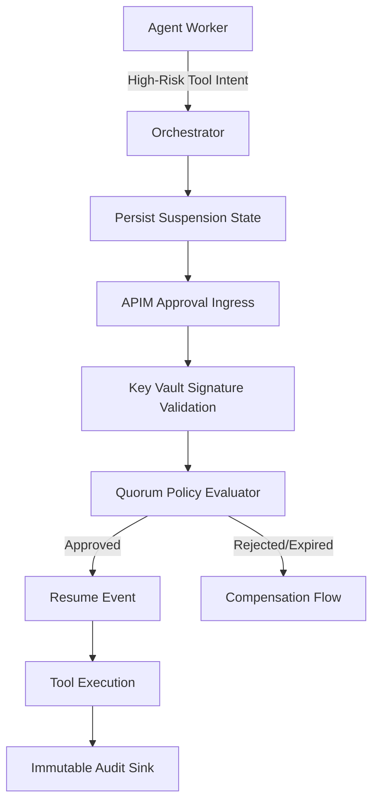
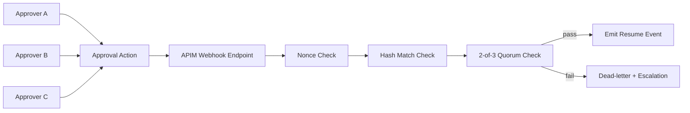

# 异步 HITL 审批回调架构选型 FAQ：APIM 签名 Webhook + Durable Functions vs Service Bus Sessions + Outbox vs Teams/Outlook Adaptive Cards

> 适用角色：Cloud & AI Solution Architect、平台工程、信息安全、合规审计、业务风控、SRE 变更治理团队。  
> 适用问题：当高风险 MCP 工具调用需要人工审批并可能暂停 `15 分钟到 14 天` 时，如何在不持续占用 GPU/Pod 计算资源的情况下实现可恢复、可审计、可防重放的异步人审闭环。  
> 约束重点：防 TOCTOU 参数漂移、双人复核（2-of-3）、回调重放防护、超时升级、跨区域合规留痕。

## 1. 执行摘要：异步审批架构的核心不在“发通知”，而在“可证明恢复正确”

生产事故显示，很多团队把 HITL 误当成简单消息通知问题。

真正困难点在于恢复时刻的上下文一致性与权限一致性。

若审批通过后恢复执行时参数已变化，就会出现经典 TOCTOU 风险。

若恢复入口不校验单次令牌和幂等键，重复回调会导致重复执行。

本指南比较三条路线：

- **方案 A**：Durable Functions `wait_for_external_event` + APIM JWS/HMAC 验签入口。
- **方案 B**：无状态 Worker + Service Bus Sessions + Cosmos DB 事务 Outbox。
- **方案 C**：Teams/Outlook Adaptive Cards + Logic Apps/Power Automate 审批流。

结论先行：

在强审计与高风险动作场景，方案 A 通常最均衡。

在现有事件总线成熟、希望统一异步模式的组织，方案 B 可形成高扩展控制面。

在协作体验优先且审批链路较标准化的团队，方案 C 上线最快但需额外补齐密码学绑定与防重放。

## 2. 生产失败模式：为何同步阻塞式审批在企业中经常失效

常见反模式是让 Agent 工作进程等待人工点击。

这会导致：

- 计算资源空耗，GPU/Pod 在等待窗口持续计费。
- 会话状态漂移，等待越久，恢复不一致概率越高。
- 审批超时后缺乏统一升级机制。
- 回调重试和网络抖动导致重复执行。

在金融、医疗、关键基础设施场景，这些问题会直接演化成重大治理风险。

因此必须把审批设计为“可挂起、可恢复、可证明”的状态机。

## 3. 三种架构路径定义：A/B/C 的控制面与数据面边界

### 3.1 方案 A：Durable 编排原生挂起

使用 `wait_for_external_event` 将执行上下文持久化并释放计算。

审批回调进入 APIM，由策略完成 JWS/HMAC 校验，再触发恢复事件。

优点是语义清晰、状态回放一致、治理可集中。

### 3.2 方案 B：消息会话 + Outbox 驱动恢复

Worker 不保留长阻塞状态。

审批请求写入 Service Bus Session，审批结果与恢复指令通过事务 Outbox 出队。

优势在于异步吞吐与组件解耦，但状态一致性设计复杂度较高。

### 3.3 方案 C：协作平台审批流

通过 Teams/Outlook Adaptive Cards 呈现审批动作。

审批结果由 Logic Apps 或 Power Automate 回调 Agent 控制平面。

用户体验优秀，但密码学绑定和回放防护通常需要额外定制。

## 4. 密码学动作绑定：防 TOCTOU 与 Confused-Deputy 的关键设计

推荐将审批令牌设计为单次、短时、不可重放。

令牌负载建议包含：

- `workflow_id`、`state_etag`、`tool_name`。
- `canonical_tool_args_sha256`。
- `approver_entra_oid` 与 `quorum_policy_id`。
- `nonce` 与 `exp`。

令牌签名建议由 Key Vault 托管密钥执行。

恢复入口必须同时验证签名、过期时间、nonce 未使用、参数哈希匹配。

仅有“审批通过”文本而无参数绑定签名，不应被视为合规可恢复。

## 5. 挂起与恢复状态机：从审批发起到执行续跑的严谨闭环

推荐状态：

1. `PendingApproval`：已挂起，等待首个审批。
2. `QuorumCollecting`：收集多方审批中。
3. `ApprovedReady`：达成阈值，等待恢复触发。
4. `Resumed`：恢复执行并写审计。
5. `ExpiredOrRejected`：超时或拒绝，进入补偿流程。

每个状态迁移都应有幂等键与审计事件。

状态迁移应记录原因为结构化字段，不使用仅文本日志。

这样可支撑后续监管审计与回溯取证。

## 6. 双人复核与升级路径：2-of-3、多层审批与 SLA 超时策略

企业审批并非总是单人。

典型要求：

- 交易类动作需 `2-of-3` 批准。
- 变更类动作需值班 SRE + 值班经理联合批准。
- 超过 SLA 自动升级到更高角色。

架构上可把“审批集合”作为独立聚合对象。

恢复条件由策略引擎计算而非硬编码在单个函数中。

这样在政策调整时无需重构核心执行逻辑。

## 7. 12 维选型矩阵：三方案在治理、性能、成本上的量化比较

> 评分 1 到 5。  
> 分数用于架构排序，需结合本组织现网约束做 PoC 复核。

| 维度 | 方案 A Durable + APIM | 方案 B SB Sessions + Outbox | 方案 C Teams/Outlook + Logic Apps |
|---|---:|---:|---:|
| 超长挂起语义清晰度 | 5 | 4 | 3 |
| 参数绑定与防漂移实现难度（低更优） | 4 | 3 | 2 |
| 防重放能力 | 5 | 4 | 3 |
| 多方 quorum 灵活性 | 5 | 5 | 3 |
| 审计追踪一致性 | 5 | 4 | 3 |
| 端到端恢复时延可控性 | 4 | 4 | 3 |
| 大规模异步吞吐 | 4 | 5 | 3 |
| 协作体验友好度 | 3 | 3 | 5 |
| 平台运维复杂度（低更优） | 3 | 2 | 4 |
| 合规非否认性 | 5 | 4 | 3 |
| 成本可预测性 | 4 | 4 | 3 |
| 跨团队标准化潜力 | 5 | 4 | 3 |

矩阵显示：

方案 A 在“高风险 + 强审计”条件下优势明显。

方案 B 在“超高异步吞吐”条件下具备吸引力。

方案 C 在“协作入口友好”方面最佳，但治理补件工作最多。

## 8. 参考架构图（一）：异步挂起审批与恢复主路径



架构重点：

执行与审批彻底解耦。

恢复动作必须经过统一验签和 quorum 判定。

## 9. 参考架构图（二）：双人复核与重放防护



此模型确保每次回调都走同样安全网关路径。

任何重复 nonce 或参数哈希不一致都被拒绝。

## 10. 生产片段：APIM 入站 JWS 验签与重放拦截策略示例

```xml
<policies>
  <inbound>
    <base />
    <set-variable name="jws" value="@(context.Request.Headers.GetValueOrDefault(&quot;X-Approval-JWS&quot;,&quot;&quot;))" />
    <set-variable name="nonce" value="@(context.Request.Headers.GetValueOrDefault(&quot;X-Approval-Nonce&quot;,&quot;&quot;))" />
    <choose>
      <when condition="@(!context.Variables.ContainsKey(&quot;jws&quot;) || string.IsNullOrEmpty((string)context.Variables[&quot;jws&quot;]))">
        <return-response>
          <set-status code="401" reason="Missing approval signature" />
        </return-response>
      </when>
    </choose>
    <send-request mode="new" response-variable-name="kvVerify" timeout="10">
      <set-url>https://approval-signature-validator.internal/verify</set-url>
      <set-method>POST</set-method>
      <set-header name="Content-Type" exists-action="override">
        <value>application/json</value>
      </set-header>
      <set-body>@("{""jws"":""" + (string)context.Variables["jws"] + """,""nonce"":""" + (string)context.Variables["nonce"] + """}")</set-body>
    </send-request>
    <choose>
      <when condition="@(((IResponse)context.Variables[&quot;kvVerify&quot;]).StatusCode != 200)">
        <return-response>
          <set-status code="403" reason="Invalid or replayed approval token" />
        </return-response>
      </when>
    </choose>
  </inbound>
  <backend><base /></backend>
  <outbound><base /></outbound>
  <on-error><base /></on-error>
</policies>
```

该示例表达三个关键点：

- 入口强制签名头。
- 外部验签服务校验 nonce 与签名。
- 失败即阻断，不允许“软失败放行”。

## 11. 容量与成本：暂停窗口内释放计算对 TCO 的实际影响

### 11.1 假设参数

- 每月高风险审批事件 420 万次。
- 平均等待时长 9.6 小时。
- 95 分位等待时长 31 小时。
- 峰值并发挂起状态 38 万。

### 11.2 方案 A 估算

- 月均 `$184k`
- 3 年 `$6.62M`
- 主要优势来自挂起期间不占用热计算。

### 11.3 方案 B 估算

- 月均 `$176k`
- 3 年 `$6.34M`
- 在超高事件吞吐时成本效率较优，但工程复杂度更高。

### 11.4 方案 C 估算

- 月均 `$201k`
- 3 年 `$7.24M`
- 协作体验优，但在复杂 quorum 与加固治理下总成本上探。

### 11.5 成本敏感点

若审批等待时间翻倍，未解耦挂起的架构成本会非线性上升。

因此“暂停即释放计算”是 HITL 架构首要原则。

## 12. 场景一：全球商业银行高价值结算双人复核闸门

业务背景：

单笔超高价值结算需风控官与运营主管双人批准。

审批窗口可跨时区持续 2–36 小时。

关键要求：

- 参数不可在审批后被替换。
- 任一审批回调都必须可追溯到具体审批人身份。
- 失败与超时必须触发升级而不是静默挂起。

推荐：

优先方案 A，配合 APIM 验签与 Durable 编排状态。

若已深度投资消息中台，可在方案 B 上实现同等控制，但要强化 Outbox 一致性设计。

## 13. 场景二：全球云平台 SRE 紧急防火墙回滚 CAB 闸门

业务背景：

重大故障时，Agent 提议执行生产防火墙回滚。

动作高风险，需 CAB 值班角色批准。

审批常跨班次，等待时间从 20 分钟到 12 小时不等。

关键要求：

- 审批链路不能持有长期高权限凭据。
- 重复通知与重复点击不能触发重复执行。
- 每次恢复都要携带审批上下文证据包。

推荐：

若协作体验优先，可采用 C 作为前台入口，但必须引入 A 或 B 的签名验证与幂等恢复内核。

## 14. 深度定量问答：架构评审中最常见的 6 个问题

### 14.1 Q1：审批等待 14 天时，状态如何保证不过期？

建议状态实体与审批令牌分离。

状态可长寿命，令牌短寿命并支持重签发。

重签发必须保留原审批链路和理由审计。

### 14.2 Q2：如何定义 replay 防护窗口？

建议 nonce 至少保留到审批令牌过期后 24 小时。

在跨区域系统中，nonce 存储需具备全局一致读保障。

### 14.3 Q3：2-of-3 quorum 如何防止角色冲突？

应把审批人角色映射与组织结构解绑。

策略引擎校验“角色集合满足”，而非“任意两人满足”。

### 14.4 Q4：超时后自动执行是否可取？

高风险动作不建议自动放行。

超时应默认拒绝或转人工升级，不应默认批准。

### 14.5 Q5：如何评估恢复时延 SLO？

建议指标：

- 回调接收到恢复事件发出 P95。
- 恢复事件发出到执行开始 P95。
- 重放拦截正确率。

### 14.6 Q6：何时从 C 升级到 A/B？

当审批策略出现多角色 quorum、密码学非否认性要求、或监管审计压力显著上升时，应尽快升级。

## 15. 五步落地指南与最终建议（Good fit vs Not for）

**Step 1：先建动作绑定模型**

先定义 canonical args、state etag、approver oid 的哈希绑定规则。

**Step 2：再建恢复入口**

恢复入口统一走 APIM 验签与 nonce 防重放。

**Step 3：实现 quorum 策略引擎**

把审批策略配置化，避免写死在业务代码中。

**Step 4：打通审计证据链**

从审批发起、审批动作、恢复执行到最终结果全链路结构化落库。

**Step 5：做季度演练**

定期演练超时、拒绝、重复回调、区域故障等异常路径。

**Good fit**：

- 高风险工具调用、强审计与强合规场景。
- 需要跨天审批且必须释放等待期间计算成本。

**Not for**：

- 低风险只读操作且无审批需求的自动化任务。
- 没有统一身份治理与审计底座的临时实验环境。

最终建议：

优先采用 A 作为企业标准基线。

在事件驱动能力成熟的组织中，把 B 作为高吞吐演进路径。

将 C 定位为协作入口层，而非唯一安全内核，通常能获得最佳综合结果。

### 15.7 Q7：审批令牌过期后的“重新授权”如何设计才安全？

重新授权不应复用原令牌。

应重新计算最新 `state_etag` 与 canonical args 哈希并重新签名。

同时在审计记录中保留“重签发原因”和“重签发人身份”。

若原动作参数发生变更，应强制重新审批而非静默续期。

### 15.8 Q8：如何定义审批拒绝后的补偿动作边界？

拒绝并不总意味着直接终止。

可根据动作类型触发回滚、告警、或人工工单转派。

补偿动作本身也应受策略约束，避免“拒绝主动作却自动执行高风险补偿”。

建议把补偿动作列入白名单并逐条审计。

### 15.9 Q9：审批通知链路中断时如何保证最终一致？

通知送达不等于审批成立。

应把审批状态唯一来源保持在控制面存储中。

通知系统仅作为投递通道，可重复发送但不改变状态真值。

定时巡检任务应扫描超时待审项并触发再通知或升级。

### 15.10 Q10：跨区域灾难恢复时，审批中的流程如何迁移？

需同时复制状态、nonce 索引和策略版本。

若只复制状态不复制 nonce，可能放大重放风险。

若只复制状态不复制策略版本，可能出现主备判定不一致。

建议在演练中验证主备切换后的幂等恢复行为。

### 15.11 Q11：如何把审批系统与 SOX/内控证据体系打通？

建议为每次审批生成统一证据 ID。

该 ID 贯穿审批发起、审批动作、恢复执行、结果确认四阶段。

证据输出格式应结构化，便于稽核系统自动采集。

避免仅依赖截图或聊天记录这类弱证据。

### 15.12 Q12：如何控制审批疲劳导致的“机械同意”风险？

可引入风险分层与采样复核机制。

低风险动作可简化审批，高风险动作保持双人复核。

对高频审批人可设置节奏保护与轮值策略。

审批质量指标应纳入治理看板，而不只看处理速度。

### 15.13 Q13：为什么要把审批策略版本化？

策略会随着监管与业务变化而演进。

没有版本化就无法回溯当时“为何允许/拒绝”。

每次策略变更都应生成变更记录、审批记录与影响范围评估。

恢复执行时应显式引用策略版本号。

### 15.14 Q14：Agent 重新规划后，原审批是否可复用？

默认不可复用。

一旦工具参数或目标对象变化，应视为新动作。

只有在哈希一致且策略允许的情况下，才可沿用原审批结论。

该规则能有效压制“先批后改参数”的绕过路径。

### 15.15 运营指标补充：把治理质量纳入 SLO

建议在平台 SLO 中增加以下指标：

- 审批回调重放拦截成功率。
- 审批后参数一致性校验通过率。
- 超时升级触发及时率。
- 多方 quorum 组装成功率。

这些指标与时延、成本共同构成 HITL 架构健康度。

### 15.16 收官建议：以“审批即控制平面能力”建设长期护城河

成熟企业会把审批看作平台核心能力，而非流程附属件。

当审批与恢复形成标准化控制平面后，新业务接入成本会显著下降。

这也是从“单点自动化”迈向“可监管自治系统”的关键门槛。

### 15.17 组织协同建议：安全、业务、平台三方共治

审批策略不是单一团队可独立完成的工作。

安全团队定义红线与签名标准。

业务团队定义风险阈值与双人复核规则。

平台团队负责状态机实现、幂等恢复与观测告警。

三方共治能显著降低“技术可行但制度失效”的风险。

### 15.18 审批体验建议：把复杂安全逻辑隐藏在平台层

审批人不应被迫理解底层签名细节。

审批界面只呈现关键信息、风险标签和影响范围。

底层 JWS、nonce、哈希比对由平台自动完成。

这样既能保证体验，也能保持安全强度。

### 15.19 平台演进建议：先统一协议，再优化实现细节

建议优先统一审批事件模型与回调契约。

在契约稳定后，再逐步替换实现组件。

例如先统一 APIM 验签入口，再决定后端用 Durable 还是 Service Bus。

该顺序有助于降低迁移成本与跨团队摩擦。

### 15.20 最终收束：异步 HITL 是企业 Agent 治理的“闸门系统”

没有异步 HITL，很多高风险 Agent 场景只能停留在实验阶段。

把审批、签名、恢复、审计做成标准闸门后，组织才具备大规模安全扩张能力。

这也是智能体平台从“可演示”到“可经营”的关键分水岭。

当你能稳定回答“谁批准了什么、依据何在、何时恢复、为何安全”四个问题时，

异步 HITL 架构就真正进入了生产成熟区间。

接下来应持续做季度故障演练与策略回放，

确保治理能力在组织规模扩张后依然有效。

这也是可持续自治运营的基础保障。
