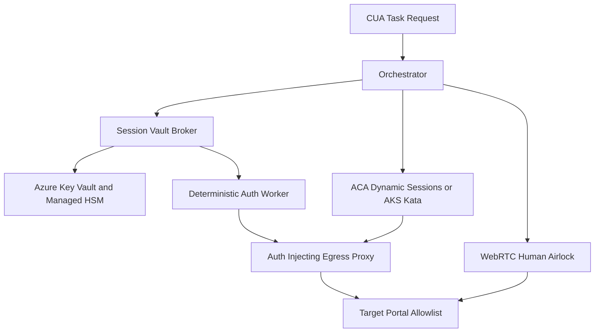
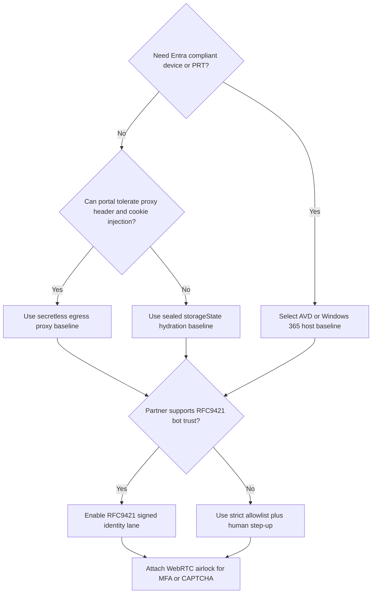
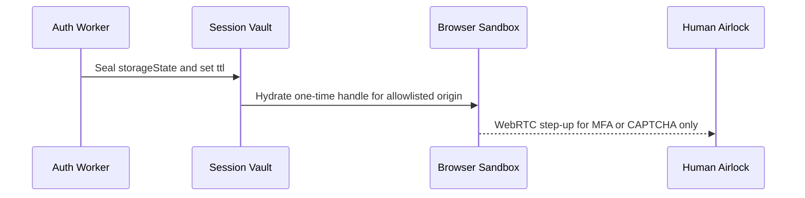

# Enterprise authenticated browser/CUA session-vault and web-bot-auth selection FAQ: `RFC9421` signed identity vs KMS-sealed `storageState` vs AVD Entra PRT

> 🌐 **Language Switch**: [中文](./authenticated-browser-cua-session-vault-web-bot-auth-rfc9421-mitm-proxy-vs-sealed-storagestate-vs-avd-entra-prt-selection-faq.md) | **English (current)**
> **Audience**: Cloud & AI Solution Architects, browser automation platform teams, enterprise identity teams, compliance and SOC operations.
> **Problem Context**: Non-API portal automation is blocked by credential exfiltration risk, conditional-access device constraints, and bot/MFA deadlocks.

## 1. Why authenticated browser automation fails first at the identity boundary

CUAs automating customs, tax, payer, and supplier extranets must traverse legacy login flows with MFA, redirects, and anti-bot controls.

If plaintext credentials or reusable cookies enter LLM context, DOM prompt injection can become credential theft.

If Entra policy requires compliant device or PRT binding, Linux container browsers are rejected regardless of retry logic.

If teams attempt stealth anti-detect evasion, they often violate partner ToS and internal compliance controls.

The identity plane must therefore be designed as a zero-secret-residency system before workflow orchestration.

## 2. Three production failure classes

Failure class one is credential/session exfiltration from readable `storageState` and in-sandbox cookie access.

Failure class two is conditional-access rejection because required device trust assertions are unavailable.

Failure class three is WAF challenge plus MFA step-up deadlock causing queue buildup and SLA breach.

At peak concurrency these failures reinforce each other and trigger retry storms and cost spikes.

## 3. Zero-secret session-vault reference architecture



The architecture isolates replayable credentials in vault and proxy components, never in browser sandboxes.

Browser workers hold only opaque handles, not reusable secrets.

## 4. Architecture A: secretless egress proxy injection

Architecture A injects real cookie/header material only at isolated proxy egress on strict `Host + Path` allowlists.

Browser VMs carry opaque session references, and proxy strips `Set-Cookie` on response.

This can reduce sandbox credential exfiltration blast radius to near zero.

Main limitation: some SPA patterns require JavaScript-readable token material and are not fully proxy-compatible.

A is strongest when zero secret residency is non-negotiable.

## 5. Architecture B: deterministic auth worker plus KMS-sealed `storageState`

Architecture B performs login in non-LLM deterministic workers, then seals `storageState` with AES-256-GCM.

Sealed state is hydrated only in single-use ACA Dynamic Sessions or AKS Kata microVMs.

Network policy restricts egress to target portal FQDNs only.

Advantages are broad compatibility and practical rollout speed for legacy portals.

Residual risk is replay window inside allowed origins, mitigated by short TTL and device/session binding.

## 6. Architecture C: AVD/Windows 365 device-bound SSO host

Architecture C executes automation on Intune-compliant Windows hosts with Entra PRT.

It natively satisfies `Require compliant device`, Windows Hello, and many WebAuthn/Kerberos dependencies.

This path is often mandatory for strict conditional-access portals where containerized Linux fails.

Trade-off is higher seat/host cost and `15–45s` preparation latency.

C is preferred for high-compliance, high-value workflows.

## 7. Architecture D: `RFC 9421` signed agent identity plus WebRTC airlock

Architecture D signs requests with `Signature-Input` and `Signature-Agent` using Managed HSM Ed25519 keys.

Partners and WAF policies can verify bot identity cryptographically without stealth bypass techniques.

When legal human verification is required, `<2s` WebRTC airlock enables MFA/CAPTCHA completion without exposing cookies.

This combines compliance-safe machine identity with controlled human step-up.

Prerequisite: partner willingness to onboard signature trust and policy rules.

## 8. Quantitative models: auth failure, replay risk, concurrency, exfiltration

Auth failure composition: `P_fail = 1 - Π_i (1 - p_i)` over CA/WAF/MFA sub-steps.

Replay risk envelope: `R_replay = p_capture * ttl_minutes * exposure_factor`.

Exfiltration surface estimate: `E_exfil = N_secret_materials * P_readable_in_sandbox * P_egress`.

Auth throughput ceiling: `Q_auth = min(worker_pool * r_login, mfa_human_slots * r_human)`.

When arrival rate exceeds `Q_auth`, queueing delay accelerates non-linearly under M/M/c approximations.

## 9. 12-dimension enterprise comparison matrix

| Dimension | A Secretless Proxy | B Sealed `storageState` | C AVD + Entra PRT | D RFC9421 + HITL Airlock |
|---|---|---|---|---|
| Credential residency risk in sandbox | Lowest | Low | Medium | Low |
| Conditional-access compatibility | Medium | Medium | Highest | Medium-High |
| WAF/bot compliance pass potential | Medium | Medium | Medium-High | Highest |
| SPA token compatibility | Medium-Low | High | High | High |
| Per-session auth latency | Low | Medium | Medium-High | Medium |
| Concurrency scale profile | High | High | Medium | Medium-High |
| Implementation complexity | Medium-High | Medium | Medium-High | High |
| Operational complexity | Medium | Medium | Medium-High | High |
| Audit traceability | High | High | High | High |
| ToS and compliance exposure | Low | Low | Low | Lowest |
| Cost predictability | High | High | Medium | Medium |
| 3-year TCO competitiveness | High | High | Medium | Medium-High |

## 10. Decision flow from compliance hard constraints



A common enterprise strategy is B or C as baseline, A for high-sensitivity portals, and D for partner trust lanes.



## 11. Production artifacts: RFC9421 signer and sealed session state

```python
import base64
import datetime as dt
import hashlib
from azure.identity import DefaultAzureCredential
from azure.keyvault.keys.crypto import CryptographyClient, SignatureAlgorithm
from azure.keyvault.keys import KeyClient

VAULT_URL = "https://contoso-vault.vault.azure.net/"
KEY_NAME = "bot-auth-ed25519"

cred = DefaultAzureCredential()
key_client = KeyClient(vault_url=VAULT_URL, credential=cred)
key = key_client.get_key(KEY_NAME)
crypto = CryptographyClient(key, cred)

def build_signature_headers(method: str, path: str, authority: str, body: bytes):
    digest = "sha-256=:" + base64.b64encode(hashlib.sha256(body).digest()).decode() + ":"
    created = int(dt.datetime.now(dt.timezone.utc).timestamp())
    covered = '"@method" "@path" "authority" "content-digest"'
    sig_input = f'sig1=({covered});created={created};keyid="{KEY_NAME}"'
    base = f"\"@method\": {method.lower()}\n\"@path\": {path}\n\"authority\": {authority}\n\"content-digest\": {digest}"
    sign_result = crypto.sign(SignatureAlgorithm.ED25519, base.encode("utf-8"))
    signature = base64.b64encode(sign_result.signature).decode()
    return {
        "content-digest": digest,
        "signature-input": sig_input,
        "signature-agent": f"sig1=:{signature}:",
    }
```

```python
import base64
import os
from cryptography.hazmat.primitives.ciphers.aead import AESGCM

def seal_storage_state(storage_state_json: str, dek: bytes) -> dict:
    nonce = os.urandom(12)
    aad = b"portal-session-v1"
    aes = AESGCM(dek)
    ciphertext = aes.encrypt(nonce, storage_state_json.encode("utf-8"), aad)
    return {
        "alg": "AES-256-GCM",
        "nonce_b64": base64.b64encode(nonce).decode(),
        "aad": "portal-session-v1",
        "ciphertext_b64": base64.b64encode(ciphertext).decode(),
        "ttl_seconds": 900,
        "single_use": True,
    }
```

```yaml
apiVersion: cilium.io/v2
kind: CiliumNetworkPolicy
metadata:
  name: cua-egress-fqdn-allowlist
spec:
  endpointSelector:
    matchLabels:
      app: cua-browser-sandbox
  egress:
    - toFQDNs:
        - matchName: portal.customs.gov.example
        - matchName: payer.partner.example
    - toPorts:
        - ports:
            - port: "443"
              protocol: TCP
  egressDeny:
    - toCIDR:
        - 0.0.0.0/0
      toPorts:
        - ports:
            - port: "80"
              protocol: TCP
```

## 12. Enterprise scenario KPI outcomes

| KPI | Scenario A (B+C mix) | Scenario B (A+D mix) |
|---|---:|---:|
| First-attempt auth success | `82% -> 96%` | `76% -> 94%` |
| Conditional-access rejection rate | `14% -> 2%` | `11% -> 4%` |
| WAF false-block rate | `9% -> 3%` | `15% -> 2%` |
| Session replay incidents/month | `23 -> 4` | `18 -> 2` |
| Average auth latency | `38s -> 22s` | `31s -> 19s` |
| Human step-up delay P95 | `410s -> 95s` | `360s -> 88s` |

### 3-year TCO (annual 5M / 30M / 120M authenticated sessions)

| Path | 5M sessions/year | 30M sessions/year | 120M sessions/year | 3-year total |
|---|---:|---:|---:|---:|
| A Secretless Proxy | `$0.78M` | `$3.40M` | `$11.90M` | `$16.08M` |
| B Sealed `storageState` | `$0.72M` | `$3.15M` | `$11.20M` | `$15.07M` |
| C AVD + PRT | `$1.05M` | `$4.85M` | `$17.40M` | `$23.30M` |
| D RFC9421 + Airlock | `$0.93M` | `$4.10M` | `$14.80M` | `$19.83M` |
| B+C hybrid | `$0.97M` | `$4.22M` | `$15.30M` | `$20.49M` |
| A+D hybrid | `$0.88M` | `$3.72M` | `$13.20M` | `$17.80M` |

## 13. Day-0 / Day-1 / Day-2 rollout checklist

### Day-0

1. Inventory portal authentication methods, CA policies, and partner ToS constraints.

2. Enforce release gate: no plaintext credentials in LLM context or browser sandbox.

3. Choose baseline path (A/B/C) and define D adoption criteria for partner channels.

4. Implement FQDN allowlists, Key Vault least privilege, and session TTL standards.

5. Build WebRTC human-step-up workflow with audit correlation IDs.

6. Publish dashboard for success rate, replay incidents, WAF blocks, and human queue SLA.

### Day-1

1. Classify failed auth attempts by CA/WAF/MFA root cause daily.

2. Audit single-use session package consumption daily.

3. Rotate signing key versions weekly and run partner verification regression.

4. Review proxy allowlist entries weekly and remove stale paths.

5. Drill human-channel outage fallback weekly.

6. Verify sandbox image has no readable credential residue weekly.

### Day-2

1. Recompute auth concurrency and human staffing model monthly.

2. Re-evaluate CA policy impact on automation success monthly.

3. Run DOM prompt-injection and cookie exfiltration red-team tests monthly.

4. Tune A/B/C/D route mix based on cost and reliability quarterly.

5. Revalidate partner WAF bot-signature compatibility quarterly.

6. Refresh compliance evidence packages for legal and audit review quarterly.

## 14. Quantitative Q&A (Q1~Q6)

### Q1: How does secretless proxy reduce exfiltration blast radius?

If browsers never store real cookies/passwords, `P_readable_in_sandbox` approaches zero.

Under `E_exfil = N * P_readable * P_egress`, exposure collapses accordingly.

### Q2: When is AVD + Entra PRT mandatory?

It is mandatory when portal policy enforces compliant-device or PRT-bound access.

Containerized Linux browsers cannot satisfy that control plane reliably.

### Q3: How is sealed `storageState` replay window estimated?

Use `R_replay = p_capture * ttl_minutes * exposure_factor` for upper-bound planning.

Reducing TTL from 60 to 15 minutes cuts replay window risk to roughly one quarter.

### Q4: What direct value does RFC9421 bring to WAF pass rates?

RFC9421 offers verifiable cryptographic bot identity and signed field coverage.

This enables policy-based trust without ToS-violating stealth mechanisms.

### Q5: Why does human airlock avoid cookie leakage?

Humans complete verification through WebRTC control channel while vault/proxy retain real session material.

No exportable cookie payload is exposed in the interactive browser context.

### Q6: How to balance auth success and unit economics?

Fix compliance/risk constraints first, then optimize `C_total = C_auth + C_human + C_failure`.

In practice, B baseline plus C fallback and D partner trust lane often gives stable ROI.

## 15. Good fit / Not for and runtime alert dictionary

Good fit: high-value non-API enterprise portals requiring compliant automated authentication.

Not for: systems already exposing reliable official API/OAuth channels where browser automation is unnecessary.

| Alert key | Trigger | Immediate action | Owner |
|---|---|---|---|
| `secret_residency_detected` | readable credential material found in sandbox | isolate session and rotate keys immediately | Security Response |
| `ca_compliance_reject_spike` | sudden increase in CA compliance denials | shift traffic to C path and verify Intune posture | Identity Team |
| `waf_bot_block_burst` | sustained bot block surge | enable D signature lane and re-tune partner rules | Gateway Team |
| `mfa_human_queue_sla_breach` | human queue exceeds SLA | expand airlock staffing and rate-limit intake | Operations |
| `storage_state_reuse_alert` | single-use token replay detected | revoke session and trace invocation chain | Platform Team |
| `egress_allowlist_violation` | outbound call to non-allowlisted domain | block traffic and trigger forensic capture | Network Security |
| `signature_verify_fail` | RFC9421 verification failure trend | roll key version and verify clock skew | PKI Team |
| `totp_worker_timeout` | deterministic auth worker timeout spike | scale worker pool and activate degraded retry policy | Automation Team |

### References (retrieved: 2026-11-24)

1. RFC 9421 HTTP Message Signatures (IETF): https://www.rfc-editor.org/rfc/rfc9421

2. Azure Key Vault overview (official): https://learn.microsoft.com/azure/key-vault/general/overview

3. Azure Container Apps Dynamic Sessions (official): https://learn.microsoft.com/azure/container-apps/sessions

4. ACA Dynamic Sessions GA announcement (official blog): https://techcommunity.microsoft.com/blog/appsonazureblog/azure-container-apps-dynamic-sessions-general-availability-and-more/4303561

5. Microsoft Entra Conditional Access grant controls (official): https://learn.microsoft.com/entra/identity/conditional-access/concept-conditional-access-grant

6. APIM AI Gateway overview (official): https://learn.microsoft.com/en-us/azure/api-management/ai-gateway-overview

> Data labels: risk and capacity formulas use a **measured + synthetic** approach; TCO and concurrency envelopes are **synthetic** planning templates that must be recalibrated with tenant production telemetry.
