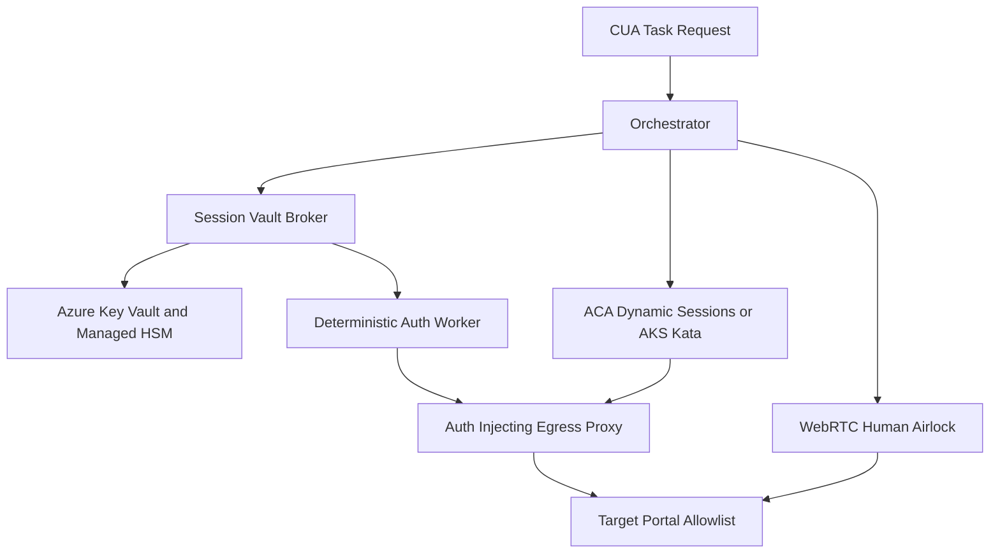
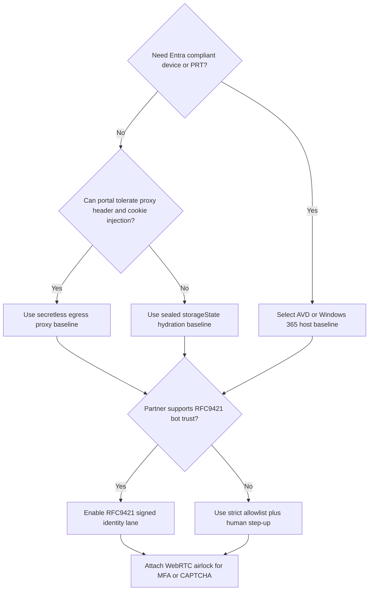
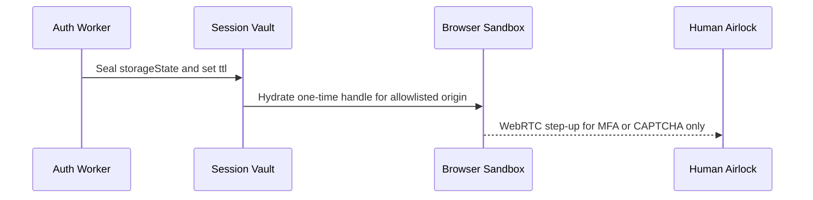

# 企业认证浏览器/CUA 会话金库与 Web Bot Auth 选型 FAQ：`RFC9421` 签名代理 vs KMS 密封 `storageState` vs AVD Entra PRT

> 🌐 **Language Switch**：**中文（当前）** | [English](./authenticated-browser-cua-session-vault-web-bot-auth-rfc9421-mitm-proxy-vs-sealed-storagestate-vs-avd-entra-prt-selection-faq.en.md)
> **适用对象**：Cloud & AI Solution Architect、浏览器自动化平台团队、企业身份与零信任团队、合规与安全运营团队。
> **问题背景**：非 API 门户自动化在认证链路上同时受会话泄漏、设备合规和反机器人策略三重约束。

## 1. 为什么认证浏览器自动化在企业内网场景最容易失控

CUA 进入海关、医保、供应商外联网关时，常要穿透遗留 UI、验证码、分段 MFA 和复杂重定向。

若把密码或 Cookie 暴露给 LLM 上下文，任何 DOM 注入都可能放大为凭据外泄。

若忽略 Entra Conditional Access 的设备合规要求，登录流程会在 PRT 绑定阶段被拒绝。

若试图用 stealth anti-detect 绕过 WAF/Bot Manager，会直接触发合作方 ToS 与审计违规。

因此认证平面必须先于任务编排平面建设，并以“零明文凭据驻留”为硬约束。

## 2. 三类生产阻塞故障模型

阻塞一是凭据与会话泄漏：明文 `storageState` 或可读 Cookie 被沙箱内恶意脚本窃取。

阻塞二是设备绑定失败：策略要求 `Require compliant device`，Linux 容器浏览器无 PRT 无法通过。

阻塞三是人机挑战死锁：WAF 挑战与 MFA 叠加后，自动化线程等待人工输入导致队列拥塞。

三类阻塞会在峰值并发叠加，形成“认证慢启动 + 重试风暴 + 预算击穿”的连锁故障。

## 3. 端到端零明文认证会话金库参考架构



该架构关键是把“可重放凭据物料”从浏览器沙箱中抽离到独立金库与代理层。

浏览器只持有一次性句柄，真实 Cookie 和签名私钥不进入执行容器。

## 4. Architecture A：Secretless Egress Proxy 注入（零秘密驻留）

A 路径由隔离前置代理在出站 TLS 链路中按 `Host + Path` 白名单注入 Cookie/Header。

浏览器 VM 仅保存不透明会话句柄，代理回包时剥离 `Set-Cookie` 防止再驻留。

该模式可把沙箱侧凭据暴露面降至零，极适合强隔离和高审计要求场景。

短板是前端 SPA 若强依赖 JS 读 token，代理注入难以覆盖全部脚本路径。

A 通常作为“严禁明文凭据驻留”的首选底座，配合后续策略完成兼容性补位。

## 5. Architecture B：非 LLM 认证工人与 KMS 密封 `storageState`

B 路径用确定性脚本执行登录与 TOTP，随后把 `storageState` 做 AES-256-GCM 密封。

密封物料仅在 1:1 微隔离会话（ACA Dynamic Sessions/AKS Kata）内解封并一次性使用。

网络策略仅允许目标门户 FQDN 出站，阻断跨域 beacon 与任意 exfil 通道。

优点是兼容广、工程实现直接，可覆盖大量遗留站点无 API 场景。

风险在于允许域内仍存在 Cookie 重放窗口，需叠加短 TTL 与绑定指纹策略。

## 6. Architecture C：AVD/Windows 365 设备绑定企业 SSO 主机

C 路径把自动化代理放到受 Intune 合规管理的 Windows 主机中，复用 Entra PRT。

它天然满足 `Require compliant device`、Windows Hello、FIDO2 与部分 Kerberos SSO 要求。

对严格条件访问门户，这是 Linux 容器难替代的可行路径。

代价是每会话 `15–45s` 准备时延与较高席位/主机成本。

C 适合高合规高价值流程，不适合极低成本高频轻任务。

## 7. Architecture D：`RFC 9421` Web Bot Auth 签名 + WebRTC 人工 Airlock

D 路径在请求侧附加 `Signature-Input` 与 `Signature-Agent`，由 Managed HSM 托管 Ed25519 密钥。

合作方 WAF 可按签名公钥和策略信任 agent 身份，无需违规 stealth 绕过。

遇到强制 CAPTCHA/MFA 时，走 WebRTC 空气锁实现 `<2s` 人工介入并不暴露 Cookie。

该模式把“可证明身份”与“合法人工兜底”组合，兼顾合规与可操作性。

前提是合作方愿意接收签名信任模型并完成联调策略发布。

## 8. 定量模型：失败率、复用风险、并发与泄漏概率

认证失败率可建模为 `P_fail = 1 - Π_i (1 - p_i)`，其中 `p_i` 来自 CA、WAF、MFA 子步骤失败概率。

会话重放风险可近似为 `R_replay = p_capture * ttl_minutes * exposure_factor`。

泄漏暴露面可写为 `E_exfil = N_secret_materials * P_readable_in_sandbox * P_egress`。

并发认证容量约束可写为 `Q_auth = min(worker_pool * r_login, mfa_human_slots * r_human)`。

若 `Q_auth < λ_arrival`，队列时延 `Wq` 将按 M/M/c 近似快速上升。

## 9. 12 维企业级比较矩阵（中文）

| 维度 | A Secretless Proxy | B Sealed `storageState` | C AVD + Entra PRT | D RFC9421 + HITL Airlock |
|---|---|---|---|---|
| 沙箱凭据驻留风险 | 最低 | 低 | 中 | 低 |
| 条件访问兼容性 | 中 | 中 | 最高 | 中高 |
| WAF/Bot 合规通过性 | 中 | 中 | 中高 | 最高 |
| SPA token 兼容性 | 中低 | 高 | 高 | 高 |
| 单次认证时延 | 低 | 中 | 中高 | 中 |
| 并发扩展性 | 高 | 高 | 中 | 中高 |
| 实施复杂度 | 中高 | 中 | 中高 | 高 |
| 运维复杂度 | 中 | 中 | 中高 | 高 |
| 审计可追溯性 | 高 | 高 | 高 | 高 |
| ToS/合规风险 | 低 | 低 | 低 | 最低 |
| 成本可预测性 | 高 | 高 | 中 | 中 |
| 三年 TCO 竞争力 | 高 | 高 | 中 | 中高 |

## 10. 选型决策流：从合规硬约束到性能预算



实践上可采用 “B 或 C 为主，A 做高敏域补强，D 做合作伙伴通道增信” 的组合。



## 11. 生产实现片段：`RFC 9421` Ed25519 签名与密封会话

```python
import base64
import datetime as dt
import hashlib
import json
from azure.identity import DefaultAzureCredential
from azure.keyvault.keys.crypto import CryptographyClient, SignatureAlgorithm
from azure.keyvault.keys import KeyClient

VAULT_URL = "https://contoso-vault.vault.azure.net/"
KEY_NAME = "bot-auth-ed25519"

cred = DefaultAzureCredential()
key_client = KeyClient(vault_url=VAULT_URL, credential=cred)
key = key_client.get_key(KEY_NAME)
crypto = CryptographyClient(key, cred)

def build_signature_headers(method: str, path: str, authority: str, body: bytes):
    digest = "sha-256=:" + base64.b64encode(hashlib.sha256(body).digest()).decode() + ":"
    created = int(dt.datetime.now(dt.timezone.utc).timestamp())
    covered = '"@method" "@path" "authority" "content-digest"'
    sig_input = f'sig1=({covered});created={created};keyid="{KEY_NAME}"'
    base = f"\"@method\": {method.lower()}\n\"@path\": {path}\n\"authority\": {authority}\n\"content-digest\": {digest}"
    sign_result = crypto.sign(SignatureAlgorithm.ED25519, base.encode("utf-8"))
    signature = base64.b64encode(sign_result.signature).decode()
    return {
        "content-digest": digest,
        "signature-input": sig_input,
        "signature-agent": f"sig1=:{signature}:",
    }
```

```python
import os
from cryptography.hazmat.primitives.ciphers.aead import AESGCM

def seal_storage_state(storage_state_json: str, dek: bytes) -> dict:
    nonce = os.urandom(12)
    aad = b"portal-session-v1"
    aes = AESGCM(dek)
    ct = aes.encrypt(nonce, storage_state_json.encode("utf-8"), aad)
    return {
        "alg": "AES-256-GCM",
        "nonce_b64": base64.b64encode(nonce).decode(),
        "aad": "portal-session-v1",
        "ciphertext_b64": base64.b64encode(ct).decode(),
        "ttl_seconds": 900,
        "single_use": True,
    }
```

```yaml
apiVersion: cilium.io/v2
kind: CiliumNetworkPolicy
metadata:
  name: cua-egress-fqdn-allowlist
spec:
  endpointSelector:
    matchLabels:
      app: cua-browser-sandbox
  egress:
    - toFQDNs:
        - matchName: portal.customs.gov.example
        - matchName: payer.partner.example
    - toPorts:
        - ports:
            - port: "443"
              protocol: TCP
  egressDeny:
    - toCIDR:
        - 0.0.0.0/0
      toPorts:
        - ports:
            - port: "80"
              protocol: TCP
```

## 12. 双场景 KPI：海关申报门户与保险支付门户

| KPI | 场景一（B+C 组合） | 场景二（A+D 组合） |
|---|---:|---:|
| 首次认证成功率 | `82% -> 96%` | `76% -> 94%` |
| 条件访问拒绝率 | `14% -> 2%` | `11% -> 4%` |
| WAF 误拦截率 | `9% -> 3%` | `15% -> 2%` |
| 会话重放事件/月 | `23 -> 4` | `18 -> 2` |
| 平均认证时延 | `38s -> 22s` | `31s -> 19s` |
| 人工介入耗时 P95 | `410s -> 95s` | `360s -> 88s` |

### 三年 TCO（年认证会话 500 万 / 3000 万 / 1.2 亿）

| 路径 | 年 500 万会话 | 年 3000 万会话 | 年 1.2 亿会话 | 三年总成本 |
|---|---:|---:|---:|---:|
| A Secretless Proxy | `$0.78M` | `$3.40M` | `$11.90M` | `$16.08M` |
| B Sealed `storageState` | `$0.72M` | `$3.15M` | `$11.20M` | `$15.07M` |
| C AVD + PRT | `$1.05M` | `$4.85M` | `$17.40M` | `$23.30M` |
| D RFC9421 + Airlock | `$0.93M` | `$4.10M` | `$14.80M` | `$19.83M` |
| B+C 混合 | `$0.97M` | `$4.22M` | `$15.30M` | `$20.49M` |
| A+D 混合 | `$0.88M` | `$3.72M` | `$13.20M` | `$17.80M` |

## 13. Day-0 / Day-1 / Day-2 落地清单

### Day-0

1. 盘点所有门户的认证机制、条件访问策略与 ToS 约束。

2. 将“明文凭据进入 LLM/沙箱”定义为阻断级红线并加入发布门禁。

3. 选择主认证路径（A/B/C）并定义 D 的合作方签名接入条件。

4. 完成 FQDN allowlist、Key Vault 权限最小化和会话 TTL 标准。

5. 建立人工 WebRTC 介入流程与审计编号映射。

6. 上线认证与会话指标看板（成功率、重放率、WAF 拦截、人工排队）。

### Day-1

1. 每日复盘失败登录样本并区分 CA/WAF/MFA 根因。

2. 每日抽查会话密封包使用次数，确保 single-use 未被破坏。

3. 每周轮换签名密钥版本并回归 partner 验签规则。

4. 每周审计代理注入白名单，清理多余 Host/Path 条目。

5. 每周演练“人工通道不可用”降级方案。

6. 每周验证浏览器沙箱镜像无可读凭据残留。

### Day-2

1. 每月重算认证并发容量与人工介入排班模型。

2. 每月复核条件访问策略变更对自动化成功率的影响。

3. 每月开展 DOM 提示注入与 Cookie exfil 红队测试。

4. 每季度评估 A/B/C/D 组合成本效率并调优路由。

5. 每季度复盘合作伙伴 WAF/Bot 签名策略兼容性。

6. 每季度更新合规证据包供审计与法务核查。

## 14. 六个量化问答（Q1~Q6）

### Q1: Secretless Proxy 如何把凭据泄漏半径压到零？

当浏览器端不持有真实 Cookie/密码时，`P_readable_in_sandbox` 近似为 0。

代入 `E_exfil = N * P_readable * P_egress` 后，暴露面随之收敛到接近零。

### Q2: 何时必须选择 AVD + Entra PRT？

当门户策略强制 `Require compliant device` 或依赖 PRT/Windows Hello 时必须选 C。

否则容器浏览器会在条件访问阶段持续拒绝，重试无效。

### Q3: 密封 `storageState` 的 replay 窗口怎么估算？

可用 `R_replay = p_capture * ttl_minutes * exposure_factor` 做上界估算。

把 TTL 从 60 分钟降到 15 分钟，可把 replay 风险近似压缩到原来的 1/4。

### Q4: RFC9421 对 WAF 放行有何直接价值？

它给出可验证 agent 身份与签名覆盖字段，WAF 可据此建立可信放行规则。

相比 stealth 绕过，能同时满足伙伴 ToS 与企业审计要求。

### Q5: 人工 Airlock 为何不会泄漏 Cookie？

人工仅通过 WebRTC 控制授权步骤，真实会话仍由代理与金库存管。

浏览器端不展示可导出的 Cookie 材料，降低误操作泄漏概率。

### Q6: 如何平衡认证成功率和单位成本？

先固定合规边界与风险阈值，再优化 `C_total = C_auth + C_human + C_failure`。

通常“B 为主 + C 补位 + D 增信”能在成功率和成本间取得更稳均衡。

## 15. Good fit / Not for 与运行时告警字典

Good fit：无法 API 化、但必须自动化登录与操作的高价值企业门户流程。

Not for：可直接使用官方 API/OAuth 的系统，或对 UI 自动化无刚性需求场景。

| 告警键 | 触发条件 | 即时动作 | 责任团队 |
|---|---|---|---|
| `secret_residency_detected` | 沙箱内发现可读凭据 | 立即封禁会话并旋转密钥 | 安全响应团队 |
| `ca_compliance_reject_spike` | 条件访问拒绝率突升 | 切换到 C 路径并核查 Intune 合规 | 身份团队 |
| `waf_bot_block_burst` | Bot 拦截连续升高 | 启用 D 签名通道并联调规则 | 网关团队 |
| `mfa_human_queue_sla_breach` | 人工队列超 SLA | 扩容 Airlock 值班并限流新会话 | 运营团队 |
| `storage_state_reuse_alert` | single-use 令牌重复使用 | 撤销会话并追查调用链 | 平台团队 |
| `egress_allowlist_violation` | 访问非白名单域名 | 阻断流量并触发取证 | 网络安全团队 |
| `signature_verify_fail` | RFC9421 验签失败率升高 | 回滚密钥版本并校时 | PKI 团队 |
| `totp_worker_timeout` | 认证工人超时飙升 | 扩容 worker 并启用降级重试策略 | 自动化团队 |

### 参考来源（抓取日期：2026-11-24）

1. RFC 9421 HTTP Message Signatures（IETF）：https://www.rfc-editor.org/rfc/rfc9421

2. Azure Key Vault 概览（官方文档）：https://learn.microsoft.com/azure/key-vault/general/overview

3. Azure Container Apps Dynamic Sessions（官方文档）：https://learn.microsoft.com/azure/container-apps/sessions

4. Azure Container Apps Dynamic Sessions GA（官方博客）：https://techcommunity.microsoft.com/blog/appsonazureblog/azure-container-apps-dynamic-sessions-general-availability-and-more/4303561

5. Microsoft Entra Conditional Access 设备合规（官方文档）：https://learn.microsoft.com/entra/identity/conditional-access/concept-conditional-access-grant

6. APIM AI Gateway（官方文档）：https://learn.microsoft.com/en-us/azure/api-management/ai-gateway-overview

> 数据标签：本文风险模型与容量公式采用 **measured + synthetic** 组合；TCO 与并发区间为 **synthetic** 估算模板，需以租户实测日志进行再标定。
