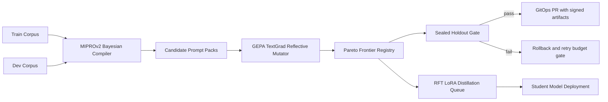
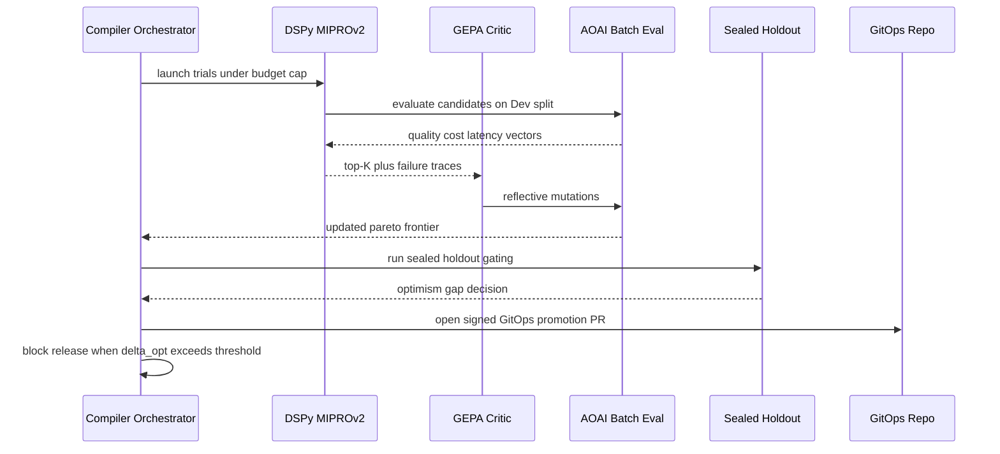
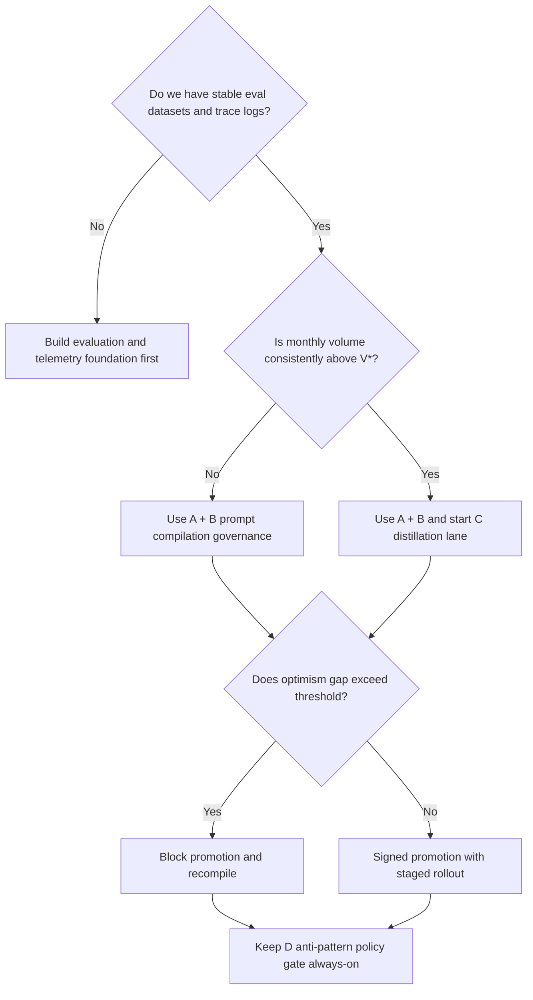

# Enterprise automated prompt and trajectory compilation selection FAQ: `DSPy MIPROv2` Bayesian joint search vs `GEPA/TextGrad` reflective Pareto evolution vs `RFT/LoRA` distillation vs manual vibe-prompting anti-pattern
> **Audience**: Cloud & AI Solution Architects, LLMOps leads, and enterprise Agent platform teams.
> **Core question**: how to optimize prompts and execution trajectories for multi-module agents without introducing hidden regressions or runaway prompt bloat.
> **Recommendation**: use A+B as the default compile-evaluate-promote pipeline; add C when monthly volume crosses `V*`; treat D as an explicitly banned operating mode.

## 1. Executive summary
Prompt optimization in enterprise agents is no longer a copywriting task; it is a systems optimization task across quality, cost, and latency.
In multi-module pipelines, a local prompt tweak often changes downstream input distributions and breaks unrelated steps.
Architecture A uses `MIPROv2` to jointly optimize module instructions and bootstrapped few-shot demonstrations with budgeted Bayesian search.
Architecture B applies `GEPA/TextGrad` to full failure traces and optimizes a non-dominated frontier over quality, token cost, and P95 latency.
Architecture C amortizes large few-shot prefixes by distilling teacher trajectories into compact `RFT/LoRA` student weights.
Architecture D relies on ad-hoc production edits and usually creates opaque regressions with no reproducible evidence.
This guide provides compile-budget equations, overfitting bounds, break-even math for `V*`, and a production operating model.
The objective is stable, auditable, and repeatable optimization rather than one-off benchmark spikes.

## 2. Why prompt optimization is now a systems engineering problem
Single-turn assistants can tolerate manual tuning; multi-module enterprise agents usually cannot.
Each module influences the next module's context, tool arguments, and error surface.
If teams optimize only on Dev averages, Goodhart effects appear quickly.
A strict `Train / Dev / Sealed-Holdout` split is therefore mandatory.
Train drives candidate generation, Dev drives fast screening, and Holdout gates production promotion.
The pipeline also needs signed artifacts, GitOps traceability, replayability, and rollback discipline.
Optimization targets must include quality, token spend, latency, tool success rate, and refusal consistency.
Without this multi-objective framing, teams accumulate prompt debt and lose predictability.

## 3. Goals and boundaries
Goal 1: improve end-to-end task success without breaking reliability or compliance controls.
Goal 2: cap prompt expansion and reduce per-run input token tax.
Goal 3: keep compilation windows budgetable through bounded trial plans.
Goal 4: make every promotion evidence-backed and audit-ready.
Goal 5: provide a quantitative threshold for moving from prompts to distilled weights.
Boundary 1: this guide targets production multi-module agents, not personal experimentation.
Boundary 2: business policy sign-off remains a human responsibility.
Boundary 3: this guide assumes baseline telemetry and evaluation datasets already exist.

## 4. Candidate architectures
Architecture A: `DSPy MIPROv2` with TPE-based joint optimization for instructions plus bootstrapped demonstrations.
Architecture B: `GEPA/TextGrad` reflective mutation over execution traces with multi-objective Pareto selection.
Architecture C: distill top teacher trajectories to `RFT/LoRA` students and reduce runtime prompt burden.
Architecture D: manual ad-hoc production prompting with no sealed evaluation and no governed rollback path.
A provides the baseline compiler, B provides efficient long-tail repair, C provides scale economics, and D provides incidents.
Recommended default: A+B, then enable C when `V*` is consistently exceeded.

## 5. Architecture A deep dive: budgeted Bayesian joint compilation
A treats instruction tokens and demonstrations as a shared optimization space.
This avoids the common trap of improving one module while degrading global workflow behavior.
Trials are typically staged from coarse exploration to focused exploitation.
Candidate scoring should run through discounted batch evaluation whenever possible.
Every candidate needs immutable metadata: prompt hash, demo set, data split, random seed, and evaluator version.
The main A risk is uncontrolled trial growth.
Mitigate this with hard caps, early stopping, and optimism-gap gates.
When Dev gains do not transfer to Holdout, promotion must be blocked automatically.
A is the foundation for reusable enterprise prompt compilers.

## 6. Architecture B deep dive: reflective Pareto evolution
B consumes real failure traces instead of blindly sampling the search space.
When tool calls fail, schemas drift, or fallback behavior regresses, mutations can target the exact fault segment.
B keeps non-dominated candidates instead of forcing a single-score winner.
This lets operations choose profiles aligned with current business constraints.
In complex agent pipelines, B often reaches usable fixes with far fewer rollouts than uninformed search.
The main B risk is critic bias or critic drift.
Mitigate with frozen critic versions, periodic calibration, and human spot checks.
B is usually the highest ROI optimizer during continuous operations.

## 7. Architecture C deep dive: prompt-to-weight amortization
C converts recurrent runtime prompt tax into controlled offline training spend.
If few-shot prefixes repeatedly consume `2,500-6,000` tokens, runtime economics deteriorate quickly.
Once monthly volume exceeds `V*`, distilled students often become cheaper and faster.
C can also reduce online prompt injection surface and simplify runtime contracts.
The trade-off is stronger training governance and model lifecycle overhead.
If data drift is faster than retraining cadence, C can become operationally expensive.
Therefore C is a scale-stage policy, not a day-one default.
C works best when teacher trajectories and production failures are continuously fed back.

## 8. Architecture D anti-pattern
D usually appears as "whoever is on-call edits prompts in production".
It may look agile in the short term but creates hidden behavioral drift.
In multi-module systems, local patches often trigger remote regressions.
Without sealed holdout, accidental Dev noise is mistaken for true improvement.
Post-incident forensics cannot reconstruct who changed what and why.
Prompt bloat and latency inflation typically follow.
D should be blocked by both policy and CI/CD gates.

## 9. Quantitative models and guardrails
Compile budget formula: `C_compile = M_trials × |D_dev| × c_rollout_bar`.
`M_trials` must be bounded by explicit budget policies.
Break-even volume for distillation: `V* = C_train / (ΔT_fewshot × p_in)`.
When traffic exceeds `V*`, C is often cheaper than carrying long few-shot prefixes indefinitely.
Multiple-hypothesis overfitting bound: `sqrt(ln(M) / (2|D_dev|))`.
If candidate count grows while Dev size stays fixed, optimism bias increases.
Use optimism gap `Δ_opt = R_dev_hat - R_holdout_hat` as a promotion gate.
Candidates with excessive `Δ_opt` should be recycled or demoted to observation status.
These equations frame decisions; they do not replace live operational telemetry.

## 10. Twelve-dimension comparison matrix
| Dimension | Architecture A | Architecture B | Architecture C | Architecture D |
|---|---|---|---|---|
| Quality upside | High | High | Medium-High | Low and unstable |
| Token efficiency | Medium | High | Highest | Low |
| P95 latency impact | Medium | Medium-High | High | Low |
| Auditability | High | High | High | Very low |
| Search efficiency | Medium | High | N/A | Low |
| Operational complexity | Medium | Medium-High | High | Low |
| Rollback readiness | High | High | Medium | Low |
| Cross-module safety | High | High | Medium-High | Low |
| Training dependency | None | None | High | None |
| Lifecycle stage | Baseline | Continuous optimization | Scale economics | Firefighting |
| Recommendation | Required | Strongly recommended | Conditional | Prohibited |
| Typical failure mode | Budget drift | Critic bias | Training overhead | Unbounded regressions |

## 11. Compilation and promotion topology


## 12. Train/Dev/Sealed-Holdout sequence


## 13. Selection decision tree


### Q1. Why do multi-module agents need joint compilation instead of manual per-module tuning
Because module outputs shape downstream module inputs, isolated edits hide system-level side effects.
Joint compilation optimizes instructions and demonstrations together, reducing local-optimum traps.
As module count grows, manual combinatorial tuning becomes infeasible.
Automated compilation also preserves reproducible evidence and rollback anchors.
Joint compilation is therefore a platform capability, not optional polishing.

### Q2. Why separate Dev from Sealed-Holdout
Dev-only optimization inflates optimism when candidate counts are large.
Sealed-Holdout provides an independent surface to reject overfitted candidates.
The split distinguishes apparent gains from transferable gains.
This is critical in regulated sectors and high-risk workflows.
Without holdout gating, post-release regressions become harder to explain.

### Q3. What is the core advantage of GEPA/TextGrad over blind search
GEPA/TextGrad uses failure evidence to mutate only relevant prompt segments.
It is effective for schema drift, tool failures, and brittle fallback behavior.
Under equal budget, reflective evolution typically yields stronger pareto candidates.
It also preserves multiple operating profiles for business-time decision making.
B is usually the highest leverage optimizer in live operations.

### Q4. When should teams move from prompt optimization to distilled weights
When few-shot prefixes remain large and traffic volume is stable and rising.
When `V*` is repeatedly exceeded and training governance is mature.
When latency and throughput targets matter more than online prompt flexibility.
At that point C bends runtime cost curves and lowers tail latency.
If drift is faster than retraining cadence, keep A+B as the primary path.

### Q5. How should teams govern multi-objective conflicts
Treat quality, token cost, and P95 latency as first-class co-equal objectives.
Promote from non-dominated candidates instead of selecting one scalar winner.
Record decision evidence and rejected alternatives for future policy shifts.
This makes policy changes operationally cheap when business constraints move.
Multi-objective governance is portfolio management, not leaderboard chasing.

### Q6. Five-step rollout and Good fit vs Not for
Step 1: freeze Train/Dev/Holdout snapshots and trace contracts.
Step 2: deploy budgeted A compilation with explicit trial ceilings.
Step 3: add B reflective Pareto refinement on real failures.
Step 4: enforce holdout optimism-gap gate plus signed GitOps promotion.
Step 5: start C distillation only after sustained volume above `V*`.
Good fit: enterprise multi-module agents with continuous operations and audit requirements.
Not for: one-off demos without governed data, telemetry, or release discipline.

## 14. Implementation snippets
```python
from dataclasses import dataclass
from math import log, sqrt
from typing import List

@dataclass
class Candidate:
    name: str
    quality: float
    token_cost: float
    p95_latency_ms: float
    dev_score: float
    holdout_score: float

def compile_budget(m_trials: int, dev_size: int, rollout_cost: float) -> float:
    return m_trials * dev_size * rollout_cost

def optimism_gap(candidate: Candidate) -> float:
    return candidate.dev_score - candidate.holdout_score

def overfit_bound(num_hypotheses: int, dev_size: int) -> float:
    return sqrt(log(max(num_hypotheses, 2)) / (2 * max(dev_size, 1)))

def pareto_frontier(candidates: List[Candidate]) -> List[Candidate]:
    frontier: List[Candidate] = []
    for c in candidates:
        dominated = False
        for o in candidates:
            if (o.quality >= c.quality and o.token_cost <= c.token_cost and o.p95_latency_ms <= c.p95_latency_ms and
                (o.quality > c.quality or o.token_cost < c.token_cost or o.p95_latency_ms < c.p95_latency_ms)):
                dominated = True
                break
        if not dominated:
            frontier.append(c)
    return frontier

def should_promote(candidate: Candidate, delta_gate: float = 0.03) -> bool:
    return optimism_gap(candidate) <= delta_gate
```

```yaml
name: nightly-prompt-compilation
on:
  schedule:
    - cron: '30 1 * * *'
  workflow_dispatch: {}
jobs:
  compile-evaluate-promote:
    runs-on: ubuntu-latest
    steps:
      - name: Checkout
        uses: actions/checkout@v4
      - name: Setup Python
        uses: actions/setup-python@v5
        with:
          python-version: '3.12'
      - name: Install dependencies
        run: pip install dspy openai pydantic
      - name: Run MIPROv2 compile
        run: python pipelines/compile_mipro.py --max-trials 320 --dev-split dev_v23
      - name: Run GEPA refinement
        run: python pipelines/refine_gepa.py --frontier-size 24
      - name: Evaluate sealed holdout
        run: python pipelines/eval_holdout.py --dataset holdout_v23 --budget-usd 900
      - name: Gate promotion
        run: python pipelines/gate_promotion.py --max-delta-opt 0.03
      - name: Open signed GitOps PR
        run: python pipelines/open_gitops_pr.py --sign-artifact --target branch/main
      - name: Upload evidence bundle
        uses: actions/upload-artifact@v4
        with:
          name: compile-evidence-bundle
          path: artifacts/evidence/
```

## 15. Enterprise TCO framing for 100K / 5M / 50M monthly runs
| Tier | Monthly runs | Recommended architecture | Dominant cost drivers | Primary value |
|---|---|---|---|---|
| Tier-1 | 100K | A | Compilation + baseline inference | Fast governance baseline |
| Tier-2 | 5M | A + B | Compilation + multi-objective optimization | Stable quality and bounded cost |
| Tier-3 | 50M | A + B + C | Distillation training + lean runtime inference | Major token and latency amortization |

## 16. Production readiness checklist
Confirm Train/Dev/Holdout snapshots are immutable and hash-pinned.
Confirm trial ceilings, budget caps, and early-stop thresholds are configured.
Confirm Pareto dimensions include quality, token cost, and P95 latency.
Confirm holdout runs use isolated credentials and isolated artifact containers.
Confirm excessive `Δ_opt` always blocks promotion automatically.
Confirm every promotion includes signed evidence and rollback instructions.
Confirm rollback can be executed within one release window.
Confirm C distillation is enabled only after sustained traffic above `V*`.
Confirm production dashboards correlate success, token usage, and latency.
Confirm policy gates disable ad-hoc production prompt editing by default.
Confirm cross-team review cadence is fixed and accountable.

## 17. Operational lessons and optimization guidance
Tag failures before B refinement using categories: tool failure, retrieval miss, format drift, and policy miss.
Bind compilation budget windows to business calendars to avoid peak-time contention.
Review Pareto frontier drift weekly for cost or latency inflection anomalies.
Maintain a minimum candidate pool to avoid single-policy fragility.
Layer policies by tenant and business line instead of forcing one universal profile.
Keep human spot-check slices for high-value workflows to cover evaluator blind spots.
Continuously feed both teacher trajectories and production incidents into retraining loops.
Standardize GitOps PR templates with budget, gain, risk, and rollback disclosures.
Align optimization cadence with product planning to preserve explainability.
Run quarterly prompt-debt cleanup to remove stale or redundant rules.

## 18. Conclusion
Automated prompt optimization for multi-module agents is a governance discipline, not an isolated tuning trick.
A supplies reproducible Bayesian joint compilation, B supplies high-leverage reflective repair, and C supplies scale-stage amortization.
D-style ad-hoc production prompting creates opaque risk and should be blocked by both process and platform policy.
When compile budgets, Pareto frontiers, holdout gates, and signed GitOps evidence are operated as one system, optimization becomes repeatable and auditable.
Enterprises should require every optimization cycle to report quality gain, cost movement, latency impact, and residual risk in one decision packet.
They should also map strategy profiles to tenant tiers and regulatory tiers so that performance gains never break governance traceability.
With this layered A+B+C path, organizations can keep improving agent capability while systematically reducing unit economics risk.
This discipline turns prompt evolution into an auditable enterprise capability rather than an ad-hoc craft practice.
During steady-state operations, review compile spend, frontier churn, holdout pass rate, and rollback frequency each month so automation remains aligned with business value instead of metric gaming.
