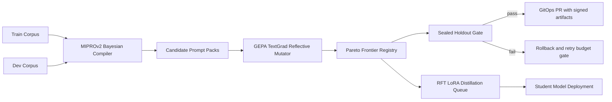
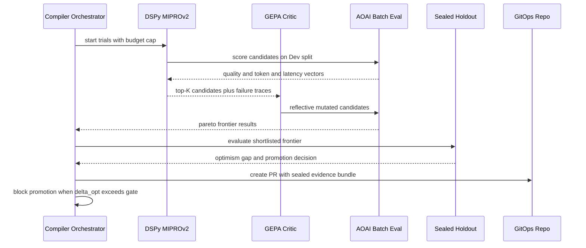
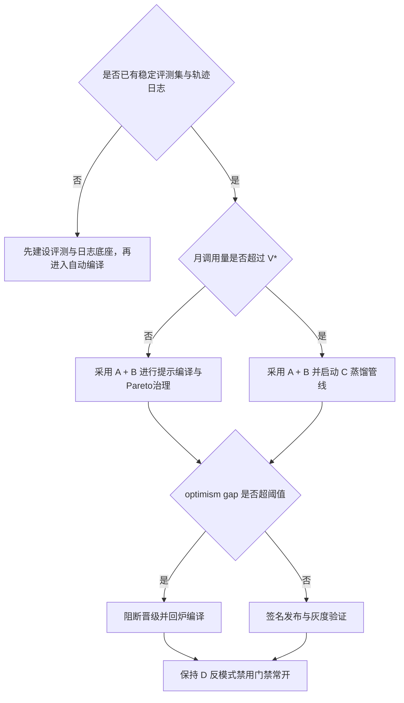

# 企业多模块智能体提示与轨迹自动编译选型 FAQ：`DSPy MIPROv2` 贝叶斯联合搜索 vs `GEPA/TextGrad` 反思式 Pareto 进化 vs `RFT/LoRA` 蒸馏固化 vs 手工 Vibe-Prompting 反模式
> **适用角色**：Cloud & AI Solution Architect、LLMOps 负责人、Agent 平台与评测治理团队。
> **核心问题**：当企业智能体由多个模块串联时，如何系统优化提示与示例轨迹，避免手工调参导致的回归与过拟合。
> **建议结论**：默认采用 A+B 的“编译-评测-晋级”流水线；当调用规模跨越 `V*` 时，追加 C 做权重蒸馏固化；D 应作为禁用反模式写入治理基线。

## 1. 执行摘要
企业智能体提示优化的主要矛盾是：质量、成本、时延三者无法同时通过手工编辑长期最优。
当工作流包含检索、规划、工具调用、结果合成等多模块时，局部提示改动会引发全链路耦合回归。
Architecture A 把模块指令与 few-shot 示例一起纳入 `MIPROv2` 的贝叶斯联合搜索，并把候选评测下沉到 Batch API 降低编译成本。
Architecture B 利用 `GEPA`/`TextGrad` 读取完整执行轨迹与失败证据，做反思式变异，直接优化非支配前沿而不是单分数。
Architecture C 把高价值提示轨迹蒸馏到学生权重，通过 `RFT/LoRA` 摊薄在线 few-shot 前缀税，适合高调用规模常态业务。
Architecture D 依赖生产环境即兴改提示，通常造成“修复一步、破坏三步”的不可追溯退化。
本文给出编译预算公式、多重假设过拟合边界、`V*` 收敛判据、三档运行规模 TCO，以及可直接落地的工程模板。
目标不是追求一次性最高分，而是建立可重复、可审计、可回滚的提示编译工程能力。

## 2. 背景：提示优化已从文案问题演化为系统工程问题
在单轮问答时代，提示更像文案调优；在多模块 Agent 时代，提示是可执行系统的一部分。
每个模块既影响本地正确率，也影响后续模块输入分布。
当团队只看 Dev 集平均分时，最常见失败是 Goodhart：指标提升而真实鲁棒性下降。
因此企业需要隔离 `Train / Dev / Sealed-Holdout` 三层评测面。
Train 负责候选生成，Dev 负责快速筛选，Sealed-Holdout 负责最终放行与防过拟合。
编译流程必须天然支持 GitOps 版本化、工件签名、可回放轨迹与审批晋级。
优化对象也从单目标扩展到多目标：质量、输入 token、P95 时延、工具成功率、拒答一致性。
只有把这些目标放入同一治理闭环，平台才能在长期演进中保持可预测行为。

## 3. 目标与边界
目标一：在不破坏合规与稳定性的前提下提升端到端任务成功率。
目标二：抑制提示膨胀，控制每次调用的输入 token 成本。
目标三：限制候选数量与评测预算，确保编译窗口可计划。
目标四：把每次晋级都绑定证据包，支持审计与事故复盘。
目标五：为高频业务提供从提示到权重的可量化迁移阈值。
边界一：本文聚焦生产级多模块 Agent，不讨论个人单提示玩具实验。
边界二：本文不替代业务评审，业务约束仍需由产品与风险方联合签字。
边界三：本文默认存在基础评测集与轨迹日志，不覆盖零数据冷启动组织。

## 4. 四类候选架构
Architecture A：`DSPy MIPROv2` 以 TPE 联合搜索模块指令与 bootstrapped few-shot，批量评测候选并输出可提交工件。
Architecture B：`GEPA/TextGrad` 基于失败轨迹反思变异，优化 `[Quality, TokenCost, P95_Latency]` Pareto 前沿。
Architecture C：将 A/B 产出的高价值轨迹蒸馏到 `RFT/LoRA` 学生模型，减少在线前缀依赖。
Architecture D：工程师在生产系统里手工改 prompt 并即时发布，无封存评测与无回滚证据。
A 提供稳定基线，B 提供高效修复与多目标平衡，C 提供规模化成本收敛，D 提供事故样本。
建议默认 A+B，依据 `V*` 判据择机启用 C，并把 D 写入策略黑名单。

## 5. Architecture A 深入：MIPROv2 联合编译与预算化搜索
A 的关键优势是把“指令改写”与“示例蒸馏”放在同一个搜索空间。
相比分步手工调参，联合搜索更能避免模块间局部最优冲突。
A 通常采用分层 trial：先粗粒度候选，再集中预算于高潜力区域。
候选评分应优先走 Batch API，以降低编译成本并提升吞吐。
每个候选必须记录输入提示、示例轨迹、评测版本、数据分片和随机种子。
A 的风险是 trial 数膨胀导致预算失控。
因此需要硬预算上限与提前终止规则。
当 Dev 提升高而 Holdout 提升低时，应触发 optimism-gap 告警并阻止晋级。
A 适合构建企业统一“可复用提示编译器”基座。

## 6. Architecture B 深入：反思式 Pareto 进化与失败定向修复
B 不盲目枚举候选，而是读取真实失败轨迹进行定向变异。
当工具调用失败、参数格式漂移、链路超时时，B 可直接针对失效段落重写规则。
多目标框架下，B 会保留非支配候选而非只保留最高质量单点。
这使团队能按业务窗口选择“高质量高成本”或“均衡成本”方案。
B 的核心收益通常体现在少量 rollout 即可修复长尾错误。
在复杂工作流中，这种效率增益经常超过盲搜索的 5x 以上。
B 的主要风险是 critic 本身偏置。
因此应对 critic 版本做冻结与回归验证，并与人工样本复核结合。

## 7. Architecture C 深入：从提示前缀税到权重摊销
C 的核心思想是把在线提示负担迁移为离线训练投入。
当 few-shot 前缀长期占用 `2,500-6,000` 输入 token 时，在线成本会持续放大。
若业务规模超过 `V*`，将 A/B 教师轨迹蒸馏到学生模型通常更经济。
C 还能减少在线提示注入面，改善合规可控性。
但 C 需要额外的训练治理、评测治理与模型生命周期治理。
若数据漂移快且训练频率跟不上，C 可能反而带来维护负担。
因此 C 不是默认第一步，而是规模化阶段策略。
C 成功的关键是把蒸馏样本与线上失败样本持续回流并重编译。

## 8. Architecture D 反模式说明
D 的典型表现是“谁值班谁改提示”，没有版本冻结也没有证据归档。
短期看似灵活，长期会形成不可解释的行为漂移。
当多个模块共享上下文时，局部修补经常诱发跨模块副作用。
没有 Sealed-Holdout 的流程很容易把 Dev 偶然噪声当成真实提升。
事故发生后无法回答“谁在何时因何修改了何条规则”。
D 还会导致提示长度失控，吞吐下降且成本上升。
因此 D 必须在治理制度和流水线门禁中被显式禁止。

## 9. 数学模型与权衡公式
编译预算可写为：`C_compile = M_trials × |D_dev| × c_rollout_bar`。
其中 `M_trials` 受搜索策略与提前终止规则控制。
当预算固定时，提高样本覆盖与降低单次 rollout 成本是主要杠杆。
few-shot 前缀税摊销阈值：`V* = C_train / (ΔT_fewshot × p_in)`。
当月调用量超过 `V*`，蒸馏模型通常优于继续追加长提示。
多重假设过拟合边界可用：`sqrt(ln(M) / (2|D_dev|))` 估计。
若候选数 `M` 提升而 `|D_dev|` 不增，表观最优候选的乐观偏差会扩大。
应使用 optimism-gap：`Δ_opt = R_dev_hat - R_holdout_hat` 做晋级闸门。
当 `Δ_opt` 超过阈值，候选需降级为观察态或回炉再编译。
这些公式用于指导治理边界，不替代真实线上指标。

## 10. 12 维架构对比矩阵
| 维度 | Architecture A | Architecture B | Architecture C | Architecture D |
|---|---|---|---|---|
| 质量提升上限 | 高 | 高 | 中高 | 低且不稳定 |
| Token 成本控制 | 中 | 高 | 最高 | 低 |
| P95 时延改善 | 中 | 中高 | 高 | 低 |
| 可审计性 | 高 | 高 | 高 | 极低 |
| 搜索效率 | 中 | 高 | 不适用 | 低 |
| 工程复杂度 | 中 | 中高 | 高 | 低 |
| 回滚便利性 | 高 | 高 | 中 | 低 |
| 多模块耦合治理 | 高 | 高 | 中高 | 低 |
| 训练依赖 | 无 | 无 | 高 | 无 |
| 适用阶段 | 基线构建 | 持续优化 | 规模化降本 | 临时救火 |
| 推荐等级 | 必选 | 强烈建议 | 条件启用 | 禁用 |
| 典型风险 | 预算膨胀 | critic 偏置 | 训练治理负担 | 回归失控 |

## 11. 编译与晋级全流程拓扑


## 12. Train/Dev/Sealed-Holdout 编译与闸门时序


## 13. 选型决策树


### Q1. 为什么多模块 Agent 需要联合编译而非逐模块手工调参
多模块链路的输入输出分布彼此耦合，逐模块手工调参会隐藏系统性副作用。
联合编译可同时优化模块指令与示例轨迹，避免局部最优冲突。
当模块数量增长时，人工枚举组合几乎不可行。
自动编译还能保留每次候选的证据与回滚路径。
因此联合编译是规模化平台的必要能力，而不是锦上添花。

### Q2. 为什么要把 Dev 与 Sealed-Holdout 分离
只看 Dev 指标会在高候选数量下放大乐观偏差。
Sealed-Holdout 提供独立验证面，专门用于拦截过拟合候选。
两层闸门可以把“看起来更好”与“真实更好”区分开。
这对于受监管行业尤为关键。
没有 Holdout 的流程几乎无法解释上线后回归来源。

### Q3. GEPA/TextGrad 相对盲搜索的核心优势是什么
GEPA/TextGrad 利用失败轨迹做定向变异，减少无效试错。
它天然适配工具调用失败、格式漂移、拒答失控等可诊断问题。
在同等预算下，反思式策略通常产生更高质量 Pareto 前沿。
同时它保留多目标候选，便于按业务窗口切换策略。
因此 B 在持续运营阶段往往是性价比最高的优化器。

### Q4. 何时应该从提示优化切换到蒸馏权重
当 few-shot 前缀长期占据大量输入 token 且调用规模稳定增长时。
当 `V*` 被持续超过且训练管线具备可控治理时。
当业务要求更低时延与更高吞吐而非频繁在线改提示时。
这时 C 能把成本曲线从线性提示税转为可摊销训练成本。
若数据漂移快于训练迭代，仍应维持 A+B 为主。

### Q5. 如何治理多目标冲突而不是只追求最高质量分
应把质量、token 成本、P95 时延定义为同级目标并保留 Pareto 前沿。
上线决策不选择单一分数冠军，而选择满足当前业务约束的非支配点。
同时记录每次选择对应的证据与放弃理由。
这样可在业务窗口变化时快速切换而不需重跑全量编译。
多目标治理本质是策略组合管理，而非一次性竞赛。

### Q6. 五步落地与 Good fit / Not for
第一步：整理 Train/Dev/Holdout 数据与轨迹日志，建立不可变评测快照。
第二步：上线 A 的预算化联合编译，定义 trial 上限与提前终止。
第三步：接入 B 的反思式 Pareto 变异，输出多目标候选前沿。
第四步：启用 Holdout optimism-gap 闸门与 GitOps 签名晋级。
第五步：当规模跨越 `V*` 时启动 C 蒸馏，并持续双轨评测回灌。
Good fit：多模块企业 Agent、需要长期治理与审计、调用规模持续增长的平台。
Not for：无评测数据、无版本治理、仅做一次性 Demo 的短周期项目。

## 14. 生产实现片段
```python
from dataclasses import dataclass
from math import log, sqrt
from typing import List

@dataclass
class Candidate:
    name: str
    quality: float
    token_cost: float
    p95_latency_ms: float
    dev_score: float
    holdout_score: float

def compile_budget(m_trials: int, dev_size: int, rollout_cost: float) -> float:
    return m_trials * dev_size * rollout_cost

def optimism_gap(candidate: Candidate) -> float:
    return candidate.dev_score - candidate.holdout_score

def overfit_bound(num_hypotheses: int, dev_size: int) -> float:
    return sqrt(log(max(num_hypotheses, 2)) / (2 * max(dev_size, 1)))

def pareto_frontier(candidates: List[Candidate]) -> List[Candidate]:
    frontier: List[Candidate] = []
    for c in candidates:
        dominated = False
        for o in candidates:
            if (o.quality >= c.quality and o.token_cost <= c.token_cost and o.p95_latency_ms <= c.p95_latency_ms and
                (o.quality > c.quality or o.token_cost < c.token_cost or o.p95_latency_ms < c.p95_latency_ms)):
                dominated = True
                break
        if not dominated:
            frontier.append(c)
    return frontier

def should_promote(candidate: Candidate, gate: float = 0.03) -> bool:
    return optimism_gap(candidate) <= gate
```

```yaml
name: nightly-prompt-compilation
on:
  schedule:
    - cron: '30 1 * * *'
  workflow_dispatch: {}
jobs:
  compile-evaluate-promote:
    runs-on: ubuntu-latest
    steps:
      - name: Checkout
        uses: actions/checkout@v4
      - name: Setup Python
        uses: actions/setup-python@v5
        with:
          python-version: '3.12'
      - name: Install dependencies
        run: pip install dspy openai pydantic
      - name: Run MIPROv2 compile
        run: python pipelines/compile_mipro.py --max-trials 320 --dev-split dev_v23
      - name: Run GEPA frontier refinement
        run: python pipelines/refine_gepa.py --frontier-size 24
      - name: Batch evaluate sealed holdout
        run: python pipelines/eval_holdout.py --dataset holdout_v23 --budget-usd 900
      - name: Gate on optimism gap
        run: python pipelines/gate_promotion.py --max-delta-opt 0.03
      - name: Publish artifact and open PR
        run: python pipelines/open_gitops_pr.py --sign-artifact --target branch/main
      - name: Upload evidence bundle
        uses: actions/upload-artifact@v4
        with:
          name: compile-evidence-bundle
          path: artifacts/evidence/
```

## 15. 100K / 5M / 50M 月运行规模 TCO 框架
| 档位 | 月运行规模 | 推荐组合 | 主要成本项 | 主要收益 |
|---|---|---|---|---|
| Tier-1 | 100K | A | 编译评测与基础推理 | 快速建立治理基线 |
| Tier-2 | 5M | A + B | 编译评测 + 多目标优化算力 | 质量稳定且成本可控 |
| Tier-3 | 50M | A + B + C | 训练蒸馏 + 低前缀在线推理 | 显著摊薄 token 税与时延 |

## 16. 上线核查清单
应确认 Train/Dev/Holdout 数据版本与快照哈希固定。
应确认编译预算上限、候选上限、提前终止阈值均已配置。
应确认 Pareto 维度至少覆盖质量、token、时延三项。
应确认 Holdout 评测在独立凭据与独立工件容器中执行。
应确认 `Δ_opt` 门禁失败会自动阻断晋级。
应确认每次晋级附带签名证据包与变更说明。
应确认回滚路径可在一次发布窗口内完成。
应确认模型蒸馏仅在超过 `V*` 且治理成熟时启用。
应确认生产监控接入任务成功率、输入 token、P95 时延联动看板。
应确认 D 类手工线上改 prompt 权限默认关闭并审计。
应确认跨团队评审节奏固定，避免策略漂移无人负责。

## 17. 运营经验与优化建议
建议把失败样本按“工具失败、检索失败、格式失败、策略失败”四类标注后再进入 B 的反思变异。
建议把批量评测预算与业务日历绑定，避免峰值期抢占在线资源。
建议每周评审一次 Pareto 前沿漂移，观察是否出现成本或时延异常上拐。
建议维持最小可用候选池，防止单候选策略失效时无替换方案。
建议按租户与业务线维护分层策略，不追求“一套提示走天下”。
建议在高价值流程上保留人工抽检样本，防止自动评测盲区。
建议将蒸馏教师轨迹与线上投诉案例双向回流，减少训练与生产脱节。
建议把 GitOps PR 评审模板标准化，固定展示预算、收益、风险和回滚方案。
建议把策略演进节奏产品化，避免纯工程视角压过业务可解释性。
建议建立季度“提示债务”清理机制，移除冗余或过时规则。

## 18. 结论
多模块 Agent 的提示优化已经不是手工文案工作，而是需要编译器、评测器、闸门与晋级制度协同的系统工程。
A 提供可重复的联合搜索基座，B 提供面向真实失败的高效率修复，C 提供规模化阶段的成本与时延收敛通道。
D 所代表的即兴线上改提示模式会持续累积不可见风险，应在制度与技术层面双重禁用。
当企业把编译预算、Pareto 前沿、Holdout 闸门、GitOps 证据包和蒸馏阈值纳入统一治理闭环后，就能把“偶然调优成功”升级为“可持续复制成功”。
进一步建议将提示编译治理纳入年度平台 OKR，要求每次优化同时报告质量收益、成本变化、时延影响与风险暴露，确保技术团队与业务团队在同一价值坐标系下决策。
还应将编译与蒸馏策略映射到租户分层与行业监管分层，确保金融、医疗、政务等高合规场景在获得性能收益的同时保留完整可追溯链路。
最终，企业可通过 A+B+C 的分层路线在保证可审计性的前提下持续压降单位任务成本，并把智能体能力演进从“人治经验”沉淀为“平台资产”。
在持续运营阶段，建议按月复核编译预算、候选密度、Holdout 通过率与回滚频次，确保自动优化始终服务于真实业务价值而非局部指标幻觉。
在持续运营阶段，建议按月复核编译预算、候选密度、Holdout 通过率与回滚频次，确保自动优化始终服务于真实业务价值而非局部指标幻觉。
在持续运营阶段，建议按月复核编译预算、候选密度、Holdout 通过率与回滚频次，确保自动优化始终服务于真实业务价值而非局部指标幻觉。
在持续运营阶段，建议按月复核编译预算、候选密度、Holdout 通过率与回滚频次，确保自动优化始终服务于真实业务价值而非局部指标幻觉。
在持续运营阶段，建议按月复核编译预算、候选密度、Holdout 通过率与回滚频次，确保自动优化始终服务于真实业务价值而非局部指标幻觉。
在持续运营阶段，建议按月复核编译预算、候选密度、Holdout 通过率与回滚频次，确保自动优化始终服务于真实业务价值而非局部指标幻觉。
在持续运营阶段，建议按月复核编译预算、候选密度、Holdout 通过率与回滚频次，确保自动优化始终服务于真实业务价值而非局部指标幻觉。
在持续运营阶段，建议按月复核编译预算、候选密度、Holdout 通过率与回滚频次，确保自动优化始终服务于真实业务价值而非局部指标幻觉。
