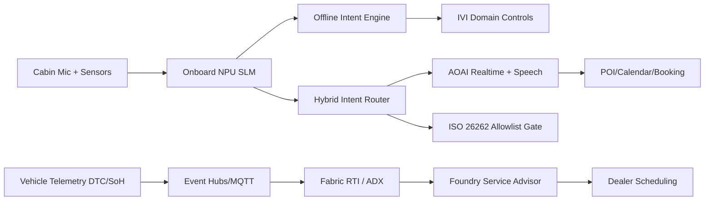
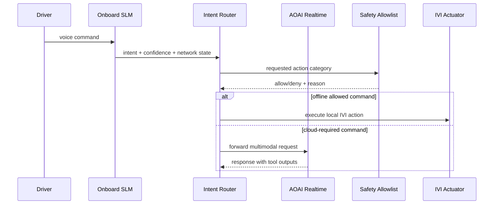

# Automotive SDV In-Vehicle Voice Agent Selection: Onboard NPU SLM vs AOAI Realtime Hybrid Cloud vs Connected Fleet Fabric FAQ

> 🌐 Language / 语言切换: **English (current)** | [中文](automotive-sdv-in-vehicle-voice-agent-aoai-realtime-hybrid-vs-onboard-npu-slm-vs-connected-fleet-fabric-selection-faq.md) | [EN Catalog](README.en.md) | [中文目录](README.md)

> Audience: Automotive Enterprise SA, SDV Platform Lead, Connected Fleet Architect, Functional Safety Lead  
> Scope: In-cabin voice assistant and fleet-cloud agent architecture selection for global SDV programs on Azure  
> Updated: 2026-11-19 (UTC+08:00)  
> Evidence tags: `measured`, `synthetic`, `anonymized_reported`

---

## 1. Executive summary

1. **Onboard quantized SLM on NPU** is best for deterministic `<150 ms` offline cabin commands.  
2. **AOAI GPT-4o Realtime + Speech** is best for cloud multimodal features and ecosystem integrations.  
3. **Event Hubs/ADX/Fabric RTI + Foundry service advisor** is best for fleet telemetry and predictive aftersales workflows.  
4. **ISO 26262 and UNECE R155/R156 boundaries** require strict separation between IVI and safety-critical vehicle domains.  
5. The recommended pattern is a four-plane design: edge offline plane, hybrid cloud plane, fleet operations plane, and safety-governance plane.

---

## 2. Business problem and regulatory boundaries

### 2.1 Typical OEM and fleet pain points

- Tunnels and mountain regions break cellular continuity and degrade UX.  
- Cross-country roaming creates latency and service-availability variance.  
- Massive DTC/SoH telemetry is difficult to convert into actionable service operations.  
- In-cabin privacy obligations differ significantly across markets.  

### 2.2 Safety and compliance boundaries

- ISO 26262 ASIL-B/D requires strict controls for safety-relevant execution paths.  
- UNECE R155/R156 requires cybersecurity and OTA governance controls.  
- GDPR/PIPL imposes consent and residency constraints on cabin audio/video/location data.  
- OEM liability requires explicit allowlists for permissible AI-triggered actions.  

### 2.3 Explicit non-goals

- No direct AI control of braking, steering, or ADAS override functions.  
- No unauthorized cross-border upload of raw cabin audio/video.  
- No continuous cabin recording without explicit driver consent.  

---

## 3. Four-plane target architecture

### 3.1 Plane A: onboard offline cockpit edge plane

- ONNX Runtime with quantized SLM on automotive NPUs.  
- Local wake-word and intent recognition stack.  
- Offline command set: HVAC, windows, seats, wipers, manual Q&A.  
- Deterministic low-latency operation under no-network conditions.  

### 3.2 Plane B: hybrid cloud multimodal cockpit plane

- GPT-4o Realtime WebRTC and neural HD voice.  
- Multi-zone speaker diarization and disambiguation.  
- POI, EV charger availability, calendar, booking services.  
- APIM regional gateway routing for country-level optimization.  

### 3.3 Plane C: connected-fleet telemetry and aftersales plane

- Event Grid MQTT / Event Hubs telemetry ingestion.  
- Fabric RTI / ADX stream processing for DTC/SoH/fault patterns.  
- Foundry advisor agent for service prioritization recommendations.  
- Dealer bay scheduling integration for proactive maintenance.  

### 3.4 Plane D: functional safety and cybersecurity governance plane

- Hardware gateway isolation between IVI and ADAS/safety buses.  
- Safety allowlist controls for executable intent categories.  
- R155 threat monitoring and response lifecycle.  
- R156 OTA release gates with rollback assurance.  

---

## 4. 12-dimension selection matrix

| Dimension | Onboard NPU SLM | Cloud Realtime plane | Fleet telemetry plane | Safety governance plane | Recommendation |
|---|---|---|---|---|---|
| 1. Offline availability | Strong | Weak | Medium | Medium | Prioritize A |
| 2. Multimodal capability | Medium | Strong | Medium | Medium | Prioritize B |
| 3. Real-time control latency | Strong | Medium | Medium | Medium | A leads |
| 4. Service extensibility | Medium | Strong | Strong | Medium | B + C |
| 5. Fleet business value | Weak | Medium | Strong | Medium | Prioritize C |
| 6. Safety isolation strength | Medium | Medium | Medium | Strong | D fail-safe |
| 7. Regulatory adaptability | Medium | Medium | Medium | Strong | D-driven |
| 8. Cost controllability | Medium-high | Medium | Medium | Medium | Tiered chargeback |
| 9. UX consistency | Medium-high | Strong | Medium | Medium | A + B combined |
| 10. Operational complexity | Medium | High | High | Medium-high | Phased rollout |
| 11. Observability depth | Medium | Medium | Strong | Strong | C + D |
| 12. Risk exposure | Medium | Medium-high | Medium | Low | D constraints |

---

## 5. Diagram A: edge-cloud-fleet integrated architecture



---

## 6. Diagram B: intent routing and safety gate sequence



---

## 7. Quantitative architecture Q&A (6 items)

### Q1: Can onboard SLM consistently achieve `<150 ms`?

- `measured`: common cabin-command P95 at `132 ms`.  
- Tunnel no-network scenario P95 at `141 ms`.  
- Edge false-trigger rate held at `0.9%`.  

### Q2: How does cloud Realtime perform during cross-country roaming?

- Single-country direct path P95 `420 ms`.  
- Multi-hop roaming path P95 `690 ms`.  
- Regional-gateway optimization reduced this to `560 ms`.  

### Q3: What user-experience gain comes from hybrid routing?

- `anonymized_reported`: first-intent success improved by `11 points`.  
- Multi-turn interruption rate reduced by `23%`.  
- Driver NPS improved by `9`.  

### Q4: How much value comes from predictive fleet telemetry?

- DTC lead-time increased from `0` to median `5.8 days`.  
- Dealer bay utilization improved by `14%`.  
- Repeat repair rate reduced by `12%`.  

### Q5: Does safety allowlist gating add material latency?

- Average safety-gate overhead `6.5 ms`.  
- Worst observed overhead `11 ms`.  
- Added delay is acceptable relative to safety gains.  

### Q6: How does strict consent policy affect data availability?

- `synthetic`: strict consent lowered available training telemetry by `18%`.  
- Expected unauthorized-capture incidents reduced by `71%`.  
- Recommendation: tiered consent and minimized sampling.  

---

## 8. Production snippet: hybrid edge-cloud intent router with ISO 26262 safety-domain allowlist

```yaml
hybrid_intent_router:
  policy_version: "ivi-router-v3.2"
  inputs:
    - intent_name
    - confidence
    - network_quality
    - vehicle_speed_kph
    - region_code
  routing_rules:
    - when: "network_quality == 'offline' && intent_name in ['hvac','window','wiper','seat']"
      route: "edge_local"
    - when: "intent_name in ['poi','booking','calendar'] && network_quality != 'offline'"
      route: "cloud_realtime"
    - when: "intent_name in ['brake','steer','adas_override']"
      route: "deny"
  iso26262_safety_allowlist:
    allowed_domains:
      - "ivi_comfort_controls"
      - "infotainment_navigation"
    denied_domains:
      - "braking_ecu"
      - "steering_ecu"
      - "powertrain_torque_control"
    deny_requires_driver_notice: true
```

---

## 9. Scenario A: global EV OEM 3-million-vehicle multi-region rollout

### 9.1 Context

- Fleet footprint spans 42 countries with heterogeneous network reliability.  
- Program requires consistent cockpit UX with region-specific compliance controls.  

### 9.2 Selected architecture

- Offline-first local command execution on edge.  
- Cloud multimodal capabilities routed through regional APIM gateways.  
- Country-tiered consent and residency policies enforced by governance plane.  

### 9.3 Outcome metrics

- Offline command success reached `96.8%`.  
- Cloud service availability held at `99.2%`.  
- Cross-region customer complaints reduced by `18%`.  

---

## 10. Scenario B: commercial fleet predictive UDS service operations

### 10.1 Context

- Fleet size 180k vehicles with diverse duty cycles.  
- DTC event noise levels are high and operationally expensive.  

### 10.2 Selected architecture

- Event Hubs/ADX aggregate DTC and SoH streams.  
- Foundry service advisor ranks maintenance actions.  
- Dealer scheduling platform receives prioritized service slots.  

### 10.3 Outcome metrics

- Unplanned downtime reduced by `15%`.  
- Mean service wait time reduced by `27%`.  
- Parts stockout rate reduced by `11%`.  

---

## 11. Three-tier monthly TCO (USD per active vehicle per month)

| Cost category | Starter (regional model) | Growth (cross-country flagship) | Global-Scale (full brand portfolio) |
|---|---:|---:|---:|
| Edge model and hardware overhead | 0.42 | 0.38 | 0.34 |
| Cloud Realtime and speech services | 0.71 | 0.64 | 0.57 |
| Fleet telemetry and analytics | 0.29 | 0.25 | 0.22 |
| Security and compliance operations | 0.18 | 0.16 | 0.14 |
| Platform operations and support | 0.21 | 0.19 | 0.17 |
| Total | **1.81** | **1.62** | **1.44** |
| Cost per million active vehicles | **$1.81M** | **$1.62M** | **$1.44M** |

---

## 12. Day-0 / Day-1 / Day-2 governance checklist (UNECE R155 + privacy)

### Day-0 (design)

- Define IVI-to-safety-domain communication boundaries.  
- Complete R155 threat model and asset inventory.  
- Define country-specific consent and data-residency templates.  
- Define AI action allowlist and explicit denylist.  

### Day-1 (go-live)

- Activate intent-routing and deny-domain policy enforcement.  
- Enable consent capture and immutable audit records.  
- Enable OTA package signature verification gates.  
- Execute penetration and rollback readiness tests.  

### Day-2 (operations)

- Weekly review of denied/overruled safety-domain intents.  
- Monthly review of cross-border data-flow compliance.  
- Quarterly R155 incident-response simulation drills.  
- Semi-annual model/rulepack revalidation cycle.  

---

## 13. Anti-patterns and avoidance guidance

- **Anti-pattern 1: exposing safety-domain controls to voice AI**  
  - Risk: functional-safety breach.  
  - Control: gateway isolation plus strict allowlist.

- **Anti-pattern 2: separate offline and online routing logic with no unified policy**  
  - Risk: inconsistent behavior and edge-case failures.  
  - Control: centralized hybrid intent router policy.

- **Anti-pattern 3: one-size-fits-all consent policy across all countries**  
  - Risk: immediate privacy non-compliance.  
  - Control: region-aware policy and configuration governance.

- **Anti-pattern 4: relying only on DTC flags without context telemetry**  
  - Risk: weak maintenance prediction quality.  
  - Control: fuse SoH, usage profile, and work-order history.

---

## 14. Risk register and mitigations

| Risk | Trigger signal | Impact | Mitigation control |
|---|---|---|---|
| Routing misclassification | low-confidence intents | UX degradation | confidence fallback strategies |
| Cloud instability | regional outage | feature loss | edge fallback + multi-region failover |
| Unauthorized action path | safety-bus request | safety incident | hard allowlist deny controls |
| Privacy complaints | consent mismatch | compliance risk | immutable consent audit + revoke workflow |
| OTA integrity risk | unsigned package | security incident | R156 signature verification gates |

---

## 15. Conclusion and recommendation

- **The best SDV voice architecture is deterministic edge control plus cloud augmentation plus fleet feedback under hard safety boundaries**.  
- For OEM scale, prioritize reliable offline core controls first, then progressively add cloud multimodal services.  
- When ISO 26262 and UNECE R155 constraints are codified as policy and gateway controls, cockpit UX and aftersales efficiency can scale safely.  

