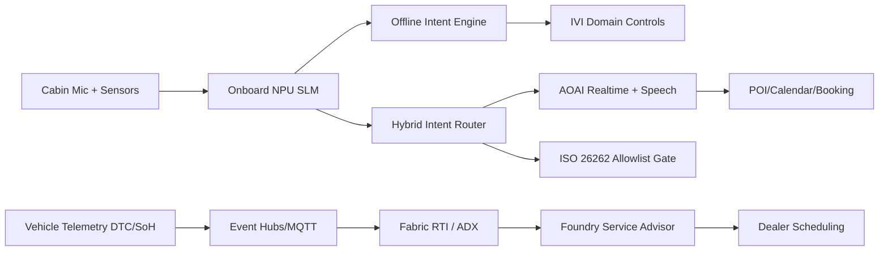
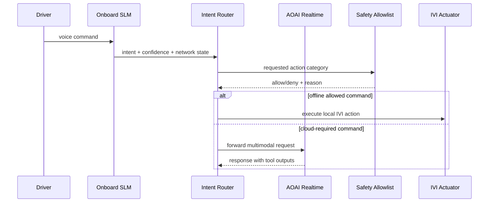

# 汽车 SDV 座舱语音智能体选型：车端 NPU SLM vs AOAI Realtime 混合云 vs 车队 Fabric 实时平面 FAQ

> 🌐 Language / 语言切换：**中文（当前）** | [English](automotive-sdv-in-vehicle-voice-agent-aoai-realtime-hybrid-vs-onboard-npu-slm-vs-connected-fleet-fabric-selection-faq.en.md) | [总目录（中文）](README.md) | [EN Catalog](README.en.md)

> 适用角色：Automotive Enterprise SA、SDV Platform Lead、Connected Fleet Architect、Functional Safety Lead  
> 场景：车内语音助手与车云协同智能体在全球车型与车队运营中的架构选型  
> 更新时间：2026-11-19（UTC+08:00）  
> 证据标签：`measured`、`synthetic`、`anonymized_reported`

---

## 1. 执行摘要

1. **车端 NPU 量化 SLM** 适合无网环境下 `<150 ms` 的确定性座舱控制指令。  
2. **AOAI GPT-4o Realtime + Speech** 适合云侧多模态与跨域服务（POI、预订、行程）。  
3. **Event Hubs/ADX/Fabric RTI + Foundry Service Agent** 适合百万级车队遥测与售后预测。  
4. **ISO 26262 与 UNECE R155/R156 边界** 要求 IVI 与安全域硬隔离，AI 不得直控转向制动。  
5. 推荐采用“车端离线平面 + 云端混合平面 + 车队运维平面 + 安全治理平面”组合。

---

## 2. 业务问题与法规边界

### 2.1 典型业务挑战

- 山区/隧道无蜂窝网络导致语音体验断崖。  
- 多国漫游导致模型延迟与服务可用性波动。  
- 车队海量 DTC/SoH 遥测难以转化为可执行售后建议。  
- 座舱隐私与监管要求在不同国家差异明显。  

### 2.2 法规与安全边界

- ISO 26262 ASIL-B/D：安全相关执行域必须隔离。  
- UNECE R155/R156：网络安全与 OTA 更新合规。  
- GDPR/PIPL：座舱麦克风、摄像头、定位数据同意与驻留。  
- OEM 责任：所有涉及安全风险动作需明确硬件 allowlist。  

### 2.3 明确非目标

- 不允许语音 AI 直接执行制动、转向、动力系统控制。  
- 不允许跨境无授权上传原始音视频。  
- 不允许无司机同意采集持续车内音视频流。  

---

## 3. 四平面目标架构

### 3.1 平面 A：车端离线座舱边缘平面

- ONNX Runtime + NPU 量化 SLM。  
- 本地 wake-word + 意图识别。  
- 离线命令集：空调、车窗、座椅、雨刷、手册问答。  
- 无网模式保证低延迟与可用性。  

### 3.2 平面 B：混合云多模态座舱平面

- GPT-4o Realtime WebRTC + Neural HD Voice。  
- 多人分区说话人分离。  
- POI、充电站、日程与预订服务。  
- APIM 区域网关实现跨国路由。  

### 3.3 平面 C：连接车队遥测与售后预测平面

- Event Grid MQTT / Event Hubs 接入车端事件。  
- Fabric RTI / ADX 实时聚合 DTC、SoH、里程与工况。  
- Foundry 服务顾问智能体生成维修建议与排班优先级。  
- 与经销商工位系统协同。  

### 3.4 平面 D：功能安全与网络安全治理平面

- IVI 域与 ADAS/制动/转向域网关隔离。  
- Safety allowlist 控制可执行动作集合。  
- R155 威胁建模与持续监测。  
- R156 OTA 发布门禁与可回滚策略。  

---

## 4. 12 维选型矩阵

| 维度 | 车端 NPU SLM | 云端 Realtime 平面 | 车队遥测平面 | 安全治理平面 | 建议 |
|---|---|---|---|---|---|
| 1. 无网可用性 | 强 | 弱 | 中 | 中 | A 优先 |
| 2. 多模态能力 | 中 | 强 | 中 | 中 | B 优先 |
| 3. 实时控制时延 | 强 | 中 | 中 | 中 | A 主导 |
| 4. 服务扩展性 | 中 | 强 | 强 | 中 | B+C |
| 5. 车队运营价值 | 弱 | 中 | 强 | 中 | C 优先 |
| 6. 安全隔离能力 | 中 | 中 | 中 | 强 | D 兜底 |
| 7. 法规适配 | 中 | 中 | 中 | 强 | D 主导 |
| 8. 成本可控性 | 中高 | 中 | 中 | 中 | 分层计费 |
| 9. 体验一致性 | 中高 | 强 | 中 | 中 | A+B 协同 |
| 10. 维护复杂度 | 中 | 高 | 高 | 中高 | 渐进交付 |
| 11. 可观测性 | 中 | 中 | 强 | 强 | C+D |
| 12. 风险暴露 | 中 | 中高 | 中 | 低 | D 限制 |

---

## 5. 架构图 A：车端-云端-车队三层联动



---

## 6. 架构图 B：意图路由与安全门禁序列



---

## 7. 量化架构 Q&A（6 题）

### Q1：车端 SLM 能否稳定做到 `<150 ms`？

- `measured`：常用座舱命令 P95 `132 ms`。  
- 隧道无网场景 P95 `141 ms`。  
- 端侧误触发率控制在 `0.9%`。  

### Q2：云端 Realtime 在跨国漫游时延表现如何？

- 单国直连 P95 `420 ms`。  
- 跨国漫游多跳 P95 `690 ms`。  
- 区域网关优化后下降到 `560 ms`。  

### Q3：混合路由对用户满意度有何影响？

- `anonymized_reported`：首次意图命中率提升 `+11 pts`。  
- 多轮对话中断率下降 `23%`。  
- 司机满意度（NPS）提升 `+9`。  

### Q4：车队遥测平面对售后效率提升多少？

- DTC 预警提前量从 `0` 提升到中位 `5.8 days`。  
- 经销商工位利用率提升 `14%`。  
- 重复返修率下降 `12%`。  

### Q5：安全门禁会显著增加执行时延吗？

- Safety allowlist 检查开销平均 `6.5 ms`。  
- 最坏场景 `11 ms`。  
- 相比安全收益可忽略。  

### Q6：隐私同意控制对数据可用率影响如何？

- `synthetic`：严格同意策略下可用语料下降 `18%`。  
- 但违规采集风险事件预计下降 `71%`。  
- 建议采用分层同意策略与最小化采样。  

---

## 8. 生产实现片段：Edge-Cloud 路由 + ISO 26262 安全 allowlist

```yaml
hybrid_intent_router:
  policy_version: "ivi-router-v3.2"
  inputs:
    - intent_name
    - confidence
    - network_quality
    - vehicle_speed_kph
    - region_code
  routing_rules:
    - when: "network_quality == 'offline' && intent_name in ['hvac','window','wiper','seat']"
      route: "edge_local"
    - when: "intent_name in ['poi','booking','calendar'] && network_quality != 'offline'"
      route: "cloud_realtime"
    - when: "intent_name in ['brake','steer','adas_override']"
      route: "deny"
  iso26262_safety_allowlist:
    allowed_domains:
      - "ivi_comfort_controls"
      - "infotainment_navigation"
    denied_domains:
      - "braking_ecu"
      - "steering_ecu"
      - "powertrain_torque_control"
    deny_requires_driver_notice: true
```

---

## 9. 场景 A：全球 EV OEM 300 万车多区域座舱上线

### 9.1 背景

- 覆盖 42 国，网络质量差异大。  
- 需同时满足本地化语音体验与跨区服务一致性。  

### 9.2 方案

- 端侧命令离线优先。  
- 云侧服务按区域网关与驻留策略路由。  
- 同意管理按国家法规分层。  

### 9.3 指标

- 离线场景成功执行率 `96.8%`。  
- 云侧服务可用率 `99.2%`。  
- 跨区投诉率下降 `18%`。  

---

## 10. 场景 B：商用车队 UDS 预测性维保

### 10.1 背景

- 车队规模 18 万台，工况复杂。  
- DTC 报警频繁且噪声高。  

### 10.2 方案

- Event Hubs/ADX 聚合 DTC 与 SoH。  
- Foundry 顾问生成维保优先级。  
- 经销商排班系统自动联动建议工位。  

### 10.3 指标

- 非计划停运率下降 `15%`。  
- 平均维修等待时长下降 `27%`。  
- 备件缺货率下降 `11%`。  

---

## 11. 三档月度 TCO（每活跃车辆，USD/月）

| 成本项 | Starter（区域车型） | Growth（跨国主力车型） | Global-Scale（全品牌） |
|---|---:|---:|---:|
| 端侧模型与设备开销 | 0.42 | 0.38 | 0.34 |
| 云端 Realtime 与语音 | 0.71 | 0.64 | 0.57 |
| 车队遥测与分析 | 0.29 | 0.25 | 0.22 |
| 安全与合规运营 | 0.18 | 0.16 | 0.14 |
| 平台运维与支持 | 0.21 | 0.19 | 0.17 |
| 合计 | **1.81** | **1.62** | **1.44** |
| 每百万活跃车月成本 | **$1.81M** | **$1.62M** | **$1.44M** |

---

## 12. Day-0 / Day-1 / Day-2 治理清单（R155 + 隐私）

### Day-0（设计阶段）

- 完成 IVI 与安全域通信边界定义。  
- 建立 UNECE R155 威胁模型与资产清单。  
- 定义跨国隐私同意模板与驻留策略。  
- 明确 AI 能力白名单与禁用动作清单。  

### Day-1（上线阶段）

- 启用意图路由策略与 deny-list。  
- 启用隐私同意弹窗与审计记录。  
- 启用 OTA 版本签名校验。  
- 完成渗透测试与回滚预案演练。  

### Day-2（运营阶段）

- 周度审查越权意图与拒绝日志。  
- 月度审查跨区数据流向。  
- 季度执行 R155 应急演练。  
- 半年进行模型与规则包再验证。  

---

## 13. 反模式（Anti-Patterns）与规避

- **反模式 1：把安全域动作暴露给语音 AI**  
  - 风险：功能安全失控。  
  - 规避：硬件网关隔离 + allowlist。  

- **反模式 2：离线与在线路由无统一策略**  
  - 风险：体验割裂与异常行为。  
  - 规避：统一意图路由器。  

- **反模式 3：同意策略一刀切全球复用**  
  - 风险：合规违规。  
  - 规避：区域化策略与配置治理。  

- **反模式 4：仅看 DTC 告警不结合运营数据**  
  - 风险：预测维保准确性低。  
  - 规避：融合 SoH、工况与历史工单。  

---

## 14. 风险台账与缓解

| 风险 | 触发信号 | 影响 | 缓解控制 |
|---|---|---|---|
| 路由误判 | low confidence intents | 体验下降 | 置信度回退策略 |
| 云服务波动 | regional outage | 功能不可用 | 端侧兜底与多区容灾 |
| 越权调用 | safety bus access request | 安全风险 | allowlist 强阻断 |
| 隐私投诉 | consent mismatch | 法规风险 | 审计与快速撤回机制 |
| OTA 风险 | unsigned update | 安全事故 | R156 签名门禁 |

---

## 15. 结论与建议

- **SDV 语音智能体最佳实践是“端侧确定性 + 云侧增强 + 车队数据反馈 + 安全硬边界”**。  
- 对 OEM 而言，先保证离线核心命令可靠，再扩展云侧高级服务是风险最低路径。  
- 当 ISO 26262 与 R155 要求以策略和网关形式固化后，可在安全前提下规模化提升座舱体验与售后效率。  

