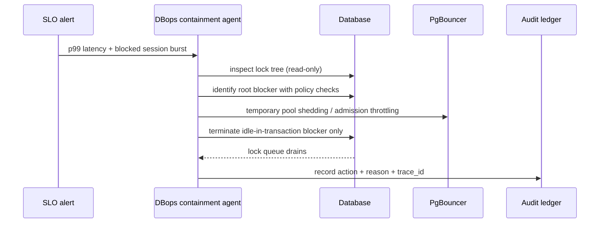

# Autonomous Database SRE and Self-Healing DBops Agent Selection FAQ: Route A (HypoPG + PITR clone replay + GitOps safe DDL) vs Route B (managed native tuning) vs Route C (bounded live containment runbooks) vs Route D (high-privilege autonomous production writes anti-pattern)

> Audience: Cloud & AI Solution Architects, platform DB teams, reliability engineers, and regulated workload owners operating Azure Database for PostgreSQL Flexible Server, Azure SQL Database/Managed Instance, and adjacent Cosmos-backed service planes.
> Goal: build autonomous DB SRE flows that recover incidents quickly while preserving lock safety, least privilege, and change-governance traceability.

## 1. Executive Summary

The core design rule for autonomous DBops on Azure is:

**contain first, prove second, change last.**

A production-safe operating model is typically a route composition:

1. **Route C for immediate incident containment** to collapse lock storms and restore throughput in seconds.
2. **Route B for built-in managed plan-regression suppression** with minimal external write privileges.
3. **Route A for structural remediation** through hypothetical analysis, clone replay, and human/canary gated GitOps schema change.

Route D must remain prohibited:

- no unrestricted autonomous `db_owner`/`azure_pg_admin` write behavior,
- no non-concurrent index build in hot OLTP windows,
- no destructive ad-hoc data mutations by autonomous agents.

## 2. Problem Statement and Reliability Boundary

Recurring failure patterns:

- sudden CPU saturation from ORM-generated missing-index query paths,
- plan flips caused by parameter skew or stale statistics,
- lock convoy amplification from one long transaction and one waiting DDL,
- autovacuum lag and XID pressure under sustained write-heavy workloads,
- weak attribution between application rollout and database latency spikes.

Architectural objective:

- achieve sub-minute containment under live incidents,
- avoid `ACCESS EXCLUSIVE`/`Sch-M` induced blast radius,
- preserve auditable change intent and rollback pathways,
- maintain strict separation between diagnosis identity and containment identity.

## 3. Four Route Definitions

### Route A — SRE Agent + HypoPG + Ephemeral Clone Replay + GitOps Safe-DDL PR

Route A is a **proof-first structural remediation path**:

- diagnose with `pg_stat_statements`, Query Store, and wait-event telemetry,
- estimate planner impact with hypothetical index metadata,
- validate true execution behavior on PITR or thin clone,
- generate governed PR through Atlas/Flyway/Liquibase with policy gates,
- execute in production only after human/canary approval.

It maximizes correctness and auditability for schema-level fixes.

### Route B — Managed Native Self-Tuning in Database Engines

Representative capabilities:

- Azure SQL Automatic Tuning (`FORCE_LAST_GOOD_PLAN`),
- PostgreSQL advisory tooling and managed connection pooling patterns,
- low-friction rollback posture for common plan regressions.

Route B is strong for fast stabilization with minimal privileged automation surface, but it cannot fully solve application anti-patterns such as N+1 query explosions or enforce cross-service migration governance.

### Route C — Bounded Live Incident Containment Runbooks

Route C is an **operational guardrail path**:

- read-only diagnostics by default,
- tightly scoped short-lived runbook identity for containment actions,
- lock-tree root blocker handling and pool shedding,
- explicit prohibition of destructive or long-blocking DDL.

This route is designed to reduce MTTR while minimizing accidental collateral damage.

### Route D — High-Privilege Autonomous Production Writes (Anti-Pattern)

Typical anti-pattern behaviors:

- autonomous non-concurrent index build on hot tables,
- autonomous `VACUUM FULL` in live windows,
- ad-hoc data rewrites without migration governance.

Route D usually converts local regressions into systemic outage risk.

## 4. 12-Dimension Comparison Matrix

| Dimension | Route A | Route B | Route C | Route D |
|---|---|---|---|---|
| Diagnostic depth | High | Medium | Medium-High | Low |
| Containment latency | Medium | High | Very High | Unpredictable |
| Structural remediation capability | High | Medium | Low | Superficial |
| Lock safety assurance | High | Medium-High | High | Low |
| Least-privilege compliance | Medium-High | High | Very High | Low |
| Change auditability | High | Medium | High | Low |
| Rollback predictability | High | Medium | Medium-High | Low |
| App-to-DB attribution quality | High | Medium | Medium | Low |
| Operational complexity | Medium-High | Low | Medium | Hidden High |
| Repeatability across teams | High | Medium | High | Low |
| 3-year TCO stability | Medium-High | High | Medium-High | Low |
| Regulatory explainability | High | Medium-High | High | Low |

## 5. Quantitative Q&A (Q1..Q6)

### Q1. Why can a 4-second waiting DDL freeze thousands of TPS?

A simplified lock-queue amplification approximation:

`Q_blocked(t) ≈ TPS_write × T_wait + Q_existing`

With `TPS_write = 5000` and `T_wait = 4s`, the blocked queue can quickly reach `~20,000` waiting writes.

Required safety controls:

- session-level `lock_timeout` guardrails (`1500ms` class or stricter),
- retry with bounded exponential backoff and jitter,
- migration window policy that rejects high-risk blocking DDL on peak schedules.

### Q2. Why is HypoPG cost delta insufficient without clone replay?

Hypothetical metadata can estimate planner cost movement, but cannot fully validate:

- physical buffer behavior,
- mixed concurrency contention,
- skew-sensitive execution paths,
- write-path side effects.

Recommended gate:

1. candidate threshold, e.g. `C_after / C_before <= 0.30`,
2. replay on PITR/thin clone to validate elapsed time, block I/O, and cache behavior under representative load traces.

### Q3. How should write amplification be evaluated when adding indexes?

Use a write amplification perspective:

`ΔW_idx = W_after - W_before`

Additions to secondary indexes can:

- increase write path page maintenance,
- reduce HOT update probability,
- raise WAL pressure.

Therefore index design must include both read-improvement and write-regression economics, not read latency alone.

### Q4. How do we safely terminate lock-tree blockers?

Safety invariants:

- terminate the root blocker, not victim sessions,
- never terminate protected system sessions (autovacuum wraparound workers, replication essentials),
- log actor, reason, SQL fingerprint, and trace linkage before action.

Relevant primitives:

- PostgreSQL: `pg_blocking_pids()`, `pg_stat_activity`,
- Azure SQL: `sys.dm_exec_requests`, lock DMVs, blocking chain views.

### Q5. How do we correlate DB P99 spikes to exact app revisions?

Use `SQLCommenter` + OpenTelemetry:

- stamp query paths with service/revision/trace metadata,
- join traces, deployment events, and query signatures in monitor workspaces,
- decide quickly whether immediate app rollback or DB tuning should be first responder action.

This avoids prolonged blame loops between app and DB teams.

### Q6. Why split identities between diagnostics and containment?

A secure split model:

- **permanent read-only diagnostics identity**,
- **JIT, short-lived containment identity** with narrow controlled actions.

Benefits:

- reduced standing privilege exposure,
- stronger compliance posture,
- cleaner forensics and accountability per containment action.

## 6. Reference Architecture (Mermaid #1)

```mermaid
flowchart LR
    APP[AKS/ACA application revisions] --> OTL[OpenTelemetry + SQLCommenter]
    OTL --> MON[App Insights / Log Analytics]
    DB[(Azure PostgreSQL / Azure SQL)]
    DB --> STAT[Query Store / pg_stat_statements]
    STAT --> AG[DB SRE Agent diagnosis plane]
    AG --> HYP[HypoPG hypothetical index simulation]
    AG --> CLONE[PITR/thin clone replay validation]
    CLONE --> GITOPS[Safe-DDL PR gate (Atlas/Flyway/Liquibase)]
    GITOPS --> CAB[Human + canary approval]
    CAB --> PROD[Production migration path]
```

## 7. Live Lock-Storm Containment Flow (Mermaid #2)



## 8. Production Config Example #1 — PostgreSQL Least Privilege and Guarded Termination Function

```sql
-- Permanent diagnostics role (read-only observability)
CREATE ROLE sre_diag_ro NOLOGIN;
GRANT pg_read_all_stats TO sre_diag_ro;

-- JIT containment role (narrowly scoped signal ability)
CREATE ROLE sre_lock_breaker NOLOGIN;
GRANT pg_signal_backend TO sre_lock_breaker;

CREATE OR REPLACE FUNCTION sre_terminate_blocker(target_pid int)
RETURNS boolean
LANGUAGE plpgsql
SECURITY DEFINER
AS $$
DECLARE
    app_name text;
BEGIN
    SELECT application_name INTO app_name
    FROM pg_stat_activity
    WHERE pid = target_pid;

    IF app_name ILIKE '%autovacuum%'
       OR app_name ILIKE '%walreceiver%'
       OR app_name ILIKE '%logical replication%' THEN
        RAISE EXCEPTION 'protected backend cannot be terminated: %', app_name;
    END IF;

    RETURN pg_terminate_backend(target_pid);
END;
$$;
```

## 9. Production Config Example #2 — Safe-DDL Linter and Hypothetical Cost Gate

```python
import re

LOCK_TIMEOUT_REQUIRED = "1500ms"

def lint_migration(sql_text: str) -> list[str]:
    issues: list[str] = []
    lower = sql_text.lower()

    if "create index" in lower and "concurrently" not in lower:
        issues.append("CREATE INDEX must include CONCURRENTLY")
    if "lock_timeout" not in lower:
        issues.append("Migration must set lock_timeout")
    if re.search(r"\b(vacuum\s+full|truncate|drop\s+table|alter\s+table\s+.*\s+set\s+logged)\b", lower):
        issues.append("Blocking or destructive operation forbidden in autonomous path")
    return issues

def hypopg_gate(cost_before: float, cost_after: float) -> bool:
    return cost_after / max(cost_before, 1e-9) <= 0.30
```

## 10. Enterprise Scenario A — Fintech Payment Ledger Lock-Convoy Incident

Context:

- Friday peak payment traffic,
- ORM path introduced missing-index query regression,
- lock convoy formed from long-running transaction and waiting DDL.

Route composition:

- Route C containment collapsed live queue in `<40s`,
- Route A validated index strategy on clone before production PR,
- app rollout rollback and ORM fix aligned using trace-linked query attribution.

Outcome:

- MTTR reduced from `35 min` class to sub-minute recovery,
- no direct high-risk production DDL executed by autonomous flow.

## 11. Enterprise Scenario B — Multi-Tenant ERP on Azure SQL Elastic Pools

Context:

- shared pool pressure with tenant-level variability,
- post-release plan regression in a subset of high-volume tenants.

Route composition:

- Route B forced last known good plans to stabilize quickly,
- SQLCommenter metadata tied regressions to exact service revisions,
- Route A opened structural PR path for durable fix and schema governance.

Outcome:

- rapid tenant experience recovery,
- stronger app/DB ownership alignment and documented remediation chain.

## 12. Three-Year TCO Comparison (Illustrative Bands)

| Route | Annual Platform Cost | Annual Governance/Ops | 3-Year Total | Interpretation |
|---|---:|---:|---:|---|
| Route A | `$680k` | `$260k` | `$2.82M` | highest structural correction quality |
| Route B | `$420k` | `$150k` | `$1.71M` | efficient managed regression stabilization |
| Route C | `$510k` | `$210k` | `$2.16M` | high incident containment value |
| Route D | `$300k` | `$580k` | `$2.64M` | low apparent platform cost, high risk externalities |

Interpretation note:

- Route D often looks inexpensive in platform line items but becomes expensive through outage, remediation, and audit overhead.
- The most cost-effective regulated posture is commonly A/B/C tiering by incident type and data criticality.

## 13. Day-0 / Day-1 / Day-2 Implementation Checklist

### Day-0 (Policy and Guardrail Baseline)

- define prohibited operation list and protected backend process list,
- define split identity model (diagnostics vs containment),
- define SQLCommenter and OTel metadata standards,
- define migration PR governance and approval workflow.

### Day-1 (Engineering Integration)

- wire Query Store/`pg_stat_statements` diagnosis pipeline,
- deploy lock-tree containment runbooks with policy gates,
- enforce safe-DDL linter and clone replay checks,
- build dashboard joining deployment revision, query signatures, and DB SLO.

### Day-2 (Operational Maturity)

- review false-positive/false-negative containment outcomes,
- tune lock timeout and retry policies by workload class,
- run quarterly index write-amplification and HOT-regression audits,
- publish supervisory-ready incident and change-governance summaries.

## 14. Good Fit vs Not For

### Good Fit

- high-throughput OLTP systems with strict SLO obligations,
- organizations with mature change-governance and platform ownership,
- teams requiring regulator-grade explainability and forensic traceability.

### Not For

- environments without least-privilege IAM discipline,
- organizations that bypass migration governance during incidents,
- teams unwilling to maintain replay validation and policy guardrails.

## 15. Final Recommendation and Operating Pattern

Avoid treating autonomous DBops as “automated superuser writes.”

The robust Azure model is:

- **Route C** for immediate bounded containment,
- **Route B** for managed plan-regression stabilization,
- **Route A** for proof-backed structural remediation.

This model aligns:

- second-level incident control,
- hour-level durable correction planning,
- week-level governance hardening and evidence quality.

### 15.1 Supervisory Evidence Package (Recommended)

- incident action ledger with actor/reason/trace linkage,
- migration PR evidence with replay artifacts and approval chain,
- monthly reliability-governance scorecard (MTTR, false-kill rate, blocked-operation prevention).

### 15.2 Core Governance KPIs

| KPI | Suggested Target |
|---|---:|
| lock-storm containment MTTR | `< 45s` |
| root blocker identification precision | `>= 98%` |
| unsafe DDL gate block rate | `= 100%` |
| autonomous high-privilege production writes | `= 0` |
| deployment-to-query attribution completeness | `>= 99%` |

### 15.3 Condensed Route Decision Tree

1. Need sub-minute containment for active lock storm?
   - Start Route C.
2. Primary issue is managed-engine plan regression under stable schema?
   - Add Route B first.
3. Need durable index/schema correction with minimal production blast risk?
   - Use Route A with hypothetical-cost and clone replay evidence.
4. Proposing direct autonomous superuser production DDL?
   - classify as Route D anti-pattern and reject release.

### 15.4 Release Governance Notes for Multi-Team Platforms

For enterprises with separate app, DB, and SRE ownership, make route execution contractually explicit:

- app team owns SQL shape and regression rollback hooks,
- DB platform owns guardrails, migration gates, replay evidence,
- SRE owns incident command and bounded containment runbooks,
- security/compliance owns periodic control validation and exception policy.

This division prevents “tooling accountability gaps” where everyone can act but no one is accountable for blast radius.

### 15.5 Practical Limits and Honest Boundaries

No autonomous system can fully replace engineering judgement in all database incidents.

Hard boundary examples:

- severe data corruption or logical delete mistakes require controlled human-led recovery,
- cross-service semantic contract drift may need code and data model redesign beyond DB tuning,
- major schema refactoring with large table rewrites may require staged migration windows not compatible with fully autonomous timing.

Treat autonomy as a reliability multiplier inside explicit safety envelopes, not as a substitute for architecture ownership.
