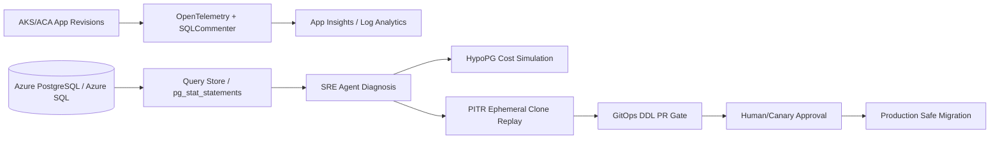
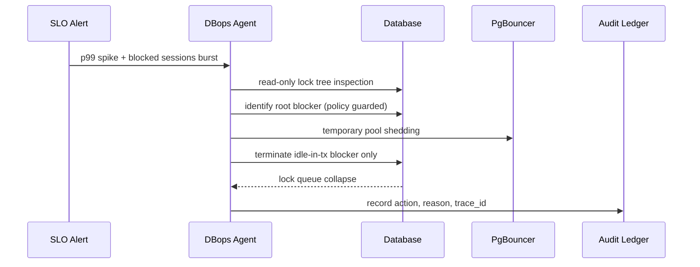

# 自治数据库 SRE / DBops 智能体选型 FAQ：Route A（HypoPG + PITR Clone 验证 + GitOps 安全 DDL）vs Route B（Azure SQL/PG 原生自动调优）vs Route C（受限在线止血 Runbook）vs Route D（高权限自治写库反模式）

> 适用对象：金融支付、交易撮合、B2B SaaS、ERP、核心账务系统的 Cloud & AI Solution Architect、数据库平台团队、SRE 与合规团队。
> 目标：在高并发生产库出现慢查询、计划回归、锁风暴、XID 膨胀时实现“可证明安全”的自治处置，而不是“高权限自动修复”。

## 1. 执行摘要

数据库自治的首要原则是：**先诊断与止血，再变更结构；先可回放证明，再生产放行**。

在 Azure 数据平台中，建议采用三层组合：

1. **Route C 先止血**：在线锁风暴与连接池拥塞优先通过受限 runbook 将 MTTR 压到秒级。
2. **Route B 稳态回归防护**：利用托管引擎内置计划回滚/自动调优能力快速抑制回归。
3. **Route A 结构性修复**：在虚拟索引 + 克隆回放 + GitOps 审核后再执行安全 DDL。

禁止 Route D：禁止自治 Agent 持有 `rds_superuser / azure_pg_admin / db_owner` 后直接在生产执行阻塞 DDL 或破坏性写操作。

## 2. 问题定义与架构边界

典型故障模式：

- ORM 漏索引导致某热点查询 CPU 飙升与缓存命中下降；
- 计划翻转（参数嗅探/统计过期）导致 P99 延迟倍增；
- 一个长事务 + 一个 DDL 等锁，形成锁队列放大；
- `autovacuum` 落后，XID 接近回绕风险；
- 数据库侧告警与应用发布版本断裂，难以快速归因。

本指南覆盖：

- Azure Database for PostgreSQL Flexible Server
- Azure SQL Database / Managed Instance
- Cosmos DB（作为邻接状态平面与限流缓冲协同）

## 3. 四条路线定义

### Route A：SRE Agent + 假想索引 + 克隆回放 + GitOps 安全 DDL

关键链路：

- `pg_stat_statements` / Query Store 诊断慢 SQL 根因；
- `HypoPG` 先做虚拟索引成本评估；
- 在 PITR 克隆上执行真实计划与 buffer hit 验证；
- 通过 Atlas/Flyway/Liquibase 生成 PR 并强制安全规则；
- 仅在人工/金丝雀审批后进入生产。

### Route B：托管引擎原生自动调优

典型能力：

- Azure SQL `FORCE_LAST_GOOD_PLAN`
- PostgreSQL Index Tuning Advisor
- 托管 `PgBouncer` 连接治理

优点：最小外部写权限与快速回归抑制。
限制：无法修复应用层 N+1、跨服务 schema 规范与灰度流程。

### Route C：受限在线止血 Runbook

策略：

- 诊断身份只读（`pg_read_all_stats`）；
- 止血身份仅允许 `pg_signal_backend` 类受限动作；
- 明确禁止 `DROP / TRUNCATE / ALTER / VACUUM FULL`；
- 通过连接池剪切、阻塞树根节点处置、弹性上限兜底快速恢复。

### Route D：高权限自治写库反模式

反模式行为：

- 生产直接 `CREATE INDEX`（非并发）
- 在线 `VACUUM FULL`
- 临时 ad-hoc `UPDATE/DELETE`

这类行为在高峰期极易把“局部异常”放大成“全站阻塞”。

## 4. 12 维比较矩阵

| 维度 | Route A | Route B | Route C | Route D |
|---|---|---|---|---|
| 诊断深度 | 高 | 中 | 中高 | 低 |
| 在线止血时延 | 中 | 高 | 很高 | 不可控 |
| 结构修复能力 | 高 | 中 | 低 | 表面高 |
| 锁风险可控性 | 高 | 中高 | 高 | 低 |
| 权限最小化 | 中高 | 高 | 很高 | 低 |
| 变更审计完整性 | 高 | 中 | 高 | 低 |
| 回滚可预测性 | 高 | 中 | 中高 | 低 |
| 应用归因闭环 | 高 | 中 | 中 | 低 |
| 运维复杂度 | 中高 | 低 | 中 | 高 |
| 可复制治理模式 | 高 | 中 | 高 | 低 |
| 三年 TCO 稳定性 | 中高 | 高 | 中高 | 低 |
| 监管可解释性 | 高 | 中高 | 高 | 低 |

## 5. 定量问题 Q1..Q6

### Q1：为什么一个 4 秒等待中的 DDL 会冻结 5000 TPS？

锁队列放大可近似表示为：

`Q_blocked(t) ≈ TPS_write × T_wait + Q_existing`

若 `TPS_write = 5000`，`T_wait = 4s`，理论上可形成 `~20,000` 个等待写请求。
因此必须执行：

- `SET lock_timeout = '1500ms'`（或更严格）
- 重试 + 抖动退避
- 禁止高峰窗口执行潜在重锁 DDL

### Q2：HypoPG 成本估算为何不能替代克隆回放？

HypoPG 可给出“假想索引后的 planner 成本变化”，但无法覆盖：

- 实际 buffer 命中变化
- I/O 抖动与并发干扰
- 真实数据分布偏斜

因此应以双阶段验证：

1. 成本筛选：`C_after / C_before <= 0.30` 作为候选阈值。
2. 克隆回放：在 PITR 克隆上验证执行时间与缓存行为。

### Q3：新增第 7 个二级索引为何可能拖慢写入？

写放大近似：

`ΔW_idx = W_after - W_before`

其中每次写入要额外维护索引页，且可能降低 HOT 更新概率。
当写密集表新增多个索引后，读延迟下降未必抵消写入吞吐损失。
因此需要在克隆环境评估“读收益 vs 写代价”的净效果。

### Q4：如何安全识别并终止锁树 root blocker？

关键原则：

- 终止根阻塞者，而非受害者查询；
- 绝不终止 `autovacuum` wraparound worker 或复制关键进程；
- 终止前记录 SQL、会话标签、租户、trace_id、变更窗口信息。

可依赖：

- PostgreSQL：`pg_blocking_pids()`
- Azure SQL：`sys.dm_exec_requests` / `sys.dm_tran_locks`

### Q5：如何把 DB 延迟尖峰关联到具体应用发布版本？

通过 `SQLCommenter` + OTel：

- SQL 注入 `service`, `revision`, `trace_id` 标签；
- 在 Application Insights / Log Analytics 联合查询中还原：
  - 发布时间线
  - SQL 指纹变化
  - P99 延迟与错误率变化

这样可快速判定“先回滚应用还是先调数据库”。

### Q6：为什么要拆分诊断身份与止血身份？

推荐双身份：

1. **长期只读诊断身份**：仅查统计与执行计划。
2. **JIT 止血身份**：短时授权，可执行受限 kill/runbook。

收益：

- 降低长期凭据风险面；
- 满足最小权限与审计可追溯；
- 防止诊断工具被滥用为写库入口。

## 6. 参考架构图（Mermaid 图 1）



## 7. 锁风暴在线止血流程（Mermaid 图 2）



## 8. 生产代码示例 1（PostgreSQL 最小权限与安全终止函数）

```sql
-- 只读诊断角色
CREATE ROLE sre_diag_ro NOLOGIN;
GRANT pg_read_all_stats TO sre_diag_ro;

-- 止血角色（不授予 DDL 写权限）
CREATE ROLE sre_lock_breaker NOLOGIN;
GRANT pg_signal_backend TO sre_lock_breaker;

CREATE OR REPLACE FUNCTION sre_terminate_blocker(target_pid int)
RETURNS boolean
LANGUAGE plpgsql
SECURITY DEFINER
AS $$
DECLARE
    app_name text;
BEGIN
    SELECT application_name INTO app_name FROM pg_stat_activity WHERE pid = target_pid;

    IF app_name ILIKE '%autovacuum%' OR app_name ILIKE '%walreceiver%' THEN
        RAISE EXCEPTION 'protected backend cannot be terminated: %', app_name;
    END IF;

    RETURN pg_terminate_backend(target_pid);
END;
$$;
```

## 9. 生产代码示例 2（HypoPG + 安全 DDL Linter Gate）

```python
import re

SAFE_LOCK_TIMEOUT = "1500ms"

def lint_migration(sql_text: str) -> list[str]:
    issues = []
    lowered = sql_text.lower()

    if "create index" in lowered and "concurrently" not in lowered:
        issues.append("CREATE INDEX must use CONCURRENTLY in production path")
    if "lock_timeout" not in lowered:
        issues.append("Migration must set lock_timeout")
    if re.search(r"\b(vacuum\s+full|truncate|drop\s+table)\b", lowered):
        issues.append("Destructive or blocking operation is forbidden")
    return issues

def hypopg_gate(cost_before: float, cost_after: float) -> bool:
    return cost_after / max(cost_before, 1e-9) <= 0.30
```

## 10. 企业场景 A：金融支付账本高峰锁风暴

背景：

- 周五晚高峰支付流量上升；
- 新发布引入漏索引查询，连接数暴涨；
- 单个长事务触发锁队列扩散。

实施：

- Route C 在 `<40s` 内止血（定位 root blocker + 连接池剪切）；
- Route A 在克隆回放确认后生成安全 DDL PR；
- 应用侧按 trace 关联回滚并修复 ORM 查询。

结果：

- MTTR 从 `35 min` 降到 `< 40 s`；
- 无需生产直接阻塞 DDL。

## 11. 企业场景 B：多租户 ERP 的计划回归治理

背景：

- Azure SQL Elastic Pool 多租户共享资源；
- 某版本发布后多个租户出现 plan regression；
- 需要兼顾快速恢复与后续结构优化。

实施：

- Route B 先 `FORCE_LAST_GOOD_PLAN` 抑制回归；
- 通过 SQLCommenter 关联到具体服务 revision；
- Route A 在治理窗口推进 schema 优化 PR。

收益：

- 快速恢复租户体验；
- 变更治理留痕完整。

## 12. 三年 TCO 对比（示例）

| 路线 | 年平台成本 | 年治理运维 | 三年总计 | 说明 |
|---|---:|---:|---:|---|
| Route A | `$680k` | `$260k` | `$2.82M` | 结构修复能力强，治理投入中高 |
| Route B | `$420k` | `$150k` | `$1.71M` | 托管能力成熟，成本可预测 |
| Route C | `$510k` | `$210k` | `$2.16M` | 事故止血价值高 |
| Route D | `$300k` | `$580k` | `$2.64M` | 事故与回滚成本吞噬“省钱” |

## 13. Day-0 / Day-1 / Day-2 落地清单

### Day-0（制度与边界）

- 定义禁止操作清单与受保护后台进程清单；
- 设计双身份权限模型（诊断 vs 止血）；
- 建立 SQLCommenter 与 OTel 统一追踪规范；
- 明确 schema 变更必须 PR 化与审核路径。

### Day-1（工程接入）

- 接入 Query Store/`pg_stat_statements` 根因模型；
- 部署锁树分析与止血 runbook；
- 上线 DDL linter gate 与克隆回放验证；
- 建立发布版本到 SQL 指纹的关联看板。

### Day-2（持续优化）

- 周期复盘误判/漏判案例；
- 调整阈值与终止策略白名单；
- 对高风险表开展索引组合与写放大回归评测；
- 输出审计日报与月度治理 KPI。

## 14. Good fit vs Not for

### Good fit

- 高并发 OLTP、严格 SLO、变更频繁业务；
- 有 DB 平台团队与发布治理流程；
- 需要可追责的自治运维闭环。

### Not for

- 缺乏最小权限与审计机制；
- 允许生产直接临时 DDL 的组织文化；
- 无法维护克隆回放与变更评审流程。

## 15. 结论与推荐路径

最稳健的 Azure DB 自治策略不是“让 Agent 自动改库”，而是：

- **Route C** 快速止血保可用；
- **Route B** 托管调优控回归；

- **Route A** 以克隆证据与 GitOps PR 推进结构性修复。

在此模型中，自治能力与合规能力同步增长：系统能在秒级恢复、小时级修复、周级固化。

### 15.1 监管与审计证据建议

- 事件级：每次止血动作记录 `who/why/what/trace_id`。
- 发布级：每次 schema PR 记录验证证据与审批链。
- 月度级：输出 MTTR、误杀率、阻塞恢复成功率与跨团队协作效率。

### 15.2 关键治理指标（建议）

| 指标 | 目标 |
|---|---:|
| 锁风暴止血 MTTR | `< 45s` |
| 阻塞根因识别准确率 | `>= 98%` |
| 非安全 DDL 拦截率 | `= 100%` |
| 生产高权限自治写入次数 | `= 0` |

### 15.3 决策树（简版）

1. 需要秒级恢复可用性？先 Route C。
2. 主要是计划回归且希望最小外部权限？叠加 Route B。
3. 需要索引/Schema 结构修复？采用 Route A 的“假想 + 克隆 + PR”闭环。
4. 想让 Agent 直接高权限改生产？判定为 Route D 反模式并拒绝。

### 15.4 控制目标与技术控制映射（审计模板）

| 控制目标 | 控制点 | 自动化校验 |
|---|---|---|
| 阻塞 DDL 不进入生产 | DDL Linter 强制 `CONCURRENTLY` + `lock_timeout` | CI PR gate |
| 自治止血不误杀系统会话 | 受保护会话白名单（`autovacuum`/复制） | Runbook pre-check |
| 结构修复必须有证据 | HypoPG 成本门槛 + 克隆回放 | PR 附件校验 |
| 应用与 DB 根因可关联 | SQLCommenter + OTel trace 贯通 | 观测查询规则 |
| 长期凭据最小化 | 诊断身份常驻只读，止血身份 JIT | IAM 周期审计 |

建议将该映射纳入平台控制目录，作为季度内控复核的固定检查项。

### 15.5 失败模式复盘手册（建议）

常见失败模式与应对：

1. **止血动作执行成功但延迟未恢复**
   根因往往在连接池饱和未解除或应用重试风暴；应联动限流与发布回滚。
2. **HypoPG 显示收益但生产效果一般**
   可能是数据分布与并发条件差异，需要补做克隆回放与参数敏感性测试。
3. **误终止业务关键会话**
   多出现在策略白名单不完整，应通过会话标签规范 + 保护清单迭代降低误杀。
4. **自动调优与手工变更冲突**
   需要统一“引擎自动策略与 GitOps 策略”优先级，避免双写治理冲突。

### 15.6 监管问询答复要点

**问：你们如何保证自治 Agent 不会扩大事故？**
答：通过最小权限双身份、受保护会话不可终止规则、禁止性 DDL gate、以及每次动作前后证据留痕，实现“可控自治”。

**问：如果需要紧急修复索引，为什么不直接在线执行？**
答：生产高峰期直接变更会引入锁风险，先止血再在克隆环境验证并通过 PR 放行，可以在可用性与安全性之间取得更稳健平衡。

**问：如何证明 DB 异常由应用发布导致？**
答：通过 SQLCommenter/OTel 把查询与 revision、trace_id 绑定，联合时间线可直接定位到具体发布版本与变更窗口。

### 15.7 平台化推广建议

在集团级多业务线落地时，建议把自治 DBops 能力产品化为统一能力包：

- **策略包**：锁终止策略、受保护进程规则、DDL 安全规则版本化管理；
- **观测包**：统一查询指纹、等待事件分类、发布关联看板模板；
- **流程包**：止血工单模板、PR 审批模板、复盘模板与季度评审模板。

通过“策略-观测-流程”三件套标准化，能够避免各团队重复造轮子，同时确保审计口径一致、指标可横向比较。
