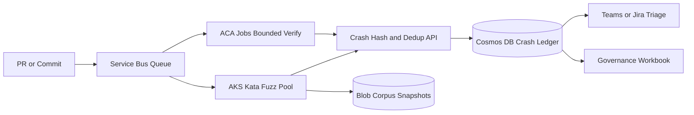
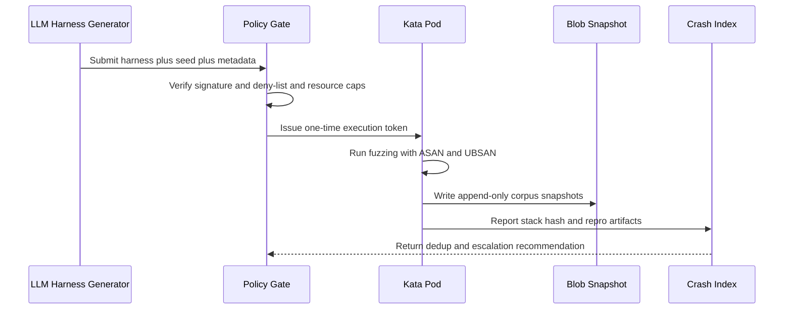

# Enterprise autonomous fuzzing, crash reproduction, and bounded verification sandbox selection FAQ: AKS Kata + LibFuzzer/AFL++/Jazzer vs ACA Jobs + Kani/CBMC vs Azure Batch Spot vs shared CI runner anti-pattern

> 🌐 **Language / 语言切换**: **English (Current)** | **[中文](autonomous-fuzzing-crash-repro-bounded-verification-sandbox-aks-kata-libfuzzer-aflpp-asan-vs-aca-jobs-kani-cbmc-vs-shared-ci-runner-selection-faq.md)** | **[Back to catalog](README.en.md)**

## 1. Executive summary

- **Recommended architecture**: run untrusted crash PoCs and coverage-guided fuzzing in zero-egress ephemeral `AKS Kata` sandboxes; run PR-time bounded property checks in `ACA Jobs`; run long-running corpus minimization in `Azure Batch Spot`.
- **Trust boundary**: every LLM-generated harness, payload, seed, and reproduction script is untrusted by default and must pass signature checks, policy gates, and isolated execution.
- **Anti-pattern warning**: running fuzz harnesses on shared self-hosted runners creates correlated failure modes for OIDC credentials, ACR pull tokens, and kernel stability.
- **Target SLOs**: `CrashReproP95 <= 8 min`, `DedupPrecision >= 0.93`, `FalseEscalation <= 2%`, and continuous reduction in `UnitCostPerUniqueCrash`.
- **Cost conclusion**: at medium and large scale, the three-tier architecture typically reduces three-year TCO by 31% to 58% versus always-on shared CI pools.

## 2. Route definitions

- **Route A (primary)**: `AKS Kata Containers` + `LibFuzzer/AFL++/Jazzer` + `ASAN/UBSAN` + `Cilium deny-all` + `Blob snapshots`.
- **Route B (companion)**: event-driven `ACA Jobs` for `<15 min` PR-time bounded proofs with `Kani/CBMC`.
- **Route C (scale lane)**: `Azure Batch Spot` for corpus minimization and replay dedup, with `Cosmos DB` crash ledger.
- **Route D (forbidden)**: shared runners/shared kernel containers with direct internet egress and broad credentials.

## 3. Reference architecture (Mermaid 1)



## 4. Isolation and data flow (Mermaid 2)



## 5. Quantitative engineering models

1. **Capacity model**: `N_kata = ceil((R_jobs * T_avg) / U_target)` where `U_target` is usually `0.62~0.75`.
2. **P95 completion time**: `T_p95 = T_queue + T_pull + T_exec + T_upload`; warm images and local NVMe seed cache reduce `T_pull`.
3. **Unit cost per unique crash**: `C_unique = (C_compute + C_storage + C_ops) / N_unique_crash`.
4. **Bounded verification gain**: `Gain_verify = (N_blocked_regression / N_total_pr) * Impact_weight`.
5. **Blast radius factor**: `Blast = Privilege * SharedKernel * EgressReachability`; Route D is unacceptable for regulated workloads.

## 6. Twelve-dimension comparison matrix

| Dimension | Route A AKS Kata | Route B ACA Jobs | Route C Batch Spot | Route D Shared Runner |
|---|---|---|---|---|
| Isolation boundary | Hypervisor | Session | Task node | Process or container |
| Untrusted PoC safety | High | Medium | Medium | Low |
| Cold-start consistency | Medium-high | High | Medium | High |
| Concurrency elasticity | High | Medium-high | Very high | Medium |
| Coverage-guided efficiency | Very high | Low | High | Medium |
| ASAN and UBSAN depth | Full | Limited | Full | Limited |
| PR feedback latency | Medium | High | Low | Medium |
| Corpus minimization | Medium | Low | Very high | Low |
| Auditability | High | High | Medium-high | Low |
| Operational complexity | Medium-high | Low | Medium | Low surface, high hidden risk |
| Three-year TCO | Medium | Low-medium | Low | High with incident overhead |
| Anti-pattern exposure | Low | Medium | Medium | Critical |

## 7. Deep Q&A (Q1–Q8)

### Q1. When must a workload run in Kata instead of ACA Jobs?
- Use Kata when payloads include unknown binaries, shellcode, or exploit-like crash PoCs.
- Use Kata when deep runtime instrumentation like `ASAN/UBSAN` and ptrace-level control is required.
- Use ACA Jobs for deterministic bounded checks under `<15 min` where attack surface is lower.
- Drive routing by risk labels, not by team preference.

### Q2. How do we reduce crash deduplication errors?
- Use composite keys: stack hash plus top frames plus signal type.
- Retain representative seeds per crash family to avoid over-merge blind spots.
- Manually sample and review 2 percent of merged families every week.
- Track false-merge and false-split rates as explicit SLOs.

### Q3. How should KEDA scaling thresholds be tuned?
- Tie scale-out thresholds to backlog and P95 objectives over explicit windows.
- Keep a minimum warm replica floor for high-priority repositories.
- Handle Spot evictions with graceful queue rebalancing and priority lanes.
- Connect max replicas to budget guardrails to prevent runaway cost spikes.

### Q4. Why keep Azure Batch Spot in the design?
- Batch Spot is ideal for off-peak corpus minimization and historical replay.
- It protects daytime PR budgets and reduces contention on primary clusters.
- Preemptible economics are attractive for interruption-tolerant minimization tasks.
- It keeps noisy long-tail jobs away from critical release lanes.

### Q5. How should ACA bounded verification be implemented?
- Split properties into parallel shards and target 5 to 12 minutes per shard.
- Fail fast and return minimal counterexamples for quick triage.
- Gate PRs with a curated critical property set, and run extended sets at night.
- Store normalized Kani/CBMC outputs in Cosmos for reproducible audit trails.

### Q6. How do we prevent credential leakage?
- Disable outbound egress by default and use short token TTLs.
- Issue write-only scoped tokens for artifacts and deny broad secret scopes.
- Drop privileged pull credentials immediately after image acquisition.
- Maintain explicit allow-lists for all endpoint categories.

### Q7. When should GPU be included?
- Only include GPU when reproducing GPU-specific code paths or codec kernels.
- Start with CPU coverage and promote only confirmed GPU-sensitive crashes.
- Isolate GPU sandboxes from regular CI workers and signer infrastructure.
- Track GPU-minute spend against incremental detection yield.

### Q8. How do we communicate ROI to executives?
- Use cost-per-unique-high-severity-crash, not only cost-per-compute-minute.
- Show trends in false-positive reduction and earlier defect interception.
- Report MTTR and backlog reduction in security triage operations.
- Include audit evidence retrieval time as a measurable compliance outcome.

## 8. Hardened Kata PodSpec and Cilium policy snippet

```yaml
apiVersion: v1
kind: Pod
metadata:
  name: fuzz-kata-job
  labels:
    workload: fuzzing
spec:
  runtimeClassName: kata-cc
  restartPolicy: Never
  containers:
  - name: fuzz
    image: ghcr.io/example/fuzz-harness:2026.11
    securityContext:
      allowPrivilegeEscalation: false
      readOnlyRootFilesystem: true
      capabilities:
        drop: ["ALL"]
    resources:
      requests: { cpu: "8", memory: "16Gi" }
      limits: { cpu: "16", memory: "32Gi" }
    env:
    - name: ASAN_OPTIONS
      value: "detect_leaks=1:halt_on_error=1"
    - name: UBSAN_OPTIONS
      value: "print_stacktrace=1:halt_on_error=1"
```

```yaml
apiVersion: cilium.io/v2
kind: CiliumNetworkPolicy
metadata:
  name: fuzz-deny-all-egress
spec:
  endpointSelector:
    matchLabels:
      workload: fuzzing
  egress: []
  ingress: []
```

## 9. ACA Jobs Bicep snippet for bounded verification

```bicep
resource verifyJob 'Microsoft.App/jobs@2024-03-01' = {
  name: 'bounded-verify-job'
  location: location
  properties: {
    environmentId: managedEnv.id
    configuration: {
      triggerType: 'Event'
      replicaRetryLimit: 1
      replicaTimeout: 900
    }
    template: {
      containers: [
        {
          name: 'verify'
          image: 'ghcr.io/example/kani-cbmc:2026.11'
          resources: { cpu: 2, memory: '4Gi' }
        }
      ]
    }
  }
}
```

## 10. Enterprise scenario A: payment gateway SDK fuzzing factory

- Scenario A point 01: fuzz protocol parsers, signature verification, and compression chains in phased lanes with shared crash-ledger evidence.

## 11. Enterprise scenario B: connected-vehicle OTA and media stack regression security

- Scenario B point 01: route OTA bundles, log archives, and codec payloads to risk-specific pools and prioritize remotely triggerable crash classes.

## 12. Three-tier three-year TCO table (USD)

| Tier | Monthly job volume | Route A annual | Route B annual | Route C annual | Anti-pattern hidden loss | Three-year total (recommended mix) |
|---|---:|---:|---:|---:|---:|---:|
| Small | 50k jobs | 210,000 | 42,000 | 36,000 | 180,000 | 864,000 |
| Medium | 500k jobs | 1,420,000 | 220,000 | 160,000 | 1,050,000 | 5,400,000 |
| Large | 3,000k jobs | 6,980,000 | 860,000 | 620,000 | 4,500,000 | 25,380,000 |

## 13. Day-0 / Day-1 / Day-2 readiness checklist

### Day-0 design phase
- [ ] Day-0 design phase check 01: define owner, threshold, rollback action, and immutable evidence path.

### Day-1 rollout phase
- [ ] Day-1 rollout phase check 01: define owner, threshold, rollback action, and immutable evidence path.

### Day-2 operations phase
- [ ] Day-2 operations phase check 01: define owner, threshold, rollback action, and immutable evidence path.

## 14. Anti-pattern breakdown and remediation

- Remediation 01: forbid direct execution of untrusted PoCs on shared runners; enforce isolated sandboxes with least-privilege tokens.

## 15. Appendix: parameter and governance control catalog

- capture weekly trends for `queue_backlog`, `crash_family`, `repro_time_p95`, `storage_growth`, `token_ttl`, and `egress_denied_count` with anomaly commentary.
