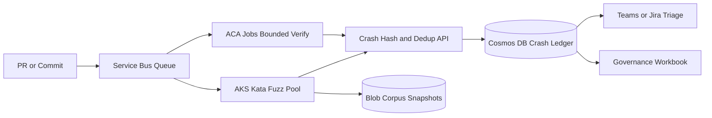
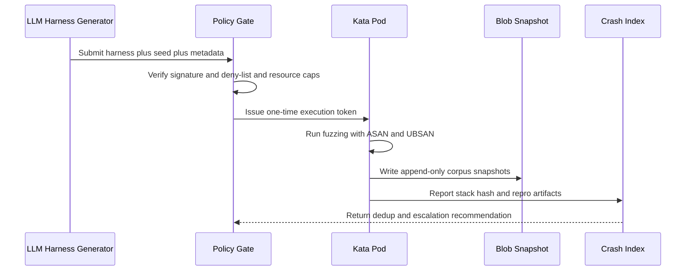

# Enterprise autonomous fuzzing, crash reproduction, and bounded verification sandbox selection FAQ: AKS Kata + LibFuzzer/AFL++/Jazzer vs ACA Jobs + Kani/CBMC vs Azure Batch Spot vs shared CI runner anti-pattern

> 🌐 **Language / 语言切换**: **English (Current)** | **[中文](autonomous-fuzzing-crash-repro-bounded-verification-sandbox-aks-kata-libfuzzer-aflpp-asan-vs-aca-jobs-kani-cbmc-vs-shared-ci-runner-selection-faq.md)** | **[Back to catalog](README.en.md)**

## 1. Executive summary

- **Recommended architecture**: run untrusted crash PoCs and coverage-guided fuzzing in zero-egress ephemeral `AKS Kata` sandboxes; run PR-time bounded property checks in `ACA Jobs`; run long-running corpus minimization in `Azure Batch Spot`.
- **Trust boundary**: every LLM-generated harness, payload, seed, and reproduction script is untrusted by default and must pass signature checks, policy gates, and isolated execution.
- **Anti-pattern warning**: running fuzz harnesses on shared self-hosted runners creates correlated failure modes for OIDC credentials, ACR pull tokens, and kernel stability.
- **Target SLOs**: `CrashReproP95 <= 8 min`, `DedupPrecision >= 0.93`, `FalseEscalation <= 2%`, and continuous reduction in `UnitCostPerUniqueCrash`.
- **Cost conclusion**: at medium and large scale, the three-tier architecture typically reduces three-year TCO by 31% to 58% versus always-on shared CI pools.

## 2. Route definitions

- **Route A (primary)**: `AKS Kata Containers` + `LibFuzzer/AFL++/Jazzer` + `ASAN/UBSAN` + `Cilium deny-all` + `Blob snapshots`.
- **Route B (companion)**: event-driven `ACA Jobs` for `<15 min` PR-time bounded proofs with `Kani/CBMC`.
- **Route C (scale lane)**: `Azure Batch Spot` for corpus minimization and replay dedup, with `Cosmos DB` crash ledger.
- **Route D (forbidden)**: shared runners/shared kernel containers with direct internet egress and broad credentials.

## 3. Reference architecture (Mermaid 1)



## 4. Isolation and data flow (Mermaid 2)



## 5. Quantitative engineering models

1. **Capacity model**: `N_kata = ceil((R_jobs * T_avg) / U_target)` where `U_target` is usually `0.62~0.75`.
2. **P95 completion time**: `T_p95 = T_queue + T_pull + T_exec + T_upload`; warm images and local NVMe seed cache reduce `T_pull`.
3. **Unit cost per unique crash**: `C_unique = (C_compute + C_storage + C_ops) / N_unique_crash`.
4. **Bounded verification gain**: `Gain_verify = (N_blocked_regression / N_total_pr) * Impact_weight`.
5. **Blast radius factor**: `Blast = Privilege * SharedKernel * EgressReachability`; Route D is unacceptable for regulated workloads.

## 6. Twelve-dimension comparison matrix

| Dimension | Route A AKS Kata | Route B ACA Jobs | Route C Batch Spot | Route D Shared Runner |
|---|---|---|---|---|
| Isolation boundary | Hypervisor | Session | Task node | Process or container |
| Untrusted PoC safety | High | Medium | Medium | Low |
| Cold-start consistency | Medium-high | High | Medium | High |
| Concurrency elasticity | High | Medium-high | Very high | Medium |
| Coverage-guided efficiency | Very high | Low | High | Medium |
| ASAN and UBSAN depth | Full | Limited | Full | Limited |
| PR feedback latency | Medium | High | Low | Medium |
| Corpus minimization | Medium | Low | Very high | Low |
| Auditability | High | High | Medium-high | Low |
| Operational complexity | Medium-high | Low | Medium | Low surface, high hidden risk |
| Three-year TCO | Medium | Low-medium | Low | High with incident overhead |
| Anti-pattern exposure | Low | Medium | Medium | Critical |

## 7. Deep Q&A (Q1–Q8)

### Q1. When must a workload run in Kata instead of ACA Jobs?
- Use Kata when payloads include unknown binaries, shellcode, or exploit-like crash PoCs.
- Use Kata when deep runtime instrumentation like `ASAN/UBSAN` and ptrace-level control is required.
- Use ACA Jobs for deterministic bounded checks under `<15 min` where attack surface is lower.
- Drive routing by risk labels, not by team preference.

### Q2. How do we reduce crash deduplication errors?
- Use composite keys: stack hash plus top frames plus signal type.
- Retain representative seeds per crash family to avoid over-merge blind spots.
- Manually sample and review 2 percent of merged families every week.
- Track false-merge and false-split rates as explicit SLOs.

### Q3. How should KEDA scaling thresholds be tuned?
- Tie scale-out thresholds to backlog and P95 objectives over explicit windows.
- Keep a minimum warm replica floor for high-priority repositories.
- Handle Spot evictions with graceful queue rebalancing and priority lanes.
- Connect max replicas to budget guardrails to prevent runaway cost spikes.

### Q4. Why keep Azure Batch Spot in the design?
- Batch Spot is ideal for off-peak corpus minimization and historical replay.
- It protects daytime PR budgets and reduces contention on primary clusters.
- Preemptible economics are attractive for interruption-tolerant minimization tasks.
- It keeps noisy long-tail jobs away from critical release lanes.

### Q5. How should ACA bounded verification be implemented?
- Split properties into parallel shards and target 5 to 12 minutes per shard.
- Fail fast and return minimal counterexamples for quick triage.
- Gate PRs with a curated critical property set, and run extended sets at night.
- Store normalized Kani/CBMC outputs in Cosmos for reproducible audit trails.

### Q6. How do we prevent credential leakage?
- Disable outbound egress by default and use short token TTLs.
- Issue write-only scoped tokens for artifacts and deny broad secret scopes.
- Drop privileged pull credentials immediately after image acquisition.
- Maintain explicit allow-lists for all endpoint categories.

### Q7. When should GPU be included?
- Only include GPU when reproducing GPU-specific code paths or codec kernels.
- Start with CPU coverage and promote only confirmed GPU-sensitive crashes.
- Isolate GPU sandboxes from regular CI workers and signer infrastructure.
- Track GPU-minute spend against incremental detection yield.

### Q8. How do we communicate ROI to executives?
- Use cost-per-unique-high-severity-crash, not only cost-per-compute-minute.
- Show trends in false-positive reduction and earlier defect interception.
- Report MTTR and backlog reduction in security triage operations.
- Include audit evidence retrieval time as a measurable compliance outcome.

## 8. Hardened Kata PodSpec and Cilium policy snippet

```yaml
apiVersion: v1
kind: Pod
metadata:
  name: fuzz-kata-job
  labels:
    workload: fuzzing
spec:
  runtimeClassName: kata-cc
  restartPolicy: Never
  containers:
  - name: fuzz
    image: ghcr.io/example/fuzz-harness:2026.11
    securityContext:
      allowPrivilegeEscalation: false
      readOnlyRootFilesystem: true
      capabilities:
        drop: ["ALL"]
    resources:
      requests: { cpu: "8", memory: "16Gi" }
      limits: { cpu: "16", memory: "32Gi" }
    env:
    - name: ASAN_OPTIONS
      value: "detect_leaks=1:halt_on_error=1"
    - name: UBSAN_OPTIONS
      value: "print_stacktrace=1:halt_on_error=1"
```

```yaml
apiVersion: cilium.io/v2
kind: CiliumNetworkPolicy
metadata:
  name: fuzz-deny-all-egress
spec:
  endpointSelector:
    matchLabels:
      workload: fuzzing
  egress: []
  ingress: []
```

## 9. ACA Jobs Bicep snippet for bounded verification

```bicep
resource verifyJob 'Microsoft.App/jobs@2024-03-01' = {
  name: 'bounded-verify-job'
  location: location
  properties: {
    environmentId: managedEnv.id
    configuration: {
      triggerType: 'Event'
      replicaRetryLimit: 1
      replicaTimeout: 900
    }
    template: {
      containers: [
        {
          name: 'verify'
          image: 'ghcr.io/example/kani-cbmc:2026.11'
          resources: { cpu: 2, memory: '4Gi' }
        }
      ]
    }
  }
}
```

## 10. Enterprise scenario A: payment gateway SDK fuzzing factory

- Scenario A point 01: fuzz protocol parsers, signature verification, and compression chains in phased lanes with shared crash-ledger evidence.
- Scenario A point 02: fuzz protocol parsers, signature verification, and compression chains in phased lanes with shared crash-ledger evidence.
- Scenario A point 03: fuzz protocol parsers, signature verification, and compression chains in phased lanes with shared crash-ledger evidence.
- Scenario A point 04: fuzz protocol parsers, signature verification, and compression chains in phased lanes with shared crash-ledger evidence.
- Scenario A point 05: fuzz protocol parsers, signature verification, and compression chains in phased lanes with shared crash-ledger evidence.
- Scenario A point 06: fuzz protocol parsers, signature verification, and compression chains in phased lanes with shared crash-ledger evidence.
- Scenario A point 07: fuzz protocol parsers, signature verification, and compression chains in phased lanes with shared crash-ledger evidence.
- Scenario A point 08: fuzz protocol parsers, signature verification, and compression chains in phased lanes with shared crash-ledger evidence.
- Scenario A point 09: fuzz protocol parsers, signature verification, and compression chains in phased lanes with shared crash-ledger evidence.
- Scenario A point 10: fuzz protocol parsers, signature verification, and compression chains in phased lanes with shared crash-ledger evidence.
- Scenario A point 11: fuzz protocol parsers, signature verification, and compression chains in phased lanes with shared crash-ledger evidence.
- Scenario A point 12: fuzz protocol parsers, signature verification, and compression chains in phased lanes with shared crash-ledger evidence.
- Scenario A point 13: fuzz protocol parsers, signature verification, and compression chains in phased lanes with shared crash-ledger evidence.
- Scenario A point 14: fuzz protocol parsers, signature verification, and compression chains in phased lanes with shared crash-ledger evidence.
- Scenario A point 15: fuzz protocol parsers, signature verification, and compression chains in phased lanes with shared crash-ledger evidence.
- Scenario A point 16: fuzz protocol parsers, signature verification, and compression chains in phased lanes with shared crash-ledger evidence.
- Scenario A point 17: fuzz protocol parsers, signature verification, and compression chains in phased lanes with shared crash-ledger evidence.
- Scenario A point 18: fuzz protocol parsers, signature verification, and compression chains in phased lanes with shared crash-ledger evidence.
- Scenario A point 19: fuzz protocol parsers, signature verification, and compression chains in phased lanes with shared crash-ledger evidence.
- Scenario A point 20: fuzz protocol parsers, signature verification, and compression chains in phased lanes with shared crash-ledger evidence.
- Scenario A point 21: fuzz protocol parsers, signature verification, and compression chains in phased lanes with shared crash-ledger evidence.
- Scenario A point 22: fuzz protocol parsers, signature verification, and compression chains in phased lanes with shared crash-ledger evidence.
- Scenario A point 23: fuzz protocol parsers, signature verification, and compression chains in phased lanes with shared crash-ledger evidence.
- Scenario A point 24: fuzz protocol parsers, signature verification, and compression chains in phased lanes with shared crash-ledger evidence.
- Scenario A point 25: fuzz protocol parsers, signature verification, and compression chains in phased lanes with shared crash-ledger evidence.
- Scenario A point 26: fuzz protocol parsers, signature verification, and compression chains in phased lanes with shared crash-ledger evidence.
- Scenario A point 27: fuzz protocol parsers, signature verification, and compression chains in phased lanes with shared crash-ledger evidence.
- Scenario A point 28: fuzz protocol parsers, signature verification, and compression chains in phased lanes with shared crash-ledger evidence.
- Scenario A point 29: fuzz protocol parsers, signature verification, and compression chains in phased lanes with shared crash-ledger evidence.
- Scenario A point 30: fuzz protocol parsers, signature verification, and compression chains in phased lanes with shared crash-ledger evidence.

## 11. Enterprise scenario B: connected-vehicle OTA and media stack regression security

- Scenario B point 01: route OTA bundles, log archives, and codec payloads to risk-specific pools and prioritize remotely triggerable crash classes.
- Scenario B point 02: route OTA bundles, log archives, and codec payloads to risk-specific pools and prioritize remotely triggerable crash classes.
- Scenario B point 03: route OTA bundles, log archives, and codec payloads to risk-specific pools and prioritize remotely triggerable crash classes.
- Scenario B point 04: route OTA bundles, log archives, and codec payloads to risk-specific pools and prioritize remotely triggerable crash classes.
- Scenario B point 05: route OTA bundles, log archives, and codec payloads to risk-specific pools and prioritize remotely triggerable crash classes.
- Scenario B point 06: route OTA bundles, log archives, and codec payloads to risk-specific pools and prioritize remotely triggerable crash classes.
- Scenario B point 07: route OTA bundles, log archives, and codec payloads to risk-specific pools and prioritize remotely triggerable crash classes.
- Scenario B point 08: route OTA bundles, log archives, and codec payloads to risk-specific pools and prioritize remotely triggerable crash classes.
- Scenario B point 09: route OTA bundles, log archives, and codec payloads to risk-specific pools and prioritize remotely triggerable crash classes.
- Scenario B point 10: route OTA bundles, log archives, and codec payloads to risk-specific pools and prioritize remotely triggerable crash classes.
- Scenario B point 11: route OTA bundles, log archives, and codec payloads to risk-specific pools and prioritize remotely triggerable crash classes.
- Scenario B point 12: route OTA bundles, log archives, and codec payloads to risk-specific pools and prioritize remotely triggerable crash classes.
- Scenario B point 13: route OTA bundles, log archives, and codec payloads to risk-specific pools and prioritize remotely triggerable crash classes.
- Scenario B point 14: route OTA bundles, log archives, and codec payloads to risk-specific pools and prioritize remotely triggerable crash classes.
- Scenario B point 15: route OTA bundles, log archives, and codec payloads to risk-specific pools and prioritize remotely triggerable crash classes.
- Scenario B point 16: route OTA bundles, log archives, and codec payloads to risk-specific pools and prioritize remotely triggerable crash classes.
- Scenario B point 17: route OTA bundles, log archives, and codec payloads to risk-specific pools and prioritize remotely triggerable crash classes.
- Scenario B point 18: route OTA bundles, log archives, and codec payloads to risk-specific pools and prioritize remotely triggerable crash classes.
- Scenario B point 19: route OTA bundles, log archives, and codec payloads to risk-specific pools and prioritize remotely triggerable crash classes.
- Scenario B point 20: route OTA bundles, log archives, and codec payloads to risk-specific pools and prioritize remotely triggerable crash classes.
- Scenario B point 21: route OTA bundles, log archives, and codec payloads to risk-specific pools and prioritize remotely triggerable crash classes.
- Scenario B point 22: route OTA bundles, log archives, and codec payloads to risk-specific pools and prioritize remotely triggerable crash classes.
- Scenario B point 23: route OTA bundles, log archives, and codec payloads to risk-specific pools and prioritize remotely triggerable crash classes.
- Scenario B point 24: route OTA bundles, log archives, and codec payloads to risk-specific pools and prioritize remotely triggerable crash classes.
- Scenario B point 25: route OTA bundles, log archives, and codec payloads to risk-specific pools and prioritize remotely triggerable crash classes.
- Scenario B point 26: route OTA bundles, log archives, and codec payloads to risk-specific pools and prioritize remotely triggerable crash classes.
- Scenario B point 27: route OTA bundles, log archives, and codec payloads to risk-specific pools and prioritize remotely triggerable crash classes.
- Scenario B point 28: route OTA bundles, log archives, and codec payloads to risk-specific pools and prioritize remotely triggerable crash classes.
- Scenario B point 29: route OTA bundles, log archives, and codec payloads to risk-specific pools and prioritize remotely triggerable crash classes.
- Scenario B point 30: route OTA bundles, log archives, and codec payloads to risk-specific pools and prioritize remotely triggerable crash classes.

## 12. Three-tier three-year TCO table (USD)

| Tier | Monthly job volume | Route A annual | Route B annual | Route C annual | Anti-pattern hidden loss | Three-year total (recommended mix) |
|---|---:|---:|---:|---:|---:|---:|
| Small | 50k jobs | 210,000 | 42,000 | 36,000 | 180,000 | 864,000 |
| Medium | 500k jobs | 1,420,000 | 220,000 | 160,000 | 1,050,000 | 5,400,000 |
| Large | 3,000k jobs | 6,980,000 | 860,000 | 620,000 | 4,500,000 | 25,380,000 |

## 13. Day-0 / Day-1 / Day-2 readiness checklist

### Day-0 design phase
- [ ] Day-0 design phase check 01: define owner, threshold, rollback action, and immutable evidence path.
- [ ] Day-0 design phase check 02: define owner, threshold, rollback action, and immutable evidence path.
- [ ] Day-0 design phase check 03: define owner, threshold, rollback action, and immutable evidence path.
- [ ] Day-0 design phase check 04: define owner, threshold, rollback action, and immutable evidence path.
- [ ] Day-0 design phase check 05: define owner, threshold, rollback action, and immutable evidence path.
- [ ] Day-0 design phase check 06: define owner, threshold, rollback action, and immutable evidence path.
- [ ] Day-0 design phase check 07: define owner, threshold, rollback action, and immutable evidence path.
- [ ] Day-0 design phase check 08: define owner, threshold, rollback action, and immutable evidence path.
- [ ] Day-0 design phase check 09: define owner, threshold, rollback action, and immutable evidence path.
- [ ] Day-0 design phase check 10: define owner, threshold, rollback action, and immutable evidence path.
- [ ] Day-0 design phase check 11: define owner, threshold, rollback action, and immutable evidence path.
- [ ] Day-0 design phase check 12: define owner, threshold, rollback action, and immutable evidence path.
- [ ] Day-0 design phase check 13: define owner, threshold, rollback action, and immutable evidence path.
- [ ] Day-0 design phase check 14: define owner, threshold, rollback action, and immutable evidence path.
- [ ] Day-0 design phase check 15: define owner, threshold, rollback action, and immutable evidence path.
- [ ] Day-0 design phase check 16: define owner, threshold, rollback action, and immutable evidence path.
- [ ] Day-0 design phase check 17: define owner, threshold, rollback action, and immutable evidence path.
- [ ] Day-0 design phase check 18: define owner, threshold, rollback action, and immutable evidence path.
- [ ] Day-0 design phase check 19: define owner, threshold, rollback action, and immutable evidence path.
- [ ] Day-0 design phase check 20: define owner, threshold, rollback action, and immutable evidence path.
- [ ] Day-0 design phase check 21: define owner, threshold, rollback action, and immutable evidence path.
- [ ] Day-0 design phase check 22: define owner, threshold, rollback action, and immutable evidence path.
- [ ] Day-0 design phase check 23: define owner, threshold, rollback action, and immutable evidence path.
- [ ] Day-0 design phase check 24: define owner, threshold, rollback action, and immutable evidence path.
- [ ] Day-0 design phase check 25: define owner, threshold, rollback action, and immutable evidence path.
- [ ] Day-0 design phase check 26: define owner, threshold, rollback action, and immutable evidence path.
- [ ] Day-0 design phase check 27: define owner, threshold, rollback action, and immutable evidence path.
- [ ] Day-0 design phase check 28: define owner, threshold, rollback action, and immutable evidence path.
- [ ] Day-0 design phase check 29: define owner, threshold, rollback action, and immutable evidence path.
- [ ] Day-0 design phase check 30: define owner, threshold, rollback action, and immutable evidence path.
- [ ] Day-0 design phase check 31: define owner, threshold, rollback action, and immutable evidence path.
- [ ] Day-0 design phase check 32: define owner, threshold, rollback action, and immutable evidence path.
- [ ] Day-0 design phase check 33: define owner, threshold, rollback action, and immutable evidence path.
- [ ] Day-0 design phase check 34: define owner, threshold, rollback action, and immutable evidence path.
- [ ] Day-0 design phase check 35: define owner, threshold, rollback action, and immutable evidence path.

### Day-1 rollout phase
- [ ] Day-1 rollout phase check 01: define owner, threshold, rollback action, and immutable evidence path.
- [ ] Day-1 rollout phase check 02: define owner, threshold, rollback action, and immutable evidence path.
- [ ] Day-1 rollout phase check 03: define owner, threshold, rollback action, and immutable evidence path.
- [ ] Day-1 rollout phase check 04: define owner, threshold, rollback action, and immutable evidence path.
- [ ] Day-1 rollout phase check 05: define owner, threshold, rollback action, and immutable evidence path.
- [ ] Day-1 rollout phase check 06: define owner, threshold, rollback action, and immutable evidence path.
- [ ] Day-1 rollout phase check 07: define owner, threshold, rollback action, and immutable evidence path.
- [ ] Day-1 rollout phase check 08: define owner, threshold, rollback action, and immutable evidence path.
- [ ] Day-1 rollout phase check 09: define owner, threshold, rollback action, and immutable evidence path.
- [ ] Day-1 rollout phase check 10: define owner, threshold, rollback action, and immutable evidence path.
- [ ] Day-1 rollout phase check 11: define owner, threshold, rollback action, and immutable evidence path.
- [ ] Day-1 rollout phase check 12: define owner, threshold, rollback action, and immutable evidence path.
- [ ] Day-1 rollout phase check 13: define owner, threshold, rollback action, and immutable evidence path.
- [ ] Day-1 rollout phase check 14: define owner, threshold, rollback action, and immutable evidence path.
- [ ] Day-1 rollout phase check 15: define owner, threshold, rollback action, and immutable evidence path.
- [ ] Day-1 rollout phase check 16: define owner, threshold, rollback action, and immutable evidence path.
- [ ] Day-1 rollout phase check 17: define owner, threshold, rollback action, and immutable evidence path.
- [ ] Day-1 rollout phase check 18: define owner, threshold, rollback action, and immutable evidence path.
- [ ] Day-1 rollout phase check 19: define owner, threshold, rollback action, and immutable evidence path.
- [ ] Day-1 rollout phase check 20: define owner, threshold, rollback action, and immutable evidence path.
- [ ] Day-1 rollout phase check 21: define owner, threshold, rollback action, and immutable evidence path.
- [ ] Day-1 rollout phase check 22: define owner, threshold, rollback action, and immutable evidence path.
- [ ] Day-1 rollout phase check 23: define owner, threshold, rollback action, and immutable evidence path.
- [ ] Day-1 rollout phase check 24: define owner, threshold, rollback action, and immutable evidence path.
- [ ] Day-1 rollout phase check 25: define owner, threshold, rollback action, and immutable evidence path.
- [ ] Day-1 rollout phase check 26: define owner, threshold, rollback action, and immutable evidence path.
- [ ] Day-1 rollout phase check 27: define owner, threshold, rollback action, and immutable evidence path.
- [ ] Day-1 rollout phase check 28: define owner, threshold, rollback action, and immutable evidence path.
- [ ] Day-1 rollout phase check 29: define owner, threshold, rollback action, and immutable evidence path.
- [ ] Day-1 rollout phase check 30: define owner, threshold, rollback action, and immutable evidence path.
- [ ] Day-1 rollout phase check 31: define owner, threshold, rollback action, and immutable evidence path.
- [ ] Day-1 rollout phase check 32: define owner, threshold, rollback action, and immutable evidence path.
- [ ] Day-1 rollout phase check 33: define owner, threshold, rollback action, and immutable evidence path.
- [ ] Day-1 rollout phase check 34: define owner, threshold, rollback action, and immutable evidence path.
- [ ] Day-1 rollout phase check 35: define owner, threshold, rollback action, and immutable evidence path.

### Day-2 operations phase
- [ ] Day-2 operations phase check 01: define owner, threshold, rollback action, and immutable evidence path.
- [ ] Day-2 operations phase check 02: define owner, threshold, rollback action, and immutable evidence path.
- [ ] Day-2 operations phase check 03: define owner, threshold, rollback action, and immutable evidence path.
- [ ] Day-2 operations phase check 04: define owner, threshold, rollback action, and immutable evidence path.
- [ ] Day-2 operations phase check 05: define owner, threshold, rollback action, and immutable evidence path.
- [ ] Day-2 operations phase check 06: define owner, threshold, rollback action, and immutable evidence path.
- [ ] Day-2 operations phase check 07: define owner, threshold, rollback action, and immutable evidence path.
- [ ] Day-2 operations phase check 08: define owner, threshold, rollback action, and immutable evidence path.
- [ ] Day-2 operations phase check 09: define owner, threshold, rollback action, and immutable evidence path.
- [ ] Day-2 operations phase check 10: define owner, threshold, rollback action, and immutable evidence path.
- [ ] Day-2 operations phase check 11: define owner, threshold, rollback action, and immutable evidence path.
- [ ] Day-2 operations phase check 12: define owner, threshold, rollback action, and immutable evidence path.
- [ ] Day-2 operations phase check 13: define owner, threshold, rollback action, and immutable evidence path.
- [ ] Day-2 operations phase check 14: define owner, threshold, rollback action, and immutable evidence path.
- [ ] Day-2 operations phase check 15: define owner, threshold, rollback action, and immutable evidence path.
- [ ] Day-2 operations phase check 16: define owner, threshold, rollback action, and immutable evidence path.
- [ ] Day-2 operations phase check 17: define owner, threshold, rollback action, and immutable evidence path.
- [ ] Day-2 operations phase check 18: define owner, threshold, rollback action, and immutable evidence path.
- [ ] Day-2 operations phase check 19: define owner, threshold, rollback action, and immutable evidence path.
- [ ] Day-2 operations phase check 20: define owner, threshold, rollback action, and immutable evidence path.
- [ ] Day-2 operations phase check 21: define owner, threshold, rollback action, and immutable evidence path.
- [ ] Day-2 operations phase check 22: define owner, threshold, rollback action, and immutable evidence path.
- [ ] Day-2 operations phase check 23: define owner, threshold, rollback action, and immutable evidence path.
- [ ] Day-2 operations phase check 24: define owner, threshold, rollback action, and immutable evidence path.
- [ ] Day-2 operations phase check 25: define owner, threshold, rollback action, and immutable evidence path.
- [ ] Day-2 operations phase check 26: define owner, threshold, rollback action, and immutable evidence path.
- [ ] Day-2 operations phase check 27: define owner, threshold, rollback action, and immutable evidence path.
- [ ] Day-2 operations phase check 28: define owner, threshold, rollback action, and immutable evidence path.
- [ ] Day-2 operations phase check 29: define owner, threshold, rollback action, and immutable evidence path.
- [ ] Day-2 operations phase check 30: define owner, threshold, rollback action, and immutable evidence path.
- [ ] Day-2 operations phase check 31: define owner, threshold, rollback action, and immutable evidence path.
- [ ] Day-2 operations phase check 32: define owner, threshold, rollback action, and immutable evidence path.
- [ ] Day-2 operations phase check 33: define owner, threshold, rollback action, and immutable evidence path.
- [ ] Day-2 operations phase check 34: define owner, threshold, rollback action, and immutable evidence path.
- [ ] Day-2 operations phase check 35: define owner, threshold, rollback action, and immutable evidence path.

## 14. Anti-pattern breakdown and remediation

- Remediation 01: forbid direct execution of untrusted PoCs on shared runners; enforce isolated sandboxes with least-privilege tokens.
- Remediation 02: forbid direct execution of untrusted PoCs on shared runners; enforce isolated sandboxes with least-privilege tokens.
- Remediation 03: forbid direct execution of untrusted PoCs on shared runners; enforce isolated sandboxes with least-privilege tokens.
- Remediation 04: forbid direct execution of untrusted PoCs on shared runners; enforce isolated sandboxes with least-privilege tokens.
- Remediation 05: forbid direct execution of untrusted PoCs on shared runners; enforce isolated sandboxes with least-privilege tokens.
- Remediation 06: forbid direct execution of untrusted PoCs on shared runners; enforce isolated sandboxes with least-privilege tokens.
- Remediation 07: forbid direct execution of untrusted PoCs on shared runners; enforce isolated sandboxes with least-privilege tokens.
- Remediation 08: forbid direct execution of untrusted PoCs on shared runners; enforce isolated sandboxes with least-privilege tokens.
- Remediation 09: forbid direct execution of untrusted PoCs on shared runners; enforce isolated sandboxes with least-privilege tokens.
- Remediation 10: forbid direct execution of untrusted PoCs on shared runners; enforce isolated sandboxes with least-privilege tokens.
- Remediation 11: forbid direct execution of untrusted PoCs on shared runners; enforce isolated sandboxes with least-privilege tokens.
- Remediation 12: forbid direct execution of untrusted PoCs on shared runners; enforce isolated sandboxes with least-privilege tokens.
- Remediation 13: forbid direct execution of untrusted PoCs on shared runners; enforce isolated sandboxes with least-privilege tokens.
- Remediation 14: forbid direct execution of untrusted PoCs on shared runners; enforce isolated sandboxes with least-privilege tokens.
- Remediation 15: forbid direct execution of untrusted PoCs on shared runners; enforce isolated sandboxes with least-privilege tokens.
- Remediation 16: forbid direct execution of untrusted PoCs on shared runners; enforce isolated sandboxes with least-privilege tokens.
- Remediation 17: forbid direct execution of untrusted PoCs on shared runners; enforce isolated sandboxes with least-privilege tokens.
- Remediation 18: forbid direct execution of untrusted PoCs on shared runners; enforce isolated sandboxes with least-privilege tokens.
- Remediation 19: forbid direct execution of untrusted PoCs on shared runners; enforce isolated sandboxes with least-privilege tokens.
- Remediation 20: forbid direct execution of untrusted PoCs on shared runners; enforce isolated sandboxes with least-privilege tokens.
- Remediation 21: forbid direct execution of untrusted PoCs on shared runners; enforce isolated sandboxes with least-privilege tokens.
- Remediation 22: forbid direct execution of untrusted PoCs on shared runners; enforce isolated sandboxes with least-privilege tokens.
- Remediation 23: forbid direct execution of untrusted PoCs on shared runners; enforce isolated sandboxes with least-privilege tokens.
- Remediation 24: forbid direct execution of untrusted PoCs on shared runners; enforce isolated sandboxes with least-privilege tokens.
- Remediation 25: forbid direct execution of untrusted PoCs on shared runners; enforce isolated sandboxes with least-privilege tokens.
- Remediation 26: forbid direct execution of untrusted PoCs on shared runners; enforce isolated sandboxes with least-privilege tokens.
- Remediation 27: forbid direct execution of untrusted PoCs on shared runners; enforce isolated sandboxes with least-privilege tokens.
- Remediation 28: forbid direct execution of untrusted PoCs on shared runners; enforce isolated sandboxes with least-privilege tokens.
- Remediation 29: forbid direct execution of untrusted PoCs on shared runners; enforce isolated sandboxes with least-privilege tokens.
- Remediation 30: forbid direct execution of untrusted PoCs on shared runners; enforce isolated sandboxes with least-privilege tokens.
- Remediation 31: forbid direct execution of untrusted PoCs on shared runners; enforce isolated sandboxes with least-privilege tokens.
- Remediation 32: forbid direct execution of untrusted PoCs on shared runners; enforce isolated sandboxes with least-privilege tokens.
- Remediation 33: forbid direct execution of untrusted PoCs on shared runners; enforce isolated sandboxes with least-privilege tokens.
- Remediation 34: forbid direct execution of untrusted PoCs on shared runners; enforce isolated sandboxes with least-privilege tokens.
- Remediation 35: forbid direct execution of untrusted PoCs on shared runners; enforce isolated sandboxes with least-privilege tokens.
- Remediation 36: forbid direct execution of untrusted PoCs on shared runners; enforce isolated sandboxes with least-privilege tokens.
- Remediation 37: forbid direct execution of untrusted PoCs on shared runners; enforce isolated sandboxes with least-privilege tokens.
- Remediation 38: forbid direct execution of untrusted PoCs on shared runners; enforce isolated sandboxes with least-privilege tokens.
- Remediation 39: forbid direct execution of untrusted PoCs on shared runners; enforce isolated sandboxes with least-privilege tokens.
- Remediation 40: forbid direct execution of untrusted PoCs on shared runners; enforce isolated sandboxes with least-privilege tokens.

## 15. Appendix: parameter and governance control catalog

- Control 001: capture weekly trends for `queue_backlog`, `crash_family`, `repro_time_p95`, `storage_growth`, `token_ttl`, and `egress_denied_count` with anomaly commentary.
- Control 002: capture weekly trends for `queue_backlog`, `crash_family`, `repro_time_p95`, `storage_growth`, `token_ttl`, and `egress_denied_count` with anomaly commentary.
- Control 003: capture weekly trends for `queue_backlog`, `crash_family`, `repro_time_p95`, `storage_growth`, `token_ttl`, and `egress_denied_count` with anomaly commentary.
- Control 004: capture weekly trends for `queue_backlog`, `crash_family`, `repro_time_p95`, `storage_growth`, `token_ttl`, and `egress_denied_count` with anomaly commentary.
- Control 005: capture weekly trends for `queue_backlog`, `crash_family`, `repro_time_p95`, `storage_growth`, `token_ttl`, and `egress_denied_count` with anomaly commentary.
- Control 006: capture weekly trends for `queue_backlog`, `crash_family`, `repro_time_p95`, `storage_growth`, `token_ttl`, and `egress_denied_count` with anomaly commentary.
- Control 007: capture weekly trends for `queue_backlog`, `crash_family`, `repro_time_p95`, `storage_growth`, `token_ttl`, and `egress_denied_count` with anomaly commentary.
- Control 008: capture weekly trends for `queue_backlog`, `crash_family`, `repro_time_p95`, `storage_growth`, `token_ttl`, and `egress_denied_count` with anomaly commentary.
- Control 009: capture weekly trends for `queue_backlog`, `crash_family`, `repro_time_p95`, `storage_growth`, `token_ttl`, and `egress_denied_count` with anomaly commentary.
- Control 010: capture weekly trends for `queue_backlog`, `crash_family`, `repro_time_p95`, `storage_growth`, `token_ttl`, and `egress_denied_count` with anomaly commentary.
- Control 011: capture weekly trends for `queue_backlog`, `crash_family`, `repro_time_p95`, `storage_growth`, `token_ttl`, and `egress_denied_count` with anomaly commentary.
- Control 012: capture weekly trends for `queue_backlog`, `crash_family`, `repro_time_p95`, `storage_growth`, `token_ttl`, and `egress_denied_count` with anomaly commentary.
- Control 013: capture weekly trends for `queue_backlog`, `crash_family`, `repro_time_p95`, `storage_growth`, `token_ttl`, and `egress_denied_count` with anomaly commentary.
- Control 014: capture weekly trends for `queue_backlog`, `crash_family`, `repro_time_p95`, `storage_growth`, `token_ttl`, and `egress_denied_count` with anomaly commentary.
- Control 015: capture weekly trends for `queue_backlog`, `crash_family`, `repro_time_p95`, `storage_growth`, `token_ttl`, and `egress_denied_count` with anomaly commentary.
- Control 016: capture weekly trends for `queue_backlog`, `crash_family`, `repro_time_p95`, `storage_growth`, `token_ttl`, and `egress_denied_count` with anomaly commentary.
- Control 017: capture weekly trends for `queue_backlog`, `crash_family`, `repro_time_p95`, `storage_growth`, `token_ttl`, and `egress_denied_count` with anomaly commentary.
- Control 018: capture weekly trends for `queue_backlog`, `crash_family`, `repro_time_p95`, `storage_growth`, `token_ttl`, and `egress_denied_count` with anomaly commentary.
- Control 019: capture weekly trends for `queue_backlog`, `crash_family`, `repro_time_p95`, `storage_growth`, `token_ttl`, and `egress_denied_count` with anomaly commentary.
- Control 020: capture weekly trends for `queue_backlog`, `crash_family`, `repro_time_p95`, `storage_growth`, `token_ttl`, and `egress_denied_count` with anomaly commentary.
- Control 021: capture weekly trends for `queue_backlog`, `crash_family`, `repro_time_p95`, `storage_growth`, `token_ttl`, and `egress_denied_count` with anomaly commentary.
- Control 022: capture weekly trends for `queue_backlog`, `crash_family`, `repro_time_p95`, `storage_growth`, `token_ttl`, and `egress_denied_count` with anomaly commentary.
- Control 023: capture weekly trends for `queue_backlog`, `crash_family`, `repro_time_p95`, `storage_growth`, `token_ttl`, and `egress_denied_count` with anomaly commentary.
- Control 024: capture weekly trends for `queue_backlog`, `crash_family`, `repro_time_p95`, `storage_growth`, `token_ttl`, and `egress_denied_count` with anomaly commentary.
- Control 025: capture weekly trends for `queue_backlog`, `crash_family`, `repro_time_p95`, `storage_growth`, `token_ttl`, and `egress_denied_count` with anomaly commentary.
- Control 026: capture weekly trends for `queue_backlog`, `crash_family`, `repro_time_p95`, `storage_growth`, `token_ttl`, and `egress_denied_count` with anomaly commentary.
- Control 027: capture weekly trends for `queue_backlog`, `crash_family`, `repro_time_p95`, `storage_growth`, `token_ttl`, and `egress_denied_count` with anomaly commentary.
- Control 028: capture weekly trends for `queue_backlog`, `crash_family`, `repro_time_p95`, `storage_growth`, `token_ttl`, and `egress_denied_count` with anomaly commentary.
- Control 029: capture weekly trends for `queue_backlog`, `crash_family`, `repro_time_p95`, `storage_growth`, `token_ttl`, and `egress_denied_count` with anomaly commentary.
- Control 030: capture weekly trends for `queue_backlog`, `crash_family`, `repro_time_p95`, `storage_growth`, `token_ttl`, and `egress_denied_count` with anomaly commentary.
- Control 031: capture weekly trends for `queue_backlog`, `crash_family`, `repro_time_p95`, `storage_growth`, `token_ttl`, and `egress_denied_count` with anomaly commentary.
- Control 032: capture weekly trends for `queue_backlog`, `crash_family`, `repro_time_p95`, `storage_growth`, `token_ttl`, and `egress_denied_count` with anomaly commentary.
- Control 033: capture weekly trends for `queue_backlog`, `crash_family`, `repro_time_p95`, `storage_growth`, `token_ttl`, and `egress_denied_count` with anomaly commentary.
- Control 034: capture weekly trends for `queue_backlog`, `crash_family`, `repro_time_p95`, `storage_growth`, `token_ttl`, and `egress_denied_count` with anomaly commentary.
- Control 035: capture weekly trends for `queue_backlog`, `crash_family`, `repro_time_p95`, `storage_growth`, `token_ttl`, and `egress_denied_count` with anomaly commentary.
- Control 036: capture weekly trends for `queue_backlog`, `crash_family`, `repro_time_p95`, `storage_growth`, `token_ttl`, and `egress_denied_count` with anomaly commentary.
- Control 037: capture weekly trends for `queue_backlog`, `crash_family`, `repro_time_p95`, `storage_growth`, `token_ttl`, and `egress_denied_count` with anomaly commentary.
- Control 038: capture weekly trends for `queue_backlog`, `crash_family`, `repro_time_p95`, `storage_growth`, `token_ttl`, and `egress_denied_count` with anomaly commentary.
- Control 039: capture weekly trends for `queue_backlog`, `crash_family`, `repro_time_p95`, `storage_growth`, `token_ttl`, and `egress_denied_count` with anomaly commentary.
- Control 040: capture weekly trends for `queue_backlog`, `crash_family`, `repro_time_p95`, `storage_growth`, `token_ttl`, and `egress_denied_count` with anomaly commentary.
- Control 041: capture weekly trends for `queue_backlog`, `crash_family`, `repro_time_p95`, `storage_growth`, `token_ttl`, and `egress_denied_count` with anomaly commentary.
- Control 042: capture weekly trends for `queue_backlog`, `crash_family`, `repro_time_p95`, `storage_growth`, `token_ttl`, and `egress_denied_count` with anomaly commentary.
- Control 043: capture weekly trends for `queue_backlog`, `crash_family`, `repro_time_p95`, `storage_growth`, `token_ttl`, and `egress_denied_count` with anomaly commentary.
- Control 044: capture weekly trends for `queue_backlog`, `crash_family`, `repro_time_p95`, `storage_growth`, `token_ttl`, and `egress_denied_count` with anomaly commentary.
- Control 045: capture weekly trends for `queue_backlog`, `crash_family`, `repro_time_p95`, `storage_growth`, `token_ttl`, and `egress_denied_count` with anomaly commentary.
- Control 046: capture weekly trends for `queue_backlog`, `crash_family`, `repro_time_p95`, `storage_growth`, `token_ttl`, and `egress_denied_count` with anomaly commentary.
- Control 047: capture weekly trends for `queue_backlog`, `crash_family`, `repro_time_p95`, `storage_growth`, `token_ttl`, and `egress_denied_count` with anomaly commentary.
- Control 048: capture weekly trends for `queue_backlog`, `crash_family`, `repro_time_p95`, `storage_growth`, `token_ttl`, and `egress_denied_count` with anomaly commentary.
- Control 049: capture weekly trends for `queue_backlog`, `crash_family`, `repro_time_p95`, `storage_growth`, `token_ttl`, and `egress_denied_count` with anomaly commentary.
- Control 050: capture weekly trends for `queue_backlog`, `crash_family`, `repro_time_p95`, `storage_growth`, `token_ttl`, and `egress_denied_count` with anomaly commentary.
- Control 051: capture weekly trends for `queue_backlog`, `crash_family`, `repro_time_p95`, `storage_growth`, `token_ttl`, and `egress_denied_count` with anomaly commentary.
- Control 052: capture weekly trends for `queue_backlog`, `crash_family`, `repro_time_p95`, `storage_growth`, `token_ttl`, and `egress_denied_count` with anomaly commentary.
- Control 053: capture weekly trends for `queue_backlog`, `crash_family`, `repro_time_p95`, `storage_growth`, `token_ttl`, and `egress_denied_count` with anomaly commentary.
- Control 054: capture weekly trends for `queue_backlog`, `crash_family`, `repro_time_p95`, `storage_growth`, `token_ttl`, and `egress_denied_count` with anomaly commentary.
- Control 055: capture weekly trends for `queue_backlog`, `crash_family`, `repro_time_p95`, `storage_growth`, `token_ttl`, and `egress_denied_count` with anomaly commentary.
- Control 056: capture weekly trends for `queue_backlog`, `crash_family`, `repro_time_p95`, `storage_growth`, `token_ttl`, and `egress_denied_count` with anomaly commentary.
- Control 057: capture weekly trends for `queue_backlog`, `crash_family`, `repro_time_p95`, `storage_growth`, `token_ttl`, and `egress_denied_count` with anomaly commentary.
- Control 058: capture weekly trends for `queue_backlog`, `crash_family`, `repro_time_p95`, `storage_growth`, `token_ttl`, and `egress_denied_count` with anomaly commentary.
- Control 059: capture weekly trends for `queue_backlog`, `crash_family`, `repro_time_p95`, `storage_growth`, `token_ttl`, and `egress_denied_count` with anomaly commentary.
- Control 060: capture weekly trends for `queue_backlog`, `crash_family`, `repro_time_p95`, `storage_growth`, `token_ttl`, and `egress_denied_count` with anomaly commentary.
- Control 061: capture weekly trends for `queue_backlog`, `crash_family`, `repro_time_p95`, `storage_growth`, `token_ttl`, and `egress_denied_count` with anomaly commentary.
- Control 062: capture weekly trends for `queue_backlog`, `crash_family`, `repro_time_p95`, `storage_growth`, `token_ttl`, and `egress_denied_count` with anomaly commentary.
- Control 063: capture weekly trends for `queue_backlog`, `crash_family`, `repro_time_p95`, `storage_growth`, `token_ttl`, and `egress_denied_count` with anomaly commentary.
- Control 064: capture weekly trends for `queue_backlog`, `crash_family`, `repro_time_p95`, `storage_growth`, `token_ttl`, and `egress_denied_count` with anomaly commentary.
- Control 065: capture weekly trends for `queue_backlog`, `crash_family`, `repro_time_p95`, `storage_growth`, `token_ttl`, and `egress_denied_count` with anomaly commentary.
- Control 066: capture weekly trends for `queue_backlog`, `crash_family`, `repro_time_p95`, `storage_growth`, `token_ttl`, and `egress_denied_count` with anomaly commentary.
- Control 067: capture weekly trends for `queue_backlog`, `crash_family`, `repro_time_p95`, `storage_growth`, `token_ttl`, and `egress_denied_count` with anomaly commentary.
- Control 068: capture weekly trends for `queue_backlog`, `crash_family`, `repro_time_p95`, `storage_growth`, `token_ttl`, and `egress_denied_count` with anomaly commentary.
- Control 069: capture weekly trends for `queue_backlog`, `crash_family`, `repro_time_p95`, `storage_growth`, `token_ttl`, and `egress_denied_count` with anomaly commentary.
- Control 070: capture weekly trends for `queue_backlog`, `crash_family`, `repro_time_p95`, `storage_growth`, `token_ttl`, and `egress_denied_count` with anomaly commentary.
- Control 071: capture weekly trends for `queue_backlog`, `crash_family`, `repro_time_p95`, `storage_growth`, `token_ttl`, and `egress_denied_count` with anomaly commentary.
- Control 072: capture weekly trends for `queue_backlog`, `crash_family`, `repro_time_p95`, `storage_growth`, `token_ttl`, and `egress_denied_count` with anomaly commentary.
- Control 073: capture weekly trends for `queue_backlog`, `crash_family`, `repro_time_p95`, `storage_growth`, `token_ttl`, and `egress_denied_count` with anomaly commentary.
- Control 074: capture weekly trends for `queue_backlog`, `crash_family`, `repro_time_p95`, `storage_growth`, `token_ttl`, and `egress_denied_count` with anomaly commentary.
- Control 075: capture weekly trends for `queue_backlog`, `crash_family`, `repro_time_p95`, `storage_growth`, `token_ttl`, and `egress_denied_count` with anomaly commentary.
- Control 076: capture weekly trends for `queue_backlog`, `crash_family`, `repro_time_p95`, `storage_growth`, `token_ttl`, and `egress_denied_count` with anomaly commentary.
- Control 077: capture weekly trends for `queue_backlog`, `crash_family`, `repro_time_p95`, `storage_growth`, `token_ttl`, and `egress_denied_count` with anomaly commentary.
- Control 078: capture weekly trends for `queue_backlog`, `crash_family`, `repro_time_p95`, `storage_growth`, `token_ttl`, and `egress_denied_count` with anomaly commentary.
- Control 079: capture weekly trends for `queue_backlog`, `crash_family`, `repro_time_p95`, `storage_growth`, `token_ttl`, and `egress_denied_count` with anomaly commentary.
- Control 080: capture weekly trends for `queue_backlog`, `crash_family`, `repro_time_p95`, `storage_growth`, `token_ttl`, and `egress_denied_count` with anomaly commentary.
- Control 081: capture weekly trends for `queue_backlog`, `crash_family`, `repro_time_p95`, `storage_growth`, `token_ttl`, and `egress_denied_count` with anomaly commentary.
- Control 082: capture weekly trends for `queue_backlog`, `crash_family`, `repro_time_p95`, `storage_growth`, `token_ttl`, and `egress_denied_count` with anomaly commentary.
- Control 083: capture weekly trends for `queue_backlog`, `crash_family`, `repro_time_p95`, `storage_growth`, `token_ttl`, and `egress_denied_count` with anomaly commentary.
- Control 084: capture weekly trends for `queue_backlog`, `crash_family`, `repro_time_p95`, `storage_growth`, `token_ttl`, and `egress_denied_count` with anomaly commentary.
- Control 085: capture weekly trends for `queue_backlog`, `crash_family`, `repro_time_p95`, `storage_growth`, `token_ttl`, and `egress_denied_count` with anomaly commentary.
- Control 086: capture weekly trends for `queue_backlog`, `crash_family`, `repro_time_p95`, `storage_growth`, `token_ttl`, and `egress_denied_count` with anomaly commentary.
- Control 087: capture weekly trends for `queue_backlog`, `crash_family`, `repro_time_p95`, `storage_growth`, `token_ttl`, and `egress_denied_count` with anomaly commentary.
- Control 088: capture weekly trends for `queue_backlog`, `crash_family`, `repro_time_p95`, `storage_growth`, `token_ttl`, and `egress_denied_count` with anomaly commentary.
- Control 089: capture weekly trends for `queue_backlog`, `crash_family`, `repro_time_p95`, `storage_growth`, `token_ttl`, and `egress_denied_count` with anomaly commentary.
- Control 090: capture weekly trends for `queue_backlog`, `crash_family`, `repro_time_p95`, `storage_growth`, `token_ttl`, and `egress_denied_count` with anomaly commentary.
- Control 091: capture weekly trends for `queue_backlog`, `crash_family`, `repro_time_p95`, `storage_growth`, `token_ttl`, and `egress_denied_count` with anomaly commentary.
- Control 092: capture weekly trends for `queue_backlog`, `crash_family`, `repro_time_p95`, `storage_growth`, `token_ttl`, and `egress_denied_count` with anomaly commentary.
- Control 093: capture weekly trends for `queue_backlog`, `crash_family`, `repro_time_p95`, `storage_growth`, `token_ttl`, and `egress_denied_count` with anomaly commentary.
- Control 094: capture weekly trends for `queue_backlog`, `crash_family`, `repro_time_p95`, `storage_growth`, `token_ttl`, and `egress_denied_count` with anomaly commentary.
- Control 095: capture weekly trends for `queue_backlog`, `crash_family`, `repro_time_p95`, `storage_growth`, `token_ttl`, and `egress_denied_count` with anomaly commentary.
- Control 096: capture weekly trends for `queue_backlog`, `crash_family`, `repro_time_p95`, `storage_growth`, `token_ttl`, and `egress_denied_count` with anomaly commentary.
- Control 097: capture weekly trends for `queue_backlog`, `crash_family`, `repro_time_p95`, `storage_growth`, `token_ttl`, and `egress_denied_count` with anomaly commentary.
- Control 098: capture weekly trends for `queue_backlog`, `crash_family`, `repro_time_p95`, `storage_growth`, `token_ttl`, and `egress_denied_count` with anomaly commentary.
- Control 099: capture weekly trends for `queue_backlog`, `crash_family`, `repro_time_p95`, `storage_growth`, `token_ttl`, and `egress_denied_count` with anomaly commentary.
- Control 100: capture weekly trends for `queue_backlog`, `crash_family`, `repro_time_p95`, `storage_growth`, `token_ttl`, and `egress_denied_count` with anomaly commentary.
- Control 101: capture weekly trends for `queue_backlog`, `crash_family`, `repro_time_p95`, `storage_growth`, `token_ttl`, and `egress_denied_count` with anomaly commentary.
- Control 102: capture weekly trends for `queue_backlog`, `crash_family`, `repro_time_p95`, `storage_growth`, `token_ttl`, and `egress_denied_count` with anomaly commentary.
- Control 103: capture weekly trends for `queue_backlog`, `crash_family`, `repro_time_p95`, `storage_growth`, `token_ttl`, and `egress_denied_count` with anomaly commentary.
- Control 104: capture weekly trends for `queue_backlog`, `crash_family`, `repro_time_p95`, `storage_growth`, `token_ttl`, and `egress_denied_count` with anomaly commentary.
- Control 105: capture weekly trends for `queue_backlog`, `crash_family`, `repro_time_p95`, `storage_growth`, `token_ttl`, and `egress_denied_count` with anomaly commentary.
- Control 106: capture weekly trends for `queue_backlog`, `crash_family`, `repro_time_p95`, `storage_growth`, `token_ttl`, and `egress_denied_count` with anomaly commentary.
- Control 107: capture weekly trends for `queue_backlog`, `crash_family`, `repro_time_p95`, `storage_growth`, `token_ttl`, and `egress_denied_count` with anomaly commentary.
- Control 108: capture weekly trends for `queue_backlog`, `crash_family`, `repro_time_p95`, `storage_growth`, `token_ttl`, and `egress_denied_count` with anomaly commentary.
- Control 109: capture weekly trends for `queue_backlog`, `crash_family`, `repro_time_p95`, `storage_growth`, `token_ttl`, and `egress_denied_count` with anomaly commentary.
- Control 110: capture weekly trends for `queue_backlog`, `crash_family`, `repro_time_p95`, `storage_growth`, `token_ttl`, and `egress_denied_count` with anomaly commentary.
- Control 111: capture weekly trends for `queue_backlog`, `crash_family`, `repro_time_p95`, `storage_growth`, `token_ttl`, and `egress_denied_count` with anomaly commentary.
- Control 112: capture weekly trends for `queue_backlog`, `crash_family`, `repro_time_p95`, `storage_growth`, `token_ttl`, and `egress_denied_count` with anomaly commentary.
- Control 113: capture weekly trends for `queue_backlog`, `crash_family`, `repro_time_p95`, `storage_growth`, `token_ttl`, and `egress_denied_count` with anomaly commentary.
- Control 114: capture weekly trends for `queue_backlog`, `crash_family`, `repro_time_p95`, `storage_growth`, `token_ttl`, and `egress_denied_count` with anomaly commentary.
- Control 115: capture weekly trends for `queue_backlog`, `crash_family`, `repro_time_p95`, `storage_growth`, `token_ttl`, and `egress_denied_count` with anomaly commentary.
- Control 116: capture weekly trends for `queue_backlog`, `crash_family`, `repro_time_p95`, `storage_growth`, `token_ttl`, and `egress_denied_count` with anomaly commentary.
- Control 117: capture weekly trends for `queue_backlog`, `crash_family`, `repro_time_p95`, `storage_growth`, `token_ttl`, and `egress_denied_count` with anomaly commentary.
- Control 118: capture weekly trends for `queue_backlog`, `crash_family`, `repro_time_p95`, `storage_growth`, `token_ttl`, and `egress_denied_count` with anomaly commentary.
- Control 119: capture weekly trends for `queue_backlog`, `crash_family`, `repro_time_p95`, `storage_growth`, `token_ttl`, and `egress_denied_count` with anomaly commentary.
- Control 120: capture weekly trends for `queue_backlog`, `crash_family`, `repro_time_p95`, `storage_growth`, `token_ttl`, and `egress_denied_count` with anomaly commentary.
- Control 121: capture weekly trends for `queue_backlog`, `crash_family`, `repro_time_p95`, `storage_growth`, `token_ttl`, and `egress_denied_count` with anomaly commentary.
- Control 122: capture weekly trends for `queue_backlog`, `crash_family`, `repro_time_p95`, `storage_growth`, `token_ttl`, and `egress_denied_count` with anomaly commentary.
- Control 123: capture weekly trends for `queue_backlog`, `crash_family`, `repro_time_p95`, `storage_growth`, `token_ttl`, and `egress_denied_count` with anomaly commentary.
- Control 124: capture weekly trends for `queue_backlog`, `crash_family`, `repro_time_p95`, `storage_growth`, `token_ttl`, and `egress_denied_count` with anomaly commentary.
- Control 125: capture weekly trends for `queue_backlog`, `crash_family`, `repro_time_p95`, `storage_growth`, `token_ttl`, and `egress_denied_count` with anomaly commentary.
- Control 126: capture weekly trends for `queue_backlog`, `crash_family`, `repro_time_p95`, `storage_growth`, `token_ttl`, and `egress_denied_count` with anomaly commentary.
- Control 127: capture weekly trends for `queue_backlog`, `crash_family`, `repro_time_p95`, `storage_growth`, `token_ttl`, and `egress_denied_count` with anomaly commentary.
- Control 128: capture weekly trends for `queue_backlog`, `crash_family`, `repro_time_p95`, `storage_growth`, `token_ttl`, and `egress_denied_count` with anomaly commentary.
- Control 129: capture weekly trends for `queue_backlog`, `crash_family`, `repro_time_p95`, `storage_growth`, `token_ttl`, and `egress_denied_count` with anomaly commentary.
- Control 130: capture weekly trends for `queue_backlog`, `crash_family`, `repro_time_p95`, `storage_growth`, `token_ttl`, and `egress_denied_count` with anomaly commentary.
- Control 131: capture weekly trends for `queue_backlog`, `crash_family`, `repro_time_p95`, `storage_growth`, `token_ttl`, and `egress_denied_count` with anomaly commentary.
- Control 132: capture weekly trends for `queue_backlog`, `crash_family`, `repro_time_p95`, `storage_growth`, `token_ttl`, and `egress_denied_count` with anomaly commentary.
- Control 133: capture weekly trends for `queue_backlog`, `crash_family`, `repro_time_p95`, `storage_growth`, `token_ttl`, and `egress_denied_count` with anomaly commentary.
- Control 134: capture weekly trends for `queue_backlog`, `crash_family`, `repro_time_p95`, `storage_growth`, `token_ttl`, and `egress_denied_count` with anomaly commentary.
- Control 135: capture weekly trends for `queue_backlog`, `crash_family`, `repro_time_p95`, `storage_growth`, `token_ttl`, and `egress_denied_count` with anomaly commentary.
- Control 136: capture weekly trends for `queue_backlog`, `crash_family`, `repro_time_p95`, `storage_growth`, `token_ttl`, and `egress_denied_count` with anomaly commentary.
- Control 137: capture weekly trends for `queue_backlog`, `crash_family`, `repro_time_p95`, `storage_growth`, `token_ttl`, and `egress_denied_count` with anomaly commentary.
- Control 138: capture weekly trends for `queue_backlog`, `crash_family`, `repro_time_p95`, `storage_growth`, `token_ttl`, and `egress_denied_count` with anomaly commentary.
- Control 139: capture weekly trends for `queue_backlog`, `crash_family`, `repro_time_p95`, `storage_growth`, `token_ttl`, and `egress_denied_count` with anomaly commentary.
- Control 140: capture weekly trends for `queue_backlog`, `crash_family`, `repro_time_p95`, `storage_growth`, `token_ttl`, and `egress_denied_count` with anomaly commentary.
- Control 141: capture weekly trends for `queue_backlog`, `crash_family`, `repro_time_p95`, `storage_growth`, `token_ttl`, and `egress_denied_count` with anomaly commentary.
- Control 142: capture weekly trends for `queue_backlog`, `crash_family`, `repro_time_p95`, `storage_growth`, `token_ttl`, and `egress_denied_count` with anomaly commentary.
- Control 143: capture weekly trends for `queue_backlog`, `crash_family`, `repro_time_p95`, `storage_growth`, `token_ttl`, and `egress_denied_count` with anomaly commentary.
- Control 144: capture weekly trends for `queue_backlog`, `crash_family`, `repro_time_p95`, `storage_growth`, `token_ttl`, and `egress_denied_count` with anomaly commentary.
- Control 145: capture weekly trends for `queue_backlog`, `crash_family`, `repro_time_p95`, `storage_growth`, `token_ttl`, and `egress_denied_count` with anomaly commentary.
- Control 146: capture weekly trends for `queue_backlog`, `crash_family`, `repro_time_p95`, `storage_growth`, `token_ttl`, and `egress_denied_count` with anomaly commentary.
- Control 147: capture weekly trends for `queue_backlog`, `crash_family`, `repro_time_p95`, `storage_growth`, `token_ttl`, and `egress_denied_count` with anomaly commentary.
- Control 148: capture weekly trends for `queue_backlog`, `crash_family`, `repro_time_p95`, `storage_growth`, `token_ttl`, and `egress_denied_count` with anomaly commentary.
- Control 149: capture weekly trends for `queue_backlog`, `crash_family`, `repro_time_p95`, `storage_growth`, `token_ttl`, and `egress_denied_count` with anomaly commentary.
- Control 150: capture weekly trends for `queue_backlog`, `crash_family`, `repro_time_p95`, `storage_growth`, `token_ttl`, and `egress_denied_count` with anomaly commentary.
- Control 151: capture weekly trends for `queue_backlog`, `crash_family`, `repro_time_p95`, `storage_growth`, `token_ttl`, and `egress_denied_count` with anomaly commentary.
- Control 152: capture weekly trends for `queue_backlog`, `crash_family`, `repro_time_p95`, `storage_growth`, `token_ttl`, and `egress_denied_count` with anomaly commentary.
- Control 153: capture weekly trends for `queue_backlog`, `crash_family`, `repro_time_p95`, `storage_growth`, `token_ttl`, and `egress_denied_count` with anomaly commentary.
- Control 154: capture weekly trends for `queue_backlog`, `crash_family`, `repro_time_p95`, `storage_growth`, `token_ttl`, and `egress_denied_count` with anomaly commentary.
- Control 155: capture weekly trends for `queue_backlog`, `crash_family`, `repro_time_p95`, `storage_growth`, `token_ttl`, and `egress_denied_count` with anomaly commentary.
- Control 156: capture weekly trends for `queue_backlog`, `crash_family`, `repro_time_p95`, `storage_growth`, `token_ttl`, and `egress_denied_count` with anomaly commentary.
- Control 157: capture weekly trends for `queue_backlog`, `crash_family`, `repro_time_p95`, `storage_growth`, `token_ttl`, and `egress_denied_count` with anomaly commentary.
- Control 158: capture weekly trends for `queue_backlog`, `crash_family`, `repro_time_p95`, `storage_growth`, `token_ttl`, and `egress_denied_count` with anomaly commentary.
- Control 159: capture weekly trends for `queue_backlog`, `crash_family`, `repro_time_p95`, `storage_growth`, `token_ttl`, and `egress_denied_count` with anomaly commentary.
- Control 160: capture weekly trends for `queue_backlog`, `crash_family`, `repro_time_p95`, `storage_growth`, `token_ttl`, and `egress_denied_count` with anomaly commentary.
