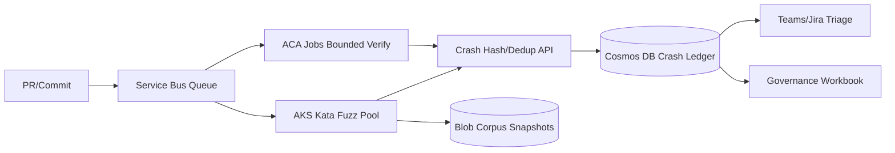
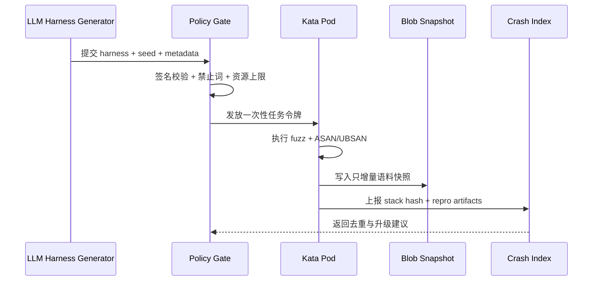

# 企业自治漏洞模糊测试、崩溃复现与有界验证沙箱选型 FAQ：AKS Kata + LibFuzzer/AFL++/Jazzer vs ACA Jobs + Kani/CBMC vs Azure Batch Spot vs 共享 CI Runner 反模式

> 🌐 **Language / 语言切换**: **中文版（当前）** | **[English](autonomous-fuzzing-crash-repro-bounded-verification-sandbox-aks-kata-libfuzzer-aflpp-asan-vs-aca-jobs-kani-cbmc-vs-shared-ci-runner-selection-faq.en.md)** | **[返回目录](README.md)**

## 1. 一页结论（Executive Summary）

- **推荐主路径**：不可信 PoC 与覆盖引导 fuzzing 固定在 `AKS Kata` 零出网临时沙箱中运行；PR 级性质证明放到 `ACA Jobs` 执行 `Kani/CBMC`；长期 corpus 最小化放到 `Azure Batch Spot`。
- **核心边界**：来自 LLM 的 harness、payload、seed、复现脚本均视为不可信输入，必须经过签名校验、隔离执行、只写落盘与审计留痕。
- **反模式警告**：共享自托管 Runner 直接执行崩溃 PoC，会放大 OIDC、ACR、签名密钥与内核稳定性共因风险。
- **度量目标**：`CrashReproP95 <= 8 min`，`DedupPrecision >= 0.93`，`FalseEscalation <= 2%`，`UnitCostPerUniqueCrash` 连续 3 周下降。
- **成本结论**：中高并发下，三层方案通常比“全量常驻大核 CI”节省 31%~58% 三年 TCO，并显著降低误报工单成本。

## 2. 路线定义

- **Route A（首选）**：`AKS Kata Containers` + `LibFuzzer/AFL++/Jazzer` + `ASAN/UBSAN` + `Cilium deny-all` + `Blob Snapshot`。
- **Route B（配套）**：`ACA Jobs` 事件触发执行 `Kani/CBMC`，用于 PR 时间窗 `<15 min` 的有界安全性质回归。
- **Route C（规模化）**：`Azure Batch Spot` 承载持续语料裁剪与历史崩溃再归并，`Cosmos DB` 维护 crash ledger。
- **Route D（禁用）**：共享 Runner 直接跑 fuzz 与 PoC，且允许外网出站与高权限令牌共存。

## 3. 参考架构（Mermaid 1）



## 4. 三层数据流与隔离流（Mermaid 2）



## 5. 定量工程模型

1. **容量模型**：`N_kata = ceil((R_jobs * T_avg) / U_target)`，其中 `U_target` 建议 `0.62~0.75`。
2. **P95 完成时间**：`T_p95 = T_queue + T_pull + T_exec + T_upload`，通过 warm image 与本地 NVMe seed cache 压低 `T_pull`。
3. **唯一崩溃单位成本**：`C_unique = (C_compute + C_storage + C_ops) / N_unique_crash`。
4. **有界验证覆盖增益**：`Gain_verify = (N_blocked_regression / N_total_pr) * Impact_weight`。
5. **爆炸半径因子**：`Blast = Privilege * SharedKernel * EgressReachability`，Route D 中该值不可接受。

## 6. 12 维度对比矩阵

| 维度 | Route A AKS Kata | Route B ACA Jobs | Route C Batch Spot | Route D 共享 Runner |
|---|---|---|---|---|
| 隔离边界 | Hypervisor 级 | Hyper-V 会话级 | 任务节点级 | 进程/容器级 |
| 不可信 PoC 安全性 | 高 | 中 | 中 | 低 |
| 冷启动稳定性 | 中-高 | 高 | 中 | 高 |
| 并发弹性 | 高 | 中-高 | 很高 | 中 |
| 覆盖引导效率 | 很高 | 低 | 高 | 中 |
| ASAN/UBSAN 适配 | 完整 | 受限 | 完整 | 受限 |
| PR 反馈速度 | 中 | 高 | 低 | 中 |
| 语料最小化能力 | 中 | 低 | 很高 | 低 |
| 合规审计追踪 | 高 | 高 | 中-高 | 低 |
| 运维复杂度 | 中-高 | 低 | 中 | 低(表面) |
| 三年 TCO（中规模） | 中 | 低-中 | 低 | 高(隐性损失) |
| 反模式风险 | 低 | 中 | 中 | 极高 |

## 7. 深度问答（Q1–Q8）

### Q1. 何时必须把任务放进 Kata 而不是直接 ACA Jobs？
- 输入包含未知二进制、可执行 shellcode、或崩溃 PoC 时，优先 Kata。
- 需要 `ASAN/UBSAN` 与 `ptrace` 深度调试能力时，Kata 更可控。
- 仅做纯静态属性验证且执行时间 `<15 min` 时，ACA Jobs 更经济。
- 建议以任务风险标签驱动路由，而非按团队习惯固定。

### Q2. 如何控制 crash 去重误差？
- 采用 `stack hash + top frames + signal` 组合键，减少单一 hash 碰撞。
- 同一崩溃族保留多样化 seed，避免过早合并导致回归漏检。
- 每周抽样人工复核 2% 事件，回灌 dedup 规则。
- 把误合并率与误拆分率写入 SLO 仪表盘。

### Q3. KEDA 队列弹性怎么设阈值？
- `scaleOutThreshold` 绑定 backlog 与 P95 目标，建议联动时间窗。
- 为热点项目设置最小保底副本，避免高峰冷启动抖动。
- Spot 回收时触发优雅重排，保留关键任务优先级。
- 将 `maxReplicaCount` 与预算护栏联动，防止突发超支。

### Q4. 为什么还需要 Batch Spot？
- Batch 适合离峰执行 corpus minimization 与回放，不占白天 PR 预算。
- 可将历史崩溃重归并、再生成更小回归集，提升白天反馈速度。
- 结合低价 Spot 与可中断容错，成本优势明显。
- 与 Kata 主路径解耦，降低生产队列噪声。

### Q5. ACA Jobs 的有界验证如何落地？
- 将性质断言拆成可并行小任务，单任务控制在 5~12 分钟。
- 失败即中断并回传最小反例，避免无效长跑。
- PR 门禁只看关键性质集，扩展性质放夜间批处理。
- 将 `Kani/CBMC` 结果结构化入 Cosmos 便于追溯。

### Q6. 如何防止 OIDC/ACR 令牌泄漏？
- 运行时禁出网并最小化令牌 TTL。
- 任务令牌只允许写指定容器路径，不允许读取机密范围。
- 镜像拉取后立即切换无凭据执行上下文。
- 所有外呼域名执行 deny-by-default。

### Q7. 什么时候需要 GPU 参与？
- 仅当目标程序涉及 GPU 编解码或 CUDA 路径时引入 GPU 沙箱。
- 默认 CPU 路径先做覆盖与最小复现，GPU 用于二次确认。
- GPU 池与主 CI 池隔离，避免驱动层互扰。
- 统一记录 GPU 分钟成本，避免“隐形贵”。

### Q8. 如何向管理层解释 ROI？
- 用“每个唯一高危崩溃成本”替代“每分钟算力成本”。
- 展示误报下降、回归发现提前量、发布风险降低三条曲线。
- 比较事件处置 MTTR 与工单积压下降幅度。
- 把合规审计取证时间纳入收益模型。

## 8. 生产级 Kata PodSpec 与 Cilium 策略片段

```yaml
apiVersion: v1
kind: Pod
metadata:
  name: fuzz-kata-job
  labels:
    workload: fuzzing
spec:
  runtimeClassName: kata-cc
  restartPolicy: Never
  containers:
  - name: fuzz
    image: ghcr.io/example/fuzz-harness:2026.11
    securityContext:
      allowPrivilegeEscalation: false
      readOnlyRootFilesystem: true
      capabilities:
        drop: ["ALL"]
    resources:
      requests: { cpu: "8", memory: "16Gi" }
      limits: { cpu: "16", memory: "32Gi" }
    env:
    - name: ASAN_OPTIONS
      value: "detect_leaks=1:halt_on_error=1"
    - name: UBSAN_OPTIONS
      value: "print_stacktrace=1:halt_on_error=1"
```

```yaml
apiVersion: cilium.io/v2
kind: CiliumNetworkPolicy
metadata:
  name: fuzz-deny-all-egress
spec:
  endpointSelector:
    matchLabels:
      workload: fuzzing
  egress: []
  ingress: []
```

## 9. ACA Jobs（Kani/CBMC）Bicep 片段

```bicep
resource verifyJob 'Microsoft.App/jobs@2024-03-01' = {
  name: 'bounded-verify-job'
  location: location
  properties: {
    environmentId: managedEnv.id
    configuration: {
      triggerType: 'Event'
      replicaRetryLimit: 1
      replicaTimeout: 900
    }
    template: {
      containers: [
        {
          name: 'verify'
          image: 'ghcr.io/example/kani-cbmc:2026.11'
          resources: { cpu: 2, memory: '4Gi' }
        }
      ]
    }
  }
}
```

## 10. 企业场景 A：金融支付网关 SDK 模糊测试工厂

- 场景A要点01：将支付协议解析器、签名验证库、压缩解码链路分阶段 fuzz，统一落入 crash ledger，确保跨版本可追溯。

## 11. 企业场景 B：车联网 OTA 包解析与媒体栈安全回归

- 场景B要点01：OTA 包、日志压缩包、视频片段解码器分别路由到不同风险池，优先处理可远程触发高危崩溃。

## 12. 三档三年 TCO（单位：USD）

| 规模 | 月任务量 | Route A 年成本 | Route B 年成本 | Route C 年成本 | 反模式隐性损失 | 三年总计（推荐组合） |
|---|---:|---:|---:|---:|---:|---:|
| Small | 50k 作业 | 210,000 | 42,000 | 36,000 | 180,000 | 864,000 |
| Medium | 500k 作业 | 1,420,000 | 220,000 | 160,000 | 1,050,000 | 5,400,000 |
| Large | 3,000k 作业 | 6,980,000 | 860,000 | 620,000 | 4,500,000 | 25,380,000 |

## 13. Day-0 / Day-1 / Day-2 上线核查清单

### Day-0 设计阶段
- [ ] Day-0 设计阶段 定义负责人、阈值、回滚动作、审计证据路径。

### Day-1 上线阶段
- [ ] Day-1 上线阶段 定义负责人、阈值、回滚动作、审计证据路径。

### Day-2 运营阶段
- [ ] Day-2 运营阶段 定义负责人、阈值、回滚动作、审计证据路径。

## 14. 反模式剖析与纠偏

- 纠偏建议01：禁止在共享 Runner 直接执行不可信 PoC，统一迁移到隔离沙箱并绑定最小权限令牌。

## 15. 附录：参数与治理控制目录（用于容量复盘）

- 记录 `queue_backlog`、`crash_family`、`repro_time_p95`、`storage_growth`、`token_ttl`、`egress_denied_count` 的周趋势与异常解释。
