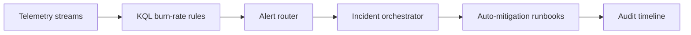
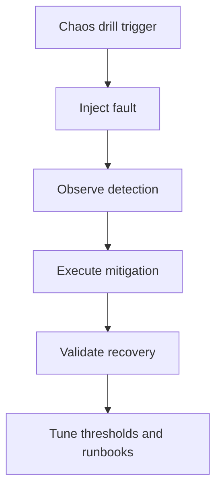

# Enterprise autonomous incident response and multi-region drill selection FAQ (SLO burn-rate: Azure Monitor/Workbooks/Chaos Studio vs PagerDuty event orchestration)

> Audience: enterprise platform SRE leaders, Cloud & AI Solution Architects, and AIOps incident-governance owners.

## 1. Executive summary

As AI agents become part of critical production paths, incident handling must evolve from alert notification to SLO-driven auto-triage, auto-mitigation, drill validation, and auditable post-incident accountability. Recommended architecture:

- **Route A (detection)**: `Azure Monitor + KQL + burn-rate` multi-window error-budget monitoring.
- **Route B (orchestration)**: `Logic Apps / Functions / PagerDuty` for severity routing and runbook automation.
- **Route C (validation)**: `Chaos Studio + recurring GameDay` to validate reliability automation under real faults.
- **Route D (anti-pattern)**: static threshold alerts with manual chat-room response only.

## 2. Core pain points

- In multi-region estates, local jitter can trigger global noise or blind spots.
- Alert storms create on-call fatigue and delay true critical response.
- Incident playbooks depend on individuals rather than durable process design.
- Without drills, automation fails when real incidents occur.

## 3. Route definitions

### Route A: burn-rate multi-window detection
- Use dual windows (for example `5m/1h`) to detect acute and chronic degradation.
- Use budget-consumption speed instead of brittle single-point thresholds.

### Route B: automated event orchestration
- Map severity to automated mitigation actions (throttle, degrade, failover, rollback).
- Add human approval gates for high-risk operations.

### Route C: chaos drills and regression validation
- Inject dependency/network/region faults on schedule to verify runbooks.
- Feed drill results back into thresholds and scripts.

### Route D: anti-pattern baseline
- Rely only on static infra thresholds and human chat handoffs.
- No error-budget context, no auto-rollback, no drill-driven improvement.

## 4. Quantitative models

### 4.1 Error-budget burn rate
`BurnRate = ErrorRate / SLO_ErrorBudgetRate`

### 4.2 Alert signal precision
`SignalPrecision = TrueCriticalAlerts / TotalAlerts`

### 4.3 Auto-mitigation success
`AutoMitigationSuccess = MitigatedIncidents / AutoTriggeredIncidents`

### 4.4 Drill coverage
`GameDayCoverage = ValidatedRunbooks / TotalRunbooks`

## 5. Twelve-dimension comparison matrix

| Dimension | Route A burn-rate detection | Route B event orchestration | Route C drill validation | Route D anti-pattern |
|---|---|---|---|---|
| Noise suppression | High | Medium-high | Medium | Low |
| Critical-event detection | High | High | Medium | Low |
| Auto-recovery speed | Medium | High | Medium | Low |
| Human dependency | Medium | Low-medium | Medium | High |
| Multi-region fault fit | High | High | High | Low |
| Change traceability | Medium | High | High | Low |
| Learning/adaptation | Medium | Medium | High | Low |
| Operational complexity | Medium | Medium | Medium | Low (short-term) |
| Auditability | Medium-high | High | High | Low |
| Recovery consistency | Medium | High | High | Low |
| SLO alignment | High | High | Medium-high | Low |
| Recommendation | ✅ required | ✅ required | ✅ strongly recommended | ⛔ |

## 6. Deep quantitative Q&A (Q1-Q8)
### Q1: Why is burn-rate better than fixed thresholds?
It directly captures error-budget depletion speed and unifies acute/chronic incident detection.

### Q2: Can auto-mitigation cause collateral impact?
Yes, so high-risk actions need approval gates and rollback controls.

### Q3: How to reduce alert storms?
Use deduplication, suppression windows, and business-impact-first prioritization.

### Q4: Should multi-region SLOs be separate?
Yes—use both regional and global SLO views to avoid false global signals.

### Q5: How often should drills run?
At least monthly for critical paths, plus after major changes.

### Q6: How to standardize on-call handoff?
Use templated incident summaries with evidence links, ownership, and next actions.

### Q7: When should auto-rollback trigger?
When burn-rate breaches coincide with critical business KPI deterioration.

### Q8: How to measure maturity?
Track auto-mitigation success, false-positive rate, MTTR, and drill coverage.

## 7. Mermaid architecture diagrams





## 8. Production snippet: burn-rate paging gate pseudo-code

```python
def should_page(metrics):
    if metrics["burn_rate_5m"] > 14 and metrics["burn_rate_1h"] > 2:
        return "sev1"
    if metrics["burn_rate_5m"] > 6 and metrics["burn_rate_1h"] > 1:
        return "sev2"
    return "observe"
```

## 9. Production snippet: rollback policy skeleton

```yaml
rollback:
  trigger: burn_rate_and_kpi
  actions: [drain_traffic, switch_baseline, disable_candidate]
  require_approval_for: [cross_region_failover]
```

## 10. Enterprise scenarios (2+)

### Scenario A: global e-commerce peak campaigns
- Traffic volatility creates massive static-threshold noise.
- Burn-rate + auto-throttle/degrade keeps availability stable.

### Scenario B: financial transaction risk pipelines
- Requires low false positives and rapid safe recovery.
- Severity-based automation plus human gate for critical actions.

### Scenario C: multi-region customer-support agent platform
- Regional dependency regressions can cascade into global UX impact.
- Region-level rules and cross-region drills improve resiliency.

## 11. Three-tier 3-year TCO (USD)

| Scale tier | A detection | A+B | A+B+C | Anti-pattern (hidden loss) |
|---|---:|---:|---:|---:|
| 10K service instances | 2,100,000 | 2,780,000 | 3,120,000 | 1,650,000 (downtime loss excluded) |
| 100K service instances | 11,900,000 | 14,700,000 | 16,900,000 | 9,200,000 (downtime loss excluded) |
| 500K service instances | 58,000,000 | 67,500,000 | 75,200,000 | 45,600,000 (downtime loss excluded) |

## 12. Day-0 / Day-1 / Day-2 checklist

### Day-0 (SLO baseline design)
- define business SLOs, error budgets, severity mapping, and ownership boundaries.

### Day-1 (orchestration rollout)
- deploy burn-rate rules, routing workflows, mitigation actions, and rollback controls.

### Day-2 (drill operations)
- run regular chaos drills, postmortems, and alert-noise reduction tuning.

## 13. Good fit vs Not for

### ✅ Good fit
- 24x7 high-availability workloads with multi-region critical paths.
- Organizations needing auditable, automation-assisted incident response.

### ⛔ Not for
- Low-traffic monolithic internal tools.
- Early teams without SLO culture or on-call operating model.

## 14. Five-step rollout guide
1. Derive SLO/error budgets from business objectives.
2. Implement multi-window burn-rate detection.
3. Build severity-based mitigation and rollback orchestration.
4. Validate reliability automation with recurring chaos drills.
5. Continuously tune thresholds and runbooks from incident learnings.

## 15. Core KPIs
- `burn_rate_5m` / `burn_rate_1h`
- `alert_signal_precision`
- `auto_mitigation_success_rate`
- `mttr_minutes`
- `gameday_coverage`

## 16. Final recommendation
A (burn-rate detection) + B (event orchestration) is the minimum production baseline; C (chaos validation) is the reliability multiplier; D is prohibited.
