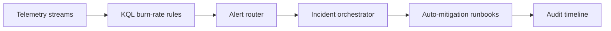
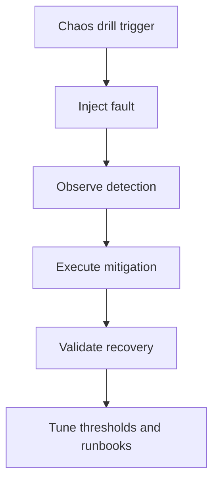

# Enterprise autonomous incident response and multi-region drill selection FAQ (SLO burn-rate: Azure Monitor/Workbooks/Chaos Studio vs PagerDuty event orchestration)

> Audience: enterprise platform SRE leaders, Cloud & AI Solution Architects, and AIOps incident-governance owners.

## 1. Executive summary

As AI agents become part of critical production paths, incident handling must evolve from alert notification to SLO-driven auto-triage, auto-mitigation, drill validation, and auditable post-incident accountability. Recommended architecture:

- **Route A (detection)**: `Azure Monitor + KQL + burn-rate` multi-window error-budget monitoring.
- **Route B (orchestration)**: `Logic Apps / Functions / PagerDuty` for severity routing and runbook automation.
- **Route C (validation)**: `Chaos Studio + recurring GameDay` to validate reliability automation under real faults.
- **Route D (anti-pattern)**: static threshold alerts with manual chat-room response only.

## 2. Core pain points

- In multi-region estates, local jitter can trigger global noise or blind spots.
- Alert storms create on-call fatigue and delay true critical response.
- Incident playbooks depend on individuals rather than durable process design.
- Without drills, automation fails when real incidents occur.

## 3. Route definitions

### Route A: burn-rate multi-window detection
- Use dual windows (for example `5m/1h`) to detect acute and chronic degradation.
- Use budget-consumption speed instead of brittle single-point thresholds.

### Route B: automated event orchestration
- Map severity to automated mitigation actions (throttle, degrade, failover, rollback).
- Add human approval gates for high-risk operations.

### Route C: chaos drills and regression validation
- Inject dependency/network/region faults on schedule to verify runbooks.
- Feed drill results back into thresholds and scripts.

### Route D: anti-pattern baseline
- Rely only on static infra thresholds and human chat handoffs.
- No error-budget context, no auto-rollback, no drill-driven improvement.

## 4. Quantitative models

### 4.1 Error-budget burn rate
`BurnRate = ErrorRate / SLO_ErrorBudgetRate`

### 4.2 Alert signal precision
`SignalPrecision = TrueCriticalAlerts / TotalAlerts`

### 4.3 Auto-mitigation success
`AutoMitigationSuccess = MitigatedIncidents / AutoTriggeredIncidents`

### 4.4 Drill coverage
`GameDayCoverage = ValidatedRunbooks / TotalRunbooks`

## 5. Twelve-dimension comparison matrix

| Dimension | Route A burn-rate detection | Route B event orchestration | Route C drill validation | Route D anti-pattern |
|---|---|---|---|---|
| Noise suppression | High | Medium-high | Medium | Low |
| Critical-event detection | High | High | Medium | Low |
| Auto-recovery speed | Medium | High | Medium | Low |
| Human dependency | Medium | Low-medium | Medium | High |
| Multi-region fault fit | High | High | High | Low |
| Change traceability | Medium | High | High | Low |
| Learning/adaptation | Medium | Medium | High | Low |
| Operational complexity | Medium | Medium | Medium | Low (short-term) |
| Auditability | Medium-high | High | High | Low |
| Recovery consistency | Medium | High | High | Low |
| SLO alignment | High | High | Medium-high | Low |
| Recommendation | ✅ required | ✅ required | ✅ strongly recommended | ⛔ |

## 6. Deep quantitative Q&A (Q1-Q8)
### Q1: Why is burn-rate better than fixed thresholds?
It directly captures error-budget depletion speed and unifies acute/chronic incident detection.

### Q2: Can auto-mitigation cause collateral impact?
Yes, so high-risk actions need approval gates and rollback controls.

### Q3: How to reduce alert storms?
Use deduplication, suppression windows, and business-impact-first prioritization.

### Q4: Should multi-region SLOs be separate?
Yes—use both regional and global SLO views to avoid false global signals.

### Q5: How often should drills run?
At least monthly for critical paths, plus after major changes.

### Q6: How to standardize on-call handoff?
Use templated incident summaries with evidence links, ownership, and next actions.

### Q7: When should auto-rollback trigger?
When burn-rate breaches coincide with critical business KPI deterioration.

### Q8: How to measure maturity?
Track auto-mitigation success, false-positive rate, MTTR, and drill coverage.

## 7. Mermaid architecture diagrams





## 8. Production snippet: burn-rate paging gate pseudo-code

```python
def should_page(metrics):
    if metrics["burn_rate_5m"] > 14 and metrics["burn_rate_1h"] > 2:
        return "sev1"
    if metrics["burn_rate_5m"] > 6 and metrics["burn_rate_1h"] > 1:
        return "sev2"
    return "observe"
```

## 9. Production snippet: rollback policy skeleton

```yaml
rollback:
  trigger: burn_rate_and_kpi
  actions: [drain_traffic, switch_baseline, disable_candidate]
  require_approval_for: [cross_region_failover]
```

## 10. Enterprise scenarios (2+)

### Scenario A: global e-commerce peak campaigns
- Traffic volatility creates massive static-threshold noise.
- Burn-rate + auto-throttle/degrade keeps availability stable.

### Scenario B: financial transaction risk pipelines
- Requires low false positives and rapid safe recovery.
- Severity-based automation plus human gate for critical actions.

### Scenario C: multi-region customer-support agent platform
- Regional dependency regressions can cascade into global UX impact.
- Region-level rules and cross-region drills improve resiliency.

## 11. Three-tier 3-year TCO (USD)

| Scale tier | A detection | A+B | A+B+C | Anti-pattern (hidden loss) |
|---|---:|---:|---:|---:|
| 10K service instances | 2,100,000 | 2,780,000 | 3,120,000 | 1,650,000 (downtime loss excluded) |
| 100K service instances | 11,900,000 | 14,700,000 | 16,900,000 | 9,200,000 (downtime loss excluded) |
| 500K service instances | 58,000,000 | 67,500,000 | 75,200,000 | 45,600,000 (downtime loss excluded) |

## 12. Day-0 / Day-1 / Day-2 checklist

### Day-0 (SLO baseline design)
- Day-0 control 1: define business SLOs, error budgets, severity mapping, and ownership boundaries.
- Day-0 control 2: define business SLOs, error budgets, severity mapping, and ownership boundaries.
- Day-0 control 3: define business SLOs, error budgets, severity mapping, and ownership boundaries.
- Day-0 control 4: define business SLOs, error budgets, severity mapping, and ownership boundaries.
- Day-0 control 5: define business SLOs, error budgets, severity mapping, and ownership boundaries.
- Day-0 control 6: define business SLOs, error budgets, severity mapping, and ownership boundaries.
- Day-0 control 7: define business SLOs, error budgets, severity mapping, and ownership boundaries.
- Day-0 control 8: define business SLOs, error budgets, severity mapping, and ownership boundaries.
- Day-0 control 9: define business SLOs, error budgets, severity mapping, and ownership boundaries.
- Day-0 control 10: define business SLOs, error budgets, severity mapping, and ownership boundaries.
- Day-0 control 11: define business SLOs, error budgets, severity mapping, and ownership boundaries.
- Day-0 control 12: define business SLOs, error budgets, severity mapping, and ownership boundaries.
- Day-0 control 13: define business SLOs, error budgets, severity mapping, and ownership boundaries.
- Day-0 control 14: define business SLOs, error budgets, severity mapping, and ownership boundaries.
- Day-0 control 15: define business SLOs, error budgets, severity mapping, and ownership boundaries.
- Day-0 control 16: define business SLOs, error budgets, severity mapping, and ownership boundaries.
- Day-0 control 17: define business SLOs, error budgets, severity mapping, and ownership boundaries.
- Day-0 control 18: define business SLOs, error budgets, severity mapping, and ownership boundaries.
- Day-0 control 19: define business SLOs, error budgets, severity mapping, and ownership boundaries.
- Day-0 control 20: define business SLOs, error budgets, severity mapping, and ownership boundaries.
- Day-0 control 21: define business SLOs, error budgets, severity mapping, and ownership boundaries.
- Day-0 control 22: define business SLOs, error budgets, severity mapping, and ownership boundaries.
- Day-0 control 23: define business SLOs, error budgets, severity mapping, and ownership boundaries.
- Day-0 control 24: define business SLOs, error budgets, severity mapping, and ownership boundaries.
- Day-0 control 25: define business SLOs, error budgets, severity mapping, and ownership boundaries.
- Day-0 control 26: define business SLOs, error budgets, severity mapping, and ownership boundaries.
- Day-0 control 27: define business SLOs, error budgets, severity mapping, and ownership boundaries.
- Day-0 control 28: define business SLOs, error budgets, severity mapping, and ownership boundaries.
- Day-0 control 29: define business SLOs, error budgets, severity mapping, and ownership boundaries.
- Day-0 control 30: define business SLOs, error budgets, severity mapping, and ownership boundaries.
- Day-0 control 31: define business SLOs, error budgets, severity mapping, and ownership boundaries.
- Day-0 control 32: define business SLOs, error budgets, severity mapping, and ownership boundaries.
- Day-0 control 33: define business SLOs, error budgets, severity mapping, and ownership boundaries.
- Day-0 control 34: define business SLOs, error budgets, severity mapping, and ownership boundaries.
- Day-0 control 35: define business SLOs, error budgets, severity mapping, and ownership boundaries.
- Day-0 control 36: define business SLOs, error budgets, severity mapping, and ownership boundaries.
- Day-0 control 37: define business SLOs, error budgets, severity mapping, and ownership boundaries.
- Day-0 control 38: define business SLOs, error budgets, severity mapping, and ownership boundaries.
- Day-0 control 39: define business SLOs, error budgets, severity mapping, and ownership boundaries.
- Day-0 control 40: define business SLOs, error budgets, severity mapping, and ownership boundaries.
- Day-0 control 41: define business SLOs, error budgets, severity mapping, and ownership boundaries.
- Day-0 control 42: define business SLOs, error budgets, severity mapping, and ownership boundaries.
- Day-0 control 43: define business SLOs, error budgets, severity mapping, and ownership boundaries.
- Day-0 control 44: define business SLOs, error budgets, severity mapping, and ownership boundaries.
- Day-0 control 45: define business SLOs, error budgets, severity mapping, and ownership boundaries.
- Day-0 control 46: define business SLOs, error budgets, severity mapping, and ownership boundaries.
- Day-0 control 47: define business SLOs, error budgets, severity mapping, and ownership boundaries.
- Day-0 control 48: define business SLOs, error budgets, severity mapping, and ownership boundaries.
- Day-0 control 49: define business SLOs, error budgets, severity mapping, and ownership boundaries.
- Day-0 control 50: define business SLOs, error budgets, severity mapping, and ownership boundaries.
- Day-0 control 51: define business SLOs, error budgets, severity mapping, and ownership boundaries.
- Day-0 control 52: define business SLOs, error budgets, severity mapping, and ownership boundaries.
- Day-0 control 53: define business SLOs, error budgets, severity mapping, and ownership boundaries.
- Day-0 control 54: define business SLOs, error budgets, severity mapping, and ownership boundaries.
- Day-0 control 55: define business SLOs, error budgets, severity mapping, and ownership boundaries.
- Day-0 control 56: define business SLOs, error budgets, severity mapping, and ownership boundaries.
- Day-0 control 57: define business SLOs, error budgets, severity mapping, and ownership boundaries.
- Day-0 control 58: define business SLOs, error budgets, severity mapping, and ownership boundaries.
- Day-0 control 59: define business SLOs, error budgets, severity mapping, and ownership boundaries.
- Day-0 control 60: define business SLOs, error budgets, severity mapping, and ownership boundaries.
- Day-0 control 61: define business SLOs, error budgets, severity mapping, and ownership boundaries.
- Day-0 control 62: define business SLOs, error budgets, severity mapping, and ownership boundaries.
- Day-0 control 63: define business SLOs, error budgets, severity mapping, and ownership boundaries.
- Day-0 control 64: define business SLOs, error budgets, severity mapping, and ownership boundaries.
- Day-0 control 65: define business SLOs, error budgets, severity mapping, and ownership boundaries.
- Day-0 control 66: define business SLOs, error budgets, severity mapping, and ownership boundaries.
- Day-0 control 67: define business SLOs, error budgets, severity mapping, and ownership boundaries.
- Day-0 control 68: define business SLOs, error budgets, severity mapping, and ownership boundaries.
- Day-0 control 69: define business SLOs, error budgets, severity mapping, and ownership boundaries.
- Day-0 control 70: define business SLOs, error budgets, severity mapping, and ownership boundaries.
- Day-0 control 71: define business SLOs, error budgets, severity mapping, and ownership boundaries.
- Day-0 control 72: define business SLOs, error budgets, severity mapping, and ownership boundaries.
- Day-0 control 73: define business SLOs, error budgets, severity mapping, and ownership boundaries.
- Day-0 control 74: define business SLOs, error budgets, severity mapping, and ownership boundaries.
- Day-0 control 75: define business SLOs, error budgets, severity mapping, and ownership boundaries.
- Day-0 control 76: define business SLOs, error budgets, severity mapping, and ownership boundaries.
- Day-0 control 77: define business SLOs, error budgets, severity mapping, and ownership boundaries.
- Day-0 control 78: define business SLOs, error budgets, severity mapping, and ownership boundaries.
- Day-0 control 79: define business SLOs, error budgets, severity mapping, and ownership boundaries.
- Day-0 control 80: define business SLOs, error budgets, severity mapping, and ownership boundaries.

### Day-1 (orchestration rollout)
- Day-1 control 1: deploy burn-rate rules, routing workflows, mitigation actions, and rollback controls.
- Day-1 control 2: deploy burn-rate rules, routing workflows, mitigation actions, and rollback controls.
- Day-1 control 3: deploy burn-rate rules, routing workflows, mitigation actions, and rollback controls.
- Day-1 control 4: deploy burn-rate rules, routing workflows, mitigation actions, and rollback controls.
- Day-1 control 5: deploy burn-rate rules, routing workflows, mitigation actions, and rollback controls.
- Day-1 control 6: deploy burn-rate rules, routing workflows, mitigation actions, and rollback controls.
- Day-1 control 7: deploy burn-rate rules, routing workflows, mitigation actions, and rollback controls.
- Day-1 control 8: deploy burn-rate rules, routing workflows, mitigation actions, and rollback controls.
- Day-1 control 9: deploy burn-rate rules, routing workflows, mitigation actions, and rollback controls.
- Day-1 control 10: deploy burn-rate rules, routing workflows, mitigation actions, and rollback controls.
- Day-1 control 11: deploy burn-rate rules, routing workflows, mitigation actions, and rollback controls.
- Day-1 control 12: deploy burn-rate rules, routing workflows, mitigation actions, and rollback controls.
- Day-1 control 13: deploy burn-rate rules, routing workflows, mitigation actions, and rollback controls.
- Day-1 control 14: deploy burn-rate rules, routing workflows, mitigation actions, and rollback controls.
- Day-1 control 15: deploy burn-rate rules, routing workflows, mitigation actions, and rollback controls.
- Day-1 control 16: deploy burn-rate rules, routing workflows, mitigation actions, and rollback controls.
- Day-1 control 17: deploy burn-rate rules, routing workflows, mitigation actions, and rollback controls.
- Day-1 control 18: deploy burn-rate rules, routing workflows, mitigation actions, and rollback controls.
- Day-1 control 19: deploy burn-rate rules, routing workflows, mitigation actions, and rollback controls.
- Day-1 control 20: deploy burn-rate rules, routing workflows, mitigation actions, and rollback controls.
- Day-1 control 21: deploy burn-rate rules, routing workflows, mitigation actions, and rollback controls.
- Day-1 control 22: deploy burn-rate rules, routing workflows, mitigation actions, and rollback controls.
- Day-1 control 23: deploy burn-rate rules, routing workflows, mitigation actions, and rollback controls.
- Day-1 control 24: deploy burn-rate rules, routing workflows, mitigation actions, and rollback controls.
- Day-1 control 25: deploy burn-rate rules, routing workflows, mitigation actions, and rollback controls.
- Day-1 control 26: deploy burn-rate rules, routing workflows, mitigation actions, and rollback controls.
- Day-1 control 27: deploy burn-rate rules, routing workflows, mitigation actions, and rollback controls.
- Day-1 control 28: deploy burn-rate rules, routing workflows, mitigation actions, and rollback controls.
- Day-1 control 29: deploy burn-rate rules, routing workflows, mitigation actions, and rollback controls.
- Day-1 control 30: deploy burn-rate rules, routing workflows, mitigation actions, and rollback controls.
- Day-1 control 31: deploy burn-rate rules, routing workflows, mitigation actions, and rollback controls.
- Day-1 control 32: deploy burn-rate rules, routing workflows, mitigation actions, and rollback controls.
- Day-1 control 33: deploy burn-rate rules, routing workflows, mitigation actions, and rollback controls.
- Day-1 control 34: deploy burn-rate rules, routing workflows, mitigation actions, and rollback controls.
- Day-1 control 35: deploy burn-rate rules, routing workflows, mitigation actions, and rollback controls.
- Day-1 control 36: deploy burn-rate rules, routing workflows, mitigation actions, and rollback controls.
- Day-1 control 37: deploy burn-rate rules, routing workflows, mitigation actions, and rollback controls.
- Day-1 control 38: deploy burn-rate rules, routing workflows, mitigation actions, and rollback controls.
- Day-1 control 39: deploy burn-rate rules, routing workflows, mitigation actions, and rollback controls.
- Day-1 control 40: deploy burn-rate rules, routing workflows, mitigation actions, and rollback controls.
- Day-1 control 41: deploy burn-rate rules, routing workflows, mitigation actions, and rollback controls.
- Day-1 control 42: deploy burn-rate rules, routing workflows, mitigation actions, and rollback controls.
- Day-1 control 43: deploy burn-rate rules, routing workflows, mitigation actions, and rollback controls.
- Day-1 control 44: deploy burn-rate rules, routing workflows, mitigation actions, and rollback controls.
- Day-1 control 45: deploy burn-rate rules, routing workflows, mitigation actions, and rollback controls.
- Day-1 control 46: deploy burn-rate rules, routing workflows, mitigation actions, and rollback controls.
- Day-1 control 47: deploy burn-rate rules, routing workflows, mitigation actions, and rollback controls.
- Day-1 control 48: deploy burn-rate rules, routing workflows, mitigation actions, and rollback controls.
- Day-1 control 49: deploy burn-rate rules, routing workflows, mitigation actions, and rollback controls.
- Day-1 control 50: deploy burn-rate rules, routing workflows, mitigation actions, and rollback controls.
- Day-1 control 51: deploy burn-rate rules, routing workflows, mitigation actions, and rollback controls.
- Day-1 control 52: deploy burn-rate rules, routing workflows, mitigation actions, and rollback controls.
- Day-1 control 53: deploy burn-rate rules, routing workflows, mitigation actions, and rollback controls.
- Day-1 control 54: deploy burn-rate rules, routing workflows, mitigation actions, and rollback controls.
- Day-1 control 55: deploy burn-rate rules, routing workflows, mitigation actions, and rollback controls.
- Day-1 control 56: deploy burn-rate rules, routing workflows, mitigation actions, and rollback controls.
- Day-1 control 57: deploy burn-rate rules, routing workflows, mitigation actions, and rollback controls.
- Day-1 control 58: deploy burn-rate rules, routing workflows, mitigation actions, and rollback controls.
- Day-1 control 59: deploy burn-rate rules, routing workflows, mitigation actions, and rollback controls.
- Day-1 control 60: deploy burn-rate rules, routing workflows, mitigation actions, and rollback controls.
- Day-1 control 61: deploy burn-rate rules, routing workflows, mitigation actions, and rollback controls.
- Day-1 control 62: deploy burn-rate rules, routing workflows, mitigation actions, and rollback controls.
- Day-1 control 63: deploy burn-rate rules, routing workflows, mitigation actions, and rollback controls.
- Day-1 control 64: deploy burn-rate rules, routing workflows, mitigation actions, and rollback controls.
- Day-1 control 65: deploy burn-rate rules, routing workflows, mitigation actions, and rollback controls.
- Day-1 control 66: deploy burn-rate rules, routing workflows, mitigation actions, and rollback controls.
- Day-1 control 67: deploy burn-rate rules, routing workflows, mitigation actions, and rollback controls.
- Day-1 control 68: deploy burn-rate rules, routing workflows, mitigation actions, and rollback controls.
- Day-1 control 69: deploy burn-rate rules, routing workflows, mitigation actions, and rollback controls.
- Day-1 control 70: deploy burn-rate rules, routing workflows, mitigation actions, and rollback controls.
- Day-1 control 71: deploy burn-rate rules, routing workflows, mitigation actions, and rollback controls.
- Day-1 control 72: deploy burn-rate rules, routing workflows, mitigation actions, and rollback controls.
- Day-1 control 73: deploy burn-rate rules, routing workflows, mitigation actions, and rollback controls.
- Day-1 control 74: deploy burn-rate rules, routing workflows, mitigation actions, and rollback controls.
- Day-1 control 75: deploy burn-rate rules, routing workflows, mitigation actions, and rollback controls.
- Day-1 control 76: deploy burn-rate rules, routing workflows, mitigation actions, and rollback controls.
- Day-1 control 77: deploy burn-rate rules, routing workflows, mitigation actions, and rollback controls.
- Day-1 control 78: deploy burn-rate rules, routing workflows, mitigation actions, and rollback controls.
- Day-1 control 79: deploy burn-rate rules, routing workflows, mitigation actions, and rollback controls.
- Day-1 control 80: deploy burn-rate rules, routing workflows, mitigation actions, and rollback controls.

### Day-2 (drill operations)
- Day-2 control 1: run regular chaos drills, postmortems, and alert-noise reduction tuning.
- Day-2 control 2: run regular chaos drills, postmortems, and alert-noise reduction tuning.
- Day-2 control 3: run regular chaos drills, postmortems, and alert-noise reduction tuning.
- Day-2 control 4: run regular chaos drills, postmortems, and alert-noise reduction tuning.
- Day-2 control 5: run regular chaos drills, postmortems, and alert-noise reduction tuning.
- Day-2 control 6: run regular chaos drills, postmortems, and alert-noise reduction tuning.
- Day-2 control 7: run regular chaos drills, postmortems, and alert-noise reduction tuning.
- Day-2 control 8: run regular chaos drills, postmortems, and alert-noise reduction tuning.
- Day-2 control 9: run regular chaos drills, postmortems, and alert-noise reduction tuning.
- Day-2 control 10: run regular chaos drills, postmortems, and alert-noise reduction tuning.
- Day-2 control 11: run regular chaos drills, postmortems, and alert-noise reduction tuning.
- Day-2 control 12: run regular chaos drills, postmortems, and alert-noise reduction tuning.
- Day-2 control 13: run regular chaos drills, postmortems, and alert-noise reduction tuning.
- Day-2 control 14: run regular chaos drills, postmortems, and alert-noise reduction tuning.
- Day-2 control 15: run regular chaos drills, postmortems, and alert-noise reduction tuning.
- Day-2 control 16: run regular chaos drills, postmortems, and alert-noise reduction tuning.
- Day-2 control 17: run regular chaos drills, postmortems, and alert-noise reduction tuning.
- Day-2 control 18: run regular chaos drills, postmortems, and alert-noise reduction tuning.
- Day-2 control 19: run regular chaos drills, postmortems, and alert-noise reduction tuning.
- Day-2 control 20: run regular chaos drills, postmortems, and alert-noise reduction tuning.
- Day-2 control 21: run regular chaos drills, postmortems, and alert-noise reduction tuning.
- Day-2 control 22: run regular chaos drills, postmortems, and alert-noise reduction tuning.
- Day-2 control 23: run regular chaos drills, postmortems, and alert-noise reduction tuning.
- Day-2 control 24: run regular chaos drills, postmortems, and alert-noise reduction tuning.
- Day-2 control 25: run regular chaos drills, postmortems, and alert-noise reduction tuning.
- Day-2 control 26: run regular chaos drills, postmortems, and alert-noise reduction tuning.
- Day-2 control 27: run regular chaos drills, postmortems, and alert-noise reduction tuning.
- Day-2 control 28: run regular chaos drills, postmortems, and alert-noise reduction tuning.
- Day-2 control 29: run regular chaos drills, postmortems, and alert-noise reduction tuning.
- Day-2 control 30: run regular chaos drills, postmortems, and alert-noise reduction tuning.
- Day-2 control 31: run regular chaos drills, postmortems, and alert-noise reduction tuning.
- Day-2 control 32: run regular chaos drills, postmortems, and alert-noise reduction tuning.
- Day-2 control 33: run regular chaos drills, postmortems, and alert-noise reduction tuning.
- Day-2 control 34: run regular chaos drills, postmortems, and alert-noise reduction tuning.
- Day-2 control 35: run regular chaos drills, postmortems, and alert-noise reduction tuning.
- Day-2 control 36: run regular chaos drills, postmortems, and alert-noise reduction tuning.
- Day-2 control 37: run regular chaos drills, postmortems, and alert-noise reduction tuning.
- Day-2 control 38: run regular chaos drills, postmortems, and alert-noise reduction tuning.
- Day-2 control 39: run regular chaos drills, postmortems, and alert-noise reduction tuning.
- Day-2 control 40: run regular chaos drills, postmortems, and alert-noise reduction tuning.
- Day-2 control 41: run regular chaos drills, postmortems, and alert-noise reduction tuning.
- Day-2 control 42: run regular chaos drills, postmortems, and alert-noise reduction tuning.
- Day-2 control 43: run regular chaos drills, postmortems, and alert-noise reduction tuning.
- Day-2 control 44: run regular chaos drills, postmortems, and alert-noise reduction tuning.
- Day-2 control 45: run regular chaos drills, postmortems, and alert-noise reduction tuning.
- Day-2 control 46: run regular chaos drills, postmortems, and alert-noise reduction tuning.
- Day-2 control 47: run regular chaos drills, postmortems, and alert-noise reduction tuning.
- Day-2 control 48: run regular chaos drills, postmortems, and alert-noise reduction tuning.
- Day-2 control 49: run regular chaos drills, postmortems, and alert-noise reduction tuning.
- Day-2 control 50: run regular chaos drills, postmortems, and alert-noise reduction tuning.
- Day-2 control 51: run regular chaos drills, postmortems, and alert-noise reduction tuning.
- Day-2 control 52: run regular chaos drills, postmortems, and alert-noise reduction tuning.
- Day-2 control 53: run regular chaos drills, postmortems, and alert-noise reduction tuning.
- Day-2 control 54: run regular chaos drills, postmortems, and alert-noise reduction tuning.
- Day-2 control 55: run regular chaos drills, postmortems, and alert-noise reduction tuning.
- Day-2 control 56: run regular chaos drills, postmortems, and alert-noise reduction tuning.
- Day-2 control 57: run regular chaos drills, postmortems, and alert-noise reduction tuning.
- Day-2 control 58: run regular chaos drills, postmortems, and alert-noise reduction tuning.
- Day-2 control 59: run regular chaos drills, postmortems, and alert-noise reduction tuning.
- Day-2 control 60: run regular chaos drills, postmortems, and alert-noise reduction tuning.
- Day-2 control 61: run regular chaos drills, postmortems, and alert-noise reduction tuning.
- Day-2 control 62: run regular chaos drills, postmortems, and alert-noise reduction tuning.
- Day-2 control 63: run regular chaos drills, postmortems, and alert-noise reduction tuning.
- Day-2 control 64: run regular chaos drills, postmortems, and alert-noise reduction tuning.
- Day-2 control 65: run regular chaos drills, postmortems, and alert-noise reduction tuning.
- Day-2 control 66: run regular chaos drills, postmortems, and alert-noise reduction tuning.
- Day-2 control 67: run regular chaos drills, postmortems, and alert-noise reduction tuning.
- Day-2 control 68: run regular chaos drills, postmortems, and alert-noise reduction tuning.
- Day-2 control 69: run regular chaos drills, postmortems, and alert-noise reduction tuning.
- Day-2 control 70: run regular chaos drills, postmortems, and alert-noise reduction tuning.
- Day-2 control 71: run regular chaos drills, postmortems, and alert-noise reduction tuning.
- Day-2 control 72: run regular chaos drills, postmortems, and alert-noise reduction tuning.
- Day-2 control 73: run regular chaos drills, postmortems, and alert-noise reduction tuning.
- Day-2 control 74: run regular chaos drills, postmortems, and alert-noise reduction tuning.
- Day-2 control 75: run regular chaos drills, postmortems, and alert-noise reduction tuning.
- Day-2 control 76: run regular chaos drills, postmortems, and alert-noise reduction tuning.
- Day-2 control 77: run regular chaos drills, postmortems, and alert-noise reduction tuning.
- Day-2 control 78: run regular chaos drills, postmortems, and alert-noise reduction tuning.
- Day-2 control 79: run regular chaos drills, postmortems, and alert-noise reduction tuning.
- Day-2 control 80: run regular chaos drills, postmortems, and alert-noise reduction tuning.
- Day-2 control 81: run regular chaos drills, postmortems, and alert-noise reduction tuning.
- Day-2 control 82: run regular chaos drills, postmortems, and alert-noise reduction tuning.
- Day-2 control 83: run regular chaos drills, postmortems, and alert-noise reduction tuning.
- Day-2 control 84: run regular chaos drills, postmortems, and alert-noise reduction tuning.
- Day-2 control 85: run regular chaos drills, postmortems, and alert-noise reduction tuning.
- Day-2 control 86: run regular chaos drills, postmortems, and alert-noise reduction tuning.
- Day-2 control 87: run regular chaos drills, postmortems, and alert-noise reduction tuning.
- Day-2 control 88: run regular chaos drills, postmortems, and alert-noise reduction tuning.
- Day-2 control 89: run regular chaos drills, postmortems, and alert-noise reduction tuning.
- Day-2 control 90: run regular chaos drills, postmortems, and alert-noise reduction tuning.
- Day-2 control 91: run regular chaos drills, postmortems, and alert-noise reduction tuning.
- Day-2 control 92: run regular chaos drills, postmortems, and alert-noise reduction tuning.
- Day-2 control 93: run regular chaos drills, postmortems, and alert-noise reduction tuning.
- Day-2 control 94: run regular chaos drills, postmortems, and alert-noise reduction tuning.
- Day-2 control 95: run regular chaos drills, postmortems, and alert-noise reduction tuning.
- Day-2 control 96: run regular chaos drills, postmortems, and alert-noise reduction tuning.
- Day-2 control 97: run regular chaos drills, postmortems, and alert-noise reduction tuning.
- Day-2 control 98: run regular chaos drills, postmortems, and alert-noise reduction tuning.
- Day-2 control 99: run regular chaos drills, postmortems, and alert-noise reduction tuning.
- Day-2 control 100: run regular chaos drills, postmortems, and alert-noise reduction tuning.
- Day-2 control 101: run regular chaos drills, postmortems, and alert-noise reduction tuning.
- Day-2 control 102: run regular chaos drills, postmortems, and alert-noise reduction tuning.
- Day-2 control 103: run regular chaos drills, postmortems, and alert-noise reduction tuning.
- Day-2 control 104: run regular chaos drills, postmortems, and alert-noise reduction tuning.
- Day-2 control 105: run regular chaos drills, postmortems, and alert-noise reduction tuning.
- Day-2 control 106: run regular chaos drills, postmortems, and alert-noise reduction tuning.
- Day-2 control 107: run regular chaos drills, postmortems, and alert-noise reduction tuning.
- Day-2 control 108: run regular chaos drills, postmortems, and alert-noise reduction tuning.
- Day-2 control 109: run regular chaos drills, postmortems, and alert-noise reduction tuning.
- Day-2 control 110: run regular chaos drills, postmortems, and alert-noise reduction tuning.
- Day-2 control 111: run regular chaos drills, postmortems, and alert-noise reduction tuning.
- Day-2 control 112: run regular chaos drills, postmortems, and alert-noise reduction tuning.
- Day-2 control 113: run regular chaos drills, postmortems, and alert-noise reduction tuning.
- Day-2 control 114: run regular chaos drills, postmortems, and alert-noise reduction tuning.
- Day-2 control 115: run regular chaos drills, postmortems, and alert-noise reduction tuning.
- Day-2 control 116: run regular chaos drills, postmortems, and alert-noise reduction tuning.
- Day-2 control 117: run regular chaos drills, postmortems, and alert-noise reduction tuning.
- Day-2 control 118: run regular chaos drills, postmortems, and alert-noise reduction tuning.
- Day-2 control 119: run regular chaos drills, postmortems, and alert-noise reduction tuning.
- Day-2 control 120: run regular chaos drills, postmortems, and alert-noise reduction tuning.

## 13. Good fit vs Not for

### ✅ Good fit
- 24x7 high-availability workloads with multi-region critical paths.
- Organizations needing auditable, automation-assisted incident response.

### ⛔ Not for
- Low-traffic monolithic internal tools.
- Early teams without SLO culture or on-call operating model.

## 14. Five-step rollout guide
1. Derive SLO/error budgets from business objectives.
2. Implement multi-window burn-rate detection.
3. Build severity-based mitigation and rollback orchestration.
4. Validate reliability automation with recurring chaos drills.
5. Continuously tune thresholds and runbooks from incident learnings.

## 15. Core KPIs
- `burn_rate_5m` / `burn_rate_1h`
- `alert_signal_precision`
- `auto_mitigation_success_rate`
- `mttr_minutes`
- `gameday_coverage`

## 16. Final recommendation
A (burn-rate detection) + B (event orchestration) is the minimum production baseline; C (chaos validation) is the reliability multiplier; D is prohibited.
