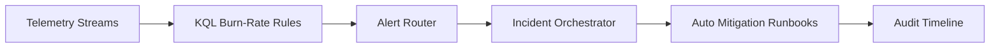
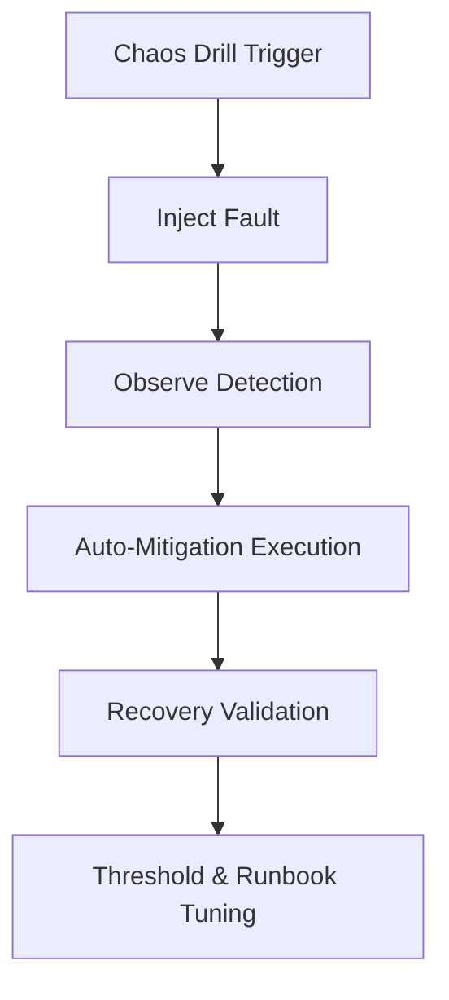

# 企业自治故障响应与多区域演练选型 FAQ（SLO Burn-Rate：Azure Monitor/Workbooks/Chaos Studio vs PagerDuty 事件编排）

> 适用对象：企业平台 SRE、Cloud & AI Solution Architect、AIOps 与值班体系负责人。

## 1. 执行摘要

当 AI Agent 进入生产关键路径后，故障响应目标从“告警通知”升级为“按 SLO 自动分级、自动处置、可演练验证、可追责复盘”。建议采用三层闭环：

- **Route A（检测层）**：`Azure Monitor + KQL + Burn-Rate` 规则计算多窗口误差消耗。
- **Route B（编排层）**：`Logic Apps / Functions / PagerDuty` 进行分级路由与 Runbook 自动执行。
- **Route C（验证层）**：`Chaos Studio + 定期 GameDay` 验证自动化在真实故障下有效。
- **Route D（反模式）**：只做静态阈值告警与人工口头交接。

## 2. 业务痛点

- 多区域架构下，单区域抖动容易触发全局误报或漏报。
- 告警泛滥导致值班疲劳，真正高优事故延迟处置。
- 故障流程依赖个人经验，人员轮转后质量明显下降。
- 缺乏演练，自动化流程在真实事故中经常失效。

## 3. 路线定义

### Route A：SLO Burn-Rate 多窗口检测
- 使用 `5m/1h` 双窗口规则识别急性与慢性退化。
- 以误差预算消耗速度代替单点阈值。

### Route B：自动化事件编排
- 将告警分级映射到不同自动处置剧本（限流、降级、切流、回退）。
- 用人工审批门槛保护高风险动作。

### Route C：混沌演练与回归验证
- 定期注入网络、依赖、区域级故障验证 runbook。
- 将演练结果回灌到门禁阈值与自动化脚本。

### Route D：反模式
- 仅依赖 CPU/错误率单阈值和人工群聊响应。
- 无误差预算、无自动回退、无演练复盘。

## 4. 定量模型

### 4.1 误差预算消耗速率
`BurnRate = ErrorRate / SLO_ErrorBudgetRate`

### 4.2 告警有效率
`SignalPrecision = TrueCriticalAlerts / TotalAlerts`

### 4.3 自动处置成功率
`AutoMitigationSuccess = MitigatedIncidents / AutoTriggeredIncidents`

### 4.4 演练覆盖率
`GameDayCoverage = ValidatedRunbooks / TotalRunbooks`

## 5. 12 维对比矩阵

| 维度 | Route A Burn-Rate 检测 | Route B 事件编排 | Route C 演练验证 | Route D 反模式 |
|---|---|---|---|---|
| 噪声抑制能力 | 高 | 中高 | 中 | 低 |
| 严重事件识别 | 高 | 高 | 中 | 低 |
| 自动修复速度 | 中 | 高 | 中 | 低 |
| 人工依赖度 | 中 | 低中 | 中 | 高 |
| 跨区故障适配 | 高 | 高 | 高 | 低 |
| 变更可追溯 | 中 | 高 | 高 | 低 |
| 训练与演进能力 | 中 | 中 | 高 | 低 |
| 运维复杂度 | 中 | 中 | 中 | 低（短期） |
| 可审计性 | 中高 | 高 | 高 | 低 |
| 恢复一致性 | 中 | 高 | 高 | 低 |
| SLO 对齐度 | 高 | 高 | 中高 | 低 |
| 结论 | ✅ 必选 | ✅ 必选 | ✅ 强烈建议 | ⛔ |

## 6. 深度问答（Q1-Q8）
### Q1：为何 Burn-Rate 比固定阈值更好？
因为它直接反映误差预算消耗速度，能统一快慢故障判定。

### Q2：自动处置会不会误伤？
会，因此高风险动作必须引入审批与回滚保护。

### Q3：如何降低告警风暴？
引入聚合、去重、抑制窗口，并以业务影响优先排序。

### Q4：多区域是否要独立 SLO？
建议区域级与全局级并行，避免局部异常放大全局噪声。

### Q5：演练频率如何定？
核心链路至少月度，重大变更后必须追加演练。

### Q6：值班交接如何标准化？
模板化事故摘要、证据链接、后续行动与责任人。

### Q7：何时触发自动回退？
当 Burn-Rate 与关键业务 KPI 同时越线。

### Q8：如何衡量体系成熟度？
看自动处置成功率、误报率、MTTR 与演练覆盖率。

## 7. Mermaid 架构图





## 8. 生产片段：Burn-Rate 门禁伪代码

```python
def should_page(metrics):
    if metrics["burn_rate_5m"] > 14 and metrics["burn_rate_1h"] > 2:
        return "sev1"
    if metrics["burn_rate_5m"] > 6 and metrics["burn_rate_1h"] > 1:
        return "sev2"
    return "observe"
```

## 9. 生产片段：自动回退策略示意

```yaml
rollback:
  trigger: burn_rate_and_kpi
  actions: [drain_traffic, switch_baseline, disable_candidate]
  require_approval_for: [cross_region_failover]
```

## 10. 企业场景（2+）

### 场景 A：全球电商促销高峰
- 促销期间流量峰值波动大，固定阈值噪声严重。
- 使用 Burn-Rate + 自动限流降级保持可用性。

### 场景 B：金融交易风控推理链路
- 需要低误报与快速恢复并重。
- 采用分级自动处置 + 人审保护关键动作。

### 场景 C：多区域客服 Agent 平台
- 单区域依赖退化会扩散到全局体验。
- 通过区域级规则与跨区演练提升韧性。

## 11. 三档三年 TCO（USD）

| 规模档位 | A 检测 | A+B | A+B+C | 反模式（隐性损失） |
|---|---:|---:|---:|---:|
| 1 万服务实例 | 2,100,000 | 2,780,000 | 3,120,000 | 1,650,000（不含停机损失） |
| 10 万服务实例 | 11,900,000 | 14,700,000 | 16,900,000 | 9,200,000（不含停机损失） |
| 50 万服务实例 | 58,000,000 | 67,500,000 | 75,200,000 | 45,600,000（不含停机损失） |

## 12. Day-0 / Day-1 / Day-2 清单

### Day-0（SLO 设计）
- 定义关键业务 SLO、误差预算、分级策略与职责边界。

### Day-1（编排落地）
- 实现 Burn-Rate 规则、事件路由、自动处置与回退策略。

### Day-2（演练运营）
- 常态化混沌演练、复盘优化与告警噪声压降。

## 13. Good fit vs Not for

### ✅ Good fit
- 7x24 高可用业务与多区域关键链路。
- 需要自动化值班减压与可审计复盘能力的组织。

### ⛔ Not for
- 单体低流量内部工具。
- 无 SLO 文化、无值班体系的早期项目。

## 14. 五步落地指南
1. 用业务目标反推 SLO 与误差预算。
2. 构建多窗口 Burn-Rate 规则。
3. 建立分级自动处置与回退机制。
4. 定期混沌演练验证脚本有效性。
5. 复盘闭环并持续调优门槛。

## 15. 核心 KPI
- `burn_rate_5m` / `burn_rate_1h`
- `alert_signal_precision`
- `auto_mitigation_success_rate`
- `mttr_minutes`
- `gameday_coverage`

## 16. 最终建议
A（Burn-Rate 检测）+ B（自动编排）是最低生产基线，C（混沌演练）是稳定续航关键，D 禁止。
