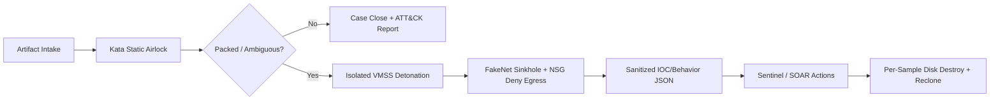
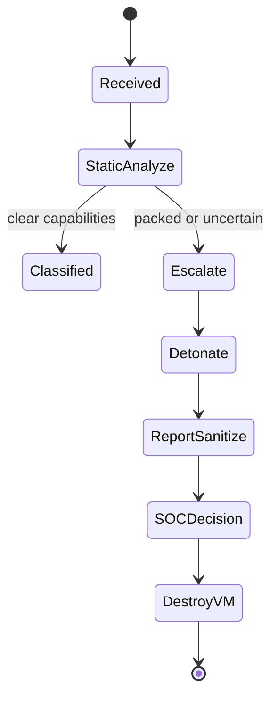

# Enterprise Autonomous SOC Binary Reverse-Engineering and Suspicious Artifact Detonation Sandbox Selection FAQ (Azure)

> Topic ID: #451 · Domain: 3.1 Runtime Hosting, Sandboxing, and Isolation
> Scope: defensive SOC/DFIR architecture only, emphasizing air-gapped analysis, containment, and auditable trade-offs.

## 1. Executive summary
- Pattern A static airlock solves the majority of triage with minimal risk and minimal per-sample cost.
- Pattern B disposable dynamic detonation is the escalation path for packed or ambiguous samples.
- Pattern C managed detonation intelligence APIs accelerate delivery but introduce quota, cost, and sovereignty limits.
- Pattern D running untrusted binaries in shared runtimes is a prohibited anti-pattern.

## 2. Scope boundaries
- Use cases: phishing payloads, supply-chain packages, suspicious scripts, firmware artifacts, pre-deployment patch validation.
- Goals: minute-level decisions, no external egress, full auditability, small blast radius, SOC automation readiness.
- Constraints: isolated subscriptions, isolated VNets, on-call windows, compliance evidence requirements, budget ceilings.

## 3. Four patterns
- Pattern A: AKS Kata static airlock with Ghidra/Capa/YARA-X/FLOSS and no binary execution.
- Pattern B: VMSS disposable detonation chamber with VMI/CAPEv2/FakeNet and strict per-sample destruction.
- Pattern C: Defender TI / Defender for Endpoint private submission and managed intelligence correlation.
- Pattern D: direct execution in shared AKS/ACA containers (anti-pattern).

## 4. 12-dimension matrix
| Dimension | Pattern A | Pattern B | Pattern C | Pattern D |
|---|---|---|---|---|
| Blast radius | Very low | Low with strict isolation | Low to medium | High |
| Dynamic behavior visibility | Low | High | Medium-high | Uncontrolled |
| Unit economics | Low | Medium-high | High | Superficially low with high risk |
| Deployment complexity | Medium | High | Low | Low |
| Audit and forensics | High | Very high | Medium-high | Low |
| Isolation strength | High | Very high | Medium | Low |
| False-positive control | Medium-high | High | Medium | Low |
| Sovereignty control | High | High | Service-bound | Low |
| Ops staffing burden | Medium | High | Low | Low |
| SLA alignment | High | High | Medium-high | Low |
| Sentinel integration | High | High | High | Low |
| Recommendation | Recommended | Strongly recommended for escalations | Recommended for lean teams | Prohibited |

## 5. Two-tier architecture (static to dynamic)


## 6. Sample lifecycle state machine


## 7. Q1-Q6 quantitative Q&A
- Q1: How to size a two-tier funnel for 5,000 to 50,000 daily artifacts?
  - Target 75-85% static triage and 15-25% dynamic escalations, then tune thresholds by artifact class and historical precision.
- Q2: How to estimate capacity for 180s detonation plus 12s reclone?
  - Use Erlang-C for queueing probability and maintain warm-clone pools around 1.3-1.6x average arrivals at peak windows.
- Q3: How to defend against indirect prompt injection from extracted strings?
  - Normalize, escape, and whitelist structured fields before passing any artifact-derived content to SOC LLM workflows.
- Q4: What is an air-gapped network baseline?
  - Use non-routable RFC6598 segments, deny-all outbound NSG defaults, and private control-plane endpoints only.
- Q5: When does managed API offload beat self-hosted labs?
  - When SOC engineering capacity is limited and sample volume is moderate, while respecting sovereignty and cost limits.
- Q6: When must shared container execution be prohibited?
  - For any unknown executable payload or untrusted package with potential runtime behavior uncertainty.

## 8. Production snippets (Bicep plus PodSpec)
```bicep
resource nsg "Microsoft.Network/networkSecurityGroups@2023-09-01" = {
  name: "detonation-nsg"
  location: resourceGroup().location
  properties: {
    securityRules: [
      { name: "deny-internet-egress" properties: { direction: "Outbound" access: "Deny" protocol: "*" destinationAddressPrefix: "Internet" sourcePortRange: "*" destinationPortRange: "*" priority: 100 } }
    ]
  }
}
```

```yaml
apiVersion: v1
kind: Pod
metadata:
  name: ghidra-static-airlock
spec:
  runtimeClassName: kata-cc
  containers:
  - name: analyzer
    image: ghcr.io/enterprise/ghidra-capa-yarax:stable
    securityContext:
      readOnlyRootFilesystem: true
      allowPrivilegeEscalation: false
  restartPolicy: Never
```

## 9. Scenario 1: global financial-services 24x7 SOC
- Sentinel-integrated triage where static analysis handles volume and dynamic detonation handles uncertain escalations.
- Warm clone pools keep escalation queue latency inside SOC response SLO.
- Full evidence chain retention supports external audits and incident postmortems.

## 10. Scenario 2: defense/manufacturing OT firmware verification
- Vendor firmware and patch artifacts are analyzed before deployment windows.
- Detonation environments remain disconnected from production enterprise routes.
- Sanitized outputs are used for policy decisions and release gating.

## 11. Three-year TCO (1k / 10k / 50k artifacts per day)
| Scale | Pattern A | Pattern B | Pattern C | Incident exposure reference |
|---|---:|---:|---:|---:|
| 1k/day | $0.55M | $0.91M | $1.12M | $0.30M |
| 10k/day | $2.95M | $5.10M | $7.80M | $1.95M |
| 50k/day | $12.8M | $21.4M | $33.6M | $9.70M |

## 12. Day-0 / Day-1 / Day-2 checklist
### Day-0
1. Define sample classes and escalation thresholds
2. Create isolated subscriptions and VNets
3. Define SOC approval and rollback flow
4. Set evidence storage baseline
5. Apply mandatory cost tags and alerts
### Day-1
1. Deploy Kata static reverse-engineering pipeline
2. Deploy disposable VMSS detonation pools
3. Enable FakeNet and deny-all egress baseline
4. Implement IOC/string sanitization output contract
5. Integrate Sentinel/SOAR response actions
### Day-2
1. Optimize funnel thresholds and spend
2. Drill disaster recovery and failover
3. Review false positive and false negative trends weekly
4. Tune queue and warm-pool parameters
5. Refresh audit artifacts and runbooks

## 13. Good fit vs Not for
- Good fit: high-volume suspicious artifacts in regulated sectors requiring strict containment and automation.
- Not for: teams without isolation budget, audit obligations, or long-term SOC operations ownership.

## 14. Risks and mitigations
- Risk: Queue saturation during campaigns
  - Mitigation: staged thresholds, fallback routing, strict output schemas, automated archival, and capacity pre-plans.
- Risk: Over-escalation increasing spend
  - Mitigation: staged thresholds, fallback routing, strict output schemas, automated archival, and capacity pre-plans.
- Risk: Unsanitized output causing prompt injection
  - Mitigation: staged thresholds, fallback routing, strict output schemas, automated archival, and capacity pre-plans.
- Risk: Evidence chain gaps
  - Mitigation: staged thresholds, fallback routing, strict output schemas, automated archival, and capacity pre-plans.
- Risk: Managed API quota depletion
  - Mitigation: staged thresholds, fallback routing, strict output schemas, automated archival, and capacity pre-plans.

## 15. References and retrieval timestamps
- Source: AKS security and isolation documentation · https://learn.microsoft.com/azure/aks/ · Retrieved: 2026-11-26 (UTC+8)
- Source: Microsoft Sentinel documentation · https://learn.microsoft.com/azure/sentinel/ · Retrieved: 2026-11-26 (UTC+8)
- Source: Defender threat intelligence documentation · https://learn.microsoft.com/defender/ · Retrieved: 2026-11-26 (UTC+8)
- Source: CAPEv2 project · https://github.com/kevoreilly/CAPEv2 · Retrieved: 2026-11-26 (UTC+8)
- Source: Ghidra project · https://github.com/NationalSecurityAgency/ghidra · Retrieved: 2026-11-26 (UTC+8)

---

### Appendix A: SOC metric dictionary
- `static_triage_coverage`: define threshold, severity, escalation action, and owner.
- `dynamic_escalation_rate`: define threshold, severity, escalation action, and owner.
- `queue_wait_p95`: define threshold, severity, escalation action, and owner.
- `sample_destroy_sla`: define threshold, severity, escalation action, and owner.
- `ioc_sanitize_failure_rate`: define threshold, severity, escalation action, and owner.
- `prompt_injection_block_rate`: define threshold, severity, escalation action, and owner.

### Appendix B: audit evidence items
- Audit item 01: retain sample hash, run metadata, destruction proof, approval trail, and case linkage.
- Audit item 02: retain sample hash, run metadata, destruction proof, approval trail, and case linkage.
- Audit item 03: retain sample hash, run metadata, destruction proof, approval trail, and case linkage.
- Audit item 04: retain sample hash, run metadata, destruction proof, approval trail, and case linkage.
- Audit item 05: retain sample hash, run metadata, destruction proof, approval trail, and case linkage.
- Audit item 06: retain sample hash, run metadata, destruction proof, approval trail, and case linkage.
- Audit item 07: retain sample hash, run metadata, destruction proof, approval trail, and case linkage.
- Audit item 08: retain sample hash, run metadata, destruction proof, approval trail, and case linkage.
- Audit item 09: retain sample hash, run metadata, destruction proof, approval trail, and case linkage.
- Audit item 10: retain sample hash, run metadata, destruction proof, approval trail, and case linkage.
- Audit item 11: retain sample hash, run metadata, destruction proof, approval trail, and case linkage.
- Audit item 12: retain sample hash, run metadata, destruction proof, approval trail, and case linkage.
- Audit item 13: retain sample hash, run metadata, destruction proof, approval trail, and case linkage.
- Audit item 14: retain sample hash, run metadata, destruction proof, approval trail, and case linkage.
- Audit item 15: retain sample hash, run metadata, destruction proof, approval trail, and case linkage.
- Audit item 16: retain sample hash, run metadata, destruction proof, approval trail, and case linkage.
- Audit item 17: retain sample hash, run metadata, destruction proof, approval trail, and case linkage.
- Audit item 18: retain sample hash, run metadata, destruction proof, approval trail, and case linkage.
- Audit item 19: retain sample hash, run metadata, destruction proof, approval trail, and case linkage.
- Audit item 20: retain sample hash, run metadata, destruction proof, approval trail, and case linkage.
- Audit item 21: retain sample hash, run metadata, destruction proof, approval trail, and case linkage.
- Audit item 22: retain sample hash, run metadata, destruction proof, approval trail, and case linkage.
- Audit item 23: retain sample hash, run metadata, destruction proof, approval trail, and case linkage.
- Audit item 24: retain sample hash, run metadata, destruction proof, approval trail, and case linkage.
- Audit item 25: retain sample hash, run metadata, destruction proof, approval trail, and case linkage.
- Audit item 26: retain sample hash, run metadata, destruction proof, approval trail, and case linkage.
- Audit item 27: retain sample hash, run metadata, destruction proof, approval trail, and case linkage.
- Audit item 28: retain sample hash, run metadata, destruction proof, approval trail, and case linkage.
- Audit item 29: retain sample hash, run metadata, destruction proof, approval trail, and case linkage.
- Audit item 30: retain sample hash, run metadata, destruction proof, approval trail, and case linkage.
- Audit item 31: retain sample hash, run metadata, destruction proof, approval trail, and case linkage.
- Audit item 32: retain sample hash, run metadata, destruction proof, approval trail, and case linkage.
- Audit item 33: retain sample hash, run metadata, destruction proof, approval trail, and case linkage.
- Audit item 34: retain sample hash, run metadata, destruction proof, approval trail, and case linkage.
- Audit item 35: retain sample hash, run metadata, destruction proof, approval trail, and case linkage.
- Audit item 36: retain sample hash, run metadata, destruction proof, approval trail, and case linkage.
- Audit item 37: retain sample hash, run metadata, destruction proof, approval trail, and case linkage.
- Audit item 38: retain sample hash, run metadata, destruction proof, approval trail, and case linkage.
- Audit item 39: retain sample hash, run metadata, destruction proof, approval trail, and case linkage.
- Audit item 40: retain sample hash, run metadata, destruction proof, approval trail, and case linkage.
- Audit item 41: retain sample hash, run metadata, destruction proof, approval trail, and case linkage.
- Audit item 42: retain sample hash, run metadata, destruction proof, approval trail, and case linkage.
- Audit item 43: retain sample hash, run metadata, destruction proof, approval trail, and case linkage.
- Audit item 44: retain sample hash, run metadata, destruction proof, approval trail, and case linkage.
- Audit item 45: retain sample hash, run metadata, destruction proof, approval trail, and case linkage.
- Audit item 46: retain sample hash, run metadata, destruction proof, approval trail, and case linkage.
- Audit item 47: retain sample hash, run metadata, destruction proof, approval trail, and case linkage.
- Audit item 48: retain sample hash, run metadata, destruction proof, approval trail, and case linkage.
- Audit item 49: retain sample hash, run metadata, destruction proof, approval trail, and case linkage.
- Audit item 50: retain sample hash, run metadata, destruction proof, approval trail, and case linkage.

### Appendix C: extended implementation checkpoints
- Checkpoint 001: verify isolation policy, egress deny controls, sanitization contract, queue settings, audit chain, and FinOps tags.
- Checkpoint 002: verify isolation policy, egress deny controls, sanitization contract, queue settings, audit chain, and FinOps tags.
- Checkpoint 003: verify isolation policy, egress deny controls, sanitization contract, queue settings, audit chain, and FinOps tags.
- Checkpoint 004: verify isolation policy, egress deny controls, sanitization contract, queue settings, audit chain, and FinOps tags.
- Checkpoint 005: verify isolation policy, egress deny controls, sanitization contract, queue settings, audit chain, and FinOps tags.
- Checkpoint 006: verify isolation policy, egress deny controls, sanitization contract, queue settings, audit chain, and FinOps tags.
- Checkpoint 007: verify isolation policy, egress deny controls, sanitization contract, queue settings, audit chain, and FinOps tags.
- Checkpoint 008: verify isolation policy, egress deny controls, sanitization contract, queue settings, audit chain, and FinOps tags.
- Checkpoint 009: verify isolation policy, egress deny controls, sanitization contract, queue settings, audit chain, and FinOps tags.
- Checkpoint 010: verify isolation policy, egress deny controls, sanitization contract, queue settings, audit chain, and FinOps tags.
- Checkpoint 011: verify isolation policy, egress deny controls, sanitization contract, queue settings, audit chain, and FinOps tags.
- Checkpoint 012: verify isolation policy, egress deny controls, sanitization contract, queue settings, audit chain, and FinOps tags.
- Checkpoint 013: verify isolation policy, egress deny controls, sanitization contract, queue settings, audit chain, and FinOps tags.
- Checkpoint 014: verify isolation policy, egress deny controls, sanitization contract, queue settings, audit chain, and FinOps tags.
- Checkpoint 015: verify isolation policy, egress deny controls, sanitization contract, queue settings, audit chain, and FinOps tags.
- Checkpoint 016: verify isolation policy, egress deny controls, sanitization contract, queue settings, audit chain, and FinOps tags.
- Checkpoint 017: verify isolation policy, egress deny controls, sanitization contract, queue settings, audit chain, and FinOps tags.
- Checkpoint 018: verify isolation policy, egress deny controls, sanitization contract, queue settings, audit chain, and FinOps tags.
- Checkpoint 019: verify isolation policy, egress deny controls, sanitization contract, queue settings, audit chain, and FinOps tags.
- Checkpoint 020: verify isolation policy, egress deny controls, sanitization contract, queue settings, audit chain, and FinOps tags.
- Checkpoint 021: verify isolation policy, egress deny controls, sanitization contract, queue settings, audit chain, and FinOps tags.
- Checkpoint 022: verify isolation policy, egress deny controls, sanitization contract, queue settings, audit chain, and FinOps tags.
- Checkpoint 023: verify isolation policy, egress deny controls, sanitization contract, queue settings, audit chain, and FinOps tags.
- Checkpoint 024: verify isolation policy, egress deny controls, sanitization contract, queue settings, audit chain, and FinOps tags.
- Checkpoint 025: verify isolation policy, egress deny controls, sanitization contract, queue settings, audit chain, and FinOps tags.
- Checkpoint 026: verify isolation policy, egress deny controls, sanitization contract, queue settings, audit chain, and FinOps tags.
- Checkpoint 027: verify isolation policy, egress deny controls, sanitization contract, queue settings, audit chain, and FinOps tags.
- Checkpoint 028: verify isolation policy, egress deny controls, sanitization contract, queue settings, audit chain, and FinOps tags.
- Checkpoint 029: verify isolation policy, egress deny controls, sanitization contract, queue settings, audit chain, and FinOps tags.
- Checkpoint 030: verify isolation policy, egress deny controls, sanitization contract, queue settings, audit chain, and FinOps tags.
- Checkpoint 031: verify isolation policy, egress deny controls, sanitization contract, queue settings, audit chain, and FinOps tags.
- Checkpoint 032: verify isolation policy, egress deny controls, sanitization contract, queue settings, audit chain, and FinOps tags.
- Checkpoint 033: verify isolation policy, egress deny controls, sanitization contract, queue settings, audit chain, and FinOps tags.
- Checkpoint 034: verify isolation policy, egress deny controls, sanitization contract, queue settings, audit chain, and FinOps tags.
- Checkpoint 035: verify isolation policy, egress deny controls, sanitization contract, queue settings, audit chain, and FinOps tags.
- Checkpoint 036: verify isolation policy, egress deny controls, sanitization contract, queue settings, audit chain, and FinOps tags.
- Checkpoint 037: verify isolation policy, egress deny controls, sanitization contract, queue settings, audit chain, and FinOps tags.
- Checkpoint 038: verify isolation policy, egress deny controls, sanitization contract, queue settings, audit chain, and FinOps tags.
- Checkpoint 039: verify isolation policy, egress deny controls, sanitization contract, queue settings, audit chain, and FinOps tags.
- Checkpoint 040: verify isolation policy, egress deny controls, sanitization contract, queue settings, audit chain, and FinOps tags.
- Checkpoint 041: verify isolation policy, egress deny controls, sanitization contract, queue settings, audit chain, and FinOps tags.
- Checkpoint 042: verify isolation policy, egress deny controls, sanitization contract, queue settings, audit chain, and FinOps tags.
- Checkpoint 043: verify isolation policy, egress deny controls, sanitization contract, queue settings, audit chain, and FinOps tags.
- Checkpoint 044: verify isolation policy, egress deny controls, sanitization contract, queue settings, audit chain, and FinOps tags.
- Checkpoint 045: verify isolation policy, egress deny controls, sanitization contract, queue settings, audit chain, and FinOps tags.
- Checkpoint 046: verify isolation policy, egress deny controls, sanitization contract, queue settings, audit chain, and FinOps tags.
- Checkpoint 047: verify isolation policy, egress deny controls, sanitization contract, queue settings, audit chain, and FinOps tags.
- Checkpoint 048: verify isolation policy, egress deny controls, sanitization contract, queue settings, audit chain, and FinOps tags.
- Checkpoint 049: verify isolation policy, egress deny controls, sanitization contract, queue settings, audit chain, and FinOps tags.
- Checkpoint 050: verify isolation policy, egress deny controls, sanitization contract, queue settings, audit chain, and FinOps tags.
- Checkpoint 051: verify isolation policy, egress deny controls, sanitization contract, queue settings, audit chain, and FinOps tags.
- Checkpoint 052: verify isolation policy, egress deny controls, sanitization contract, queue settings, audit chain, and FinOps tags.
- Checkpoint 053: verify isolation policy, egress deny controls, sanitization contract, queue settings, audit chain, and FinOps tags.
- Checkpoint 054: verify isolation policy, egress deny controls, sanitization contract, queue settings, audit chain, and FinOps tags.
- Checkpoint 055: verify isolation policy, egress deny controls, sanitization contract, queue settings, audit chain, and FinOps tags.
- Checkpoint 056: verify isolation policy, egress deny controls, sanitization contract, queue settings, audit chain, and FinOps tags.
- Checkpoint 057: verify isolation policy, egress deny controls, sanitization contract, queue settings, audit chain, and FinOps tags.
- Checkpoint 058: verify isolation policy, egress deny controls, sanitization contract, queue settings, audit chain, and FinOps tags.
- Checkpoint 059: verify isolation policy, egress deny controls, sanitization contract, queue settings, audit chain, and FinOps tags.
- Checkpoint 060: verify isolation policy, egress deny controls, sanitization contract, queue settings, audit chain, and FinOps tags.
- Checkpoint 061: verify isolation policy, egress deny controls, sanitization contract, queue settings, audit chain, and FinOps tags.
- Checkpoint 062: verify isolation policy, egress deny controls, sanitization contract, queue settings, audit chain, and FinOps tags.
- Checkpoint 063: verify isolation policy, egress deny controls, sanitization contract, queue settings, audit chain, and FinOps tags.
- Checkpoint 064: verify isolation policy, egress deny controls, sanitization contract, queue settings, audit chain, and FinOps tags.
- Checkpoint 065: verify isolation policy, egress deny controls, sanitization contract, queue settings, audit chain, and FinOps tags.
- Checkpoint 066: verify isolation policy, egress deny controls, sanitization contract, queue settings, audit chain, and FinOps tags.
- Checkpoint 067: verify isolation policy, egress deny controls, sanitization contract, queue settings, audit chain, and FinOps tags.
- Checkpoint 068: verify isolation policy, egress deny controls, sanitization contract, queue settings, audit chain, and FinOps tags.
- Checkpoint 069: verify isolation policy, egress deny controls, sanitization contract, queue settings, audit chain, and FinOps tags.
- Checkpoint 070: verify isolation policy, egress deny controls, sanitization contract, queue settings, audit chain, and FinOps tags.
- Checkpoint 071: verify isolation policy, egress deny controls, sanitization contract, queue settings, audit chain, and FinOps tags.
- Checkpoint 072: verify isolation policy, egress deny controls, sanitization contract, queue settings, audit chain, and FinOps tags.
- Checkpoint 073: verify isolation policy, egress deny controls, sanitization contract, queue settings, audit chain, and FinOps tags.
- Checkpoint 074: verify isolation policy, egress deny controls, sanitization contract, queue settings, audit chain, and FinOps tags.
- Checkpoint 075: verify isolation policy, egress deny controls, sanitization contract, queue settings, audit chain, and FinOps tags.
- Checkpoint 076: verify isolation policy, egress deny controls, sanitization contract, queue settings, audit chain, and FinOps tags.
- Checkpoint 077: verify isolation policy, egress deny controls, sanitization contract, queue settings, audit chain, and FinOps tags.
- Checkpoint 078: verify isolation policy, egress deny controls, sanitization contract, queue settings, audit chain, and FinOps tags.
- Checkpoint 079: verify isolation policy, egress deny controls, sanitization contract, queue settings, audit chain, and FinOps tags.
- Checkpoint 080: verify isolation policy, egress deny controls, sanitization contract, queue settings, audit chain, and FinOps tags.
- Checkpoint 081: verify isolation policy, egress deny controls, sanitization contract, queue settings, audit chain, and FinOps tags.
- Checkpoint 082: verify isolation policy, egress deny controls, sanitization contract, queue settings, audit chain, and FinOps tags.
- Checkpoint 083: verify isolation policy, egress deny controls, sanitization contract, queue settings, audit chain, and FinOps tags.
- Checkpoint 084: verify isolation policy, egress deny controls, sanitization contract, queue settings, audit chain, and FinOps tags.
- Checkpoint 085: verify isolation policy, egress deny controls, sanitization contract, queue settings, audit chain, and FinOps tags.
- Checkpoint 086: verify isolation policy, egress deny controls, sanitization contract, queue settings, audit chain, and FinOps tags.
- Checkpoint 087: verify isolation policy, egress deny controls, sanitization contract, queue settings, audit chain, and FinOps tags.
- Checkpoint 088: verify isolation policy, egress deny controls, sanitization contract, queue settings, audit chain, and FinOps tags.
- Checkpoint 089: verify isolation policy, egress deny controls, sanitization contract, queue settings, audit chain, and FinOps tags.
- Checkpoint 090: verify isolation policy, egress deny controls, sanitization contract, queue settings, audit chain, and FinOps tags.
- Checkpoint 091: verify isolation policy, egress deny controls, sanitization contract, queue settings, audit chain, and FinOps tags.
- Checkpoint 092: verify isolation policy, egress deny controls, sanitization contract, queue settings, audit chain, and FinOps tags.
- Checkpoint 093: verify isolation policy, egress deny controls, sanitization contract, queue settings, audit chain, and FinOps tags.
- Checkpoint 094: verify isolation policy, egress deny controls, sanitization contract, queue settings, audit chain, and FinOps tags.
- Checkpoint 095: verify isolation policy, egress deny controls, sanitization contract, queue settings, audit chain, and FinOps tags.
- Checkpoint 096: verify isolation policy, egress deny controls, sanitization contract, queue settings, audit chain, and FinOps tags.
- Checkpoint 097: verify isolation policy, egress deny controls, sanitization contract, queue settings, audit chain, and FinOps tags.
- Checkpoint 098: verify isolation policy, egress deny controls, sanitization contract, queue settings, audit chain, and FinOps tags.
- Checkpoint 099: verify isolation policy, egress deny controls, sanitization contract, queue settings, audit chain, and FinOps tags.
- Checkpoint 100: verify isolation policy, egress deny controls, sanitization contract, queue settings, audit chain, and FinOps tags.
- Checkpoint 101: verify isolation policy, egress deny controls, sanitization contract, queue settings, audit chain, and FinOps tags.
- Checkpoint 102: verify isolation policy, egress deny controls, sanitization contract, queue settings, audit chain, and FinOps tags.
- Checkpoint 103: verify isolation policy, egress deny controls, sanitization contract, queue settings, audit chain, and FinOps tags.
- Checkpoint 104: verify isolation policy, egress deny controls, sanitization contract, queue settings, audit chain, and FinOps tags.
- Checkpoint 105: verify isolation policy, egress deny controls, sanitization contract, queue settings, audit chain, and FinOps tags.
- Checkpoint 106: verify isolation policy, egress deny controls, sanitization contract, queue settings, audit chain, and FinOps tags.
- Checkpoint 107: verify isolation policy, egress deny controls, sanitization contract, queue settings, audit chain, and FinOps tags.
- Checkpoint 108: verify isolation policy, egress deny controls, sanitization contract, queue settings, audit chain, and FinOps tags.
- Checkpoint 109: verify isolation policy, egress deny controls, sanitization contract, queue settings, audit chain, and FinOps tags.
- Checkpoint 110: verify isolation policy, egress deny controls, sanitization contract, queue settings, audit chain, and FinOps tags.
- Checkpoint 111: verify isolation policy, egress deny controls, sanitization contract, queue settings, audit chain, and FinOps tags.
- Checkpoint 112: verify isolation policy, egress deny controls, sanitization contract, queue settings, audit chain, and FinOps tags.
- Checkpoint 113: verify isolation policy, egress deny controls, sanitization contract, queue settings, audit chain, and FinOps tags.
- Checkpoint 114: verify isolation policy, egress deny controls, sanitization contract, queue settings, audit chain, and FinOps tags.
- Checkpoint 115: verify isolation policy, egress deny controls, sanitization contract, queue settings, audit chain, and FinOps tags.
- Checkpoint 116: verify isolation policy, egress deny controls, sanitization contract, queue settings, audit chain, and FinOps tags.
- Checkpoint 117: verify isolation policy, egress deny controls, sanitization contract, queue settings, audit chain, and FinOps tags.
- Checkpoint 118: verify isolation policy, egress deny controls, sanitization contract, queue settings, audit chain, and FinOps tags.
- Checkpoint 119: verify isolation policy, egress deny controls, sanitization contract, queue settings, audit chain, and FinOps tags.
- Checkpoint 120: verify isolation policy, egress deny controls, sanitization contract, queue settings, audit chain, and FinOps tags.
- Checkpoint 121: verify isolation policy, egress deny controls, sanitization contract, queue settings, audit chain, and FinOps tags.
- Checkpoint 122: verify isolation policy, egress deny controls, sanitization contract, queue settings, audit chain, and FinOps tags.
- Checkpoint 123: verify isolation policy, egress deny controls, sanitization contract, queue settings, audit chain, and FinOps tags.
- Checkpoint 124: verify isolation policy, egress deny controls, sanitization contract, queue settings, audit chain, and FinOps tags.
- Checkpoint 125: verify isolation policy, egress deny controls, sanitization contract, queue settings, audit chain, and FinOps tags.
- Checkpoint 126: verify isolation policy, egress deny controls, sanitization contract, queue settings, audit chain, and FinOps tags.
- Checkpoint 127: verify isolation policy, egress deny controls, sanitization contract, queue settings, audit chain, and FinOps tags.
- Checkpoint 128: verify isolation policy, egress deny controls, sanitization contract, queue settings, audit chain, and FinOps tags.
- Checkpoint 129: verify isolation policy, egress deny controls, sanitization contract, queue settings, audit chain, and FinOps tags.
- Checkpoint 130: verify isolation policy, egress deny controls, sanitization contract, queue settings, audit chain, and FinOps tags.
- Checkpoint 131: verify isolation policy, egress deny controls, sanitization contract, queue settings, audit chain, and FinOps tags.
- Checkpoint 132: verify isolation policy, egress deny controls, sanitization contract, queue settings, audit chain, and FinOps tags.
- Checkpoint 133: verify isolation policy, egress deny controls, sanitization contract, queue settings, audit chain, and FinOps tags.
- Checkpoint 134: verify isolation policy, egress deny controls, sanitization contract, queue settings, audit chain, and FinOps tags.
- Checkpoint 135: verify isolation policy, egress deny controls, sanitization contract, queue settings, audit chain, and FinOps tags.
- Checkpoint 136: verify isolation policy, egress deny controls, sanitization contract, queue settings, audit chain, and FinOps tags.
- Checkpoint 137: verify isolation policy, egress deny controls, sanitization contract, queue settings, audit chain, and FinOps tags.
- Checkpoint 138: verify isolation policy, egress deny controls, sanitization contract, queue settings, audit chain, and FinOps tags.
- Checkpoint 139: verify isolation policy, egress deny controls, sanitization contract, queue settings, audit chain, and FinOps tags.
- Checkpoint 140: verify isolation policy, egress deny controls, sanitization contract, queue settings, audit chain, and FinOps tags.
- Checkpoint 141: verify isolation policy, egress deny controls, sanitization contract, queue settings, audit chain, and FinOps tags.
- Checkpoint 142: verify isolation policy, egress deny controls, sanitization contract, queue settings, audit chain, and FinOps tags.
- Checkpoint 143: verify isolation policy, egress deny controls, sanitization contract, queue settings, audit chain, and FinOps tags.
- Checkpoint 144: verify isolation policy, egress deny controls, sanitization contract, queue settings, audit chain, and FinOps tags.
- Checkpoint 145: verify isolation policy, egress deny controls, sanitization contract, queue settings, audit chain, and FinOps tags.
- Checkpoint 146: verify isolation policy, egress deny controls, sanitization contract, queue settings, audit chain, and FinOps tags.
- Checkpoint 147: verify isolation policy, egress deny controls, sanitization contract, queue settings, audit chain, and FinOps tags.
- Checkpoint 148: verify isolation policy, egress deny controls, sanitization contract, queue settings, audit chain, and FinOps tags.
- Checkpoint 149: verify isolation policy, egress deny controls, sanitization contract, queue settings, audit chain, and FinOps tags.
- Checkpoint 150: verify isolation policy, egress deny controls, sanitization contract, queue settings, audit chain, and FinOps tags.
- Checkpoint 151: verify isolation policy, egress deny controls, sanitization contract, queue settings, audit chain, and FinOps tags.
- Checkpoint 152: verify isolation policy, egress deny controls, sanitization contract, queue settings, audit chain, and FinOps tags.
- Checkpoint 153: verify isolation policy, egress deny controls, sanitization contract, queue settings, audit chain, and FinOps tags.
- Checkpoint 154: verify isolation policy, egress deny controls, sanitization contract, queue settings, audit chain, and FinOps tags.
- Checkpoint 155: verify isolation policy, egress deny controls, sanitization contract, queue settings, audit chain, and FinOps tags.
- Checkpoint 156: verify isolation policy, egress deny controls, sanitization contract, queue settings, audit chain, and FinOps tags.
- Checkpoint 157: verify isolation policy, egress deny controls, sanitization contract, queue settings, audit chain, and FinOps tags.
- Checkpoint 158: verify isolation policy, egress deny controls, sanitization contract, queue settings, audit chain, and FinOps tags.
- Checkpoint 159: verify isolation policy, egress deny controls, sanitization contract, queue settings, audit chain, and FinOps tags.
- Checkpoint 160: verify isolation policy, egress deny controls, sanitization contract, queue settings, audit chain, and FinOps tags.
- Checkpoint 161: verify isolation policy, egress deny controls, sanitization contract, queue settings, audit chain, and FinOps tags.
- Checkpoint 162: verify isolation policy, egress deny controls, sanitization contract, queue settings, audit chain, and FinOps tags.
- Checkpoint 163: verify isolation policy, egress deny controls, sanitization contract, queue settings, audit chain, and FinOps tags.
- Checkpoint 164: verify isolation policy, egress deny controls, sanitization contract, queue settings, audit chain, and FinOps tags.
- Checkpoint 165: verify isolation policy, egress deny controls, sanitization contract, queue settings, audit chain, and FinOps tags.
- Checkpoint 166: verify isolation policy, egress deny controls, sanitization contract, queue settings, audit chain, and FinOps tags.
- Checkpoint 167: verify isolation policy, egress deny controls, sanitization contract, queue settings, audit chain, and FinOps tags.
- Checkpoint 168: verify isolation policy, egress deny controls, sanitization contract, queue settings, audit chain, and FinOps tags.
- Checkpoint 169: verify isolation policy, egress deny controls, sanitization contract, queue settings, audit chain, and FinOps tags.
- Checkpoint 170: verify isolation policy, egress deny controls, sanitization contract, queue settings, audit chain, and FinOps tags.
- Checkpoint 171: verify isolation policy, egress deny controls, sanitization contract, queue settings, audit chain, and FinOps tags.
- Checkpoint 172: verify isolation policy, egress deny controls, sanitization contract, queue settings, audit chain, and FinOps tags.
- Checkpoint 173: verify isolation policy, egress deny controls, sanitization contract, queue settings, audit chain, and FinOps tags.
- Checkpoint 174: verify isolation policy, egress deny controls, sanitization contract, queue settings, audit chain, and FinOps tags.
- Checkpoint 175: verify isolation policy, egress deny controls, sanitization contract, queue settings, audit chain, and FinOps tags.
- Checkpoint 176: verify isolation policy, egress deny controls, sanitization contract, queue settings, audit chain, and FinOps tags.
- Checkpoint 177: verify isolation policy, egress deny controls, sanitization contract, queue settings, audit chain, and FinOps tags.
- Checkpoint 178: verify isolation policy, egress deny controls, sanitization contract, queue settings, audit chain, and FinOps tags.
- Checkpoint 179: verify isolation policy, egress deny controls, sanitization contract, queue settings, audit chain, and FinOps tags.
- Checkpoint 180: verify isolation policy, egress deny controls, sanitization contract, queue settings, audit chain, and FinOps tags.
- Checkpoint 181: verify isolation policy, egress deny controls, sanitization contract, queue settings, audit chain, and FinOps tags.
- Checkpoint 182: verify isolation policy, egress deny controls, sanitization contract, queue settings, audit chain, and FinOps tags.
- Checkpoint 183: verify isolation policy, egress deny controls, sanitization contract, queue settings, audit chain, and FinOps tags.
- Checkpoint 184: verify isolation policy, egress deny controls, sanitization contract, queue settings, audit chain, and FinOps tags.
- Checkpoint 185: verify isolation policy, egress deny controls, sanitization contract, queue settings, audit chain, and FinOps tags.
- Checkpoint 186: verify isolation policy, egress deny controls, sanitization contract, queue settings, audit chain, and FinOps tags.
- Checkpoint 187: verify isolation policy, egress deny controls, sanitization contract, queue settings, audit chain, and FinOps tags.
- Checkpoint 188: verify isolation policy, egress deny controls, sanitization contract, queue settings, audit chain, and FinOps tags.
- Checkpoint 189: verify isolation policy, egress deny controls, sanitization contract, queue settings, audit chain, and FinOps tags.
- Checkpoint 190: verify isolation policy, egress deny controls, sanitization contract, queue settings, audit chain, and FinOps tags.
- Checkpoint 191: verify isolation policy, egress deny controls, sanitization contract, queue settings, audit chain, and FinOps tags.
- Checkpoint 192: verify isolation policy, egress deny controls, sanitization contract, queue settings, audit chain, and FinOps tags.
- Checkpoint 193: verify isolation policy, egress deny controls, sanitization contract, queue settings, audit chain, and FinOps tags.
- Checkpoint 194: verify isolation policy, egress deny controls, sanitization contract, queue settings, audit chain, and FinOps tags.
- Checkpoint 195: verify isolation policy, egress deny controls, sanitization contract, queue settings, audit chain, and FinOps tags.
- Checkpoint 196: verify isolation policy, egress deny controls, sanitization contract, queue settings, audit chain, and FinOps tags.
- Checkpoint 197: verify isolation policy, egress deny controls, sanitization contract, queue settings, audit chain, and FinOps tags.
- Checkpoint 198: verify isolation policy, egress deny controls, sanitization contract, queue settings, audit chain, and FinOps tags.
- Checkpoint 199: verify isolation policy, egress deny controls, sanitization contract, queue settings, audit chain, and FinOps tags.
- Checkpoint 200: verify isolation policy, egress deny controls, sanitization contract, queue settings, audit chain, and FinOps tags.
- Checkpoint 201: verify isolation policy, egress deny controls, sanitization contract, queue settings, audit chain, and FinOps tags.
- Checkpoint 202: verify isolation policy, egress deny controls, sanitization contract, queue settings, audit chain, and FinOps tags.
- Checkpoint 203: verify isolation policy, egress deny controls, sanitization contract, queue settings, audit chain, and FinOps tags.
- Checkpoint 204: verify isolation policy, egress deny controls, sanitization contract, queue settings, audit chain, and FinOps tags.
- Checkpoint 205: verify isolation policy, egress deny controls, sanitization contract, queue settings, audit chain, and FinOps tags.
- Checkpoint 206: verify isolation policy, egress deny controls, sanitization contract, queue settings, audit chain, and FinOps tags.
- Checkpoint 207: verify isolation policy, egress deny controls, sanitization contract, queue settings, audit chain, and FinOps tags.
- Checkpoint 208: verify isolation policy, egress deny controls, sanitization contract, queue settings, audit chain, and FinOps tags.
- Checkpoint 209: verify isolation policy, egress deny controls, sanitization contract, queue settings, audit chain, and FinOps tags.
- Checkpoint 210: verify isolation policy, egress deny controls, sanitization contract, queue settings, audit chain, and FinOps tags.
- Checkpoint 211: verify isolation policy, egress deny controls, sanitization contract, queue settings, audit chain, and FinOps tags.
- Checkpoint 212: verify isolation policy, egress deny controls, sanitization contract, queue settings, audit chain, and FinOps tags.
- Checkpoint 213: verify isolation policy, egress deny controls, sanitization contract, queue settings, audit chain, and FinOps tags.
- Checkpoint 214: verify isolation policy, egress deny controls, sanitization contract, queue settings, audit chain, and FinOps tags.
- Checkpoint 215: verify isolation policy, egress deny controls, sanitization contract, queue settings, audit chain, and FinOps tags.
- Checkpoint 216: verify isolation policy, egress deny controls, sanitization contract, queue settings, audit chain, and FinOps tags.
- Checkpoint 217: verify isolation policy, egress deny controls, sanitization contract, queue settings, audit chain, and FinOps tags.
- Checkpoint 218: verify isolation policy, egress deny controls, sanitization contract, queue settings, audit chain, and FinOps tags.
- Checkpoint 219: verify isolation policy, egress deny controls, sanitization contract, queue settings, audit chain, and FinOps tags.
- Checkpoint 220: verify isolation policy, egress deny controls, sanitization contract, queue settings, audit chain, and FinOps tags.
- Checkpoint 221: verify isolation policy, egress deny controls, sanitization contract, queue settings, audit chain, and FinOps tags.
- Checkpoint 222: verify isolation policy, egress deny controls, sanitization contract, queue settings, audit chain, and FinOps tags.
- Checkpoint 223: verify isolation policy, egress deny controls, sanitization contract, queue settings, audit chain, and FinOps tags.
- Checkpoint 224: verify isolation policy, egress deny controls, sanitization contract, queue settings, audit chain, and FinOps tags.
- Checkpoint 225: verify isolation policy, egress deny controls, sanitization contract, queue settings, audit chain, and FinOps tags.
- Checkpoint 226: verify isolation policy, egress deny controls, sanitization contract, queue settings, audit chain, and FinOps tags.
- Checkpoint 227: verify isolation policy, egress deny controls, sanitization contract, queue settings, audit chain, and FinOps tags.
- Checkpoint 228: verify isolation policy, egress deny controls, sanitization contract, queue settings, audit chain, and FinOps tags.
- Checkpoint 229: verify isolation policy, egress deny controls, sanitization contract, queue settings, audit chain, and FinOps tags.
- Checkpoint 230: verify isolation policy, egress deny controls, sanitization contract, queue settings, audit chain, and FinOps tags.

