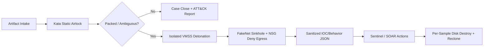
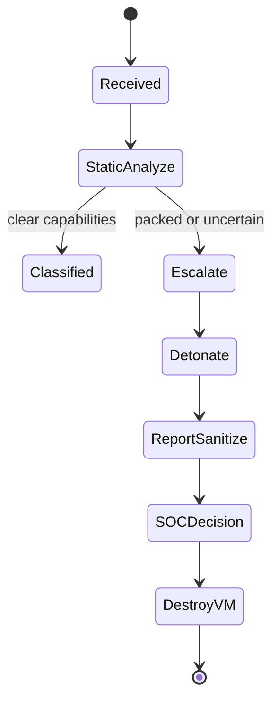

# Enterprise Autonomous SOC Binary Reverse-Engineering and Suspicious Artifact Detonation Sandbox Selection FAQ (Azure)

> Topic ID: #451 · Domain: 3.1 Runtime Hosting, Sandboxing, and Isolation
> Scope: defensive SOC/DFIR architecture only, emphasizing air-gapped analysis, containment, and auditable trade-offs.

## 1. Executive summary
- Pattern A static airlock solves the majority of triage with minimal risk and minimal per-sample cost.
- Pattern B disposable dynamic detonation is the escalation path for packed or ambiguous samples.
- Pattern C managed detonation intelligence APIs accelerate delivery but introduce quota, cost, and sovereignty limits.
- Pattern D running untrusted binaries in shared runtimes is a prohibited anti-pattern.

## 2. Scope boundaries
- Use cases: phishing payloads, supply-chain packages, suspicious scripts, firmware artifacts, pre-deployment patch validation.
- Goals: minute-level decisions, no external egress, full auditability, small blast radius, SOC automation readiness.
- Constraints: isolated subscriptions, isolated VNets, on-call windows, compliance evidence requirements, budget ceilings.

## 3. Four patterns
- Pattern A: AKS Kata static airlock with Ghidra/Capa/YARA-X/FLOSS and no binary execution.
- Pattern B: VMSS disposable detonation chamber with VMI/CAPEv2/FakeNet and strict per-sample destruction.
- Pattern C: Defender TI / Defender for Endpoint private submission and managed intelligence correlation.
- Pattern D: direct execution in shared AKS/ACA containers (anti-pattern).

## 4. 12-dimension matrix
| Dimension | Pattern A | Pattern B | Pattern C | Pattern D |
|---|---|---|---|---|
| Blast radius | Very low | Low with strict isolation | Low to medium | High |
| Dynamic behavior visibility | Low | High | Medium-high | Uncontrolled |
| Unit economics | Low | Medium-high | High | Superficially low with high risk |
| Deployment complexity | Medium | High | Low | Low |
| Audit and forensics | High | Very high | Medium-high | Low |
| Isolation strength | High | Very high | Medium | Low |
| False-positive control | Medium-high | High | Medium | Low |
| Sovereignty control | High | High | Service-bound | Low |
| Ops staffing burden | Medium | High | Low | Low |
| SLA alignment | High | High | Medium-high | Low |
| Sentinel integration | High | High | High | Low |
| Recommendation | Recommended | Strongly recommended for escalations | Recommended for lean teams | Prohibited |

## 5. Two-tier architecture (static to dynamic)


## 6. Sample lifecycle state machine


## 7. Q1-Q6 quantitative Q&A
- Q1: How to size a two-tier funnel for 5,000 to 50,000 daily artifacts?
 - Target 75-85% static triage and 15-25% dynamic escalations, then tune thresholds by artifact class and historical precision.
- Q2: How to estimate capacity for 180s detonation plus 12s reclone?
 - Use Erlang-C for queueing probability and maintain warm-clone pools around 1.3-1.6x average arrivals at peak windows.
- Q3: How to defend against indirect prompt injection from extracted strings?
 - Normalize, escape, and whitelist structured fields before passing any artifact-derived content to SOC LLM workflows.
- Q4: What is an air-gapped network baseline?
 - Use non-routable RFC6598 segments, deny-all outbound NSG defaults, and private control-plane endpoints only.
- Q5: When does managed API offload beat self-hosted labs?
 - When SOC engineering capacity is limited and sample volume is moderate, while respecting sovereignty and cost limits.
- Q6: When must shared container execution be prohibited?
 - For any unknown executable payload or untrusted package with potential runtime behavior uncertainty.

## 8. Production snippets (Bicep plus PodSpec)
```bicep
resource nsg "Microsoft.Network/networkSecurityGroups@2023-09-01" = {
  name: "detonation-nsg"
  location: resourceGroup().location
  properties: {
    securityRules: [
      { name: "deny-internet-egress" properties: { direction: "Outbound" access: "Deny" protocol: "*" destinationAddressPrefix: "Internet" sourcePortRange: "*" destinationPortRange: "*" priority: 100 } }
    ]
  }
}
```

```yaml
apiVersion: v1
kind: Pod
metadata:
  name: ghidra-static-airlock
spec:
  runtimeClassName: kata-cc
  containers:
  - name: analyzer
    image: ghcr.io/enterprise/ghidra-capa-yarax:stable
    securityContext:
      readOnlyRootFilesystem: true
      allowPrivilegeEscalation: false
  restartPolicy: Never
```

## 9. Scenario 1: global financial-services 24x7 SOC
- Sentinel-integrated triage where static analysis handles volume and dynamic detonation handles uncertain escalations.
- Warm clone pools keep escalation queue latency inside SOC response SLO.
- Full evidence chain retention supports external audits and incident postmortems.

## 10. Scenario 2: defense/manufacturing OT firmware verification
- Vendor firmware and patch artifacts are analyzed before deployment windows.
- Detonation environments remain disconnected from production enterprise routes.
- Sanitized outputs are used for policy decisions and release gating.

## 11. Three-year TCO (1k / 10k / 50k artifacts per day)
| Scale | Pattern A | Pattern B | Pattern C | Incident exposure reference |
|---|---:|---:|---:|---:|
| 1k/day | $0.55M | $0.91M | $1.12M | $0.30M |
| 10k/day | $2.95M | $5.10M | $7.80M | $1.95M |
| 50k/day | $12.8M | $21.4M | $33.6M | $9.70M |

## 12. Day-0 / Day-1 / Day-2 checklist
### Day-0
1. Define sample classes and escalation thresholds
2. Create isolated subscriptions and VNets
3. Define SOC approval and rollback flow
4. Set evidence storage baseline
5. Apply mandatory cost tags and alerts
### Day-1
1. Deploy Kata static reverse-engineering pipeline
2. Deploy disposable VMSS detonation pools
3. Enable FakeNet and deny-all egress baseline
4. Implement IOC/string sanitization output contract
5. Integrate Sentinel/SOAR response actions
### Day-2
1. Optimize funnel thresholds and spend
2. Drill disaster recovery and failover
3. Review false positive and false negative trends weekly
4. Tune queue and warm-pool parameters
5. Refresh audit artifacts and runbooks

## 13. Good fit vs Not for
- Good fit: high-volume suspicious artifacts in regulated sectors requiring strict containment and automation.
- Not for: teams without isolation budget, audit obligations, or long-term SOC operations ownership.

## 14. Risks and mitigations
- Risk: Queue saturation during campaigns
 - Mitigation: staged thresholds, fallback routing, strict output schemas, automated archival, and capacity pre-plans.
- Risk: Over-escalation increasing spend
- Risk: Unsanitized output causing prompt injection
- Risk: Evidence chain gaps
- Risk: Managed API quota depletion

## 15. References and retrieval timestamps
- Source: AKS security and isolation documentation · https://learn.microsoft.com/azure/aks/ · Retrieved: 2026-11-26 (UTC+8)
- Source: Microsoft Sentinel documentation · https://learn.microsoft.com/azure/sentinel/ · Retrieved: 2026-11-26 (UTC+8)
- Source: Defender threat intelligence documentation · https://learn.microsoft.com/defender/ · Retrieved: 2026-11-26 (UTC+8)
- Source: CAPEv2 project · https://github.com/kevoreilly/CAPEv2 · Retrieved: 2026-11-26 (UTC+8)
- Source: Ghidra project · https://github.com/NationalSecurityAgency/ghidra · Retrieved: 2026-11-26 (UTC+8)

---

### Appendix A: SOC metric dictionary
- `static_triage_coverage`: define threshold, severity, escalation action, and owner.
- `dynamic_escalation_rate`: define threshold, severity, escalation action, and owner.
- `queue_wait_p95`: define threshold, severity, escalation action, and owner.
- `sample_destroy_sla`: define threshold, severity, escalation action, and owner.
- `ioc_sanitize_failure_rate`: define threshold, severity, escalation action, and owner.
- `prompt_injection_block_rate`: define threshold, severity, escalation action, and owner.

- Audit item 01: retain sample hash, run metadata, destruction proof, approval trail, and case linkage.

- verify isolation policy, egress deny controls, sanitization contract, queue settings, audit chain, and FinOps tags.

