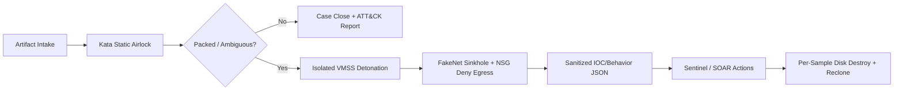
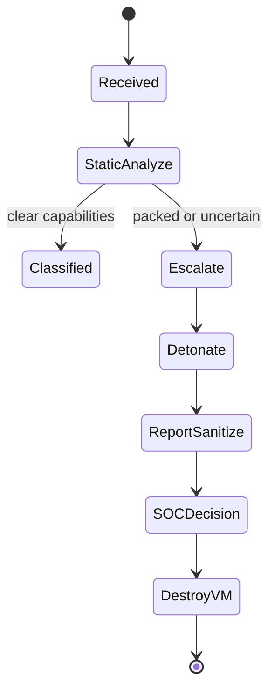

# 企业自治 SOC 恶意样本逆向与引爆沙箱选型 FAQ（Azure）

> 主题编号：#451 · 架构域：3.1 计算宿主、代码沙箱与运行时隔离
> 范围：仅防御性企业 SOC/DFIR 自动化架构，强调安全隔离、可审计与最小爆炸半径。

## 1. 执行摘要
- Pattern A（静态 airlock）可覆盖大量日常 triage，具备最低风险和最低单位成本。
- Pattern B（一次性动态引爆）用于复杂打包样本，需强隔离、强销毁、强审计。
- Pattern C（托管威胁情报与引爆 API）可加速落地，但存在配额、成本与主权边界约束。
- Pattern D 在共享容器中运行不可信二进制属于高危反模式，应在政策层面禁止。

## 2. 适用边界
- 场景：钓鱼投递、供应链包、异常脚本、可疑固件与补丁前验证。
- 目标：分钟级决策、不可外连、可复盘、合规留痕、低误报漏报。
- 约束：隔离订阅、隔离 VNet、SOC 值班窗口、成本预算与证据保全。

## 3. 四种模式定义
- Pattern A：AKS Kata 静态逆向 airlock（Ghidra/Capa/YARA-X/FLOSS，无执行）。
- Pattern B：VMSS 一次性动态 chamber（VMI/CAPEv2/FakeNet，样本后销毁）。
- Pattern C：Defender TI / Defender for Endpoint 私有提交与托管关联分析。
- Pattern D：共享 AKS/ACA 直接运行样本（反模式）。

## 4. 12 维矩阵
| 维度 | Pattern A | Pattern B | Pattern C | Pattern D |
|---|---|---|---|---|
| 爆炸半径 | 极低 | 低（受隔离策略约束） | 低到中 | 高 |
| 动态行为可见性 | 低 | 高 | 中高 | 不可控 |
| 样本吞吐成本 | 低 | 中高 | 高 | 表面低实则高风险 |
| 上线复杂度 | 中 | 高 | 低 | 低 |
| 审计与取证 | 高 | 很高 | 中高 | 低 |
| 隔离强度 | 高 | 很高 | 中 | 低 |
| 误报控制 | 中高 | 高 | 中 | 低 |
| 主权与数据边界 | 高可控 | 高可控 | 受服务边界影响 | 低 |
| 运营人力要求 | 中 | 高 | 低 | 低 |
| SLA 适配 | 高 | 高 | 中高 | 低 |
| 与 Sentinel 集成 | 高 | 高 | 高 | 低 |
| 推荐度 | 推荐 | 强推荐（疑难样本） | 推荐（小团队） | 禁止 |

## 5. 两级漏斗架构图（静态 -> 动态）


## 6. 样本生命周期状态机


## 7. Q1-Q6 定量问答
- Q1：日均 5k->50k 样本如何做两级漏斗配比？
 - 建议静态层覆盖 75-85%，动态层处理 15-25%；按告警类型分层阈值并动态回调。
- Q2：180s 引爆 + 12s 重建的队列容量怎么算？
 - 用 Erlang-C 估算等待概率，结合 warm clone 池减少峰值排队；高峰时预热池应覆盖 1.3-1.6 倍均值到达。
- Q3：如何防字符串间接提示注入？
 - 对提取字符串、HTTP 头、PCAP 元数据进行结构化白名单与转义，再喂给 SOC LLM。
- Q4：空气隔离网络如何设计？
 - 使用非路由 RFC6598 网段 + NSG 全拒外连 + 仅控制平面私网终结点。
- Q5：托管 API 何时优于自建？
 - 当团队不足且样本量中等时，托管服务可缩短上线时间，但需评估成本与主权限制。
- Q6：何时必须禁止共享容器执行？
 - 凡涉及未知可执行载荷或供应链包，不得进入共享运行时。

## 8. 生产片段（Bicep + PodSpec）
```bicep
resource nsg "Microsoft.Network/networkSecurityGroups@2023-09-01" = {
  name: "detonation-nsg"
  location: resourceGroup().location
  properties: {
    securityRules: [
      { name: "deny-internet-egress" properties: { direction: "Outbound" access: "Deny" protocol: "*" destinationAddressPrefix: "Internet" sourcePortRange: "*" destinationPortRange: "*" priority: 100 } }
    ]
  }
}
```

```yaml
apiVersion: v1
kind: Pod
metadata:
  name: ghidra-static-airlock
spec:
  runtimeClassName: kata-cc
  containers:
  - name: analyzer
    image: ghcr.io/enterprise/ghidra-capa-yarax:stable
    securityContext:
      readOnlyRootFilesystem: true
      allowPrivilegeEscalation: false
  restartPolicy: Never
```

## 9. 场景 1：全球金融机构 24x7 SOC
- 与 Microsoft Sentinel 联动，先静态后动态，SOAR 自动工单闭环。
- 高峰期通过 warm clone 池保证疑难样本等待时间不超阈值。
- 审计证据全链路留存，满足监管与外部审计。

## 10. 场景 2：国防/制造 OT 固件验证
- 对供应商固件包进行静态能力审计与必要动态验证。
- 引爆环境不与生产网互通，结果仅输出净化后的 JSON 证据。
- 支持补丁上线前的风险评估闸门。

## 11. 三年 TCO（1k / 10k / 50k 日样本）
| 规模 | Pattern A | Pattern B | Pattern C | 事故暴露参考 |
|---|---:|---:|---:|---:|
| 1k/day | $0.55M | $0.91M | $1.12M | $0.30M |
| 10k/day | $2.95M | $5.10M | $7.80M | $1.95M |
| 50k/day | $12.8M | $21.4M | $33.6M | $9.70M |

## 12. Day-0 / Day-1 / Day-2 清单
### Day-0
1. 定义样本分级和升级条件
2. 建立隔离订阅与隔离 VNet
3. 定义 SOC 审批与回滚路径
4. 完成日志与证据存储基线
5. 设置成本标签与告警
### Day-1
1. 上线 Kata 静态逆向流水线
2. 部署 VMSS 一次性引爆池
3. 启用 FakeNet 与外连全拒策略
4. 实现 IOC/字符串净化输出
5. 接入 Sentinel/SOAR 自动动作
### Day-2
1. 优化漏斗阈值和成本
2. 演练灾难恢复与应急切换
3. 按周复盘误报与漏报
4. 优化队列与预热池参数
5. 刷新审计材料与 Runbook

## 13. Good fit vs Not for
- Good fit：高频可疑样本、强监管行业、需要可证明隔离与自动闭环处置。
- Not for：无隔离预算、无审计要求、仅临时实验用途的团队。

## 14. 风险与缓解
- 风险：队列积压
 - 缓解：分级阈值、回退策略、结构化净化、证据自动归档与容量预案。
- 风险：误升级导致成本上升
- 风险：输出净化不足引发提示注入
- 风险：证据链断裂
- 风险：托管配额耗尽

## 15. 参考来源与时间
- 来源：AKS 隔离与安全文档 · https://learn.microsoft.com/azure/aks/ · 抓取时间：2026-11-26（UTC+8）
- 来源：Microsoft Sentinel 文档 · https://learn.microsoft.com/azure/sentinel/ · 抓取时间：2026-11-26（UTC+8）
- 来源：Defender Threat Intelligence 文档 · https://learn.microsoft.com/defender/ · 抓取时间：2026-11-26（UTC+8）
- 来源：CAPEv2 项目 · https://github.com/kevoreilly/CAPEv2 · 抓取时间：2026-11-26（UTC+8）
- 来源：Ghidra 项目 · https://github.com/NationalSecurityAgency/ghidra · 抓取时间：2026-11-26（UTC+8）

---

### 附录 A：SOC 指标字典
- `static_triage_coverage`：记录阈值、告警级别、升级动作与负责人。
- `dynamic_escalation_rate`：记录阈值、告警级别、升级动作与负责人。
- `queue_wait_p95`：记录阈值、告警级别、升级动作与负责人。
- `sample_destroy_sla`：记录阈值、告警级别、升级动作与负责人。
- `ioc_sanitize_failure_rate`：记录阈值、告警级别、升级动作与负责人。
- `prompt_injection_block_rate`：记录阈值、告警级别、升级动作与负责人。

- 审计项 01：保留提交哈希、样本指纹、运行日志、销毁记录与审批轨迹。

- 验证隔离策略、网络封堵、净化流程、队列参数、审计留痕和费用标签。

