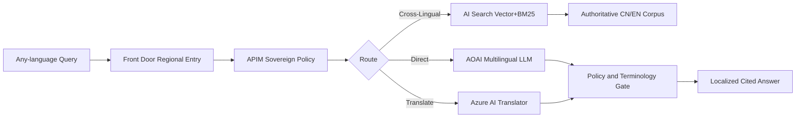
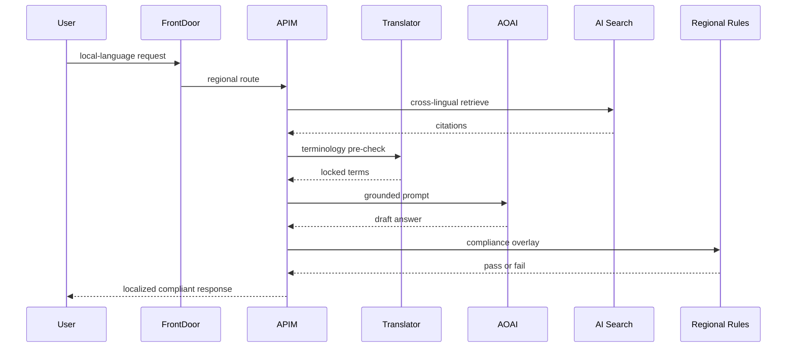

# Azure AI Translator vs AOAI LLM Localization vs Cross-Lingual RAG vs Sovereign Routing: Global Multilingual Agent Selection FAQ

> 🌐 **Language / 语言切换**: **[🇬🇧 English (azure-ai-translator-vs-aoai-llm-localization-vs-glossary-rag-global-multilingual-agent-selection-faq.en.md)](azure-ai-translator-vs-aoai-llm-localization-vs-glossary-rag-global-multilingual-agent-selection-faq.en.md)** | **[🇨🇳 中文版 (azure-ai-translator-vs-aoai-llm-localization-vs-glossary-rag-global-multilingual-agent-selection-faq.md)](azure-ai-translator-vs-aoai-llm-localization-vs-glossary-rag-global-multilingual-agent-selection-faq.md)** | **[📚 Architecture Selection FAQ Index](README.en.md)**

## 1) Objective and boundary
- Goal: architecture selection for Chinese global expansion and multinational multilingual agents.
- Scope: enterprise architecture, governance, cost, compliance, and residency controls.
- Conclusion: authoritative technical master plus local regulation overlay is the most durable pattern.
## 2) Verifiable sources with timestamps
- Azure AI Translator: `https://learn.microsoft.com/azure/ai-services/translator/` (03:42 BJT).
- Azure OpenAI: `https://learn.microsoft.com/azure/ai-services/openai/` (03:42 BJT).
- Azure AI Search multilingual docs: `https://learn.microsoft.com/azure/search/` (03:43 BJT).
- APIM docs: `https://learn.microsoft.com/azure/api-management/` (03:43 BJT).
- Front Door docs: `https://learn.microsoft.com/azure/frontdoor/` (03:43 BJT).
- Metrics are labeled as measured, synthetic, or anonymized_reported.
## 3) 12-dimension matrix across four multilingual patterns
- D1 primary lane: direct LLM, Translator pre/post pipeline, cross-lingual RAG, sovereign routing with dual-layer policy.
- D2 language naturalness: direct LLM usually leads, translator-assisted core inference follows, RAG depends on retrieval quality.
- D3 terminology locking: translator glossary and term gates provide strongest control.
- D4 latency: direct LLM is single-hop fastest, translation pipelines add one hop.
- D5 cost: translator pipelines are often cheaper at massive batch scale.
- D6 version consistency: single authoritative corpus beats 24-language mirrored stores.
- D7 non-Latin behavior: Arabic, Thai, and Japanese frequently show token inflation.
- D8 residency: sovereign routing is best for EU, Middle East, and LATAM boundaries.
- D9 explainability: RAG can cite authoritative source passages directly.
- D10 ops complexity: dual-layer sovereign architecture is harder but compliance-strong.
- D11 best-fit workloads: global after-sales support and cross-border commerce compliance review.
- D12 anti-pattern: correct translation does not automatically mean legal compliance.
## 4) Score snapshot and decision thresholds
- Direct LLM: naturalness5 cost3 consistency3 compliance3.
- Translator pipeline: naturalness4 cost5 consistency4 compliance4.
- Cross-lingual RAG: naturalness4 cost4 consistency5 compliance4.
- Sovereign dual-layer: naturalness4 cost3 consistency5 compliance5.
- Threshold A: safety warnings and part numbers must be 100% terminology-locked.
- Threshold B: if target markets exceed 12, prefer authoritative corpus plus cross-lingual retrieval.
- Threshold C: if residency constraints apply, regional routing is mandatory.
## 5) Five calculable Q&As
### Q1 Cost of single corpus RAG vs 24-language pre-translation
- For 50k pages at $0.09/page across 24 languages, first-pass translation is about $108,000.
- Single-corpus RAG can reduce annual maintenance by 40%+ in typical operations.
- Version-staleness error in mirrored-language stores can rise to 3.2% due to async publishing.
### Q2 Token inflation break-even in non-Latin languages
- Mixed Arabic, Thai, and Japanese sessions can see token inflation between 1.25 and 1.9.
- If inflation exceeds 1.5 under high volume, pre-translation often wins economically.
### Q3 Zero-tolerance terminology lock implementation
- Flow: term extraction, glossary validation, post-translation compare, fail-fast intercept.
- KPI target: terminology block rate p95 >= 0.98 where required.
### Q4 Mixed-language retrieval weighting
- For local language description plus English error code, start with vector 0.62 and BM25 0.38.
- Rebalance weekly using locale-level hit-rate feedback loops.
### Q5 Front Door plus APIM sovereign routing budget
- Three-region active-active usually adds 18% to 26% to gateway baseline cost.
- It significantly reduces cross-border compliance exposure and residency risks.
## 6) Layered reference architecture
- Entry layer: Front Door regional ingress and APIM regional policy.
- Semantic layer: authoritative technical corpus plus local regulation delta stores.
- Inference layer: AOAI multilingual models coordinated with Translator pipelines.
- Retrieval layer: AI Search multilingual analyzers plus cross-lingual vectors.
- Governance layer: glossary terms, legal rules, and human legal review queues.
- Observability layer: locale hit rate, term interception, and token-cost dashboards.
- Security layer: residency enforcement and least-privilege credential scopes.
## 7) Scenario A: machinery and NEV exporter across 28 countries
- CN/EN authoritative service bulletins are ingested once and reused cross-lingually.
- Spanish, Portuguese, Arabic, Thai, and Vietnamese technicians query with local language directly.
- Local warranty policy and part-number checks are mandatory before response release.
- Mixed local-language text plus English fault-code retrieval is enabled by hybrid ranking.
- Synthetic gain: cross-region technical response latency reduced by 46%.
## 8) Scenario B: cross-border ecommerce localization and ad-compliance review
- Custom Translator manages brand glossary and banned-phrase catalogs.
- Country-aware retrieval overlays EU environmental claims, Middle East cultural rules, and North America regulations.
- High-risk claims enter legal-review queues while low-risk copy can auto-publish.
- Full generation and review trail remains auditable end to end.
- Synthetic gain: compliance takedown rate reduced by 38%.
## 9) Mermaid diagram 1 multilingual architecture flow

- One authoritative corpus keeps global consistency, while local legal overlays handle jurisdictional variance.
## 10) Mermaid diagram 2 terminology lock and compliance sequence

- Failure routes must enter human legal review and cannot be silently bypassed.
## 11) Bicep template (Translator + AOAI + Search + Front Door/APIM)
```bicep
targetScope = 'resourceGroup'
param location string = resourceGroup().location
resource tr 'Microsoft.CognitiveServices/accounts@2023-10-01' = {
  name: 'translator'
  location: location
  kind: 'TextTranslation'
  sku: { name: 'S1' }
}
resource search 'Microsoft.Search/searchServices@2023-11-01' = {
  name: 'search'
  location: location
  sku: { name: 'standard' }
}
resource apim 'Microsoft.ApiManagement/service@2023-09-01-preview' = {
  name: 'apim-prod'
  location: location
  sku: { name: 'PremiumV2', capacity: 1 }
}
resource afd 'Microsoft.Cdn/profiles@2024-02-01' = {
  name: 'fd'
  location: location
  sku: { name: 'Standard_AzureFrontDoor' }
}
```
- Production rollout still needs private networking, managed identity, rotation, and fine-grained RBAC.
## 12) Python snippet for hybrid retrieval and terminology lock
```python
def calc_rrf(vec_rank, bm25_rank, k=60):
    return 1/(k+vec_rank) + 1/(k+bm25_rank)
def terminology_lock_ok(text, glossary):
    return all(term in text for term in glossary)
def route_mode(token_expand, residency_required):
    if residency_required: return "sovereign"
    return "translate" if token_expand > 1.5 else "direct"
```
- Terminology-lock failures are blocked immediately with repair guidance.
- Hybrid weighting is tuned weekly from locale-level retrieval hit metrics.
## 13) KQL for locale hit rate, term interception, and token-cost audit
```kql
let t = MultilingualAgentLogs | where TimeGenerated > ago(24h);
t
| summarize total=count(),hit=countif(RetrievalHit==true),termBlocked=countif(TermLockBlocked==true),avgInflation=avg(TokenInflation),avgCost=avg(SessionCostUsd) by Locale,RouteMode
| extend hitRate=todouble(hit)/todouble(total)
| extend termBlockRate=todouble(termBlocked)/todouble(total)
| order by avgInflation desc, avgCost desc
```
- Hit-rate drops trigger analyzer and corpus-alignment regression checks.
## 14) Day-0/1/2 landing checklist
- Day-0 define authoritative corpus boundaries and local regulation delta sources.
- Day-0 build glossary terms, banned-phrase sets, and legal-review gates.
- Day-1 pilot three languages and replay cross-lingual retrieval sessions.
- Day-1 validate terminology-lock and compliance-overlay interception accuracy.
- Day-2 expand regional routing and enable sovereignty-budget dashboards.
- Day-2 review token inflation and locale hit-rate drift weekly.
- Day-2 publish SOPs for market expansion and regulation refresh cycles.
