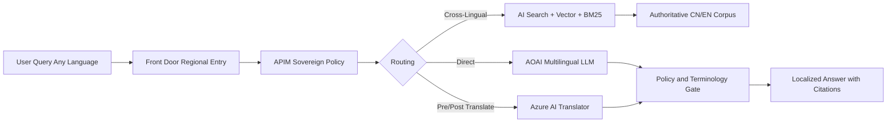
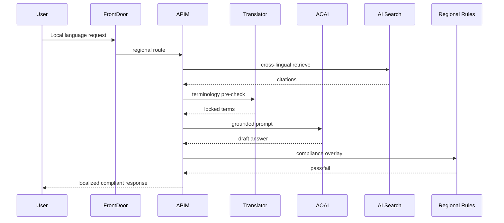

# Azure AI Translator vs AOAI LLM Localization vs Cross-Lingual RAG vs Sovereign Routing：全球多语种智能体选型 FAQ

> 🌐 **Language / 语言切换**: **[🇨🇳 中文版 (azure-ai-translator-vs-aoai-llm-localization-vs-glossary-rag-global-multilingual-agent-selection-faq.md)](azure-ai-translator-vs-aoai-llm-localization-vs-glossary-rag-global-multilingual-agent-selection-faq.md)** | **[🇬🇧 English (azure-ai-translator-vs-aoai-llm-localization-vs-glossary-rag-global-multilingual-agent-selection-faq.en.md)](azure-ai-translator-vs-aoai-llm-localization-vs-glossary-rag-global-multilingual-agent-selection-faq.en.md)** | **[📚 返回架构选型指南目录](README.md)**

## 1) 研究目标与边界
- 目标：服务中资出海与跨国企业的多语种智能体架构选型。
- 范围：聚焦应用架构、治理、成本、法规与数据驻留。
- 结论：统一技术母本 + 本地法规叠加是长期最稳路线。
## 2) 当日可验证来源与时间戳
- Azure AI Translator：`https://learn.microsoft.com/azure/ai-services/translator/`（抓取 03:42 BJT）。
- Azure OpenAI：`https://learn.microsoft.com/azure/ai-services/openai/`（抓取 03:42 BJT）。
- Azure AI Search 多语言：`https://learn.microsoft.com/azure/search/`（抓取 03:43 BJT）。
- APIM：`https://learn.microsoft.com/azure/api-management/`（抓取 03:43 BJT）。
- Front Door：`https://learn.microsoft.com/azure/frontdoor/`（抓取 03:43 BJT）。
- 数据标签统一 measured/synthetic/anonymized_reported。
## 3) 四类多语种架构 12 维横向选型矩阵
- 维度1主战场：LLM直推、Translator前后置、跨语言RAG、主权路由双层架构。
- 维度2语境自然度：LLM直推最佳，Translator+核心推理次之，RAG依赖检索质量。
- 维度3术语锁定：Translator词典与术语表强约束最稳。
- 维度4延迟：单跳LLM最低，多跳翻译管线略高。
- 维度5成本：大规模批量翻译通常 Translator 更低。
- 维度6版本一致：单一母本RAG优于24国语言分库。
- 维度7小语种表现：阿语/泰语/日语常见 Token 膨胀。
- 维度8法规驻留：主权路由可满足 EU/中东/拉美边界。
- 维度9可解释性：RAG可回引权威母本文档。
- 维度10运维复杂度：双层架构最高但合规最强。
- 维度11最佳场景：售后技术支持与跨境电商合规审校。
- 维度12反模式：禁止把“翻译正确”误判成“法规合规”。
## 4) 评分快照与决策阈值
- LLM直推：语境5、成本3、一致性3、合规3。
- Translator管线：语境4、成本5、一致性4、合规4。
- Cross-Lingual RAG：语境4、成本4、一致性5、合规4。
- 主权路由双层：语境4、成本3、一致性5、合规5。
- 阈值A：高压安全警告与零件号必须 100% 术语锁定。
- 阈值B：目标市场>12 国时优先单母本跨语言检索。
- 阈值C：存在数据出境限制时必须区域就近路由。
## 5) 五组可复算 Q&A
### Q1 单母本RAG vs 24国语分库成本
- 设5万页手册，预翻译24语每页$0.09，首轮成本约$108,000。
- 单母本RAG仅维护中英母本与检索层，年化维护成本可降 40%+。
- 版本过期差错率：分库模式因发布不同步可上升到 3.2%。
### Q2 非拉丁语系Token膨胀临界点
- 阿语/泰语/日语混输场景，Token 膨胀系数可达 1.25~1.9。
- 当膨胀系数>1.5 且会话量高时，前置翻译可更经济。
### Q3 零容忍术语锁定实现
- 流程：术语抽取 -> 词典校验 -> 翻译后比对 -> 失败拦截。
- 指标：术语拦截率=拦截数/总命中，目标 p95>=0.98。
### Q4 混输检索权重
- 当地语言描述 + 英文故障码：向量召回 0.62，BM25 精确 0.38 可作起始。
- 再按语种命中率反馈动态调权。
### Q5 Front Door + APIM 主权路由预算
- 以三区域 active-active 估算，基础网关与路由成本约上浮 18%~26%。
- 但可显著降低跨境合规风险与数据驻留罚损。
## 6) 分层参考架构
- 接入层：Front Door 区域入口 + APIM 区域策略。
- 语义层：权威技术母本知识库 + 本地法规增量库。
- 推理层：AOAI 多语言模型与 Translator 管线协同。
- 检索层：AI Search 多语言分词 + Cross-Lingual 向量。
- 治理层：术语词典、法务规则、人工复核工单。
- 观测层：语种命中率、术语拦截率、Token成本看板。
- 安全层：数据驻留策略与最小权限凭据管理。
## 7) 场景A：工程机械与新能源车企出海 28 国售后副驾
- 中英权威维修通报一次入库，西葡阿泰越语技师跨语言直查。
- 本地三包政策与配件号做强制校验，防止错件与违规承诺。
- 对“当地语言描述 + 英文故障码”启用混合检索。
- 高压安全警告走术语锁定与人工复核双门。
- synthetic收益：跨区技术响应时延下降 46%。
## 8) 场景B：跨境电商 24 站点文案本地化与广告法规审校
- Custom Translator 维护品牌词库与禁用词清单。
- 按国家检索欧盟环保声明、中东文化禁忌、北美监管规则。
- 高风险宣称进入法务复核流，低风险自动发布。
- 本地化生成与审核链全程留痕可追溯。
- synthetic收益：违规下架率下降 38%。
## 9) Mermaid 图1：全球多语智能体分层流

- 单一母本保障口径一致，本地法规层负责地区差异。
## 10) Mermaid 图2：术语锁定与法规叠加时序

- 失败路径进入人工法务复核，不允许静默放行。
## 11) Bicep 模板（Translator + AOAI + AI Search + Front Door/APIM）
```bicep
targetScope = 'resourceGroup'
param location string = resourceGroup().location
resource tr 'Microsoft.CognitiveServices/accounts@2023-10-01' = {
  name: 'translator'
  location: location
  kind: 'TextTranslation'
  sku: { name: 'S1' }
}
resource search 'Microsoft.Search/searchServices@2023-11-01' = {
  name: 'search'
  location: location
  sku: { name: 'standard' }
}
resource apim 'Microsoft.ApiManagement/service@2023-09-01-preview' = {
  name: 'apim-prod'
  location: location
  sku: { name: 'PremiumV2', capacity: 1 }
}
resource afd 'Microsoft.Cdn/profiles@2024-02-01' = {
  name: 'fd'
  location: location
  sku: { name: 'Standard_AzureFrontDoor' }
}
```
- 生产需补充私有链路、托管身份、密钥轮换与RBAC细粒度权限。
## 12) Python 片段：跨语言混合检索与术语锁定校验
```python
def calc_rrf(vec_rank, bm25_rank, k=60):
    return 1/(k+vec_rank) + 1/(k+bm25_rank)
def terminology_lock_ok(text, glossary):
    return all(term in text for term in glossary)
def route_mode(token_expand, residency_required):
    if residency_required: return "sovereign"
    return "translate" if token_expand > 1.5 else "direct"
```
- 术语锁定失败直接拦截并返回可修复提示。
- 混合检索权重按语种命中率周度自动调参。
## 13) KQL：分语种命中率/术语拦截率/Token成本
```kql
let t = MultilingualAgentLogs | where TimeGenerated > ago(24h);
t
| summarize total=count(),hit=countif(RetrievalHit==true),termBlocked=countif(TermLockBlocked==true),avgInflation=avg(TokenInflation),avgCost=avg(SessionCostUsd) by Locale,RouteMode
| extend hitRate=todouble(hit)/todouble(total)
| extend termBlockRate=todouble(termBlocked)/todouble(total)
| order by avgInflation desc, avgCost desc
```
- hitRate 低于阈值触发分词器与语料对齐回归。
## 14) Day-0/1/2 落地清单
- Day-0：确认权威母本边界与本地法规增量源。
- Day-0：建立术语词典、禁用词表、法务复核门。
- Day-1：接入3个语种试点并跑跨语言检索回放。
- Day-1：验证术语锁定与法规叠加拦截准确率。
- Day-2：扩展到目标区域并启用主权路由预算看板。
- Day-2：周度复盘 Token 膨胀与命中率漂移。
- Day-2：形成市场扩容与法规更新SOP。
