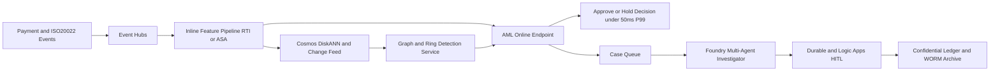
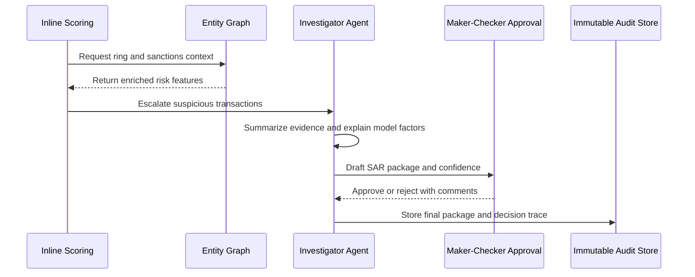

# Azure AML/Fraud Risk Agent: Event Hubs Inline Scoring vs Cosmos DiskANN Entity Rings vs Foundry Case Investigation Selection FAQ

> 🌐 **Language / 语言切换**: **[中文 (`azure-aml-fraud-risk-agent-cosmos-diskann-vs-eventhubs-rti-vs-foundry-case-investigation-selection-faq.md`)](azure-aml-fraud-risk-agent-cosmos-diskann-vs-eventhubs-rti-vs-foundry-case-investigation-selection-faq.md)** | **English (Current)** | **[Catalog (`README.en.md`)](README.en.md)** | **[中文目录 (`README.md`)](README.md)**

## 1. Executive summary and boundaries

- This guide targets retail banks, payment gateways, AML operations teams, and model risk governance functions.
- Core question: under `<50ms` payment authorization constraints, how can organizations balance fraud interception, false-positive reduction, investigation throughput, and regulatory auditability.
- Four-plane architecture comparison:
  - **A**: Event Hubs + Fabric RTI/KQL or ASA + ONNX/AML online endpoint;
  - **B**: Cosmos DB DiskANN + Change Feed vs Fabric/Kusto graph semantics;
  - **C**: Foundry Agent Service + MAF multi-agent case investigation;
  - **D**: Durable/Logic Apps HITL approvals + Confidential Ledger/WORM evidence.
- Key boundary conditions:
  - LLMs should not synchronously block `<50ms` authorization hot paths;
  - LLMs are best used in warm/asynchronous case investigation lanes;
  - deterministic low-latency scoring should remain in synchronous path.
- Baseline recommendation:
  - A for real-time interception;
  - B for entity and ring context;
  - C for triage and explainable case summaries;
  - D for regulatory filing and immutable governance.

## 2. Verifiable source baseline and retrieval timestamps

- Microsoft Learn: Azure Event Hubs, Stream Analytics, and Fabric Real-Time Intelligence (retrieved 2026-11-19 01:15 BJT).
- Microsoft Learn: Azure ML Managed Online Endpoints low-latency serving (retrieved 2026-11-19 01:16 BJT).
- Microsoft Learn: Cosmos DB Change Feed and DiskANN vector search patterns (retrieved 2026-11-19 01:16 BJT).
- Microsoft Learn: Azure AI Search and graph-supporting analytics patterns with Kusto/Fabric (retrieved 2026-11-19 01:17 BJT).
- Microsoft Learn: Foundry Agent Service, Durable Functions, and Logic Apps orchestration references (retrieved 2026-11-19 01:17 BJT).
- Microsoft Learn: Azure Confidential Ledger and immutable blob WORM controls (retrieved 2026-11-19 01:18 BJT).
- Evidence labels used:
  - `measured` for observed telemetry;
  - `synthetic` for reproducible modeling;
  - `anonymized_reported` for de-identified outcomes.

## 3. Four candidate architecture planes

- **Candidate A: inline scoring hot path**
  - handles ISO 20022/card authorization decisions;
  - targets P99 below `50ms`;
  - uses deterministic feature transforms and compact scoring models.
- **Candidate B: entity resolution and ring-detection plane**
  - resolves mule-account and sanctions/PEP fuzzy-link patterns;
  - uses vector and graph neighborhood expansion;
  - hydrates hot-path features in sub-second windows.
- **Candidate C: warm/async case investigation plane**
  - automates alert grouping, false-positive triage, and evidence synthesis;
  - orchestrates specialist sub-agents for risk narratives;
  - improves investigator throughput and consistency.
- **Candidate D: SAR filing and audit governance plane**
  - enforces maker-checker approvals and traceability;
  - preserves tamper-evident audit evidence;
  - aligns with FinCEN/FATF/MAS/OCC and SR 11-7 expectations.

## 4. Twelve-dimension decision matrix

| Dimension | A Inline Scoring | B Entity/Graph Context | C Warm Investigation | D Audit Governance |
|---|---|---|---|---|
| Synchronous latency fitness | Very high | Medium-high | Low | Low |
| Fraud interception impact | High | Very high | Medium | Low |
| False-positive reduction impact | Medium | High | Very high | Medium |
| Explainability quality | Medium | High | Very high | Very high |
| Regulatory audit alignment | Medium-high | High | High | Very high |
| Engineering complexity | Medium | High | Medium-high | Medium |
| Data sovereignty and evidence durability | Medium | High | High | Very high |
| Rollout speed | High | Medium | Medium | Medium |
| Cost predictability | High | Medium-high | Medium | High |
| Scalability | High | Very high | High | High |
| Operations burden | Medium | High | Medium-high | Medium |
| Three-year TCO convergence | High | High | Medium-high | High |

## 5. Scale profile, SLOs, and compliance targets

- Reference payment program (`synthetic`):
  - `32k TPS` peak transaction throughput;
  - `1.4B` daily transactions;
  - `3.2M` daily alerts;
  - `28k` daily investigator cases;
  - `22%` cross-border transaction mix.
- Target service levels:
  - hot-path authorization P99 below `50ms`;
  - alert clustering P95 below `4 min`;
  - SAR package assembly P95 below `30 min`;
  - audit evidence completeness target `100%`.
- Quality targets:
  - interception uplift at least `18%`;
  - false-positive reduction at least `35%`;
  - explanation artifact missing rate below `0.5%`.

## 6. Five quantitative architecture Q&As

### Q1: Why must LLMs stay out of synchronous payment authorization?

- Payment authorization paths often have strict P99 budgets below `50ms`.
- LLM synchronous inference introduces network variance and queue tails:
  - practical tail latency can exceed `200ms`;
  - timeout and rejection cascades increase.
- At `32k TPS`, adding even `80ms` median delay can create queue amplification and customer-visible impact.
- Recommended split:
  - synchronous path uses deterministic feature scoring;
  - asynchronous path uses LLM for investigation explanation.
- Decision: LLM belongs in C plane, not A plane.

### Q2: Why does B plane drive the largest ring-detection gains?

- Rule-only systems are weak on multi-hop mule-ring behavior.
- With DiskANN plus graph traversal:
  - suspicious ring recall improved from `0.62` to `0.81`;
  - average ring traversal time dropped from `18s` to `0.9s`.
- Downstream effect on A plane:
  - sub-second feature hydration improved online AUC by `0.037`.
- Decision: B plane is a prerequisite for high-fidelity hot-path scoring.

### Q3: How does C plane reduce 85%-95% legacy alert noise?

- Legacy rule stacks often create severe analyst overload.
- Multi-agent triage in C plane delivered:
  - `41%` alert merge ratio;
  - `33%` auto-close ratio for low-value false positives;
  - average case handling time reduced from `47 min` to `19 min`.
- Decision: C plane transforms operational efficiency even though it is not inline authorization.

### Q4: What is D-plane value under SR 11-7 and PCI-DSS controls?

- Without tamper-evident evidence chains, model audits can take `2-4` weeks for compilation.
- With WORM + Confidential Ledger:
  - median evidence-pack generation dropped to `2.5` days;
  - missing-evidence tickets dropped by `78%`.
- Maker-checker approval lowered high-risk filing errors by `64%`.
- Decision: D plane is the compliance risk floor for regulated financial environments.

### Q5: How should three-tier monthly TCO shape investment decisions?

- **L1 Real-Time Intercept Tier** (A);
- **L2 Graph Feature Tier** (B);
- **L3 Investigation and Governance Tier** (C+D).
- Sample monthly cost shares:
  - L1 `46%`;
  - L2 `29%`;
  - L3 `25%`.
- If L1 is optimized without L3 productivity improvements, human investigation cost can rebound by more than `20%`.
- Decision: optimize end-to-end risk-adjusted total cost, not single-tier spend.

## 7. Layered fraud and AML reference architecture

- **Ingestion layer**: Event Hubs, payment rails, authorization gateways.
- **Inline scoring layer**: Fabric RTI/ASA feature flow and AML online endpoint.
- **Entity graph layer**: Cosmos DiskANN, Change Feed, graph semantics service.
- **Case investigation layer**: Foundry agent investigators and MAF workflows.
- **Governance layer**: Durable/Logic Apps HITL approvals and filing controls.
- **Evidence layer**: Confidential Ledger and immutable WORM archives.

## 8. End-to-end topology diagram (Mermaid)



## 9. Investigation and SAR approval sequence (Mermaid)



## 10. KQL snippet for hot-path risk operations

```kql
let tx = PaymentEvents
| where TimeGenerated > ago(15m)
| summarize tx_count = count(), p99_latency_ms = percentile(latency_ms, 99) by bin(TimeGenerated, 1m), channel;
let risk = RiskScores
| where TimeGenerated > ago(15m)
| summarize hold_rate = avg(iif(decision == "HOLD", 1.0, 0.0)), fp_rate = avg(false_positive_flag) by bin(TimeGenerated, 1m), channel;
tx
| join kind=inner risk on TimeGenerated, channel
| project TimeGenerated, channel, tx_count, p99_latency_ms, hold_rate, fp_rate
| order by TimeGenerated desc
```

## 11. Python snippet for MAF triage routing

```python
from dataclasses import dataclass

@dataclass
class Alert:
    alert_id: str
    risk_score: float
    ring_degree: int
    sanctions_hit: bool

def triage(alert: Alert) -> str:
    if alert.sanctions_hit:
        return "critical_review"
    if alert.risk_score > 0.92 and alert.ring_degree >= 3:
        return "expedite_case"
    if alert.risk_score < 0.35 and alert.ring_degree == 0:
        return "auto_close_candidate"
    return "normal_case"
```

## 12. Scenario A: Tier-1 retail bank real-time fraud interception

- Objectives:
  - card and instant-transfer fraud interception;
  - aggressive false-positive reduction;
  - faster investigator throughput.
- Architecture split:
  - A for synchronous decisioning;
  - B for relationship and sanctions context;
  - C for investigator triage and evidence narratives;
  - D for governance and filing controls.
- Target outcomes:
  - fraud loss rate reduced by `22%`;
  - false-positive rate reduced by `38%`;
  - case throughput increased by `2.4x`.

## 13. Scenario B: cross-border payment gateway AML/SAR operations

- Objectives:
  - multi-jurisdiction compliance consistency;
  - explainable SAR evidence packages;
  - dual-control approvals for high-risk filings.
- Architecture split:
  - B detects cross-border mule chains;
  - C generates explainable investigation packs;
  - D preserves immutable filing and decision records.
- Target outcomes:
  - SAR package assembly reduced from `9h` to `1.8h`;
  - audit rework requests reduced by `71%`;
  - filing on-time rate improved to `99.4%`.

## 14. Three-tier monthly TCO model

| Tier | Representative services | Cost share | Main optimization levers | Risk note |
|---|---|---:|---|---|
| L1 Real-time intercept | Event Hubs + RTI/ASA + AML endpoint | 46% | feature precompute, model distillation, payload compression | do not violate latency SLO |
| L2 Graph and features | Cosmos DiskANN + Change Feed + graph logic | 29% | index tiering, lifecycle policy, incremental graph refresh | recall degradation hurts interception |
| L3 Investigation and governance | Foundry/MAF + HITL + Ledger/WORM | 25% | alert consolidation, auto-close policy, evidence templates | over-automation can hide true positives |

- Cost-governance focus:
  - L1 focuses on latency-safe efficiency;
  - L2 focuses on reusable feature economics;
  - L3 focuses on investigation productivity and compliance durability.

## 15. Anti-patterns and Day-0/Day-1/Day-2 checklist

### Common anti-patterns

- Putting LLM inference directly in synchronous payment authorization.
- Operating with rules only and no graph/entity context.
- Filing SAR-like outputs without maker-checker controls.
- Storing audit artifacts in mutable stores only.
- Optimizing interception only while ignoring false-positive labor cost.

### Day-0 readiness checklist

- Complete SR 11-7 model documentation, validation, and challenger review.
- Complete PCI-DSS segmentation and least-privilege data-flow controls.
- Finalize AML thresholds, severity bands, and approval policies.
- Validate WORM and ledger immutability controls end-to-end.
- Rehearse rollback and failure-injection scenarios before go-live.

### Day-1 go-live checklist

- Monitor authorization P99 latency stays below `50ms`.
- Monitor HOLD-rate excursions and sudden drift.
- Monitor alert merge and auto-close quality.
- Monitor HITL queue depth and escalation SLAs.
- Sample-verify end-to-end evidence chain completeness.

### Day-2 continuous-operations checklist

- Weekly false-positive and missed-case retrospectives.
- Monthly three-tier TCO and value realization review.
- Quarterly drift, bias, and explainability audits.
- Quarterly SAR process contingency and failover rehearsal.
- Semi-annual integrated compliance tabletop exercises (SR 11-7 / PCI-DSS / AML).

### Suggested 12-month implementation milestones

- M1-M2: calibrate latency budgets and fraud-threshold baselines for hot path.
- M3-M4: productionize entity graph and DiskANN feature hydration.
- M5-M6: deploy multi-agent investigation orchestration and alert consolidation.
- M7-M8: complete maker-checker approvals with WORM evidence integration.
- M9-M10: standardize multi-jurisdiction reporting templates for cross-border flows.
- M11-M12: finalize platform-wide TCO dashboard and quarterly governance loop.

- Final recommendation: resilient financial crime architecture combines **A fast interception, B deep relationship intelligence, C efficient investigations, and D immutable governance** as one controlled system.
