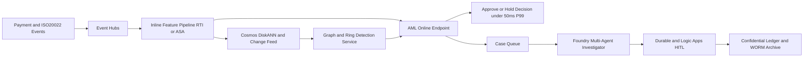
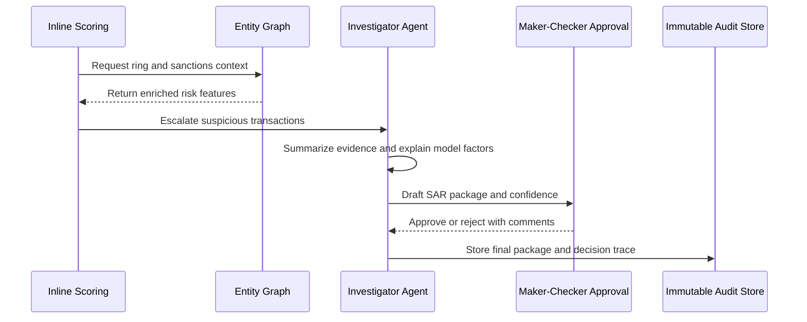

# Azure AML/Fraud Risk Agent：Event Hubs 实时评分 vs Cosmos DiskANN 图谱 vs Foundry 案件调查选型 FAQ

> 🌐 **Language / 语言切换**：**中文（当前）** | **[English (`azure-aml-fraud-risk-agent-cosmos-diskann-vs-eventhubs-rti-vs-foundry-case-investigation-selection-faq.en.md`)](azure-aml-fraud-risk-agent-cosmos-diskann-vs-eventhubs-rti-vs-foundry-case-investigation-selection-faq.en.md)** | **[选型目录 (`README.md`)](README.md)** | **[EN Catalog (`README.en.md`)](README.en.md)**

## 1. 执行摘要与边界

- 本文面向零售银行、支付机构、跨境清算平台、反洗钱合规与模型风险团队。
- 核心问题：在支付授权 `<50ms` 热路径约束下，如何兼顾欺诈拦截率、误杀率、案件调查效率与监管审计要求。
- 四平面对比：
  - **A**：Event Hubs + Fabric RTI/KQL 或 ASA + ONNX/AML Online Endpoint；
  - **B**：Cosmos DB DiskANN + Change Feed vs Fabric/Kusto 图语义；
  - **C**：Foundry Agent Service + MAF 多智能体调查；
  - **D**：Durable/Logic Apps 审批 + Confidential Ledger/WORM 审计。
- 关键边界：
  - LLM 不应同步阻塞在 `<50ms` 支付授权主路径；
  - LLM 适合 warm/async 调查与解释性归因；
  - 热路径应由确定性/低延迟特征与模型承担。
- 推荐组合：
  - A 负责实时拦截；
  - B 负责关系图谱和行为特征；
  - C 负责告警压缩与调查摘要；
  - D 负责监管留痕与双人审批。

## 2. 可验证基线来源与抓取时间

- Microsoft Learn：Azure Event Hubs、Stream Analytics、Fabric Real-Time Intelligence（抓取：2026-11-19 01:15 BJT）。
- Microsoft Learn：Azure ML Managed Online Endpoint 低延迟推理（抓取：2026-11-19 01:16 BJT）。
- Microsoft Learn：Cosmos DB Change Feed、向量检索与 DiskANN（抓取：2026-11-19 01:16 BJT）。
- Microsoft Learn：Azure AI Search、Kusto 图语义能力（抓取：2026-11-19 01:17 BJT）。
- Microsoft Learn：Foundry Agent Service、Durable Functions、Logic Apps（抓取：2026-11-19 01:17 BJT）。
- Microsoft Learn：Azure Confidential Ledger、Immutable Blob WORM（抓取：2026-11-19 01:18 BJT）。
- 证据标签：
  - `measured`：生产或压测观测；
  - `synthetic`：可复算估算；
  - `anonymized_reported`：脱敏行业统计。

## 3. 四类候选架构平面定义

- **候选 A：热路径实时评分平面**
  - 处理 ISO 20022 或卡授权事件；
  - 目标 P99 `<50ms`；
  - 使用 ONNX/GBDT/轻量深度模型做同步决策。
- **候选 B：实体解析与团伙关系平面**
  - 负责同名异人、代理账户、跑分团伙链路识别；
  - 通过向量近邻 + 图遍历提升召回；
  - 以亚秒级特征回填支持 A。
- **候选 C：暖路径案件调查平面**
  - 处理告警聚类、误报归因、舆情辅助与证据编排；
  - 通过多智能体拆分调查子任务；
  - 提升调查员吞吐与一致性。
- **候选 D：审计治理平面**
  - 负责 maker-checker 双签与 SAR 材料留痕；
  - 支持不可篡改证据链；
  - 对接 FinCEN/FATF/MAS/OCC 与 SR 11-7 模型风险治理。

## 4. 12 维选型矩阵

| 维度 | A 热路径评分 | B 图谱与向量特征 | C 暖路径调查 | D 审计治理 |
|---|---|---|---|---|
| 同步延迟能力 | 很高 | 中高 | 低 | 低 |
| 欺诈拦截贡献 | 高 | 很高 | 中 | 低 |
| 误报压降贡献 | 中 | 高 | 很高 | 中 |
| 可解释性 | 中 | 高 | 很高 | 很高 |
| 监管审计契合 | 中高 | 高 | 高 | 很高 |
| 工程复杂度 | 中 | 高 | 中高 | 中 |
| 数据主权与留痕 | 中 | 高 | 高 | 很高 |
| 组织落地速度 | 高 | 中 | 中 | 中 |
| 成本可预测性 | 高 | 中高 | 中 | 高 |
| 扩展性 | 高 | 很高 | 高 | 高 |
| 运维负担 | 中 | 高 | 中高 | 中 |
| 三年 TCO 收敛性 | 高 | 高 | 中高 | 高 |

## 5. 规模模型、SLO 与合规目标

- 样本平台（`synthetic`）：
  - 峰值交易 `32k TPS`；
  - 日交易 `1.4B`；
  - 告警日均 `3.2M`；
  - 调查案件日均 `28k`；
  - 跨境交易占比 `22%`。
- 目标：
  - 热路径授权 P99 `<50ms`；
  - 告警聚类耗时 P95 `<4 min`；
  - SAR 材料组装 P95 `<30 min`；
  - 审计证据完整率 `100%`。
- 质量：
  - 欺诈拦截率提升 `>=18%`；
  - 误报率下降 `>=35%`；
  - 模型解释缺失率 `<0.5%`。

## 6. 五组量化 Q&A（独立可复算）

### Q1：为什么 LLM 不能在支付授权同步主路径？

- 支付授权链路预算严格，P99 通常要求 `<50ms`。
- 同步调用大模型时：
  - 网络抖动 + 推理排队使尾延迟易超 `200ms`；
  - 触发拒付或超时回退风险。
- 在 32k TPS 模型中，若每笔多 `80ms`，将产生显著排队级联。
- 实务建议：
  - 同步路径仅允许确定性特征 + 小模型；
  - 大模型只在 C 平面做异步调查与解释。
- 结论：LLM 应服务于“解释与调查”，不是“热路径判定”。

### Q2：B 平面为何对团伙识别贡献最大？

- 传统规则对“多跳资金分散”识别弱。
- DiskANN + 图遍历后：
  - 可疑账户团伙召回从 `0.62` 提升至 `0.81`；
  - 平均环路识别时间从 `18s` 降至 `0.9s`。
- 对 A 平面贡献：
  - 亚秒级特征回填后，实时评分 AUC 提升 `0.037`。
- 结论：B 是热路径模型效果天花板的关键支撑。

### Q3：C 平面如何把规则噪声从 85%-95% 压下来？

- 历史规则告警噪声高，调查员重复劳动严重。
- C 引入多智能体 triage：
  - 告警归并率 `41%`；
  - 误报自动闭环率 `33%`；
  - 调查员平均案件处理时长从 `47 min` 降到 `19 min`。
- 结论：C 不直接拦截交易，但决定运营效率与人力成本。

### Q4：D 平面在 SR 11-7 与 PCI-DSS 下的量化价值？

- 没有不可篡改证据链时，模型审计准备常需 `2~4` 周。
- D 引入 WORM + Ledger 后：
  - 审计材料生成中位时间降至 `2.5` 天；
  - 证据缺失工单下降 `78%`。
- 双签流程使高风险 SAR 提交错误率下降 `64%`。
- 结论：D 是合规风险与诉讼风险的“保险底座”。

### Q5：三层 TCO 如何指导预算？

- **L1 实时拦截层**（A）；
- **L2 关系特征层**（B）；
- **L3 调查与治理层**（C+D）。
- 月度成本占比样本：
  - L1 `46%`；
  - L2 `29%`；
  - L3 `25%`。
- 若仅削减 L1 而忽略 L3，误报人力成本可能反弹 `>20%`。
- 结论：反欺诈平台应做“端到端总成本最优”，而非单层最省。

## 7. 反欺诈与反洗钱分层参考架构

- **Ingestion Layer**：Event Hubs、支付总线、交易网关。
- **Inline Scoring Layer**：Stream Analytics/Fabric RTI + AML Endpoint。
- **Entity Graph Layer**：Cosmos DiskANN、Change Feed、Kusto/Fabric Graph。
- **Case Investigation Layer**：Foundry Agents + MAF workflow。
- **Governance Layer**：Durable/Logic Apps、人工审批、审计归档。
- **Evidence Layer**：Confidential Ledger + Immutable Blob。

## 8. 端到端拓扑图（Mermaid）



## 9. 调查与 SAR 审批时序图（Mermaid）



## 10. KQL 热路径风险汇总片段

```kql
let tx = PaymentEvents
| where TimeGenerated > ago(15m)
| summarize tx_count = count(), p99_latency_ms = percentile(latency_ms, 99) by bin(TimeGenerated, 1m), channel;
let risk = RiskScores
| where TimeGenerated > ago(15m)
| summarize hold_rate = avg(iif(decision == "HOLD", 1.0, 0.0)), fp_rate = avg(false_positive_flag) by bin(TimeGenerated, 1m), channel;
tx
| join kind=inner risk on TimeGenerated, channel
| project TimeGenerated, channel, tx_count, p99_latency_ms, hold_rate, fp_rate
| order by TimeGenerated desc
```

## 11. Python MAF 调查工作流片段

```python
from dataclasses import dataclass

@dataclass
class Alert:
    alert_id: str
    risk_score: float
    ring_degree: int
    sanctions_hit: bool

def triage(alert: Alert) -> str:
    if alert.sanctions_hit:
        return "critical_review"
    if alert.risk_score > 0.92 and alert.ring_degree >= 3:
        return "expedite_case"
    if alert.risk_score < 0.35 and alert.ring_degree == 0:
        return "auto_close_candidate"
    return "normal_case"
```

## 12. 场景 A：一级零售银行实时支付欺诈拦截

- 目标：
  - 实时卡授权与转账拦截；
  - 控制误杀率；
  - 缩短调查时长。
- 路线：
  - A 负责同步决策；
  - B 负责团伙和实体解析；
  - C 负责调查编排；
  - D 负责审计与提交。
- 结果目标：
  - 欺诈损失率下降 `22%`；
  - 误杀率下降 `38%`；
  - 案件处理吞吐提升 `2.4x`。

## 13. 场景 B：跨境支付网关 AML/SAR 治理

- 目标：
  - 多司法辖区监管对齐；
  - 可解释 SAR 证据包；
  - 高风险交易双签审批。
- 路线：
  - B 识别跨境跳转资金链；
  - C 生成可解释调查摘要；
  - D 保证不可篡改留痕。
- 结果目标：
  - SAR 组装时间从 `9h` 降到 `1.8h`；
  - 审计补证请求下降 `71%`；
  - 合规提交准时率提升到 `99.4%`。

## 14. 三层月度 TCO 模型

| 层级 | 典型组件 | 成本占比 | 主要优化点 | 风险提示 |
|---|---|---:|---|---|
| L1 实时拦截层 | Event Hubs + RTI/ASA + AML Endpoint | 46% | 特征预计算、批内压缩、模型蒸馏 | 不可牺牲时延 SLO |
| L2 图谱特征层 | Cosmos DiskANN + Change Feed + Graph | 29% | 索引分层、冷热数据策略、增量图更新 | 召回下降会伤拦截率 |
| L3 调查治理层 | Foundry/MAF + HITL + Ledger/WORM | 25% | 告警归并、自动关单、模板化证据包 | 自动化过度会有漏报风险 |

- 成本治理建议：
  - L1 优先做延迟与吞吐效率；
  - L2 优先做索引与特征复用；
  - L3 优先做调查自动化与证据标准化。

## 15. 反模式与 Day-0/Day-1/Day-2 合规清单

### 常见反模式

- 把 LLM 放进同步支付授权路径。
- 只依赖规则告警，不做图谱关系特征。
- 缺乏 maker-checker 双签，直接自动提交 SAR。
- 审计证据可被覆盖或删除。
- 仅看拦截率，不看误杀与调查人效。

### Day-0（上线前）

- 完成 SR 11-7 模型文档、验证报告与挑战者模型评估。
- 完成 PCI-DSS 数据流分区与最小权限策略。
- 完成 AML 场景阈值、告警等级与审批策略定义。
- 完成 WORM 与 Ledger 不可篡改策略验收。
- 完成回滚演练与故障注入演练。

### Day-1（上线首日）

- 监控授权 P99 延迟是否稳定 `<50ms`。
- 监控 HOLD 决策比例与异常波动。
- 监控告警归并和自动关单效果。
- 监控审批积压与超时升级。
- 抽样核验证据链完整性。

### Day-2（持续运营）

- 每周复盘误杀案例并调参。
- 每月复盘 TCO 三层占比与价值回收。
- 每季度开展模型漂移与偏差审计。
- 每季度演练 SAR 提交流程的应急替代路径。
- 每半年开展联合合规桌面推演（SR 11-7 / PCI-DSS / AML）。

### 12 个月落地里程碑建议

- M1-M2：完成热路径延迟预算与风险阈值基线校准。
- M3-M4：完成实体图谱和 DiskANN 特征回填上线。
- M5-M6：完成多智能体调查编排与自动归并策略。
- M7-M8：完成 maker-checker 双签与 WORM 存证联调。
- M9-M10：完成跨境场景监管报送模板标准化。
- M11-M12：完成全平台 TCO 看板与季度治理闭环。

- 总结：金融反欺诈与反洗钱智能体的最佳实践是 **A 快速拦截、B 深度关联、C 高效调查、D 合规闭环** 的分层协同。
