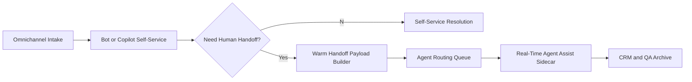
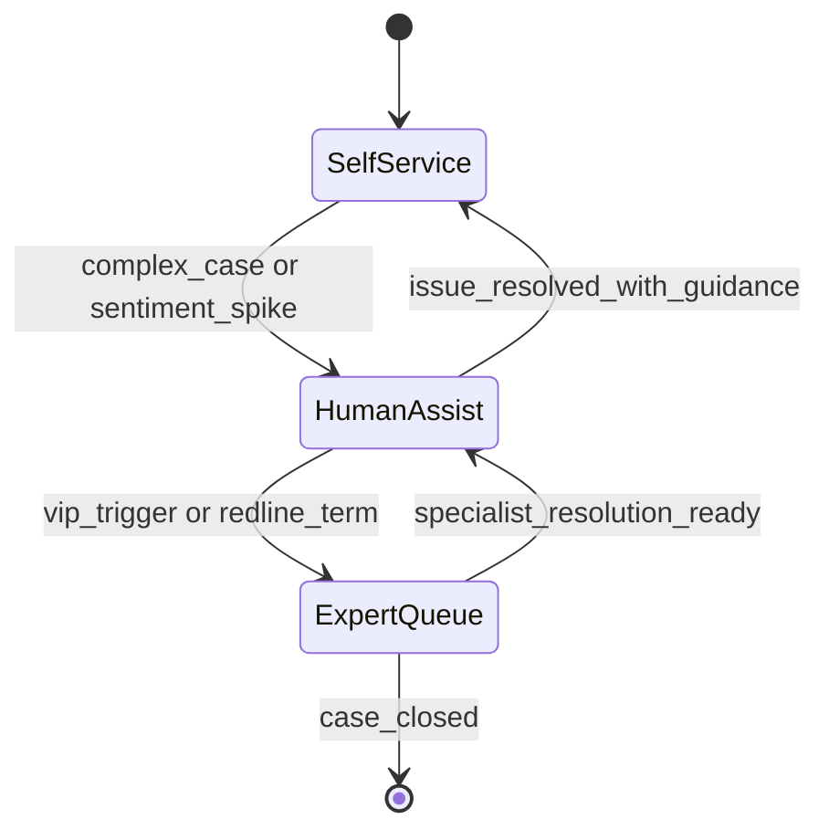

# Azure Bot Omnichannel vs D365 Contact Center vs ACS Sidecar Assist: Enterprise Contact Center Selection FAQ

> 🌐 **Language / 语言切换**: **[🇬🇧 English (azure-bot-service-omnichannel-d365-contact-center-vs-acs-custom-cc-agent-handoff-selection-faq.en.md)](azure-bot-service-omnichannel-d365-contact-center-vs-acs-custom-cc-agent-handoff-selection-faq.en.md)** | **[🇨🇳 中文版 (azure-bot-service-omnichannel-d365-contact-center-vs-acs-custom-cc-agent-handoff-selection-faq.md)](azure-bot-service-omnichannel-d365-contact-center-vs-acs-custom-cc-agent-handoff-selection-faq.md)** | **[📚 Architecture Selection FAQ Index](README.en.md)**

## 1) Objective and boundary
Goal: build architecture-level selection for omnichannel contact center human-AI collaboration and warm handoff continuity.
Scope: voice SIP/PSTN plus WeChat/web/app channels, covering real-time assist, compliance prompts, auto-summary, and QA closure.
Exclusion: no low-level codec, kernel-driver, or protocol-register tuning details.
Conclusion: warm-handoff context contract plus sidecar agent-assist plus full QA loop is the enterprise landing path.
## 2) Verifiable sources with timestamps
- Dynamics 365 Contact Center docs (04:46 BJT)。
- Azure Communication Services docs (04:46 BJT)。
- Azure Bot Service docs (04:47 BJT)。
- Azure AI Speech docs (04:47 BJT)。
- Copilot Studio handoff docs (04:48 BJT)。
- APIM AI Gateway and policy docs (04:48 BJT)。
- Cosmos DB session-state docs (04:49 BJT)。
Evidence labels are measured/synthetic/anonymized_reported and persisted in evidence files.
## 3) Four contact-center patterns and 12-dimension matrix
- A: D365 Contact Center omnichannel with native Copilot fits greenfield or full replacement scenarios.
- B: Existing Genesys/Five9/Cisco/Avaya plus ACS/Speech/Foundry sidecar assist fits low-intrusion modernization.
- C: Copilot Studio self-service plus standard handoff protocol fits FAQ-heavy operations.
- D: Full self-built omnichannel state and workforce-routing platform fits only hyperscale self-engineering organizations.
- Dimension 1 warm-handoff context continuity.
- Dimension 2 multi-channel concurrency across voice and text.
- Dimension 3 real-time agent screen-pop latency and stability.
- Dimension 4 compliance guidance and prohibited-commitment interception.
- Dimension 5 AHT/deflection/rephrase-rate improvement potential.
- Dimension 6 CRM ticket auto-fill and classification quality.
- Dimension 7 legacy CC preservation versus replacement risk.
- Dimension 8 operations complexity and time-to-production.
- Dimension 9 cost model and annual TCO predictability.
- Dimension 10 deterministic VIP and regulatory escalation routing.
- Dimension 11 dual-track redaction recording and full AI QA coverage.
- Dimension 12 anti-pattern risk (handoff without context causing repeated narration and complaint spikes).
## 4) Scoreboard and gating thresholds
- D365 native: governance5, integration5, migration-intrusion3, launch-speed5.
- ACS sidecar: migration-intrusion5, elasticity4, governance4, coupling3.
- Copilot Studio: low-code5, self-service4, complex-routing3, extensibility3.
- Full self-built: control5, complexity5, launch-speed1, long-term maintenance-heavy.
- Threshold A: warm-handoff payload transfer latency should stay below 300ms.
- Threshold B: real-time screen-pop guidance should stay below 800ms.
- Threshold C: red-line trigger must route to expert queue with zero-wait deterministic escalation.
- Threshold D: call QA coverage target is 100% post-call analysis coverage.
## 5) Five calculable Q&As
### Q1 Why customers repeat narration after transfer
- Standardize warm-handoff payload with structured slots, sentiment tags, three-line summary, and recent action trail.
- Use sidecar real-time transcription and policy engine hints to avoid replacing existing softswitch foundations.
- Close the loop with rephrase-rate, AHT, first-contact resolution, and complaint metrics.
### Q2 How to achieve <800ms agent screen-pop on legacy contact-center stacks
- Standardize warm-handoff payload with structured slots, sentiment tags, three-line summary, and recent action trail.
- Use sidecar real-time transcription and policy engine hints to avoid replacing existing softswitch foundations.
- Close the loop with rephrase-rate, AHT, first-contact resolution, and complaint metrics.
### Q3 Financial impact of deflection 35%→68% and AHT -28%
- Standardize warm-handoff payload with structured slots, sentiment tags, three-line summary, and recent action trail.
- Use sidecar real-time transcription and policy engine hints to avoid replacing existing softswitch foundations.
- Close the loop with rephrase-rate, AHT, first-contact resolution, and complaint metrics.
### Q4 How to design deterministic escalation for emotion spikes and VIP triggers
- Standardize warm-handoff payload with structured slots, sentiment tags, three-line summary, and recent action trail.
- Use sidecar real-time transcription and policy engine hints to avoid replacing existing softswitch foundations.
- Close the loop with rephrase-rate, AHT, first-contact resolution, and complaint metrics.
### Q5 How to implement dual-track redacted recording plus full AI QA
- Standardize warm-handoff payload with structured slots, sentiment tags, three-line summary, and recent action trail.
- Use sidecar real-time transcription and policy engine hints to avoid replacing existing softswitch foundations.
- Close the loop with rephrase-rate, AHT, first-contact resolution, and complaint metrics.
## 6) Layered reference architecture
- Channel: voice SIP/PSTN, WeChat/enterprise chat, web, and app.
- Ingress: ACS/Speech or D365 Omnichannel with unified session identity.
- Orchestration: bot/copilot flow plus warm-handoff state machine.
- Assist: real-time agent copilot, prohibited-commitment alerts, and dynamic knowledge pops.
- State: Cosmos session store for context, slots, sentiment, and transfer trace.
- Governance: APIM policy, identity, quota, red-line terms, and audit gates.
- Archive: dual-track redacted recordings and full AI QA pipelines.
- Operations: ticket summaries, QA dashboards, and SLO/cost audits.
## 7) Scenario A: global airline disruption service center
- Burst traffic is first deflected by self-service bot for standard rebooking eligibility and policy response.
- Complex interline tickets, sentiment escalation, or premium-rights triggers invoke seamless warm handoff.
- Transfer payload includes itinerary, fare-rules, summary, and compensation policy card for premium agents.
- Agent sidecar detects compliance risk and can enforce expert takeover when required.
- Within three seconds after hangup, summary is generated and posted to CRM and QA systems.
## 8) Scenario B: city-bank credit-card center real-time compliance copilot
- Preserve existing Genesys stack and split customer/agent channels via SIPREC dual-channel ingest.
- Detect missing fee disclosure, prohibited commitments, and regulatory red-line terms in near real time.
- Auto-fill CRM ticket category and risk tags to reduce manual wrap-up effort.
- High-risk calls trigger zero-wait escalation to compliance experts with full trace evidence.
- Post-call summaries are archived in seconds and fed into full AI QA plus sampling review flows.
## 9) Mermaid diagram 1: warm-handoff architecture flow

- Core principle: build context payload before transfer to avoid repeated customer narration.
## 10) Mermaid diagram 2: escalation and compliance interception state machine

- Escalation state machine must be deterministic, replayable, and auditable to avoid policy bypass.
## 11) Bicep template (ACS + Speech + Foundry + Cosmos + APIM)
```bicep
targetScope = 'resourceGroup'
param location string = resourceGroup().location
resource apim 'Microsoft.ApiManagement/service@2023-09-01-preview' = {
  name: 'apim-prod'
  location: location
  sku: { name: 'PremiumV2', capacity: 1 }
}
resource acs 'Microsoft.Communication/communicationServices@2023-04-01' = {
  name: 'acs'
  location: 'global'
}
resource cosmos 'Microsoft.DocumentDB/databaseAccounts@2024-05-15' = {
  name: 'cosmos'
  location: location
  kind: 'GlobalDocumentDB'
}
```
- Production setup should include private endpoints, key governance, recording redaction policy, and multi-region DR controls.
## 12) Warm handoff schema and red-line escalation policy snippets
```json
{
  "session_id": "string",
  "customer_slots": {"intent":"string","order_id":"string","vip_tier":"string"},
  "sentiment": {"score": 0.0, "label":"calm|neutral|agitated"},
  "summary_3_lines": ["line1","line2","line3"],
  "redline_flags": ["fee_disclosure_missing","regulatory_term_hit"]
}
```
```python
def escalate(ctx):
    if 'regulatory_term_hit' in ctx['redline_flags'] or ctx['customer_slots'].get('vip_tier') == 'platinum':
        return 'expert_queue'
    if ctx['sentiment']['label'] == 'agitated':
        return 'priority_human_assist'
    return 'standard_human_assist'
```
- Context payload versions must be traceable and stored with transfer outcomes for complaint replay.
## 13) KQL: deflection, AHT, repeat-narration, and compliance interception audit
```kql
let t = ContactCenterOpsLogs | where TimeGenerated > ago(30d);
t
| summarize deflectionRate=avg(todouble(IsSelfServiceResolved)), ahtSec=avg(AHTSeconds), repeatNarrationRate=avg(todouble(RepeatNarration)), complianceInterceptRate=avg(todouble(ComplianceIntercepted)) by Channel
| order by repeatNarrationRate desc
```
- Joint reduction in repeat-narration rate and AHT is the primary business evidence for warm-handoff success.
## 14) Five-step rollout guide
- Step 1: map channels, intents, and transfer scenarios with unified context contract.
- Step 2: launch sidecar real-time assist in one channel first and verify <800ms screen-pop target.
- Step 3: expand to omnichannel with red-line, VIP, and sentiment escalation state machine.
- Step 4: connect CRM auto-summary, dual-track redacted recording, and full AI QA pipelines.
- Step 5: optimize strategy weekly using deflection, AHT, repeat-rate, and complaint metrics.
- Build tiered on-call and escalation SOP to sustain peak-event operations.
- Every policy release must ship replay packs and impact assessment to prevent compliance regressions.
