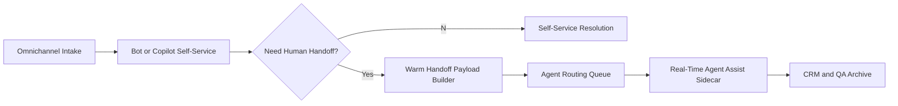
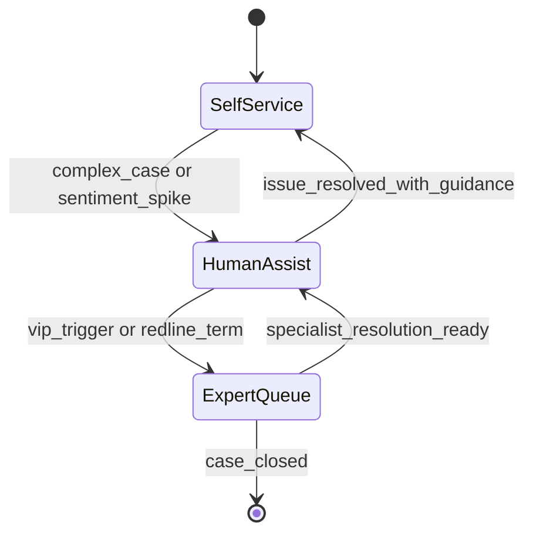

# Azure Bot Omnichannel vs D365 Contact Center vs ACS Sidecar Assist：企业全渠道联络中心选型 FAQ

> 🌐 **Language / 语言切换**: **[🇨🇳 中文版 (azure-bot-service-omnichannel-d365-contact-center-vs-acs-custom-cc-agent-handoff-selection-faq.md)](azure-bot-service-omnichannel-d365-contact-center-vs-acs-custom-cc-agent-handoff-selection-faq.md)** | **[🇬🇧 English (azure-bot-service-omnichannel-d365-contact-center-vs-acs-custom-cc-agent-handoff-selection-faq.en.md)](azure-bot-service-omnichannel-d365-contact-center-vs-acs-custom-cc-agent-handoff-selection-faq.en.md)** | **[📚 返回架构选型指南目录](README.md)**

## 1) 研究目标与边界
目标：构建全渠道客服中心的人机协同与无感热转人工架构选型方法。
范围：语音SIP/PSTN + 微信/企微/网页/App 渠道，覆盖实时辅助、合规提醒、自动小结与质检闭环。
排除：不涉及底层语音编解码器、内核驱动、网络协议寄存器调优细节。
结论：Warm Handoff 上下文契约 + 旁路坐席辅助 + 全量质检是企业落地主路径。
## 2) 可验证来源与时间戳
- Dynamics 365 Contact Center 文档（04:46 BJT）。
- Azure Communication Services 文档（04:46 BJT）。
- Azure Bot Service 文档（04:47 BJT）。
- Azure AI Speech 文档（04:47 BJT）。
- Copilot Studio Handoff 文档（04:48 BJT）。
- APIM AI Gateway 与策略文档（04:48 BJT）。
- Cosmos DB 会话状态管理文档（04:49 BJT）。
证据标签统一 measured/synthetic/anonymized_reported，并在 evidence 文件固化。
## 3) 四类全渠道客服架构 12 维矩阵
- A: D365 Contact Center 原生全渠道 + Copilot，适合整套替换与统一CRM视图。
- B: 既有 Genesys/Five9/Cisco/Avaya + ACS/Speech/Foundry 旁路坐席辅助，适合低侵入改造。
- C: Copilot Studio 全渠道自助机器人 + 标准 Handoff 协议，适合 FAQ 高占比业务。
- D: 全自研会话状态机与排班路由中台，仅适合超大型自研组织。
- 维度1 无感热转人工的上下文连续性。
- 维度2 语音与文本多渠道并发处理能力。
- 维度3 实时坐席弹屏时延与稳定性。
- 维度4 合规提醒与违规承诺拦截能力。
- 维度5 AHT、Deflection、复述率改善空间。
- 维度6 CRM 工单自动归档与分类准确率。
- 维度7 既有呼叫中心保护与替换风险。
- 维度8 运维复杂度与上线速度。
- 维度9 成本模型与年度TCO可预测性。
- 维度10 VIP/红线词越级直转确定性。
- 维度11 双轨脱敏录音与全量AI质检覆盖。
- 维度12 反模式（无上下文转接导致重复复述与投诉）。
## 4) 评分与门禁阈值
- D365 原生：治理5、一体化5、改造侵入3、上线速度5。
- ACS 旁路：改造侵入5、弹性4、治理4、系统耦合3。
- Copilot Studio：低代码5、自助分流4、复杂路由3、扩展控制3。
- 全自研：控制5、复杂度5、上线速度1、长期维护成本高。
- 阈值A：Warm Handoff 负载要求下转接上下文时延需 <300ms。
- 阈值B：坐席弹屏知识建议响应需 <800ms 才可视为实时辅助。
- 阈值C：红线词命中必须零等待越级直转专家队列。
- 阈值D：录音质检覆盖率目标为 100% 全量后评估。
## 5) 五组可复算 Q&A
### Q1 为什么转人工后客户被迫重复复述
- 统一 Warm Handoff Payload，包含结构化槽位、情绪标签、三句摘要与最近操作轨迹。
- 通过旁路实时转录与策略引擎输出坐席提示，避免替换既有软交换底座。
- 用复述率、AHT、首次解决率和投诉率做闭环量化，驱动持续优化。
### Q2 既有呼叫中心如何实现 <800ms 坐席弹屏
- 统一 Warm Handoff Payload，包含结构化槽位、情绪标签、三句摘要与最近操作轨迹。
- 通过旁路实时转录与策略引擎输出坐席提示，避免替换既有软交换底座。
- 用复述率、AHT、首次解决率和投诉率做闭环量化，驱动持续优化。
### Q3 Deflection 35%→68% 与 AHT -28% 的TCO意义
- 统一 Warm Handoff Payload，包含结构化槽位、情绪标签、三句摘要与最近操作轨迹。
- 通过旁路实时转录与策略引擎输出坐席提示，避免替换既有软交换底座。
- 用复述率、AHT、首次解决率和投诉率做闭环量化，驱动持续优化。
### Q4 情绪升级与VIP越级直转状态机如何设计
- 统一 Warm Handoff Payload，包含结构化槽位、情绪标签、三句摘要与最近操作轨迹。
- 通过旁路实时转录与策略引擎输出坐席提示，避免替换既有软交换底座。
- 用复述率、AHT、首次解决率和投诉率做闭环量化，驱动持续优化。
### Q5 双轨脱敏录音与全量AI质检如何落地
- 统一 Warm Handoff Payload，包含结构化槽位、情绪标签、三句摘要与最近操作轨迹。
- 通过旁路实时转录与策略引擎输出坐席提示，避免替换既有软交换底座。
- 用复述率、AHT、首次解决率和投诉率做闭环量化，驱动持续优化。
## 6) 分层参考架构
- 渠道层：语音 SIP/PSTN、微信/企微、网页、App。
- 接入层：ACS/Speech 或 D365 Omnichannel 接入与会话标识统一。
- 编排层：Bot/Copilot 流程编排 + Warm Handoff 状态机。
- 辅助层：实时坐席副驾、违规承诺预警、动态知识弹屏。
- 状态层：Cosmos 会话库保存上下文、槽位、情绪与转接轨迹。
- 治理层：APIM 策略、身份、配额、敏感词和审计门禁。
- 归档层：双轨脱敏录音归档与全量AI质检流水线。
- 运营层：工单小结、QA质检看板与SLO/成本审计。
## 7) 场景A：跨国航空延误退改签客服中枢
- 突发流量先由自助机器人完成改签资格判断与标准政策回复。
- 当识别到联程复杂票、情绪升级或特殊权益时触发无感热转人工。
- 转接时同步航段、票规、历史对话摘要与赔付建议卡片到白金坐席。
- 坐席侧实时检测承诺风险与不合规话术，必要时强制专家接管。
- 挂断后3秒内生成工单小结并回写CRM与质检系统。
## 8) 场景B：城商行信用卡中心实时合规副驾
- 保留既有 Genesys 底座，通过 SIPREC 双声道分离客户与坐席语音。
- 实时检测费率披露遗漏、违规承诺和投诉红线词，毫秒级提示坐席修正。
- 自动预填CRM工单分类与风险标签，减少人工录入时间。
- 对高风险通话触发零等待越级直转合规专家并保留全链路证据。
- 通话后秒级小结归档，进入全量AI质检与抽检复核流程。
## 9) Mermaid 图1：Warm Handoff 架构流

- 核心在于先构建上下文载荷，再转人工，避免客户重复复述。
## 10) Mermaid 图2：升级与合规拦截状态机

- 升级状态机需确定性、可回放、可审计，避免人工绕过合规门禁。
## 11) Bicep 模板（ACS + Speech + Foundry + Cosmos + APIM）
```bicep
targetScope = 'resourceGroup'
param location string = resourceGroup().location
resource apim 'Microsoft.ApiManagement/service@2023-09-01-preview' = {
  name: 'apim-prod'
  location: location
  sku: { name: 'PremiumV2', capacity: 1 }
}
resource acs 'Microsoft.Communication/communicationServices@2023-04-01' = {
  name: 'acs'
  location: 'global'
}
resource cosmos 'Microsoft.DocumentDB/databaseAccounts@2024-05-15' = {
  name: 'cosmos'
  location: location
  kind: 'GlobalDocumentDB'
}
```
- 生产需补齐私网端点、密钥托管、录音脱敏策略与跨区容灾配置。
## 12) Warm Handoff Schema 与红线升级策略片段
```json
{
  "session_id": "string",
  "customer_slots": {"intent":"string","order_id":"string","vip_tier":"string"},
  "sentiment": {"score": 0.0, "label":"calm|neutral|agitated"},
  "summary_3_lines": ["line1","line2","line3"],
  "redline_flags": ["fee_disclosure_missing","regulatory_term_hit"]
}
```
```python
def escalate(ctx):
    if 'regulatory_term_hit' in ctx['redline_flags'] or ctx['customer_slots'].get('vip_tier') == 'platinum':
        return 'expert_queue'
    if ctx['sentiment']['label'] == 'agitated':
        return 'priority_human_assist'
    return 'standard_human_assist'
```
- 上下文载荷版本必须可追踪并与转接结果一并落库以支持投诉复盘。
## 13) KQL：Deflection/AHT/复述率/合规拦截审计
```kql
let t = ContactCenterOpsLogs | where TimeGenerated > ago(30d);
t
| summarize deflectionRate=avg(todouble(IsSelfServiceResolved)), ahtSec=avg(AHTSeconds), repeatNarrationRate=avg(todouble(RepeatNarration)), complianceInterceptRate=avg(todouble(ComplianceIntercepted)) by Channel
| order by repeatNarrationRate desc
```
- 复述率与AHT联合下降是 Warm Handoff 成功的首要业务证据。
## 14) 五步落地指南
- 步骤1：梳理渠道、意图、转接场景并定义统一上下文契约。
- 步骤2：先在单渠道上线旁路实时辅助，验证 <800ms 弹屏目标。
- 步骤3：扩展到全渠道并接入红线词、VIP、情绪升级状态机。
- 步骤4：打通CRM自动小结、双轨脱敏录音与全量AI质检流水线。
- 步骤5：按周复盘 Deflection、AHT、复述率、投诉率并优化策略。
- 建立分层值班与升级SOP，确保高峰事件可持续运营。
- 每次策略发布必须附带回放包与影响评估，防止合规回退。
