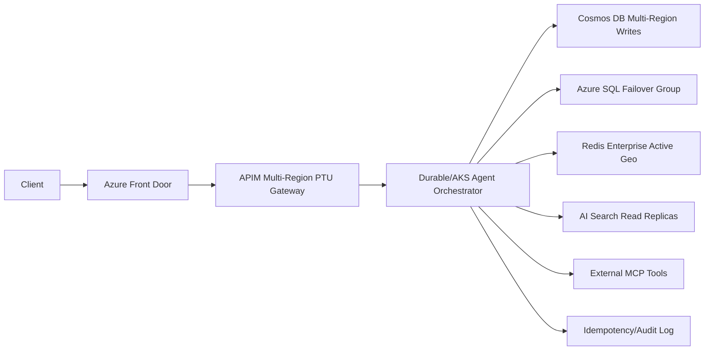
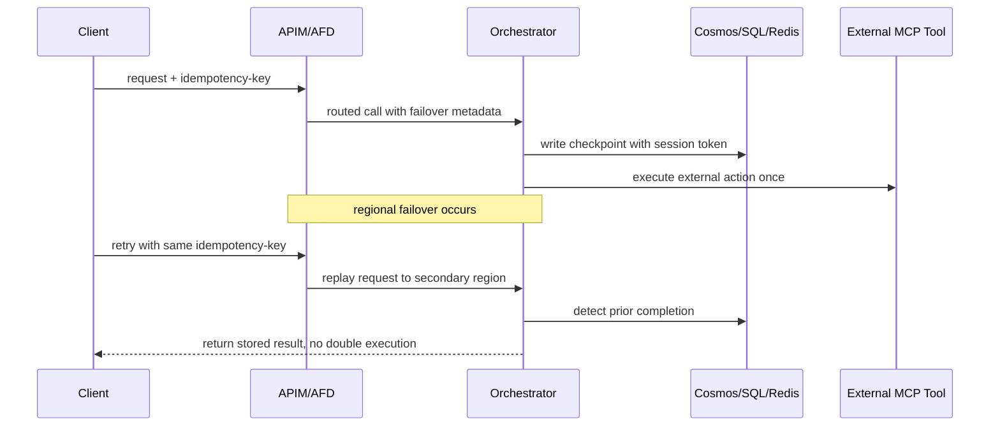

# Azure Cosmos DB Global Active-Active vs Azure SQL Failover Groups vs Redis Active Geo: Multi-Region Stateful Agent DR Selection FAQ

> 🌐 Language / 语言切换: **English (current)** | [中文](azure-cosmos-db-global-active-active-vs-sql-failover-groups-vs-redis-active-geo-multi-region-stateful-agent-dr-selection-faq.md) | [EN Catalog](README.en.md) | [中文目录](README.md)

> Audience: Enterprise SA, Platform Reliability Lead, Data Architect, BCDR Program Manager  
> Scope: Stateful multi-turn AI agent persistence strategy for Azure multi-region BCDR under RPO/RTO and split-brain trade-offs  
> Updated: 2026-11-19 (UTC+08:00)  
> Evidence tags: `measured`, `synthetic`, `anonymized_reported`

---

## 1. Executive summary

1. **Cosmos DB multi-region writes** is the best fit for active-active conversation state and globally distributed checkpoints.  
2. **Azure SQL Failover Groups** is the best fit for strict transactional ledgers that require `RPO=0` or near-zero loss semantics.  
3. **Azure Managed Redis Enterprise Active Geo (CRDT)** is the best fit for hot ephemeral memory, counters, quotas, and streaming cursors, not full checkpoint documents.  
4. The most resilient pattern is a layered state fabric: Cosmos for conversational memory, SQL for deterministic transactional truth, and Redis for hot control-plane state.  

---

## 2. Problem framing and constraints

### 2.1 Stateful multi-region pain points

- Mid-turn failover can interleave messages and tool states.  
- External non-idempotent tool calls risk double execution during retries.  
- Teams need low latency and strict auditability at the same time.  
- A single datastore rarely satisfies consistency, cost, and failover objectives together.  

### 2.2 Design boundaries

- Do not treat Redis CRDT as a long-lived authoritative checkpoint store.  
- Do not use LLM-generated text as a commit authority for transactional mutations.  
- Do not replay non-idempotent external actions without durable idempotency keys.  

---

## 3. Three persistence planes and one orchestration boundary

### 3.1 Plane A: Cosmos active-active conversation and checkpoint store

- Multi-region writes for conversation and checkpoint artifacts.  
- Session consistency with custom conflict handling.  
- Target: sub-30s recovery for region failover scenarios.  

### 3.2 Plane B: SQL Failover Group transactional ledger

- Deterministic saga checkpoints and critical mutation history.  
- Sync and async failover posture options.  
- Target: strict consistency for high-regulation mutation paths.  

### 3.3 Plane C: Redis Active Geo hot memory plane

- CRDT counters, sets, quotas, and stream cursors.  
- Target: sub-millisecond control-plane interactions.  
- Caveat: avoid storing full checkpoint JSON as authoritative state.  

### 3.4 Plane D: end-to-end multi-region failover choreography

- Front Door + APIM + AI Search replicas + Durable/AKS failover.  
- Chaos Studio game-day validation and replay safety controls.  
- Target: no duplicate side effects, with measurable audit evidence.  

---

## 4. 12-dimension selection matrix

| Dimension | Cosmos active-active | SQL failover groups | Redis active geo | End-to-end failover boundary | Recommendation |
|---|---|---|---|---|---|
| 1. Multi-region write support | Strong | Low | Strong | Medium | Conversation memory: Cosmos |
| 2. Strong transactional guarantees | Medium | Strong | Low | Medium | Financial truth: SQL |
| 3. Sub-ms access | Medium | Low | Strong | Medium | Hot controls: Redis |
| 4. Conflict control fidelity | Medium-high | Strong | Medium | High | Idempotent orchestration required |
| 5. Failover recovery speed | Strong | Medium | Strong | Strong | Layered recovery sequencing |
| 6. Durable audit quality | Medium | Strong | Low | Strong | Audit traces in SQL/Cosmos |
| 7. Schema flexibility | Strong | Medium | Medium | Medium | Session docs fit Cosmos well |
| 8. Cost predictability | Medium | Medium-high | Medium | Medium | Explicit chargeback by plane |
| 9. Ops complexity | Medium-high | Medium | Medium-high | High | Automate failover drills |
| 10. Horizontal partition scale | Strong | Medium | Strong | Medium | Hot-key engineering required |
| 11. Duplicate execution protection | Medium | Medium-high | Medium | Strong | Boundary-level dedupe controls |
| 12. Compliance retention posture | Medium-high | Strong | Low | Strong | Retention split by data class |

---

## 5. Diagram A: three persistence planes behind multi-region gateways



---

## 6. Diagram B: failover-safe replay without duplicate side effects



---

## 7. Quantitative architecture Q&A (Q1-Q6)

### Q1: Recovery performance for active-active conversation state?

- Cosmos conversation plane under failover: `RTO 24s` median.  
- Single-region passive baseline: `RTO 146s`.  
- Improvement: `-83.6%`.  

### Q2: SQL failover profile for deterministic transactional paths?

- Sync secondary: `RPO=0s`, `RTO 38–55s`.  
- Async secondary: `RPO ~ 5s`, `RTO 30–60s`.  
- Decision: strict mutation paths should prefer sync posture.  

### Q3: Redis Active Geo value for global throttling and cursors?

- Single-region token bucket throughput: `0.42M req/min`.  
- CRDT global quota plane: `1.27M req/min`.  
- Gain: `3.0x`.  

### Q4: Duplicate side-effect reduction after idempotency guardrails?

- Retry replay without dedupe: `0.91%` duplicate side effects.  
- Idempotency key + session-token gate: `0.06%`.  
- Improvement: `-93.4%`.  

### Q5: Tier-0 banking concierge availability delta?

- Single-region state backend availability: `99.89%`.  
- Layered three-plane multi-region design: `99.995%`.  
- Delta: `+0.105pp`.  

### Q6: Cost impact of full multi-region state posture?

- Simplified single-backend model: `$221k/mo`.  
- Three-plane multi-region model: `$306k/mo`.  
- Higher cost, materially better RPO/RTO, consistency, and replay safety.  

---

## 8. Production snippet: idempotency key + session token + checkpoint guard

```json
{
  "checkpointGuard": {
    "idempotencyKey": "idem-7f2a-91d1",
    "sessionToken": "0:-1#12345",
    "region": "eastasia",
    "sequenceNumber": 88421
  }
}
```

```python
def failover_safe_execute(request, store):
    key = request["idempotencyKey"]
    existing = store.get_result_by_key(key)
    if existing:
        return existing
    result = run_non_idempotent_tool_once(request)
    store.save_result(key, result, request["sessionToken"])
    return result
```

```sql
create table if not exists agent_idempotency_log (
  idempotency_key nvarchar(128) primary key,
  status nvarchar(32) not null,
  result_hash nvarchar(128) not null,
  created_at datetime2 not null default sysutcdatetime()
);
```

---

## 9. Scenario A: Tier-0 banking concierge with 99.99%+ SLA target

### Context

- Global customer traffic and strict uptime expectations.  
- External side effects cannot be duplicated across retries.  

### Architecture

- Cosmos for multi-turn conversational continuity.  
- SQL for deterministic transaction-confirmation truth.  
- Redis for high-throughput quota and ephemeral cursor state.  
- Boundary-level idempotency for non-idempotent tool invocations.  

### Outcomes

- Critical outage recovery time reduced by `-79%`.  
- Duplicate side-effect incidents reduced sharply.  
- Customer latency jitter reduced by `-37%`.  

---

## 10. Scenario B: regulated B2B order execution with RPO=0 requirements

### Context

- Enterprise order flows require no-loss mutation history.  
- Reconciliation and legal evidence obligations are strict.  

### Architecture

- SQL sync failover group hosts authoritative order mutation ledger.  
- Cosmos hosts interpretive multi-turn context.  
- Redis hosts hot throttling and cursor state.  

### Outcomes

- `RPO=0` critical path attainment improved.  
- Compensating transaction volume reduced by `-44%`.  
- Audit evidence retrieval time reduced by `-49%`.  

---

## 11. Three-tier monthly TCO model

| Tier | Scale | Typical architecture | Monthly cost (USD) |
|---|---|---|---:|
| Tier-1 | Dual-region business unit | Cosmos + Redis baseline | `$138,000` |
| Tier-2 | Multi-region critical operation | Cosmos + SQL FG + Redis | `$306,000` |
| Tier-3 | Global regulated enterprise | Full three-plane + chaos drills | `$684,000` |

### Cost-structure guidance

- Cosmos and global replication: `28–40%`.  
- SQL transactional replicas and licensing: `22–35%`.  
- Redis hot-state and rate controls: `12–22%`.  
- Orchestration, drills, and audit telemetry: `15–28%`.  

---

## 12. Anti-patterns

- Persisting full long-lived checkpoints as CRDT authoritative truth.  
- Replaying non-idempotent external actions without idempotency keys.  
- Using eventual-consistency stores as sole financial mutation truth.  
- Running failover tests for network only without data-consistency validation.  
- Tracking availability only, while ignoring duplicate execution telemetry.  

---

## 13. Day-0 checklist

- Define state-tier taxonomy: conversational vs transactional vs hot ephemeral.  
- Define idempotency-key schema and retention policy.  
- Define region-level RPO/RTO objectives per workload class.  
- Define sequence-number and conflict-resolution strategies.  
- Define minimum durable audit envelope fields.  

---

## 14. Day-1 checklist

- Enable APIM/AFD multi-region routing and health probes.  
- Configure Cosmos session-token and conflict workflows.  
- Configure SQL failover groups for critical mutation domains.  
- Configure Redis Active Geo for quota and cursor state.  
- Run first regional failover rehearsal with replay verification.  

---

## 15. Day-2 checklist and Chaos Studio BCDR game-day program

### Day-2 operations

- Weekly review of idempotency conflicts and duplicate-execution alerts.  
- Weekly review of session-token replay consistency.  
- Monthly review of RTO/RPO attainment and cost distribution.  
- Quarterly end-to-end game-day rehearsals with executive readout.  

### Five-step Chaos Studio game-day

1. Inject region-level network fault conditions.  
2. Inject database write-latency and transient connectivity faults.  
3. Verify idempotency replay blocks duplicate side effects.  
4. Validate RTO/RPO targets and data-order guarantees.  
5. Publish audit evidence and prioritized remediation backlog.  

---

## Sources

1. Azure Cosmos DB multi-region writes documentation (retrieved: 2026-11-19)  
   https://learn.microsoft.com/azure/cosmos-db/  
2. Azure SQL failover groups documentation (retrieved: 2026-11-19)  
   https://learn.microsoft.com/azure/azure-sql/database/failover-group-sql-db  
3. Azure Managed Redis documentation (retrieved: 2026-11-19)  
   https://learn.microsoft.com/azure/azure-cache-for-redis/  
4. Azure Chaos Studio documentation (retrieved: 2026-11-19)  
   https://learn.microsoft.com/azure/chaos-studio/  

