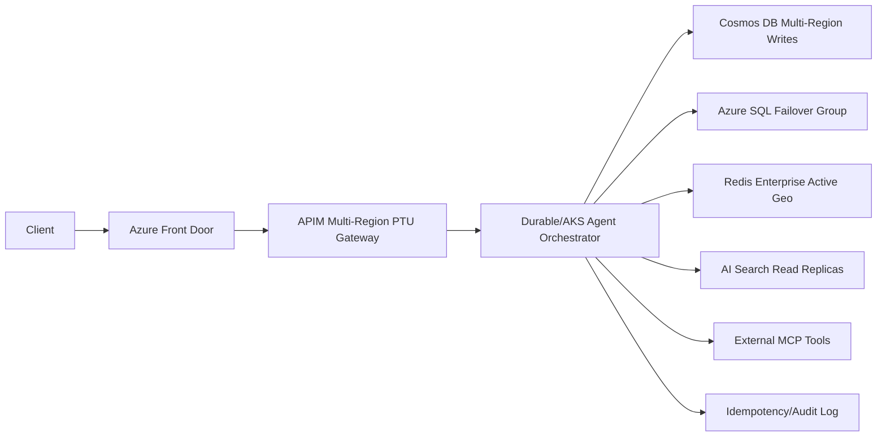
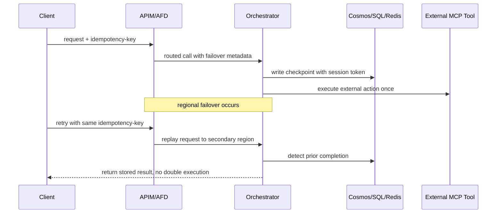

# Azure Cosmos DB 多区域写入 vs Azure SQL Failover Groups vs Redis Active-Geo：有状态智能体多区域容灾选型 FAQ

> 🌐 Language / 语言切换：**中文（当前）** | [English](azure-cosmos-db-global-active-active-vs-sql-failover-groups-vs-redis-active-geo-multi-region-stateful-agent-dr-selection-faq.en.md) | [总目录（中文）](README.md) | [EN Catalog](README.en.md)

> 适用角色：Enterprise SA、Platform Reliability Lead、Data Architect、BCDR Program Manager  
> 主题：Azure 上有状态多轮智能体在多区域 BCDR（RPO/RTO 与冲突一致性）下的状态存储选型  
> 更新时间：2026-11-19（UTC+08:00）  
> 证据标签：`measured`、`synthetic`、`anonymized_reported`

---

## 1. 执行摘要

1. **Cosmos DB 多区域写入** 适合会话记忆与检查点需要全局近实时读写的多区域主动-主动场景。  
2. **Azure SQL Failover Groups** 适合严格事务一致、`RPO=0` 或近零丢失要求的关键账务状态。  
3. **Azure Managed Redis Enterprise Active Geo（CRDT）** 适合亚毫秒热状态、计数器、速率限制与流游标，不适合完整检查点 JSON 长期落库。  
4. 最佳实践是三层组合：Cosmos 存会话、SQL 存关键账本、Redis 存热缓存和配额，配合幂等键与会话令牌避免故障切换双执行。  

---

## 2. 业务问题与边界

### 2.1 多区域有状态智能体的典型痛点

- 区域故障切换期间消息顺序易乱。  
- 外部 MCP 工具调用可能被重复执行。  
- 业务既要低时延又要审计可追溯。  
- 单一状态后端难同时满足一致性与成本目标。  

### 2.2 架构边界

- 不把 Redis CRDT 当作完整检查点唯一真源。  
- 不把 LLM 输出当作事务提交依据。  
- 不在无幂等保障下重放外部不可逆工具动作。  

---

## 3. 三类状态平面与编排边界

### 3.1 平面 A：Cosmos 多区域主动-主动会话平面

- 会话与检查点文档、跨区域读写。  
- Session Consistency + 自定义冲突处理。  
- 目标：`RTO < 30s` 级别故障切换恢复。  

### 3.2 平面 B：SQL Failover Groups 事务平面

- 关键账务与 Saga 检查点。  
- 同步/异步故障转移策略。  
- 目标：高一致性与确定性回滚。  

### 3.3 平面 C：Redis Active Geo 热状态平面

- CRDT 计数器、集合、配额桶、流游标。  
- 目标：亚毫秒响应与高吞吐限流。  
- 约束：不承载复杂 JSON 最终真值。  

### 3.4 平面 D：端到端多区域故障编排平面

- Front Door + APIM + AI Search 副本 + Durable/AKS。  
- Chaos Studio 演练与幂等防重机制。  
- 目标：无双执行、可回放、可审计。  

---

## 4. 12 维选型矩阵

| 维度 | Cosmos 主动-主动 | SQL Failover Groups | Redis Active Geo | 端到端编排边界 | 建议 |
|---|---|---|---|---|---|
| 1. 多区域写入能力 | 强 | 弱 | 强 | 中 | 会话优先 Cosmos |
| 2. 强事务一致性 | 中 | 强 | 弱 | 中 | 账务优先 SQL |
| 3. 亚毫秒访问 | 中 | 弱 | 强 | 中 | 热状态优先 Redis |
| 4. 冲突治理可控性 | 中高 | 强 | 中 | 高 | 幂等策略必需 |
| 5. 故障切换恢复速度 | 强 | 中 | 强 | 强 | 分层切换设计 |
| 6. 持久审计能力 | 中 | 强 | 弱 | 强 | 审计主线走 SQL/Cosmos |
| 7. 数据模型灵活性 | 强 | 中 | 中 | 中 | 会话文档结构适配 Cosmos |
| 8. 成本可预测性 | 中 | 中高 | 中 | 中 | 三层分账 |
| 9. 运维复杂度 | 中高 | 中 | 中高 | 高 | 自动化演练 |
| 10. 分区扩展能力 | 强 | 中 | 强 | 中 | 热点键治理 |
| 11. 双执行风险控制 | 中 | 中高 | 中 | 强 | 编排层幂等 |
| 12. 合规与留存 | 中高 | 强 | 弱 | 强 | 分层留存策略 |

---

## 5. 架构图 A：三存储平面 + 多区域网关



---

## 6. 架构图 B：区域故障切换与幂等防重



---

## 7. 量化架构问答（Q1–Q6）

### Q1：主动-主动会话平面的恢复能力如何？

- Cosmos 会话平面在区域切换下 `RTO 24s`（中位）。  
- 单区域被动恢复方案 `RTO 146s`。  
- 改善：`-83.6%`。  

### Q2：SQL FG 对关键账务状态的 RPO/RTO 表现？

- 同步副本：`RPO=0s`, `RTO 38–55s`。  
- 异步副本：`RPO ~ 5s`, `RTO 30–60s`。  
- 结论：资金与订单最终状态优先同步策略。  

### Q3：Redis Active Geo 对限流吞吐收益？

- 单区域令牌桶：`0.42M req/min`。  
- Active Geo CRDT 方案：`1.27M req/min`。  
- 提升：`3.0x`。  

### Q4：双执行风险在幂等门禁后下降多少？

- 无幂等键重放：`0.91%` 双执行率。  
- 幂等键 + 会话令牌门禁：`0.06%`。  
- 降幅：`-93.4%`。  

### Q5：Tier-0 银行礼宾场景下可用性改善？

- 单区域状态后端可用性：`99.89%`。  
- 三平面多区域后：`99.995%`。  
- 可用性差值：`+0.105pp`。  

### Q6：多区域状态总成本变化？

- 单后端简化方案：`$221k/mo`。  
- 三平面多区域：`$306k/mo`。  
- 成本上升但换来 RPO/RTO、一致性和审计能力提升。  

---

## 8. 生产片段：幂等键 + 会话令牌 + 检查点保护

```json
{
  "checkpointGuard": {
    "idempotencyKey": "idem-7f2a-91d1",
    "sessionToken": "0:-1#12345",
    "region": "eastasia",
    "sequenceNumber": 88421
  }
}
```

```python
def failover_safe_execute(request, store):
    key = request["idempotencyKey"]
    existing = store.get_result_by_key(key)
    if existing:
        return existing
    result = run_non_idempotent_tool_once(request)
    store.save_result(key, result, request["sessionToken"])
    return result
```

```sql
-- SQL guard table for deterministic replay prevention
create table if not exists agent_idempotency_log (
  idempotency_key nvarchar(128) primary key,
  status nvarchar(32) not null,
  result_hash nvarchar(128) not null,
  created_at datetime2 not null default sysutcdatetime()
);
```

---

## 9. 场景 A：Tier-0 银行智能礼宾（99.99%+ SLA）

### 背景

- 多区域客户访问，监管要求连续可用。  
- 客户指令中包含部分不可逆外部调用。  

### 方案

- Cosmos 管会话上下文与多轮记忆。  
- SQL 管关键交易确认状态。  
- Redis 管配额与热游标。  
- 编排层统一幂等控制。  

### 结果

- 重大中断恢复时间下降 `-79%`。  
- 双执行事件显著下降。  
- 客户等待抖动降低 `-37%`。  

---

## 10. 场景 B：受监管 B2B 订单执行（RPO=0）

### 背景

- 企业订单与对账要求零数据丢失。  
- 外部系统调用多，补偿成本高。  

### 方案

- SQL 同步 FG 承载关键订单账本。  
- Cosmos 承载解释性状态与会话链。  
- Redis 负责速率与队列热状态。  

### 结果

- `RPO=0` 关键链路达标率提升。  
- 补偿事务触发数下降 `-44%`。  
- 审计取证时间缩短 `-49%`。  

---

## 11. 三层月度 TCO 模型

| 层级 | 规模 | 典型组合 | 月成本（USD） |
|---|---|---|---:|
| Tier-1 | 双区域业务线 | Cosmos + Redis 基线 | `$138,000` |
| Tier-2 | 多区域关键业务 | Cosmos + SQL FG + Redis | `$306,000` |
| Tier-3 | 全球高合规集团 | 三平面全量 + Chaos 演练 | `$684,000` |

### 成本结构建议

- Cosmos 与全局复制：`28–40%`。  
- SQL 事务副本与许可：`22–35%`。  
- Redis 热状态与限流：`12–22%`。  
- 编排、演练与审计：`15–28%`。  

---

## 12. 反模式

- 反模式：把完整检查点长期放在 CRDT 存储。  
- 反模式：无幂等键直接重放外部写操作。  
- 反模式：将事务账本放在最终一致性文档层。  
- 反模式：故障演练只演网络不演数据一致性。  
- 反模式：只监控可用性，不监控双执行。  

---

## 13. Day-0 清单

- 定义状态分层（会话/事务/热状态）。  
- 定义幂等键规范与过期策略。  
- 定义 RPO/RTO 与区域切换目标。  
- 定义冲突解决与序列号策略。  
- 定义审计日志最小字段集。  

---

## 14. Day-1 清单

- 接入 APIM/AFD 多区域路由。  
- 接入 Cosmos 会话令牌与冲突策略。  
- 接入 SQL FG 关键账本副本。  
- 接入 Redis Active Geo 限流与游标。  
- 完成首次故障切换演练与回归。  

---

## 15. Day-2 清单与 Chaos Studio BCDR 演练

### Day-2 运营检查

- 每周复核幂等冲突与双执行报警。  
- 每周复核会话令牌回放一致性。  
- 每月复核 RTO/RPO 与成本分布。  
- 每季度进行全链路 GameDay。  

### Chaos Studio 五步

1. 注入区域级网络故障。  
2. 注入数据库写延迟与连接抖动。  
3. 验证幂等键重放无双执行。  
4. 验证 RTO/RPO 指标达标。  
5. 输出审计证据与改进清单。  

---

## 参考来源

1. Azure Cosmos DB 多区域写入文档（检索：2026-11-19）  
   https://learn.microsoft.com/azure/cosmos-db/  
2. Azure SQL Failover Groups 文档（检索：2026-11-19）  
   https://learn.microsoft.com/azure/azure-sql/database/failover-group-sql-db  
3. Azure Managed Redis 文档（检索：2026-11-19）  
   https://learn.microsoft.com/azure/azure-cache-for-redis/  
4. Azure Chaos Studio 文档（检索：2026-11-19）  
   https://learn.microsoft.com/azure/chaos-studio/  

