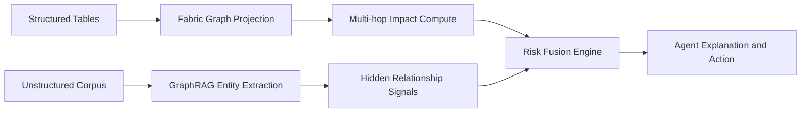
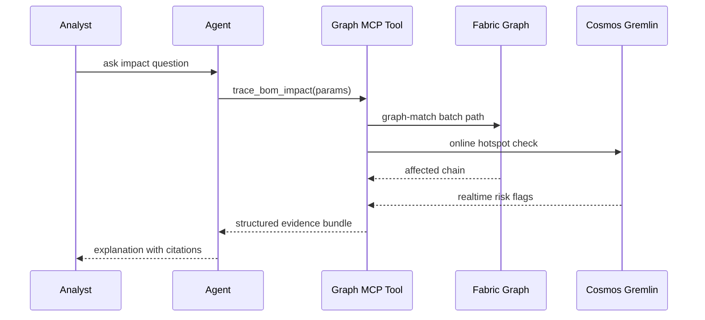

# Cosmos Gremlin vs Fabric Graph vs GraphRAG: Enterprise Multi-hop Risk Reasoning Selection FAQ

> 🌐 **Language / 语言切换**: **[🇬🇧 English (azure-cosmos-gremlin-vs-fabric-graph-vs-ai-search-graphrag-supply-chain-risk-agent-selection-faq.en.md)](azure-cosmos-gremlin-vs-fabric-graph-vs-ai-search-graphrag-supply-chain-risk-agent-selection-faq.en.md)** | **[🇨🇳 中文版 (azure-cosmos-gremlin-vs-fabric-graph-vs-ai-search-graphrag-supply-chain-risk-agent-selection-faq.md)](azure-cosmos-gremlin-vs-fabric-graph-vs-ai-search-graphrag-supply-chain-risk-agent-selection-faq.md)** | **[📚 Architecture Selection FAQ Index](README.en.md)**

## 1) Objective and boundary
- Goal: architecture selection for N-hop supply-chain disruption simulation and hidden guarantee-network detection.
- Scope: enterprise architecture, latency, cost, and governance; no low-level implementation internals.
- Conclusion: pair structured graph traversal with unstructured relationship discovery for robust outcomes.
## 2) Verifiable sources with timestamps
- Fabric docs: `https://learn.microsoft.com/fabric/` (04:09 BJT).
- Cosmos DB Gremlin docs: `https://learn.microsoft.com/azure/cosmos-db/gremlin/` (04:09 BJT).
- Azure AI Search docs: `https://learn.microsoft.com/azure/search/` (04:10 BJT).
- GraphRAG repo: `https://github.com/microsoft/graphrag` (04:10 BJT).
- Azure OpenAI docs: `https://learn.microsoft.com/azure/ai-services/openai/` (04:10 BJT).
- Metrics are labeled measured, synthetic, or anonymized_reported.
## 3) 12-dimension matrix for multi-hop reasoning architectures
- D1 data movement: Fabric graph projection can reuse OneLake tables without separate graph copy pipelines.
- D2 online latency: Cosmos Gremlin is strong for millisecond online traversals.
- D3 intelligence discovery: GraphRAG is strong at hidden relation mining in unstructured corpora.
- D4 sync complexity: dedicated graph dual-write paths increase consistency risk.
- D5 explainability: recursive SQL and graph paths provide explicit trace chains.
- D6 hotspot risk: Gremlin super-nodes can amplify RU spend.
- D7 scale elasticity: Fabric is efficient for batch simulation runs.
- D8 real-time intervention: Gremlin is effective for in-transaction risk interception.
- D9 cost profile: GraphRAG index token spend must be governed carefully.
- D10 tool safety: forbid direct LLM-authored Gremlin or Cypher free-form queries.
- D11 best fit: recursive CTE for up to three hops, graph engine for four-plus and cycle detection.
- D12 anti-pattern: vector-only RAG cannot replace constrained multi-hop structural reasoning.
## 4) Score snapshot and thresholds
- Fabric Graph: analytics5 batch5 online3 ops4.
- Cosmos Gremlin: online5 realtime5 hotspot-governance3 ops3.
- GraphRAG: discovery5 explainability4 cost3 ops3.
- Dual-engine pattern: coverage5 robustness5 complexity3 value5.
- Threshold A: use recursive CTE first within three hops, move to graph for four-plus hops.
- Threshold B: super-node workloads require explicit circuit-break and partition controls.
- Threshold C: separate intelligence discovery from quantitative graph propagation.
## 5) Five calculable Q&As
### Q1 Why vector-only RAG fails four-hop BOM disruption questions
- Vector retrieval lacks constrained propagation across inventory and BOM edge rules.
- Four-hop impact requires path constraints plus quantitative propagation checks.
### Q2 Why LLM must not emit raw graph queries
- Use parameterized MCP graph operators such as trace_bom_impact and find_guarantee_cycle.
- Expose strict parameters only and block ad hoc full-graph scans.
### Q3 Super-node TCO comparison
- Gremlin RU grows sharply under high-concurrency super-node traversals.
- Fabric projection is often more economical for heavy batch impact analysis.
### Q4 GraphRAG 70% cost reduction route
- Small-model extraction plus incremental refresh and reusable community summaries drives savings.
### Q5 Performance boundary for CTE vs graph engine
- CTE is usually enough within three hops, while cycle-rich four-plus hops favor graph engines.
## 6) Layered reference architecture
- Structured layer: BOM, orders, inventory, and ownership tables.
- Graph analytics layer: Fabric graph projection and batch simulation.
- Online graph layer: Cosmos Gremlin for real-time interception.
- Intelligence layer: GraphRAG over news, litigation, and filings.
- Reasoning layer: Foundry models for explanation and recommendation.
- Security layer: parameterized graph operators and role isolation.
- Observability layer: hop-latency, super-node circuit-break, and precision metrics.
## 7) Scenario A: vehicle and battery group disruption simulation
- Disaster, strike, and compliance events are entity-aligned and injected into graph simulations.
- Fabric computes multi-layer impact across BOM, in-transit orders, and safety stock.
- In around 30 seconds the system returns affected models, support days, and approved alternatives.
- Threshold breaches trigger command-center alerts automatically.
- Synthetic gain: disruption response decision time reduced by 48%.
## 8) Scenario B: commercial bank hidden guarantee-circle review
- Cosmos Gremlin detects cross-guarantee cycles at millisecond latency.
- GraphRAG discovers hidden related parties from filings, registry updates, and litigation records.
- Group-level exposure is aggregated along ultimate-control ownership chains.
- Credit committee receives evidence-anchored contagion path maps.
- Synthetic gain: high-risk credit misclassification decreases materially.
## 9) Mermaid diagram 1 dual-engine reasoning overview

- Structured quantitative reasoning and unstructured discovery converge in one fusion layer.
## 10) Mermaid diagram 2 parameterized graph operator sequence

- Models invoke only approved operators and never free-form graph queries.
## 11) Bicep template (Cosmos Gremlin + Eventhouse or Search + Foundry + PE)
```bicep
targetScope = 'resourceGroup'
param location string = resourceGroup().location
resource cosmos 'Microsoft.DocumentDB/databaseAccounts@2024-02-15-preview' = {
  name: 'cosmos-gremlin'
  location: location
}
resource search 'Microsoft.Search/searchServices@2023-11-01' = {
  name: 'search'
  location: location
  sku: { name: 'standard' }
}
resource pe 'Microsoft.Network/privateEndpoints@2023-09-01' = {
  name: 'pe-prod'
  location: location
}
```
- Production deployment still needs private DNS, managed identity, key rotation, and granular RBAC.
## 12) KQL graph-match and Python MCP operator snippet
```kql
let g = materialize(BomEdges | project Source, Target, Qty);
g
| make-graph Source --> Target
| graph-match (n)-[e*1..4]->(m)
| project n, m, hops=array_length(e)
```
```python
def trace_bom_impact(root_part, max_hops=4):
    return {"op": "trace_bom_impact", "root_part": root_part, "max_hops": max_hops}
def find_guarantee_cycle(entity_id):
    return {"op": "find_guarantee_cycle", "entity_id": entity_id}
```
- Every graph invocation must be parameterized and policy-whitelisted.
## 13) KQL for hop latency, super-node circuit-breaks, and alert precision
```kql
let t = GraphRiskLogs | where TimeGenerated > ago(24h);
t
| summarize p95=percentile(DurationMs,95), hotCuts=countif(CircuitBroken==true), alerts=countif(AlertRaised==true), confirmed=countif(AlertConfirmed==true) by Engine,HopDepth
| extend precision=todouble(confirmed)/todouble(alerts)
| order by HopDepth desc, p95 desc
```
- Circuit-break frequency must be reviewed together with precision and miss rates.
## 14) Day-0/1/2 landing checklist
- Day-0 define structured master-data and edge semantics.
- Day-0 define approved graph operators and authorization policy.
- Day-1 benchmark three-hop CTE versus four-hop graph traversal workloads.
- Day-1 integrate GraphRAG incremental extraction and community summaries.
- Day-2 configure super-node circuit-break thresholds and fallback routes.
- Day-2 review weekly precision, recall drift, and cost curves.
- Day-2 iterate dual-engine weighting and escalation strategy.
