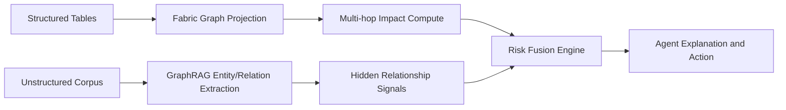
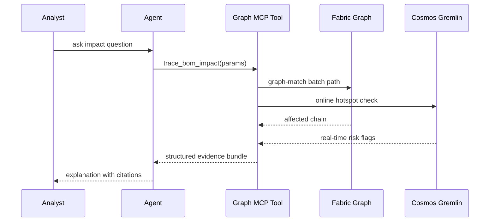

# Cosmos Gremlin vs Fabric Graph vs GraphRAG：企业多跳关系推理选型 FAQ

> 🌐 **Language / 语言切换**: **[🇨🇳 中文版 (azure-cosmos-gremlin-vs-fabric-graph-vs-ai-search-graphrag-supply-chain-risk-agent-selection-faq.md)](azure-cosmos-gremlin-vs-fabric-graph-vs-ai-search-graphrag-supply-chain-risk-agent-selection-faq.md)** | **[🇬🇧 English (azure-cosmos-gremlin-vs-fabric-graph-vs-ai-search-graphrag-supply-chain-risk-agent-selection-faq.en.md)](azure-cosmos-gremlin-vs-fabric-graph-vs-ai-search-graphrag-supply-chain-risk-agent-selection-faq.en.md)** | **[📚 返回架构选型指南目录](README.md)**

## 1) 研究目标与边界
- 目标：支持 N 级供应链断供推演、隐性担保圈识别与关系智能体选型。
- 范围：聚焦企业架构、覆盖率、时延、成本与治理，不讨论底层实现细节。
- 结论：结构化穿透与非结构化发现应采用双引擎协同。
## 2) 可验证来源与时间戳
- Fabric Eventhouse/KQL：`https://learn.microsoft.com/fabric/`（抓取 04:09 BJT）。
- Azure Cosmos DB Gremlin：`https://learn.microsoft.com/azure/cosmos-db/gremlin/`（抓取 04:09 BJT）。
- Azure AI Search：`https://learn.microsoft.com/azure/search/`（抓取 04:10 BJT）。
- GraphRAG：`https://github.com/microsoft/graphrag`（抓取 04:10 BJT）。
- Azure OpenAI：`https://learn.microsoft.com/azure/ai-services/openai/`（抓取 04:10 BJT）。
- 数据标签统一 measured/synthetic/anonymized_reported。
## 3) 四类多跳推理架构 12 维矩阵
- 维度1数据搬运：Fabric 图投影可零搬运复用OneLake宽表。
- 维度2在线时延：Cosmos Gremlin 适合毫秒级在线遍历。
- 维度3情报发现：GraphRAG更擅长非结构化隐性关联挖掘。
- 维度4同步复杂度：独立图库双写链路增加一致性风险。
- 维度5可解释性：关系库递归与图路径可给出明确穿透链路。
- 维度6热点风险：Gremlin超级节点会放大RU消耗。
- 维度7规模弹性：Fabric 对批量推演与分析更友好。
- 维度8实时拦截：Gremlin 对事中风险拦截更合适。
- 维度9成本形态：GraphRAG 建索引Token成本需严格治理。
- 维度10工具安全：禁止LLM裸写Gremlin/Cypher全库扫描。
- 维度11最佳场景：CTE<=3跳，4跳+环路检测优先图引擎。
- 维度12反模式：纯向量RAG无法替代多跳结构化穿透推演。
## 4) 评分与决策阈值
- Fabric Graph：分析5、批量5、在线3、运维4。
- Cosmos Gremlin：在线5、实时5、热点治理3、运维3。
- GraphRAG：发现5、解释4、成本3、运维3。
- 双引擎组合：覆盖5、稳健5、复杂度3、价值5。
- 阈值A：3跳内可先递归CTE，4跳以上进入图引擎。
- 阈值B：存在超级节点时必须启用熔断与分片策略。
- 阈值C：情报发现与量化穿透应分层执行。
## 5) 五组可复算 Q&A
### Q1 为什么纯向量RAG答不了4跳BOM断供
- 纯向量召回缺少结构化边权与库存约束传播。
- 4跳影响半径需要图路径与数量约束联合计算。
### Q2 禁止LLM裸写Gremlin设计模式
- 采用参数化MCP图算子：`trace_bom_impact`、`find_guarantee_cycle`。
- 只暴露受控参数，屏蔽原始语句与全图扫描能力。
### Q3 超级节点TCO对比
- Gremlin 在单超级节点高并发遍历时RU放大明显。
- Fabric图投影在批量分析场景通常更经济。
### Q4 GraphRAG降本70%路径
- 小模型抽取 + 增量更新 + 社区摘要复用可显著降本。
### Q5 CTE与图引擎性能分水岭
- 3跳内CTE常可满足，4跳及环路检测图引擎更稳。
## 6) 分层参考架构
- 结构化层：BOM/订单/库存/股权宽表。
- 图分析层：Fabric Graph 投影与批量推演。
- 在线图层：Cosmos Gremlin 实时拦截。
- 情报层：GraphRAG 从新闻/裁判文书发现隐性关系。
- 推理层：Foundry 模型做解释与建议。
- 安全层：参数化图算子与权限隔离。
- 观测层：跳数时延、超级节点熔断、准确率。
## 7) 场景A：整车与电池集团多级断供推演
- 灾情/罢工/合规预警实体对齐后触发图穿透。
- Fabric 上计算 BOM-在途订单-安全库存多层影响。
- 30 秒输出受影响车型、可支撑天数、二供替代清单。
- 关键节点超阈值时自动告警供应链指挥台。
- synthetic收益：断供响应决策时间下降 48%。
## 8) 场景B：商业银行隐性互保圈授信审查
- Cosmos Gremlin 毫秒级检测交叉互保环路。
- GraphRAG 挖掘招股书/工商/涉诉中的隐性关联方。
- 统一授信敞口按集团实控链路自动聚合。
- 信审委获得带证据锚点的风险传染路径图。
- synthetic收益：高风险授信误判率显著下降。
## 9) Mermaid 图1：双引擎关系推理总览

- 结构化定量与非结构化发现在融合层统一决策。
## 10) Mermaid 图2：参数化图算子调用时序

- 模型只调用受控算子，不直接拼接图查询语句。
## 11) Bicep 模板（Cosmos Gremlin + Eventhouse/Search + Foundry + PE）
```bicep
targetScope = 'resourceGroup'
param location string = resourceGroup().location
resource cosmos 'Microsoft.DocumentDB/databaseAccounts@2024-02-15-preview' = {
  name: 'cosmos-gremlin'
  location: location
}
resource search 'Microsoft.Search/searchServices@2023-11-01' = {
  name: 'search'
  location: location
  sku: { name: 'standard' }
}
resource pe 'Microsoft.Network/privateEndpoints@2023-09-01' = {
  name: 'pe-prod'
  location: location
}
```
- 生产需补齐私网DNS、托管身份、密钥轮换与RBAC。
## 12) KQL graph-match 与 Python参数化图算子片段
```kql
let g = materialize(BomEdges | project Source, Target, Qty);
g
| make-graph Source --> Target
| graph-match (n)-[e*1..4]->(m)
| project n, m, hops=array_length(e)
```
```python
def trace_bom_impact(root_part, max_hops=4):
    return {"op": "trace_bom_impact", "root_part": root_part, "max_hops": max_hops}
def find_guarantee_cycle(entity_id):
    return {"op": "find_guarantee_cycle", "entity_id": entity_id}
```
- 所有图调用必须参数化并受策略白名单约束。
## 13) KQL：跳数耗时/超级节点熔断/预警准确率
```kql
let t = GraphRiskLogs | where TimeGenerated > ago(24h);
t
| summarize p95=percentile(DurationMs,95), hotCuts=countif(CircuitBroken==true), alerts=countif(AlertRaised==true), confirmed=countif(AlertConfirmed==true) by Engine,HopDepth
| extend precision=todouble(confirmed)/todouble(alerts)
| order by HopDepth desc, p95 desc
```
- 热点熔断触发频率需与精度指标一起评估。
## 14) Day-0/1/2 落地清单
- Day-0：梳理结构化主数据与关系边定义。
- Day-0：定义受控图算子与权限策略。
- Day-1：上线3跳CTE与4跳图引擎对照压测。
- Day-1：接入GraphRAG增量抽取与社区摘要。
- Day-2：建立超级节点熔断阈值与回退路径。
- Day-2：周度复盘预警准确率与成本曲线。
- Day-2：迭代双引擎权重与告警策略。
