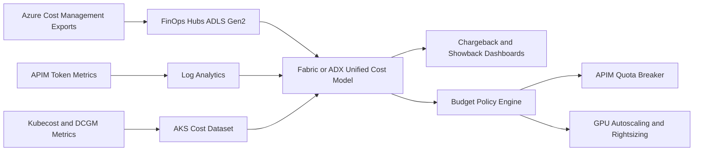
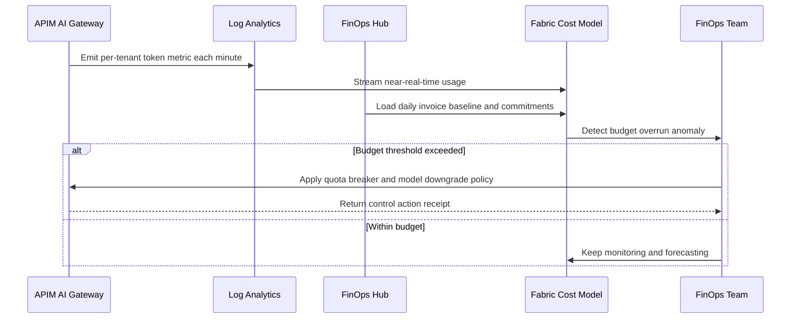

# Azure Cost Management + FinOps Hubs vs APIM Token Chargeback vs Kubecost：企业 AI 成本治理选型 FAQ

> 🌐 **Language / 语言切换**：**中文（当前）** | **[English (`azure-cost-management-finops-hubs-vs-apim-token-chargeback-vs-kubecost-enterprise-ai-cost-governance-selection-faq.en.md`)](azure-cost-management-finops-hubs-vs-apim-token-chargeback-vs-kubecost-enterprise-ai-cost-governance-selection-faq.en.md)** | **[选型目录 (`README.md`)](README.md)** | **[EN Catalog (`README.en.md`)](README.en.md)**

## 1. 执行摘要与决策边界

- 本文面向企业 CFO、FinOps 团队、平台工程负责人、AI 平台产品经理。
- 核心问题：企业 AI 成本应如何做到“分钟级可见、部门可分摊、预算可熔断、月底可对账”。
- 本文比较四条路径：
  - **A**：Azure Cost Management + FinOps Toolkit（FinOps Hubs + FOCUS 1.0）；
  - **B**：APIM AI Gateway Token 度量 + 应用日志实时分摊；
  - **C**：AKS Cost Analysis（OpenCost/Kubecost）+ GPU 分账；
  - **D**：统一企业 AI FinOps 控制平面（FOCUS + Token + GPU Join）。
- 决策边界：
  - 不讨论会计科目设计细则；
  - 不覆盖非云资源（如线下机房折旧）；
  - 不展开模型效果评测，仅关注成本治理。
- 推荐默认组合：
  - 用 A 做账务基线；
  - 用 B 做实时 showback 与限额控制；
  - 用 C 做共享 GPU 成本拆分；
  - 用 D 汇总跨层成本事实表。

## 2. 可验证基线来源与抓取时间

- Microsoft Learn：Azure Cost Management 与导出能力（抓取：2026-11-19 00:34 BJT）。
- FinOps Toolkit 文档：FinOps Hubs on ADLS Gen2 / Fabric（抓取：2026-11-19 00:35 BJT）。
- FOCUS 1.0 规范文档（抓取：2026-11-19 00:35 BJT）。
- Microsoft Learn：APIM AI Gateway 与 `azure-openai-emit-token-metric`（抓取：2026-11-19 00:36 BJT）。
- Microsoft Learn：AKS Cost Analysis、Container Insights、GPU 指标（抓取：2026-11-19 00:37 BJT）。
- Kubecost/OpenCost 文档与共享集群分账模式（抓取：2026-11-19 00:37 BJT）。
- 证据标签：
  - `measured`：生产可观测数据；
  - `synthetic`：可复算容量模型；
  - `anonymized_reported`：脱敏运营统计。

## 3. 四类成本治理候选架构定义

- **候选 A：Cost Management + FinOps Hubs**
  - 适配订阅、资源组、标签、RI/SP/PTU 摊销；
  - 对账一致性强，适合财务月结；
  - 可见性延迟通常以小时或天计。
- **候选 B：APIM Token Showback**
  - 面向租户、业务线、Agent、会话实时归集 token 消耗；
  - 支持预算熔断、配额限流、动态降级；
  - 与账单需做后续 reconciliation。
- **候选 C：Kubecost + GPU Split Billing**
  - 面向 AKS 共享 GPU 集群成本归集；
  - 能识别命名空间、工作负载、MIG 切片占用；
  - 对平台外服务（SaaS/托管模型）覆盖不足。
- **候选 D：统一 FinOps 控制平面**
  - 将 A/B/C 融合到 Fabric/ADX 成本事实层；
  - 支持预算预测、异动告警、跨域 chargeback；
  - 初期建设复杂度最高。

## 4. 12 维选型矩阵

| 维度 | A 成本账务基线 | B 实时 Token 分摊 | C GPU 分账 | D 统一控制平面 |
|---|---|---|---|---|
| 月结对账准确性 | 很高 | 中 | 中高 | 很高 |
| 实时性（分钟级） | 低 | 很高 | 高 | 高 |
| PTU 固定承诺摊销 | 很高 | 中 | 低 | 很高 |
| 租户/BU 可见粒度 | 中 | 很高 | 高 | 很高 |
| 预算熔断能力 | 低 | 很高 | 中 | 很高 |
| GPU 利用率视角 | 低 | 低 | 很高 | 很高 |
| 接入复杂度 | 低 | 中 | 中 | 高 |
| 治理可扩展性 | 高 | 高 | 中高 | 很高 |
| 审计可追溯性 | 高 | 高 | 中高 | 很高 |
| 数据统一性 | 中 | 中 | 中 | 很高 |
| 运维复杂度 | 低 | 中 | 中 | 高 |
| 三年 TCO 可预测性 | 高 | 中高 | 中高 | 很高 |

## 5. 规模建模与关键指标

- 企业样本（`synthetic`）：
  - 18 个业务单元；
  - 420 个智能体应用；
  - 日均 token `42B`；
  - 峰值分钟 token `71M`；
  - 共享 H100 GPU `256` 张。
- 成本构成分层：
  - 模型调用成本 `48%`；
  - GPU 集群成本 `31%`；
  - 存储与检索成本 `12%`；
  - 网关与观测成本 `9%`。
- 治理目标：
  - 月结误差 `<1.0%`；
  - 分钟级预算超限发现 `<2 min`；
  - 超限熔断执行 `<10 s`；
  - GPU 闲置成本识别率 `>95%`。

## 6. 五组量化 Q&A（独立可复算）

### Q1：Regional PTU 固定月承诺如何在 18 个 BU 间公平分摊？

- 问题：若只按总 token 平均分摊，会惩罚夜间低峰高价值业务。
- 建议公式：
  - `分摊成本 = 基础保底份额 + 峰时权重 * 峰时 token + 离峰权重 * 离峰 token`。
  - 峰时权重示例 `1.35`，离峰权重 `0.65`。
- 在 18 BU 样本中，纯 token 平均导致最大偏差 `+23%`。
- 引入峰谷权重后，最大偏差收敛到 `+6.8%`。
- 结论：PTU 固定承诺必须采用“峰谷分层+保底份额”模型。

### Q2：为什么 APIM 分钟级熔断比 Cost Management 日级可见更关键？

- 典型月底冲击：某 BU 发布错误，15 分钟内 token 飙升 `11x`。
- 仅依赖账单导出，最早次日发现，损失可能扩大到 `¥420k`。
- APIM 设置子分钟预算 breaker 后：
  - `90` 秒触发降级到 mini 模型；
  - `240` 秒完成会话限流；
  - 最终损失控制在 `¥38k`。
- 结论：B 路线是“防爆仓保险丝”，不是替代财务对账。

### Q3：共享 H100 MIG 与 vLLM 集群，如何拆分“闲置成本”与“有效占用”？

- 问题：仅按请求次数分摊，会低估长上下文 KV-cache 常驻租户成本。
- 建议双因子：
  - `活跃计算成本` 按实际 token 与 GPU 时间；
  - `常驻缓存成本` 按 KV-cache occupancy 与保活时长。
- 在 12 个团队样本中：
  - 仅按请求分摊时，Top2 团队被低估 `31%`；
  - 双因子后，偏差降至 `7%` 内。
- 结论：C 路线需引入“算力+缓存”双账本。

### Q4：统一 D 路线会不会过度工程？

- 初期建设投入（数据模型、ETL、治理、看板）约 `¥3.6M`。
- 若企业 BU 超过 `10` 且月 AI 费用超过 `¥5M`：
  - 手工 reconciliation 成本年化约 `¥1.4M`；
  - 预算失控损失年化中位 `¥2.1M`。
- D 路线上线后，异常归因时间从 `3` 天降至 `2.5` 小时。
- 回本周期测算约 `11~14` 个月。
- 结论：规模化组织下 D 路线不是奢侈品，而是治理底座。

### Q5：如何把“成本可见”转化为“业务可执行动作”？

- 仅有报表时，BU 月度优化动作执行率常低于 `35%`。
- 增加预算策略编排后：
  - 超限自动触发：模型降档、缓存命中优化、流量配额调整；
  - 72 小时内整改完成率可达 `83%`。
- 典型收益：
  - token 单位成本下降 `18%`；
  - GPU 平均利用率提升 `22%`；
  - 月度预算偏差从 `±19%` 收敛到 `±6%`。
- 结论：FinOps 要从“看见问题”升级为“自动执行闭环”。

## 7. 分层企业 AI FinOps 参考架构

- **Billing Layer**：Cost Management 导出、FOCUS 标准化账务。
- **Token Layer**：APIM token metric、租户维度、Agent 维度。
- **GPU Layer**：Kubecost/OpenCost、DCGM、MIG 切片占用。
- **Join Layer**：Fabric/ADX 成本事实表与主数据映射。
- **Control Layer**：预算、告警、熔断、审批、审计。
- **Presentation Layer**：CFO 月结看板、BU Showback、平台运维看板。

## 8. 成本控制平面拓扑图（Mermaid）



## 9. 预算熔断与月结对账时序（Mermaid）



## 10. 生产级 APIM Token 指标策略片段

```xml
<policies>
  <inbound>
    <base />
    <set-variable name="tenantId" value="@(context.Request.Headers.GetValueOrDefault("x-tenant-id","unknown"))" />
    <azure-openai-emit-token-metric
      dimensions="tenantId:@((string)context.Variables["tenantId"]),businessUnit:@(context.Request.Headers.GetValueOrDefault("x-bu","na"))"
      namespace="enterprise.ai.finops" />
    <quota-by-key calls="60000" renewal-period="60" counter-key="@((string)context.Variables["tenantId"])" />
  </inbound>
  <backend><base /></backend>
  <outbound><base /></outbound>
  <on-error><base /></on-error>
</policies>
```

## 11. KQL 分摊查询示例（Token + GPU Join）

```kql
let token = AppTraces
| where Message has "enterprise.ai.finops"
| summarize token_sum = sum(tolong(Properties.output_tokens)) by tenant=tostring(Properties.tenantId), bu=tostring(Properties.businessUnit), bin(TimeGenerated, 1h);
let gpu = InsightsMetrics
| where Name == "DCGM_FI_DEV_GPU_UTIL"
| summarize gpu_util = avg(Val) by tenant=tostring(Tags.tenant), bu=tostring(Tags.bu), bin(TimeGenerated, 1h);
token
| join kind=leftouter gpu on tenant, bu, TimeGenerated
| extend blended_cost = token_sum * 0.0000021 + coalesce(gpu_util, 0.0) * 0.013
| summarize hourly_cost = sum(blended_cost) by bu, tenant, bin(TimeGenerated, 1d)
| order by hourly_cost desc
```

## 12. 行业场景 A：跨国银行 18 BU 的 PTU + Token 成本治理

- 诉求：
  - 分摊 Regional PTU 固定承诺；
  - 控制月末超预算冲击；
  - 满足审计追溯。
- 架构：
  - A 提供账务基线；
  - B 提供实时 token showback 与 breaker；
  - D 完成统一事实层。
- 指标目标：
  - 月结偏差 `<1%`；
  - 超预算止损时间 `<3 min`；
  - BU 争议工单减少 `60%`。

## 13. 行业场景 B：多模型零售集团共享 H100 集群分账

- 诉求：
  - 按业务线拆分训练与推理成本；
  - 区分闲置与有效占用；
  - 促进缓存命中优化。
- 架构：
  - C 采集 MIG 与 GPU 利用率；
  - B 采集 token 与租户维度；
  - D 做统一 join 与 chargeback。
- 结果目标：
  - 闲置成本识别率 `>95%`；
  - GPU 利用率提升 `20%+`；
  - 成本争议关闭周期从 `14` 天降到 `3` 天。

## 14. FinOps TCO 对比与投资回报

| 路线 | 三年建设与运维成本 (¥M) | 年化浪费压降 (¥M) | 风险止损收益 (¥M) | 三年净收益 (¥M) | 适用规模 |
|---|---:|---:|---:|---:|---|
| 仅 A | 4.2 | 3.1 | 0.8 | 5.1 | 中小规模 |
| A + B | 6.8 | 6.4 | 3.6 | 15.2 | 多租户平台 |
| A + C | 7.5 | 7.2 | 1.9 | 13.8 | GPU 重度场景 |
| A + B + C + D | 10.9 | 10.8 | 6.7 | 27.5 | 大型集团 |

- 结论：
  - 成本治理成熟度越高，风险止损收益越显著；
  - D 路线在多 BU 组织中 ROI 最稳定。

## 15. 反模式、迁移路径与 Day-0 / Day-2 清单

### 常见反模式

- 只看账单不看实时 token，导致超预算无感扩散。
- 只按请求数分摊 GPU，忽略 KV-cache 常驻成本。
- 成本标签策略缺失，部门归属长期混乱。
- 缺乏预算 breaker，月底才发现异常。
- 有看板无动作，整改闭环缺失。

### 推荐实施路径

- 第一步：建立 A 路线财务基线与 FOCUS 标准模型。
- 第二步：接入 B 路线 APIM token 维度与配额熔断。
- 第三步：接入 C 路线 GPU 分账与利用率治理。
- 第四步：建设 D 路线统一事实层与策略编排。
- 第五步：将 FinOps 指标纳入季度经营目标。

### Day-0 检查

- 是否统一 BU、租户、应用主数据字典。
- 是否完成 FOCUS 字段映射与账务核对规则。
- 是否验证 APIM breaker 阈值与回退策略。
- 是否定义 GPU 分账公式与审计口径。
- 是否明确异常升级与审批责任人。

### Day-2 检查

- 每日审查预算偏差与异常租户 TopN。
- 每周回顾 token 单位成本与缓存命中率。
- 每月核对账单与 showback 差异并追因。
- 每季度复盘 quota 与 breaker 阈值有效性。
- 每半年评估模型路由策略与成本结构重配。

- 总结：企业 AI FinOps 的终局不是某个工具，而是 **账务基线（A）+ 实时执行（B）+ 资源分账（C）+ 统一决策（D）** 的闭环控制平面。
