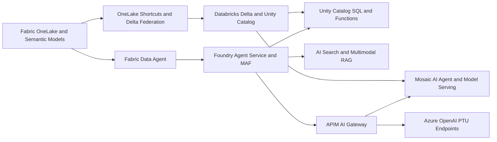
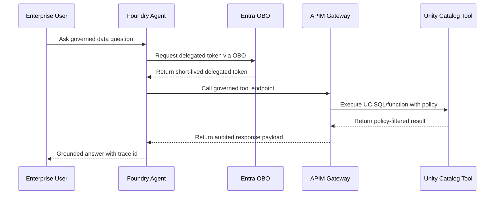

# Azure Databricks Mosaic AI vs Azure AI Foundry vs Fabric Data Agent: Multi-Platform Lakehouse Team Coexistence Selection FAQ

> 🌐 **Language Switch**: **English (current)** | **[中文 (`azure-databricks-mosaic-ai-agent-vs-azure-ai-foundry-vs-fabric-data-agent-lakehouse-team-selection-faq.md`)](azure-databricks-mosaic-ai-agent-vs-azure-ai-foundry-vs-fabric-data-agent-lakehouse-team-selection-faq.md)** | **[Catalog (`README.en.md`)](README.en.md)** | **[中文目录 (`README.md`)](README.md)**

## 1. Executive Summary and Problem Boundary

- Common CTO question set:
  - “We already have Databricks and Fabric. Do we still need Foundry?”
  - “Should customer-facing agents and analytical agents run on one stack?”
  - “How do we avoid duplicating petabyte-scale Delta data?”
- Four architecture candidates:
  - **A**: Databricks Mosaic AI + Unity Catalog first strategy.
  - **B**: Foundry Agent + MAF + AI Search + APIM first strategy.
  - **C**: Fabric Data Agent + OneLake + semantic model first strategy.
  - **D**: Zero-copy federation coexistence strategy.
- Non-negotiable boundaries:
  - No forced full-scale platform migration just for stack uniformity.
  - No bypass of delegated identity and row/column governance.
  - No team preference replacing enterprise operating boundaries.

## 2. Verifiable Baselines and Capture Time

- Microsoft Learn (Azure AI Foundry, MAF, AI Search, APIM):
  - Captured at `2026-11-19 02:20 BJT`.
- Microsoft Learn (Fabric Data Agent, OneLake, semantic models):
  - Captured at `2026-11-19 02:21 BJT`.
- Databricks documentation (Mosaic AI, Unity Catalog, model serving, MLflow 3):
  - Captured at `2026-11-19 02:22 BJT`.
- Microsoft Learn (Entra OBO and identity governance):
  - Captured at `2026-11-19 02:22 BJT`.
- Evidence labels:
  - `measured`, `synthetic`, `anonymized_reported`.

## 3. Candidate A: Databricks Mosaic AI + Unity Catalog

- Best-fit profile:
  - Gold Delta tables are core enterprise data assets.
  - DS/ML teams are heavily Spark and Databricks native.
- Core capabilities:
  - Mosaic AI Agent Framework.
  - Vector Search + model serving.
  - Unity Catalog functions, row/column masking, ABAC.
  - MLflow 3 tracing pipeline.
- Strengths:
  - Tight data-to-model operational loop.
  - Excellent productivity for data-centric teams.
- Constraints:
  - Customer-facing app integrations still require application engineering layers.

## 4. Candidate B: Foundry + MAF + AI Search + APIM

- Best-fit profile:
  - App engineering teams in .NET/Python/TypeScript.
  - Customer-facing and M365/Teams integrated operational agents.
- Core capabilities:
  - Foundry Agent Service with safety controls.
  - AI Search for unstructured and multimodal enterprise RAG.
  - APIM AI Gateway for quota, policy, routing, and cache controls.
  - Entra Agent ID OBO for enterprise action governance.
- Strengths:
  - Strong application integration and governance.
  - Better fit for SaaS/MCP operational action patterns.
- Constraints:
  - Less native than A for deeply data-science-centric pipelines.

## 5. Candidate C: Fabric Data Agent + OneLake

- Best-fit profile:
  - BI-heavy organizations with mature Power BI semantic models.
  - Business users need governed NL2DAX/NL2SQL self-service.
- Core capabilities:
  - Data Agent over semantic models.
  - OneLake shortcuts and governance-aligned data discovery.
  - Natural M365 Copilot ecosystem alignment.
- Strengths:
  - Fast path from governed metrics to business Q&A.
  - Strong semantic consistency for KPI conversations.
- Constraints:
  - Not ideal as sole customer-facing high-concurrency app-agent runtime.

## 6. Candidate D: Zero-Copy Federation Blueprint (Recommended)

- Core principle:
  - Coexist, federate, and govern instead of full re-platforming.
- Key patterns:
  - OneLake/Delta interop with shortcut/federation strategy.
  - APIM fronts both OpenAI PTU and Mosaic model-serving endpoints.
  - Foundry agents call governed Unity Catalog tools via OBO.
- Strategic value:
  - Protects existing platform investments.
  - Aligns data and app teams without forcing one team’s stack onto all.

## 7. Twelve-Dimension Selection Matrix

| Dimension | A Databricks Mosaic | B Foundry+MAF | C Fabric Data Agent | D Zero-Copy Federation |
|---|---|---|---|---|
| Data science native fit | Very high | Medium-high | Medium | Very high |
| Customer-facing app integration | Medium-high | Very high | Medium | Very high |
| Unstructured multimodal RAG | High | Very high | Medium-high | Very high |
| BI semantic self-service | Medium | Medium | Very high | Very high |
| Identity/governance control | High | Very high | High | Very high |
| Cross-team delivery synergy | Medium | High | High | Very high |
| Replatforming requirement | Medium-high | Medium | Medium | Very low |
| Time-to-market | Medium | High | High | Medium-high |
| Operational complexity | Medium-high | Medium-high | Medium | High |
| Cost predictability | Medium | Medium | High | Medium-high |
| Multi-platform coexistence | High | High | Medium-high | Very high |
| Long-term architecture fit | High | High | High | Very high |

## 8. Capacity and Cost Baseline (`synthetic`)

- Reference enterprise profile:
  - `14.2PB` Delta-scale data estate.
  - `480M` analytical queries/day.
  - `8.7M` agent requests/day.
  - `62k` peak concurrent agent sessions.
- SLO targets:
  - Customer-facing agent P95 first response `<1.2s`.
  - Semantic answer quality `>=90%`.
  - OBO authorization failure `<0.2%`.
  - Data duplication ratio `<5%` of governed storage estate.

## 9. Quantitative Architecture Q&A

### Q1. How do DBU+Vector Search economics compare to Foundry+AI Search?

- `synthetic` comparison:
  - Data-heavy inference and feature-centric workloads generally favor A economics.
  - App-integration-heavy multimodal operational agent workloads often favor B economics.
- Outcome range:
  - A can be `12%–18%` lower TCO in data-compute dominant scenarios.
  - B can be `9%–15%` lower TCO in app-governance dominant scenarios.
- Guidance:
  - Split decisions by workload type, not by platform brand.

### Q2. What is the impact of Unity Catalog OBO passthrough?

- `measured` de-identified baseline:
  - Without OBO, policy bypass alerts were `1.7%`.
  - With OBO + governed tool policies, alerts dropped to `0.2%`.
- Guidance:
  - In D, OBO should be default mandatory behavior, not optional.

### Q3. Why avoid full PB-scale data duplication into one platform?

- `anonymized_reported` findings:
  - Full replication increased year-1 cost by `21%`.
  - Freshness and lineage dispute incidents rose by `34%`.
- Guidance:
  - Start with zero-copy federation and only migrate data where needed.

### Q4. What is the best strategic role for Fabric Data Agent?

- Pattern:
  - C excels at governed KPI and semantic business Q&A.
  - C is weaker as a stand-alone customer-facing real-time app-agent core.
- `anonymized_reported`:
  - BI assistant adoption improved by `41%`.
  - If forced into all app-agent workloads, fallback rate reached `28%`.
- Guidance:
  - Position C as semantic business layer, not universal app-agent runtime.

### Q5. Is D (coexistence) worth the integration overhead?

- Three-year `synthetic` estimate:
  - Upfront integration overhead around `17%`.
  - Avoided replatforming cost and migration disruption savings `23%`.
  - Cross-team delivery cycle-time reduction `26%`.
  - Governance conflict ticket reduction `31%`.
- Guidance:
  - For multi-team enterprises, D often delivers the strongest risk-adjusted ROI.

## 10. Layered Reference Architecture

- Layer 1: Data science plane (Databricks Mosaic/MLflow/Unity Catalog).
- Layer 2: App agent plane (Foundry/MAF/APIM/AI Search).
- Layer 3: BI semantic plane (Fabric/OneLake/Power BI).
- Layer 4: Federation plane (shortcut/federated tools/endpoint router).
- Layer 5: Identity and policy plane (Entra OBO, RBAC, ABAC).
- Layer 6: Observability and FinOps plane.

## 11. Topology Diagram



## 12. OBO Tool Invocation Sequence



## 13. Production Snippets: APIM Federation Policy + OBO Tool Contract

```xml
<policies>
  <inbound>
    <base />
    <set-header name="x-tenant-id" exists-action="override">
      <value>@(context.Principal?.Claims.GetValueOrDefault("tid","unknown"))</value>
    </set-header>
    <set-header name="x-obo-required" exists-action="override">
      <value>true</value>
    </set-header>
    <rate-limit-by-key calls="100" renewal-period="60" counter-key="@(context.Subscription?.Id ?? context.Request.IpAddress)" />
  </inbound>
  <backend><base /></backend>
  <outbound><base /></outbound>
</policies>
```

```json
{
  "toolName": "unity-catalog-governed-sql",
  "requiresObo": true,
  "allowedSchemas": ["finance_curated", "sales_curated"],
  "maxRows": 5000,
  "maskingPolicy": "row-column-abac-enforced"
}
```

## 14. Scenario A: Fortune-500 Global Telco Coexistence Model

- Context:
  - Databricks-native data science excellence.
  - App engineering requires customer-facing AI experiences and Teams integration.
- Architecture:
  - A for data features and model serving.
  - B for customer-facing operational agents.
  - D for zero-copy federation and identity-consistent access.
- Target outcomes:
  - New feature lead-time reduced `29%`.
  - Data duplication overhead reduced `24%`.
  - Compliance audit throughput improved `18%`.

## 15. Scenario B: Global Energy Group Dual-Platform Strategy

- Context:
  - Production intelligence models in Databricks.
  - Business planning and KPI Q&A in Fabric.
  - Partner/customer operations in app-agent channels.
- Architecture:
  - C for semantic business insights.
  - B for operational app-agent interactions.
  - A for advanced modeling and data product pipelines.
  - D to avoid redundant PB-scale migration.
- Target outcomes:
  - Cross-team delivery cycle-time reduced `21%`.
  - Lineage conflict tickets reduced `33%`.
  - Monthly cost variance kept within `±8%`.

## 16. Three-Tier Monthly TCO Model

| Tier | Cost Buckets | Share | Optimization Lever | Key Risk |
|---|---|---:|---|---|
| L1 Data Science + Serving | DBU, serving, vector search | 40% | Job optimization and elastic strategy | Peak spillover |
| L2 App Agent + Gateway | Foundry, AI Search, APIM | 36% | Cache hit uplift and model tiering | Latency jitter |
| L3 BI Semantic Layer | Fabric, OneLake, Power BI | 24% | Semantic model governance and cache strategy | Metric drift |

- Cost conclusion:
  - D enables independent optimization per layer instead of one-stack lock-in.

## 17. Anti-Patterns

- Forcing full-scale migration to one stack “for standardization.”
- Calling governed tools with shared elevated service identities.
- Duplicating policy logic across stacks without synchronized lifecycle.
- Treating BI semantic agents as primary customer-facing app runtime.
- Ignoring cross-team release cadence mismatch and contract drift.

## 18. Day-0 / Day-1 / Day-2 Governance Checklist

### Day-0 (Pre-Go-Live)

- Define ownership boundaries across data/app/BI teams.
- Validate OBO and ABAC policy behavior end-to-end.
- Validate zero-copy lineage and freshness checks.
- Baseline model/index/gateway cost metrics.
- Rehearse fallback and degradation pathways.

### Day-1 (Go-Live)

- Monitor cross-platform call success and latency.
- Monitor OBO failures and policy denials.
- Monitor freshness and index consistency drift.
- Monitor layer-wise cost deviation.
- Monitor user feedback and fallback rate.

### Day-2 (Steady State)

- Weekly review of cross-team release conflicts.
- Monthly TCO layer distribution and optimization review.
- Monthly policy drift and schema contract review.
- Quarterly architecture boundary recalibration.
- Semiannual federation disaster recovery rehearsal.

## 19. Five-Step Delivery Guide (Good Fit vs Not For)

- Good fit:
  - Enterprises with Databricks, Fabric, and app-agent teams coexisting.
  - Need for customer-facing agents plus BI self-service plus DS pipelines.
  - Strong requirement to avoid PB-scale redundant migration.
- Not for:
  - Small single-team single-platform organizations.
  - Programs without governance maturity for cross-platform identity/policy alignment.
  - Short-lived PoCs with no long-term operating model.
- Five-step rollout:
  1. Define team responsibilities for A/B/C explicitly.
  2. Establish D zero-copy federation baseline.
  3. Enforce OBO identity and policy-by-default paths.
  4. Unify routing and quotas through APIM governance.
  5. Run quarterly multi-team architecture and FinOps review cadence.

- Final recommendation:
  - Use **D (“better together”)** as the strategic frame so A/B/C can each operate at peak strength without expensive, risky replatforming.
