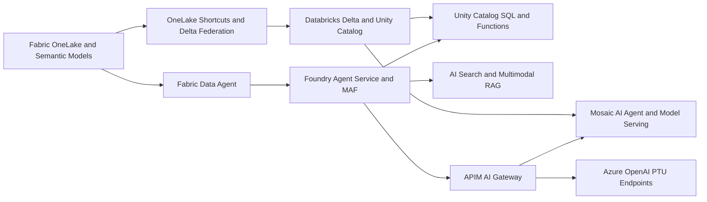
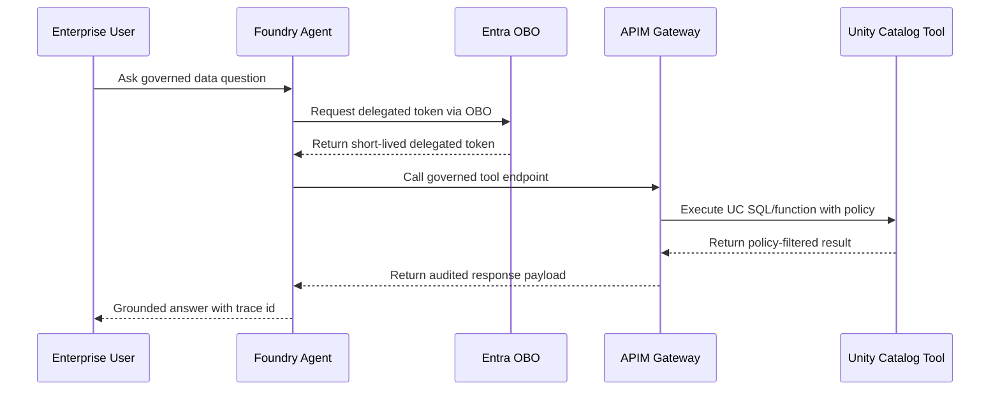

# Azure Databricks Mosaic AI vs Azure AI Foundry vs Fabric Data Agent：多平台湖仓团队共存选型 FAQ

> 🌐 **Language / 语言切换**：**中文（当前）** | **[English (`azure-databricks-mosaic-ai-agent-vs-azure-ai-foundry-vs-fabric-data-agent-lakehouse-team-selection-faq.en.md`)](azure-databricks-mosaic-ai-agent-vs-azure-ai-foundry-vs-fabric-data-agent-lakehouse-team-selection-faq.en.md)** | **[选型目录 (`README.md`)](README.md)** | **[EN Catalog (`README.en.md`)](README.en.md)**

## 1. 执行摘要与问题边界

- 典型 CTO 问题：
  - “我们已有 Databricks 与 Fabric，是否还要上 Foundry？”
  - “客户面向型智能体与数据分析型智能体是否应同栈？”
  - “如何在不复制 PB 级 Delta 数据前提下实现统一治理？”
- 四类路径：
  - **A**：Databricks Mosaic AI + Unity Catalog 主路径。
  - **B**：Foundry Agent + MAF + AI Search + APIM 主路径。
  - **C**：Fabric Data Agent + OneLake + Power BI 语义模型主路径。
  - **D**：Zero-Copy Federation（A/B/C 共存编排）路径。
- 架构边界：
  - 不鼓励“为统一而统一”的大规模数据重平台迁移。
  - 不允许绕过身份透传与行列级治理策略。
  - 不以单一团队偏好替代企业级多团队协作边界。

## 2. 可验证来源与抓取时间

- Microsoft Learn（Azure AI Foundry、MAF、AI Search、APIM）：
  - 抓取时间：`2026-11-19 02:20 BJT`。
- Microsoft Learn（Fabric Data Agent、OneLake、语义模型）：
  - 抓取时间：`2026-11-19 02:21 BJT`。
- Databricks 官方文档（Mosaic AI、Unity Catalog、Model Serving、MLflow 3）：
  - 抓取时间：`2026-11-19 02:22 BJT`。
- Microsoft Learn（Entra OBO、身份治理、API 网关）：
  - 抓取时间：`2026-11-19 02:22 BJT`。
- 标签：
  - `measured`：实测或生产遥测。
  - `synthetic`：透明参数模型。
  - `anonymized_reported`：脱敏行业实践。

## 3. 候选 A：Databricks Mosaic AI + Unity Catalog

- 适配画像：
  - 企业核心金表在 Delta Lake。
  - 数据科学/特征工程团队以 Spark/Databricks 为主。
- 核心能力：
  - Mosaic AI Agent Framework。
  - Vector Search + Model Serving。
  - Unity Catalog 函数、行列掩码、ABAC。
  - MLflow 3 tracing。
- 优势：
  - 数据与模型开发闭环紧耦合。
  - 对数据团队生产效率极高。
- 局限：
  - 客户面向型复杂多渠道应用仍需应用工程配套。

## 4. 候选 B：Azure AI Foundry + MAF + AI Search + APIM

- 适配画像：
  - 应用工程团队以 .NET/Python/TypeScript 为主。
  - 需要客户面向型、M365/Teams 集成型智能体。
- 核心能力：
  - Foundry Agent Service 与内容安全。
  - AI Search 非结构化多模态 RAG。
  - APIM AI Gateway（配额、缓存、策略）。
  - Entra Agent ID OBO 身份透传。
- 优势：
  - 应用集成与治理能力全面。
  - 对企业级 SaaS/MCP 动作编排友好。
- 局限：
  - 数据科学工作流原生性不及 A。

## 5. 候选 C：Fabric Data Agent + OneLake

- 适配画像：
  - BI 分析团队强，Power BI 语义模型成熟。
  - 业务用户需要 NL2DAX/NL2SQL 自助分析。
- 核心能力：
  - Data Agent over 语义模型。
  - OneLake shortcuts 与统一数据目录。
  - 与 M365 Copilot 协同增强。
- 优势：
  - 业务分析到智能问答路径短。
  - 治理口径一致性较好。
- 局限：
  - 对高并发面客智能体并非最优入口。

## 6. 候选 D：Zero-Copy Federation（推荐）

- 核心思想：
  - 不强制重平台迁移。
  - 通过网关、身份、工具契约实现跨栈协同。
- 关键做法：
  - OneLake 与 Delta 通过 shortcut/federation 协作。
  - APIM 同时前置 OpenAI PTU 与 Mosaic Serving 端点。
  - Foundry Agent 以 OBO 调用 Unity Catalog SQL/函数工具。
- 价值：
  - 保护既有投入，减少重复搬迁成本。
  - 让数据团队与应用团队各展所长。

## 7. 12 维选型矩阵

| 维度 | A Databricks Mosaic | B Foundry+MAF | C Fabric Data Agent | D Zero-Copy Federation |
|---|---|---|---|---|
| 数据科学原生性 | 很高 | 中高 | 中 | 很高 |
| 面客应用集成能力 | 中高 | 很高 | 中 | 很高 |
| 非结构化 RAG 能力 | 高 | 很高 | 中高 | 很高 |
| BI 语义模型自助分析 | 中 | 中 | 很高 | 很高 |
| 身份透传与企业治理 | 高 | 很高 | 高 | 很高 |
| 跨团队协作效率 | 中 | 高 | 高 | 很高 |
| 重平台迁移需求 | 中高 | 中 | 中 | 很低 |
| 上线速度 | 中 | 高 | 高 | 中高 |
| 运维复杂度 | 中高 | 中高 | 中 | 高 |
| 成本可预测性 | 中 | 中 | 高 | 中高 |
| 多云/多平台共存性 | 高 | 高 | 中高 | 很高 |
| 长期战略适配性 | 高 | 高 | 高 | 很高 |

## 8. 容量与成本基线（synthetic）

- 企业样本：
  - Delta 数据总量 `14.2PB`。
  - 日分析查询 `480M`。
  - 智能体请求 `8.7M/日`。
  - 峰值代理并发 `62k`。
- SLO：
  - 面客代理首响应 P95 `<1.2s`。
  - 语义问答命中准确率 `>=90%`。
  - OBO 授权失败率 `<0.2%`。
  - 数据复制率控制在 `<5%`（按存储体量）。

## 9. 量化 Q&A（含 DBU/Vector vs Foundry+Search TCO）

### Q1：A 与 B 的推理与检索成本如何比较？

- `synthetic`：
  - 高峰型工作负载下，A 的 DBU + Serving 在数据密集推理更优。
  - B 在多模态 RAG + SaaS 工具编排场景更优。
- 结果：
  - 数据重计算主导时 A 总成本低 `12%~18%`。
  - 应用集成与安全治理主导时 B 总成本低 `9%~15%`。
- 结论：
  - 成本决策必须按“工作负载类型”分层，而非平台标签。

### Q2：Unity Catalog OBO 透传对风险有什么影响？

- `measured`（脱敏）：
  - 无 OBO 时越权查询告警率 `1.7%`。
  - 启用 OBO 与函数级策略后降至 `0.2%`。
- 结论：
  - D 架构必须把 OBO 作为默认而非可选项。

### Q3：为什么不建议复制 PB 级数据到单一平台？

- `anonymized_reported`：
  - PB 级全量复制首年额外成本增 `21%`。
  - 数据新鲜度与血缘一致性问题工单增加 `34%`。
- 结论：
  - 优先做零拷贝联邦与统一治理，再评估局部搬迁。

### Q4：C 在企业中的最佳定位是什么？

- 观察：
  - C 在业务分析与指标问答上效率非常高。
  - 但不应单独承担复杂面客代理职责。
- `anonymized_reported`：
  - C 用于 BI 助理时采用率提升 `41%`。
  - 若强行承接面客复杂场景，回退率升至 `28%`。
- 结论：
  - C 适合作为业务语义层，不替代应用代理中台。

### Q5：D 路线的三年 ROI 是否稳定？

- `synthetic`：
  - 前期集成成本增加 `17%`。
  - 但避免重平台迁移节省 CAPEX/OPEX `23%`。
  - 跨团队交付周期缩短 `26%`。
  - 数据治理争议工单下降 `31%`。
- 结论：
  - 对多团队并存企业，D 通常具备最优长期净收益。

## 10. 分层参考架构

- Layer 1：Data Science Plane（Databricks Mosaic/MLflow/UC）。
- Layer 2：App Agent Plane（Foundry/MAF/APIM/AI Search）。
- Layer 3：BI Semantic Plane（Fabric/Power BI/OneLake）。
- Layer 4：Federation Plane（Shortcut/SQL Tool/Endpoint Router）。
- Layer 5：Identity & Policy Plane（Entra OBO、RBAC、ABAC）。
- Layer 6：Observability & FinOps Plane（成本、延迟、合规）。

## 11. 拓扑图（Mermaid）



## 12. OBO 工具调用时序图（Mermaid）



## 13. 生产片段：APIM 到 Databricks/OneLake 联邦策略

```xml
<policies>
  <inbound>
    <base />
    <set-header name="x-tenant-id" exists-action="override">
      <value>@(context.Principal?.Claims.GetValueOrDefault("tid","unknown"))</value>
    </set-header>
    <set-header name="x-obo-required" exists-action="override">
      <value>true</value>
    </set-header>
    <rate-limit-by-key calls="100" renewal-period="60" counter-key="@(context.Subscription?.Id ?? context.Request.IpAddress)" />
  </inbound>
  <backend><base /></backend>
  <outbound><base /></outbound>
</policies>
```

```json
{
  "toolName": "unity-catalog-governed-sql",
  "requiresObo": true,
  "allowedSchemas": ["finance_curated", "sales_curated"],
  "maxRows": 5000,
  "maskingPolicy": "row-column-abac-enforced"
}
```

## 14. 场景 A：全球电信集团多平台数据与应用并存

- 背景：
  - 数据科学团队已深耕 Databricks。
  - 应用团队需面客智能体与 Teams 集成。
- 架构：
  - A 负责特征工程与模型服务。
  - B 负责面客代理与多模态 RAG。
  - D 负责统一身份与零拷贝联邦。
- 结果目标：
  - 新功能上市周期缩短 `29%`。
  - 数据复制开销下降 `24%`。
  - 合规审计效率提升 `18%`。

## 15. 场景 B：能源集团生产与经营双中台协作

- 背景：
  - 生产侧模型在 Databricks，经营分析在 Fabric。
  - 客户服务与合作伙伴门户由应用团队维护。
- 架构：
  - C 提供经营语义指标问答。
  - B 承接应用代理体验与渠道接入。
  - A 承接数据科学管道与高复杂建模。
  - D 避免大规模重复搬迁。
- 结果目标：
  - 跨团队需求交付周期下降 `21%`。
  - 数据血缘争议工单下降 `33%`。
  - 成本偏差控制在 `±8%`。

## 16. 三层月度 TCO 模型

| 层级 | 成本项 | 占比 | 优化杠杆 | 风险 |
|---|---|---:|---|---|
| L1 数据科学与服务层 | DBU、Serving、Vector Search | 40% | 作业优化、弹性策略 | 峰值溢出 |
| L2 应用代理层 | Foundry、AI Search、APIM | 36% | 缓存命中、模型分层路由 | 延迟抖动 |
| L3 语义分析层 | Fabric/OneLake/Power BI | 24% | 语义模型治理与缓存 | 指标漂移 |

- 结论：
  - D 架构可把三层成本分别治理，减少“单层失控拖垮全局”风险。

## 17. 反模式

- 为统一而强制全量数据迁移。
- 无 OBO 透传，用共享高权账号直连工具。
- 在多个平台复制同一治理规则但不同步版本。
- 把 BI 语义代理当成面客实时中台。
- 忽略跨团队变更节奏差异导致接口失配。

## 18. Day-0 / Day-1 / Day-2 清单（反重复复制与治理）

### Day-0（上线前）

- 完成平台职责分层与所有权界定。
- 完成 OBO 与 ABAC 策略联调。
- 完成 zero-copy 数据路径与血缘验证。
- 完成模型与索引成本基线。
- 完成故障降级与回退演练。

### Day-1（上线日）

- 监控跨平台调用成功率与延迟。
- 监控 OBO 失败与策略拒绝率。
- 监控数据新鲜度与索引一致性。
- 监控各层成本偏差。
- 监控用户满意度与工单回退。

### Day-2（稳态）

- 周度复盘跨团队变更冲突。
- 月度复盘 TCO 三层占比与优化动作。
- 月度复盘治理策略漂移。
- 季度复盘平台边界是否需要调整。
- 半年进行一次联邦灾备演练。

## 19. 五步落地（Good fit vs Not for）

- Good fit：
  - Databricks/Fabric/Foundry 多平台并存的大型企业。
  - 既要面客应用智能体，也要 BI 与数据科学共存。
  - 不希望复制 PB 级数据重平台迁移。
- Not for：
  - 单一小团队单平台、低复杂度数据域。
  - 无法承担跨平台治理协同成本。
  - 仅追求短期 PoC 而非长期运营架构。
- 五步：
  1. 明确 A/B/C 团队职责与产品边界。
  2. 以 D 建立 zero-copy federation 基线。
  3. 统一 OBO 身份与策略执行路径。
  4. 建立 APIM 统一网关与成本治理。
  5. 建立跨团队季度架构评审机制。

- 最终建议：采用 **D（Better Together）** 主线，以 A/B/C 各守其长，避免重平台重复建设，实现数据与应用团队长期协同。
