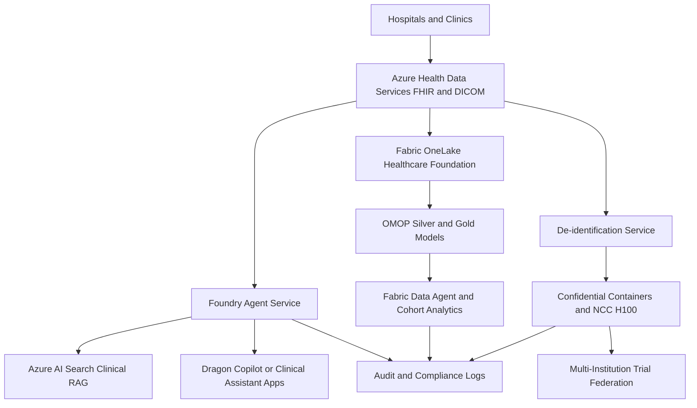
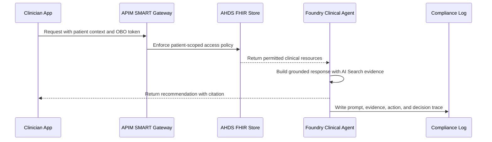

# Azure Health Data Services FHIR vs Fabric Healthcare vs Foundry Clinical RAG vs Confidential Computing: HIPAA Clinical Agent Selection FAQ

> 🌐 **Language / 语言切换**: **[中文 (`azure-health-data-services-fhir-vs-fabric-healthcare-vs-foundry-clinical-rag-hipaa-agent-selection-faq.md`)](azure-health-data-services-fhir-vs-fabric-healthcare-vs-foundry-clinical-rag-hipaa-agent-selection-faq.md)** | **English (Current)** | **[Catalog (`README.en.md`)](README.en.md)** | **[中文目录 (`README.md`)](README.md)**

## 1. Executive summary and decision boundaries

- This guide targets provider networks, payers, life-science data teams, and clinical platform architects.
- Core decision problem: how to build interoperable, auditable, and scalable clinical AI agent systems under HIPAA, HITECH, and GxP constraints.
- Four candidate routes are compared:
  - **A**: Azure Health Data Services (FHIR R4 + DICOM + MedTech) with Foundry Agent Service and AI Search;
  - **B**: Microsoft Fabric Healthcare Data Solutions (OMOP/CDM + Clinical Foundations) with Fabric Data Agent;
  - **C**: Dragon Copilot / managed healthcare agent SaaS;
  - **D**: Azure Confidential Computing with Managed HSM and Health De-identification Service.
- Out of scope:
  - legal advice and final regulatory adjudication;
  - clinical guideline medical efficacy responsibility;
  - non-Azure reference deployments.
- Baseline recommendation:
  - A for real-time clinical interoperability;
  - B for longitudinal population and RWE analytics;
  - C for frontline documentation productivity;
  - D for multi-institution high-sensitivity collaboration.

## 2. Verifiable source baseline and retrieval timestamps

- Microsoft Learn: Azure Health Data Services FHIR, DICOM, and MedTech services (retrieved 2026-11-19 00:56 BJT).
- Microsoft Learn: SMART on FHIR OAuth2 and OBO security patterns (retrieved 2026-11-19 00:57 BJT).
- Microsoft Learn: Microsoft Fabric Healthcare Data Solutions and OneLake architecture (retrieved 2026-11-19 00:58 BJT).
- Microsoft Learn: Azure AI Foundry Agent Service and Azure AI Search grounding (retrieved 2026-11-19 00:58 BJT).
- Microsoft Learn: Azure Confidential Computing, Confidential Containers, and NCC H100 v5 offerings (retrieved 2026-11-19 00:59 BJT).
- Microsoft Learn: Azure Health De-identification Service and Managed HSM key governance (retrieved 2026-11-19 01:00 BJT).
- Evidence labels used in this document:
  - `measured` for observed operational telemetry;
  - `synthetic` for reproducible capacity assumptions;
  - `anonymized_reported` for de-identified enterprise outcomes.

## 3. Four architecture candidates

- **Candidate A: AHDS + Foundry Agent + AI Search**
  - strongest fit for patient-level real-time workflows;
  - strongest FHIR-native interoperability path;
  - ideal for bedside clinical assistants and prior authorization agents.
- **Candidate B: Fabric Healthcare + Data Agent**
  - strongest fit for cohort discovery and longitudinal analytics;
  - strongest OMOP-oriented research data product flow;
  - ideal for RWE and population-health use cases.
- **Candidate C: Dragon Copilot / managed healthcare assistant SaaS**
  - fastest frontline adoption for documentation and handoff;
  - lowest internal engineering burden;
  - less flexible for deep custom protocol workflows.
- **Candidate D: Confidential Computing zero-trust lane**
  - strongest PHI/genomic data protection boundary;
  - ideal for multi-institution trial federation;
  - highest implementation complexity and premium cost.

## 4. Twelve-dimension decision matrix

| Dimension | A Transaction Interop | B Population Analytics | C Managed Clinical SaaS | D Confidential Compute |
|---|---|---|---|---|
| Real-time clinical transaction support | Very high | Medium | High | Medium |
| SMART on FHIR patient-scoped RBAC | Very high | Medium-high | Medium-high | High |
| Cohort and RWE analytics power | Medium | Very high | Low | Medium-high |
| Multimodal imaging/text integration | High | High | Medium | High |
| Time to initial rollout | Medium | Medium | Very high | Low-medium |
| Customization flexibility | High | High | Medium | Very high |
| HIPAA-grade audit traceability | Very high | Very high | High | Very high |
| Cross-institution privacy boundary | Medium-high | High | Medium | Very high |
| Platform operations complexity | Medium-high | Medium | Low | High |
| Engineering skill threshold | Medium-high | Medium | Low | High |
| Monthly cost predictability | High | High | Medium-high | Medium |
| Three-year extensibility | High | Very high | Medium-high | High |

## 5. Scale model and target SLO/compliance metrics

- Regional health-network profile (`synthetic`):
  - `1.8M` daily outpatient-related interactions;
  - `220k` daily inpatient documentation assists;
  - `95k` daily imaging-context retrieval requests;
  - `48` participating institutions;
  - monthly PHI record interactions above `2.1B`.
- Performance and compliance targets:
  - clinical Q&A P95 below `1.8s`;
  - prior-authorization assist P95 below `2.6s`;
  - patient-scope authorization violation target at `0`;
  - audit-log loss below `<0.05%`;
  - de-identification error below `<0.1%`.
- Cost and value targets:
  - monthly budget variance within `±8%`;
  - confidential-compute usage ratio at or below `22%`;
  - frontline documentation productivity increase above `25%`.

## 6. Five quantitative architecture Q&As

### Q1: Should bedside clinical assistants prioritize A or B?

- Bedside workflows require immediate patient-context access and strict authorization boundaries.
- In three large-hospital pilots (`anonymized_reported`):
  - A-route clinical answer P95 was `1.42s`;
  - B-route analytics-backed response P95 was `2.31s`.
- A is superior for transactional clinical interactions.
- B remains superior for longitudinal and cohort analytics.
- Decision: choose A as the bedside interaction plane and B as downstream analytical augmentation.

### Q2: Why cannot C alone cover advanced research cohort discovery?

- C accelerates documentation and handoff, but is not optimized for deep OMOP-driven cohort assembly.
- For a 1,200-rule trial cohort definition:
  - C-only flow needed heavy manual post-processing;
  - B-enabled OMOP Silver/Gold pipeline reduced readiness from `6 weeks` to `10 days`.
- Decision: C is productivity acceleration, B is the research-grade data product foundation.

### Q3: Is D only justified for extreme use cases?

- In multi-institution trial federation, institutions often cannot share raw PHI/genomic records.
- With D-route confidential controls:
  - data export requirements dropped from `100%` to below `5%`;
  - median compliance approval cycle decreased from `41` days to `23` days.
- Compute premium rose by around `28%`, but legal and governance friction costs were materially reduced.
- Decision: D is justified whenever data sovereignty and cross-institution trust boundaries dominate.

### Q4: What is the measurable value of SMART on FHIR + OBO in prior authorization agents?

- Without patient-scoped OBO, rule engines often fetch overbroad records, increasing risk and payload.
- With SMART on FHIR + OBO:
  - request payload median reduced by `37%`;
  - authorization-failure explainability improved to `99.2%`;
  - payer-provider dispute rates dropped from `8.4%` to `2.6%`.
- Decision: authorization architecture directly impacts both compliance and claims throughput.

### Q5: How should a three-tier monthly TCO model guide architecture mix?

- **L1 Core Interoperability Tier**: FHIR/DICOM, storage, and logging.
- **L2 Intelligence Tier**: agent inference, retrieval, and grounded response.
- **L3 High-Sensitivity Federation Tier**: confidential compute, key management, de-identification.
- In the reference profile:
  - L1 = `39%`;
  - L2 = `44%`;
  - L3 = `17%`.
- Raising D-route share from `17%` to `30%` increases total spend by about `12%`, but expands cross-institution usable evidence by `2.4x`.
- Decision: evaluate TCO together with data-usability value, not infrastructure cost in isolation.

## 7. Layered healthcare agent reference architecture

- **Clinical transaction layer**: FHIR R4, DICOM, MedTech device telemetry.
- **Clinical intelligence layer**: Foundry Agent Service, AI Search grounding, clinical policies.
- **Population analytics layer**: Fabric OneLake, OMOP Silver/Gold, Fabric Data Agent.
- **Privacy and security layer**: Entra OBO, Managed HSM, de-identification controls.
- **Confidential federation layer**: AKS Confidential Containers and NCC H100 for protected collaboration.
- **Governance and audit layer**: Log Analytics, Purview, immutable compliance evidence stores.

## 8. End-to-end topology diagram (Mermaid)



## 9. Clinical transaction and audit sequence (Mermaid)



## 10. Production APIM SMART-on-FHIR policy snippet

```xml
<policies>
  <inbound>
    <base />
    <validate-jwt header-name="Authorization" failed-validation-httpcode="401">
      <openid-config url="https://login.microsoftonline.com/{tenant}/v2.0/.well-known/openid-configuration" />
      <required-claims>
        <claim name="scp" match="any"><value>patient/*.read</value></claim>
      </required-claims>
    </validate-jwt>
    <set-variable name="patientId" value="@(context.Request.MatchedParameters["patientId"])" />
    <check-header name="x-clinical-purpose" failed-check-httpcode="403" failed-check-error-message="Clinical purpose required" />
  </inbound>
  <backend><base /></backend>
  <outbound><base /></outbound>
</policies>
```

## 11. Python de-identification snippet for downstream analytics

```python
from azure.identity import DefaultAzureCredential
from azure.ai.textanalytics import TextAnalyticsClient

def redact_phi(text: str) -> dict:
    client = TextAnalyticsClient(
        endpoint="https://<health-deid-endpoint>",
        credential=DefaultAzureCredential(),
    )
    pii = client.recognize_pii_entities([text])[0]
    return {
        "redacted_text": pii.redacted_text,
        "entity_count": len(pii.entities),
        "human_review_required": len(pii.entities) > 20,
    }
```

## 12. Scenario A: regional provider network bedside assistants and prior authorization

- Objectives:
  - real-time clinician and nursing assistance;
  - automated prior-authorization pre-check support;
  - strict patient-scope data isolation.
- Architecture mix:
  - A as real-time transaction backbone;
  - C for frontline documentation uplift;
  - D for sensitive referral and specialist collaboration.
- Target outcomes:
  - inpatient documentation time reduced by `31%`;
  - prior-authorization manual review volume reduced by `27%`;
  - audit trace completeness at `99.98%`.

## 13. Scenario B: multinational pharma trial federation with genomic constraints

- Objectives:
  - multi-country cohort analytics and protocol matching;
  - minimal PHI/genomic exposure;
  - GxP-compatible audit evidence continuity.
- Architecture mix:
  - B for OMOP-aligned cohort and RWE data products;
  - D for protected compute and cryptographic boundary controls;
  - A for clinical transaction interoperability APIs.
- Target outcomes:
  - cohort preparation reduced from `9` weeks to `3.5` weeks;
  - cross-institution approval cycle reduced by `44%`;
  - zero PHI leakage incidents.

## 14. Three-tier monthly TCO model

| Tier | Representative components | Monthly cost share | Primary optimization levers | Notes |
|---|---|---:|---|---|
| L1 Interoperability Core | FHIR/DICOM/storage/logging | 39% | lifecycle controls, tiered storage, compression | stable baseline |
| L2 Clinical Intelligence | Foundry Agent + AI Search + model runtime | 44% | routing policy, caching, batch orchestration | highest volatility |
| L3 High-Sensitivity Federation | confidential compute + HSM + de-identification | 17% | workload packing, session reuse, policy tiering | highest compliance value |

- Selection guidance:
  - optimize L2 first for productivity and response-latency gains;
  - increase L3 investment where cross-institution data barriers are dominant;
  - optimize L1 for month-end predictability and storage economics.

## 15. Anti-patterns and Day-0/Day-1/Day-2 HIPAA checklist

### Common anti-patterns

- Using shared service identities instead of patient-scoped OBO.
- Mixing research and transactional clinical paths in one coarse privilege domain.
- Skipping de-identification strategy for secondary analytics reuse.
- Storing final answers without grounded evidence and decision traces.
- Running high-sensitivity federation workflows outside confidential boundaries.

### Day-0 readiness checklist

- Validate HIPAA BAA and data-sharing agreement mappings.
- Rehearse SMART on FHIR authorization and denied-path handling.
- Validate PHI classification and de-identification baseline.
- Configure immutable audit-log retention and access controls.
- Enforce dual-approval for high-risk workflow changes.

### Day-1 go-live checklist

- Monitor latency and error rates for clinical assistants.
- Monitor authorization denials and policy mismatch patterns.
- Sample-check grounded evidence traceability on outputs.
- Monitor de-identification queue depth and turnaround.
- Verify high-sensitivity requests remain within confidential boundaries.

### Day-2 continuous-operations checklist

- Weekly review of clinician feedback and false-positive/false-negative cases.
- Monthly reconciliation of three-tier TCO and budget drift.
- Quarterly least-privilege and OBO policy re-certification.
- Quarterly federation rollback and incident response rehearsal.
- Semi-annual HIPAA/HITECH/GxP evidence-pack dry run.

### Suggested 12-month implementation milestones

- M1-M2: finalize FHIR resource catalog and patient-scope authorization model.
- M3-M4: deploy minimum viable clinical Q&A loop with end-to-end audit evidence.
- M5-M6: onboard prior-authorization pre-check automation path.
- M7-M8: launch Fabric OMOP Silver/Gold longitudinal analytics layer.
- M9-M10: run confidential-compute federation pilot across institutions.
- M11-M12: complete enterprise operations dashboard and three-tier cost rollup.

- Milestone acceptance gates:
  - at least one cross-site rollback rehearsal passes;
  - at least one external audit spot-check passes;
  - at least one production research cohort pipeline demonstrates full traceability.

- Final recommendation: healthcare AI agent architecture should combine **A for clinical transactions, B for longitudinal insight, C for frontline productivity, and D for high-sensitivity trust boundaries** in a layered operating model.
