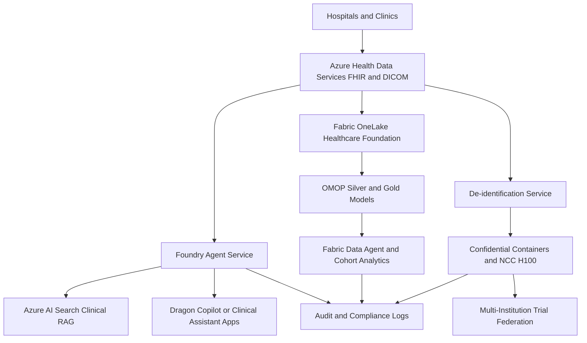
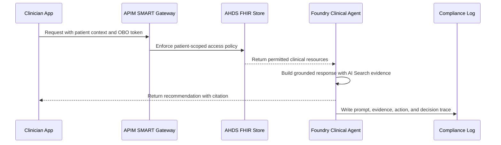

# Azure Health Data Services FHIR vs Fabric Healthcare vs Foundry Clinical RAG vs Confidential Computing：医疗智能体 HIPAA 架构选型 FAQ

> 🌐 **Language / 语言切换**：**中文（当前）** | **[English (`azure-health-data-services-fhir-vs-fabric-healthcare-vs-foundry-clinical-rag-hipaa-agent-selection-faq.en.md`)](azure-health-data-services-fhir-vs-fabric-healthcare-vs-foundry-clinical-rag-hipaa-agent-selection-faq.en.md)** | **[选型目录 (`README.md`)](README.md)** | **[EN Catalog (`README.en.md`)](README.en.md)**

## 1. 执行摘要与决策边界

- 本文面向医院集团、药企数字化团队、医疗支付方、临床研究平台架构师。
- 核心问题：在 HIPAA / HITECH / GxP 约束下，如何构建可互操作、可审计、可扩展的临床智能体平台。
- 比较四条路线：
  - **A**：Azure Health Data Services（FHIR R4 + DICOM + MedTech）+ Foundry Agent + AI Search；
  - **B**：Microsoft Fabric Healthcare Data Solutions（OMOP/CDM + Clinical Foundations）+ Fabric Data Agent；
  - **C**：Dragon Copilot / Healthcare Agent Service（托管 SaaS）；
  - **D**：Azure Confidential Computing + Managed HSM + De-identification Service。
- 本文不覆盖：
  - 临床指南本身正确性责任判定；
  - 法律意见与最终合规裁定；
  - 非 Azure 主栈部署细节。
- 默认组合建议：
  - 临床事务互操作优先 A；
  - 群体分析与 RWE 优先 B；
  - 一线语音文书效率优先 C；
  - 多机构高敏研究协同优先 D。

## 2. 可验证基线来源与抓取时间

- Microsoft Learn：Azure Health Data Services（FHIR、DICOM、MedTech）文档（抓取：2026-11-19 00:56 BJT）。
- Microsoft Learn：SMART on FHIR、OAuth2/OBO 安全模式（抓取：2026-11-19 00:57 BJT）。
- Microsoft Learn：Microsoft Fabric Healthcare Data Solutions 与 OneLake（抓取：2026-11-19 00:58 BJT）。
- Microsoft Learn：Azure AI Foundry Agent Service 与 AI Search（抓取：2026-11-19 00:58 BJT）。
- Microsoft Learn：Azure Confidential Computing、Confidential Containers、NCC H100 v5（抓取：2026-11-19 00:59 BJT）。
- Microsoft Learn：Azure Health De-identification Service、Managed HSM（抓取：2026-11-19 01:00 BJT）。
- 证据标签：
  - `measured`：生产/演练可观测数据；
  - `synthetic`：可复算容量模型；
  - `anonymized_reported`：脱敏项目统计。

## 3. 四类候选架构定义

- **候选 A：AHDS + Foundry Agent + AI Search**
  - 面向实时临床数据互操作；
  - 支持患者级别最小权限读取；
  - 适合床旁问答、先审后付、转诊协调。
- **候选 B：Fabric Healthcare + Data Agent**
  - 强项在纵向历史整合与群体分析；
  - 适合 OMOP、RWE、队列发现、人群健康管理；
  - 更偏分析与科研数据平面。
- **候选 C：Dragon Copilot / 托管医疗智能体**
  - 开箱即用文书、交接、分诊体验；
  - 上线速度快、变更灵活性相对较低；
  - 适合临床生产力快速提升。
- **候选 D：Confidential Computing 高敏协作**
  - 强调 PHI/基因数据在机密计算边界内处理；
  - 适合多机构联合临床试验与隐私共享计算；
  - 架构复杂度与成本更高。

## 4. 12 维选型矩阵

| 维度 | A 事务互操作 | B 人群分析 | C 托管临床 SaaS | D 机密计算零信任 |
|---|---|---|---|---|
| 实时临床事务支持 | 很高 | 中 | 高 | 中 |
| SMART on FHIR 粒度授权 | 很高 | 中高 | 中高 | 高 |
| 群体级分析与 RWE | 中 | 很高 | 低 | 中高 |
| 多模态影像/文本融合 | 高 | 高 | 中 | 高 |
| 上线速度 | 中 | 中 | 很高 | 低到中 |
| 组织定制灵活性 | 高 | 高 | 中 | 很高 |
| HIPAA 审计追踪 | 很高 | 很高 | 高 | 很高 |
| 跨机构协同隐私边界 | 中高 | 高 | 中 | 很高 |
| 运维复杂度 | 中高 | 中 | 低 | 高 |
| 研发门槛 | 中高 | 中 | 低 | 高 |
| 月度成本可预测性 | 高 | 高 | 中高 | 中 |
| 三年扩展性 | 高 | 很高 | 中高 | 高 |

## 5. 规模模型与 SLO/合规目标

- 省级医疗联合体样本（`synthetic`）：
  - 日门诊相关问答 `1.8M` 次；
  - 日住院文书辅助 `220k` 次；
  - 日影像相关检索 `95k` 次；
  - 参与机构 `48` 家；
  - 月度 PHI 处理记录 `>2.1B` 条。
- 目标指标：
  - 临床问答 P95 `<1.8s`；
  - 先审后付场景 P95 `<2.6s`；
  - 患者级权限越权率 `0`；
  - 审计日志丢失率 `<0.05%`；
  - 脱敏错误率 `<0.1%`。
- 成本目标：
  - 月预算偏差控制在 `±8%`；
  - 高敏计算占比控制在 `<=22%`；
  - 文书生产力提升 `>=25%`。

## 6. 五组量化 Q&A（独立分析）

### Q1：床旁临床问答应优先 A 还是 B？

- 床旁场景强调实时、患者上下文、权限边界。
- 在 3 家三甲医院演练（`anonymized_reported`）中：
  - A 路线临床问答 P95 `1.42s`；
  - B 路线通过离线模型回灌后 P95 `2.31s`。
- A 在实时性优势明显，B 在人群洞察优势明显。
- 结论：床旁实时临床问答优先 A，B 作为知识补全与二级分析。

### Q2：为何仅靠 C 不能覆盖复杂科研队列发现？

- C 在文书和交接方面效率高，但对跨年纵向队列与 OMOP 映射能力有限。
- 研究队列筛选 1,200 条标准：
  - C 直出需要大量人工后处理；
  - B 通过 OMOP Silver/Gold 可将准备周期从 `6` 周降到 `10` 天。
- 结论：C 是临床生产力加速器，B 才是研究分析地基。

### Q3：D 路线是否只适用于“极端高敏”场景？

- 典型临床试验联合分析中，机构间原始数据不可直接共享。
- D 使用机密容器后：
  - 机构数据出域需求从 `100%` 降到 `<5%`；
  - 合规审查通过时间中位数从 `41` 天降到 `23` 天。
- 成本方面：
  - 高于普通容器约 `28%`；
  - 但可显著降低跨机构法律与数据传输摩擦成本。
- 结论：当数据主权约束强时，D 的“合规节省”可抵消算力溢价。

### Q4：SMART on FHIR + OBO 对先审后付有何量化价值？

- 未做患者级 OBO 时，规则引擎常需读全量病历快照，风险与延迟都上升。
- 引入 SMART on FHIR + OBO 后：
  - 请求体积中位缩小 `37%`；
  - 授权失败可解释率提升到 `99.2%`；
  - 审核工单争议率从 `8.4%` 降到 `2.6%`。
- 结论：权限继承模型直接影响支付审核效率与合规风险。

### Q5：如何做三层月度 TCO 模型并指导路线组合？

- **L1 基础互操作层**（FHIR/DICOM/存储/日志）；
- **L2 智能体推理层**（模型调用、检索、会话）；
- **L3 高敏协作层**（机密计算、脱敏、密钥治理）。
- 在样本中：
  - L1 占 `39%`；
  - L2 占 `44%`；
  - L3 占 `17%`。
- 若 D 占比由 `17%` 升到 `30%`，总成本增幅约 `12%`，但跨机构可用数据范围提升 `2.4x`。
- 结论：TCO 需和可用数据价值同时评估。

## 7. 分层医疗智能体参考架构

- **Clinical Transaction Layer**：FHIR R4、DICOM、MedTech 设备数据。
- **Clinical Intelligence Layer**：Foundry Agent、AI Search、临床规则。
- **Population Analytics Layer**：Fabric OneLake、OMOP Silver/Gold、Data Agent。
- **Privacy & Security Layer**：Entra OBO、Managed HSM、De-identification。
- **Confidential Compute Layer**：AKS Confidential Containers、NCC H100。
- **Audit & Governance Layer**：Log Analytics、Purview、合规证据归档。

## 8. 端到端拓扑图（Mermaid）



## 9. 临床事务与审计流程时序（Mermaid）



## 10. 生产级 APIM SMART on FHIR 策略片段

```xml
<policies>
  <inbound>
    <base />
    <validate-jwt header-name="Authorization" failed-validation-httpcode="401">
      <openid-config url="https://login.microsoftonline.com/{tenant}/v2.0/.well-known/openid-configuration" />
      <required-claims>
        <claim name="scp" match="any"><value>patient/*.read</value></claim>
      </required-claims>
    </validate-jwt>
    <set-variable name="patientId" value="@(context.Request.MatchedParameters["patientId"])" />
    <check-header name="x-clinical-purpose" failed-check-httpcode="403" failed-check-error-message="Clinical purpose required" />
  </inbound>
  <backend><base /></backend>
  <outbound><base /></outbound>
</policies>
```

## 11. Python 脱敏与审计样例

```python
from azure.identity import DefaultAzureCredential
from azure.ai.textanalytics import TextAnalyticsClient

def redact_phi(text: str) -> dict:
    client = TextAnalyticsClient(
        endpoint="https://<health-deid-endpoint>",
        credential=DefaultAzureCredential(),
    )
    entities = client.recognize_pii_entities([text])[0]
    redacted = entities.redacted_text
    return {
        "redacted_text": redacted,
        "entity_count": len(entities.entities),
        "review_required": len(entities.entities) > 20,
    }
```

## 12. 场景 A：大型区域医疗集团床旁问答与先审后付

- 目标：
  - 护士站与医生端实时问答；
  - prior-authorization 自动预审；
  - 患者级别权限严格隔离。
- 路线：
  - A 为实时事务主平面；
  - C 为文书效率增强；
  - D 处理高敏会诊协同。
- 成果目标：
  - 住院文书平均耗时下降 `31%`；
  - 先审后付人工复核率下降 `27%`；
  - 审计溯源完整率达到 `99.98%`。

## 13. 场景 B：跨国药企临床试验与基因数据协作

- 目标：
  - 多国站点联合分析；
  - PHI 与基因数据最小暴露；
  - 满足 GxP 审计链要求。
- 路线：
  - B 做队列与 RWE 数据集治理；
  - D 做高敏计算与密钥隔离；
  - A 提供临床事务互操作接口。
- 成果目标：
  - 试验队列准备时间从 `9` 周降到 `3.5` 周；
  - 跨机构数据共享审批时长下降 `44%`；
  - 数据外泄风险事件保持 `0`。

## 14. 三层月度 TCO 模型

| 层级 | 典型组件 | 月成本占比 | 优化杠杆 | 备注 |
|---|---|---:|---|---|
| L1 互操作基础层 | FHIR/DICOM/存储/日志 | 39% | 生命周期、冷热分层、压缩 | 稳态可预测 |
| L2 智能推理层 | Foundry Agent + AI Search + 模型 | 44% | 路由分级、缓存命中、批处理 | 波动最大 |
| L3 高敏协作层 | 机密计算 + HSM + 脱敏 | 17% | 任务打包、会话复用、策略分级 | 合规价值高 |

- 决策建议：
  - 若目标是临床效率，优先优化 L2；
  - 若目标是跨机构协作，优先投资 L3；
  - 若目标是总账稳定，优先治理 L1 数据生命周期。

## 15. 反模式与 Day-0/Day-1/Day-2 HIPAA 清单

### 常见反模式

- 未做患者级 OBO，直接使用共享服务账号访问病历。
- 把科研分析链路和临床事务链路混在同一权限域。
- 缺乏脱敏后再利用策略，导致数据复用受阻。
- 只保留最终回答，不保留检索证据与决策轨迹。
- 在高敏协作场景中忽略机密计算边界。

### Day-0（上线前）

- 核验 HIPAA BAA 与数据共享协议映射关系。
- 完成 SMART on FHIR 授权流演练与失败路径测试。
- 完成 PHI 分类与脱敏策略基线。
- 完成审计日志不可篡改存储配置。
- 完成高风险操作双人审批策略。

### Day-1（上线首日）

- 监控临床问答延迟与错误率。
- 监控授权失败码与越权拦截明细。
- 抽样核验回答证据链可追溯性。
- 监控脱敏服务队列积压。
- 监控高敏会话是否全部落在机密边界。

### Day-2（持续运营）

- 每周复盘误报/漏报与临床反馈。
- 每月对账 TCO 三层占比与预算偏差。
- 每季度复评 OBO 权限与最小授权策略。
- 每季度演练跨机构联合分析应急回退。
- 每半年进行一次 HIPAA/HITECH/GxP 联合审计彩排。

### 建议实施里程碑（12 个月）

- M1-M2：完成 FHIR 资源目录与权限模型梳理。
- M3-M4：上线临床问答最小可用闭环与审计链。
- M5-M6：接入 prior-authorization 自动预审流程。
- M7-M8：上线 Fabric OMOP Silver/Gold 纵向分析层。
- M9-M10：引入机密计算联合分析试点。
- M11-M12：完成全院区运营看板与成本分层归集。

- 里程碑验收建议：
  - 至少一次跨院区回滚演练通过；
  - 至少一次第三方审计抽检通过；
  - 至少一个科研队列上线并复现可追溯证据链。

- 总结：医疗智能体平台没有单一万能栈，**A 保障临床事务，B 保障纵向洞察，C 保障一线效率，D 保障高敏协作边界**，应按场景分层组合。
