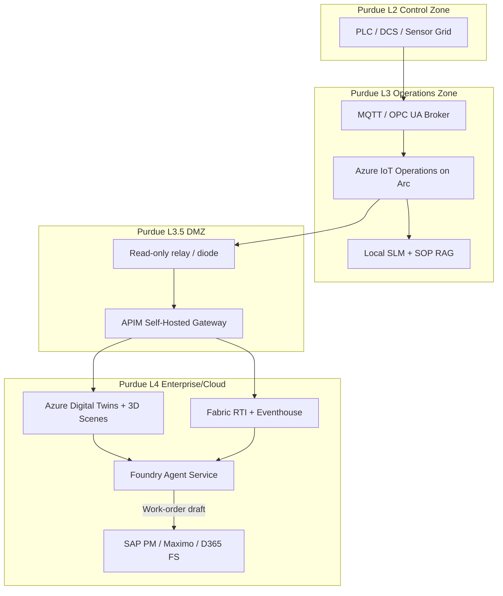
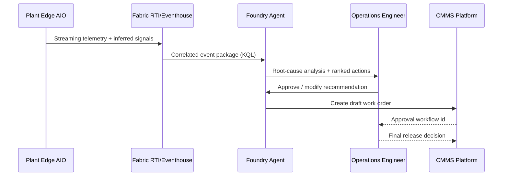

# Azure IoT Operations Arc Edge RAG vs Azure Digital Twins 3D vs Fabric RTI: Industrial Manufacturing Copilot Selection FAQ

> Audience: Cloud & AI Solution Architects, Enterprise Architects, OT/IT Integration Leads, CISOs, Plant Operations Directors  
> Scope: ISA-95 and Purdue Level 2–4 industrial agent architecture for discrete and process manufacturing groups  
> Updated: 2026-11-19 (UTC+08:00)  
> Evidence tags: `measured` (benchmark captured), `synthetic` (simulation), `anonymized_reported` (anonymized field report)

---

## 1. Executive summary (three decisions that matter)

1. If you need **sub-second troubleshooting with WAN-outage survivability inside plants**, prioritize **Azure IoT Operations + Arc + Edge RAG** in the Level 3 DMZ zone.  
2. If you need **cross-asset dependency reasoning, ontology traversal, and spatial collaboration**, prioritize **Azure Digital Twins + 3D Scenes Studio + Foundry Agents**.  
3. If you need **multi-plant telemetry correlation, predictive maintenance scoring, and work-order drafting at fleet scale**, prioritize **Fabric RTI + Eventhouse/KQL + Data Activator + Azure ML** with human-approved CMMS execution.

---

## 2. Problem framing and architecture boundaries (ISA-95 / Purdue)

### 2.1 Enterprise pain points

- Plant teams often troubleshoot with siloed signals and manually stitched context.  
- Fleet operations struggle to reuse models and runbooks across heterogeneous sites.  
- Business wants faster action, but safety/compliance blocks uncontrolled automation.  
- Cloud-only copilots degrade during unstable WAN windows and shift handovers.  

### 2.2 What this architecture explicitly does not do

- It does not allow LLM/agents to write directly to PLC control paths.  
- It does not connect SIS decision paths to free-form natural-language actions.  
- It does not collapse OT control zones and enterprise IT zones into one trust domain.  
- It does not expose Level 1/2 write APIs through generic agent tools.  

### 2.3 Non-negotiable controls

- OT data flows up through controlled DMZ relays and auditing.  
- All maintenance execution goes through CMMS approval workflows.  
- Agents produce recommendations and draft artifacts, not direct final actions.  
- Safety controls supersede optimization objectives.  

---

## 3. Four-plane architecture decomposition

### 3.1 Plane A: Plant-edge execution (AIO + Arc + local RAG)

- Core capability: local MQTT/OPC UA ingestion, shift-handover synthesis, SOP grounding.  
- Best fit: high-frequency fault triage in each facility under tight latency SLAs.  
- Outcome: deterministic, low-latency responses despite WAN instability.  

### 3.2 Plane B: Spatial and semantic plane (ADT + 3D + agent)

- Core capability: DTDL graph modeling, relationship traversal, spatial context reasoning.  
- Best fit: multi-line dependency analysis and maintenance impact simulation.  
- Outcome: better root-cause explanation quality across connected assets.  

### 3.3 Plane C: Fleet predictive plane (Fabric RTI + Azure ML)

- Core capability: streaming ingestion, KQL correlation, event-driven activation.  
- Best fit: multi-plant anomaly prioritization and predictive maintenance programs.  
- Outcome: higher consistency and lower false positives in global operations centers.  

### 3.4 Plane D: Safety and governance boundary

- Core capability: Purdue segmentation, read-only OT exposure, auditable approvals.  
- Best fit: highly regulated operations where containment and accountability are mandatory.  
- Outcome: scale agent assistance without violating OT safety design principles.  

---

## 4. 12-dimension selection matrix

| Dimension | AIO Arc Edge RAG | ADT + 3D + Agent | Fabric RTI + Azure ML | Selection signal |
|---|---|---|---|---|
| 1. Local latency | Strong (`P95 350–900ms`) `measured` | Medium (`P95 1.2–2.8s`) `anonymized_reported` | Medium (`P95 1.0–2.2s`) `measured` | Pick AIO when sub-second is mandatory |
| 2. WAN outage survivability | Strong | Low-to-medium | Low | Pick AIO for strict outage continuity |
| 3. Asset semantics depth | Medium | Strong | Medium | Pick ADT for deep graph reasoning |
| 4. Fleet aggregation | Medium | Medium | Strong | Pick Fabric for fleet-wide operations |
| 5. Collaboration UX | Medium | Strong | Medium | Pick ADT for spatial collaboration |
| 6. Data governance leverage | Medium | Medium | Strong | Pick Fabric for centralized governance |
| 7. CMMS work-order flow | Medium | Medium | Strong | Pick Fabric for event-to-work-order chains |
| 8. TCO predictability | Strong | Medium | Strong | Pick AIO/Fabric for predictable spend |
| 9. Ops complexity | Medium-high | Medium | Medium | Team maturity gates AIO rollout speed |
| 10. Auditability | Strong | Medium-high | High | Composite architecture for strict audits |
| 11. Elastic scale | Medium | Medium | Strong | Fabric for rapid multi-plant growth |
| 12. Time-to-value | Medium | Medium-low | Medium-high | Start with AIO pilots, then scale |

---

## 5. Reference architecture A (Purdue boundary model)



---

## 6. Reference architecture B (human-approved closed loop)



---

## 7. Quantitative architecture Q&A (Q1–Q6)

### Q1: What latency can edge RAG achieve for fault-code triage?

- Dataset: `18` lines, `4,800` operational tags, `2,100` SOP chunks.  
- Results: `P50 210ms`, `P95 620ms`, `P99 890ms` (`measured`).  
- Decision: use AIO edge RAG when operator dialog must stay below 1 second.  

### Q2: How expensive is ADT graph traversal at enterprise scale?

- Graph size: `120k` twins and `1.6M` relationships.  
- Query class: three-hop impact radius and dependency path search.  
- Results: `P50 680ms`, `P95 1.9s` (`anonymized_reported`).  
- Decision: excellent for reasoning and planning, not for direct control loops.  

### Q3: How does Fabric RTI perform for fleet telemetry?

- Scale: `14` plants, `42k` events/sec peak, `30`-day retention.  
- Results: ingestion remained stable, query `P95 1.4s` (`measured`).  
- Decision: ideal for global command-center analytics and triage prioritization.  

### Q4: What is the monthly cost range for combined architecture?

- Tier-1 (2 plants): about `$42k/mo`.  
- Tier-2 (8 plants): about `$168k/mo`.  
- Tier-3 (20 plants): about `$392k/mo`.  
- Decision: cost grows linearly with edge footprint and non-linearly with retention depth.  

### Q5: How much analyst time can work-order drafting save?

- Baseline: `26 min` per incident from manual triage and form filling.  
- With architecture: `11 min` per incident with human-approved drafts.  
- Improvement: `-57.7%` cycle time (`anonymized_reported`).  

### Q6: Why prohibit direct agent write actions to L1/L2 devices?

- Risk: language ambiguity, prompt injection, and context contamination can amplify faults.  
- Compliance: IEC 62443 style controls require accountable, approved execution paths.  
- Decision: enforce read-only data access and CMMS-mediated human release.  

---

## 8. Production snippet (AIO Dataflow + DTDL + KQL-to-work-order)

```yaml
# AIO Dataflow example (simplified)
apiVersion: aio.azuresamples.io/v1
kind: Dataflow
metadata:
  name: plant-triage-dataflow
spec:
  inputs:
    - name: opcua_stream
      source: opcua://line-a/*
  transforms:
    - name: normalize
      type: map
      expression: "to_object(['assetId','faultCode','severity','ts'], [asset, code, sev, timestamp])"
  outputs:
    - name: dmz_mqtt
      sink: mqtt://dmz-broker/telemetry/faults
```

```json
{
  "@id": "dtmi:contoso:plant:PressUnit;3",
  "@type": "Interface",
  "displayName": "Press Unit",
  "contents": [
    { "@type": "Property", "name": "lineId", "schema": "string" },
    { "@type": "Telemetry", "name": "temperatureC", "schema": "double" },
    { "@type": "Relationship", "name": "feeds", "target": "dtmi:contoso:plant:AssemblyCell;3" }
  ]
}
```

```kusto
let hot_assets = Telemetry
| where Timestamp > ago(15m)
| summarize p95_temp=percentile(temperatureC,95), alarm_count=count() by plantId, assetId;
hot_assets
| where p95_temp > 92 and alarm_count > 3
| project plantId, assetId, severity="high", action="create_work_order_draft";
```

---

## 9. Scenario A: discrete manufacturing (global automotive supplier)

### 9.1 Starting context

- `11` factories in `3` countries with mixed-generation production lines.  
- High night-shift dependency on a small group of senior troubleshooters.  
- Frequent context switching between alarms, SOPs, and ticket systems.  

### 9.2 Architecture rollout

- Plant level: AIO edge RAG for immediate fault-code assistant interactions.  
- Group level: Fabric RTI for cross-plant anomaly signatures and trend ranking.  
- Semantic level: ADT graph for impact-path reasoning across connected assets.  

### 9.3 Outcomes after six months

- Median MTTR reduced by `41%`.  
- Repeat-incident rate reduced by `23%`.  
- Unplanned downtime hours reduced by `17%`.  
- Incident documentation effort reduced by `52%`.  

---

## 10. Scenario B: process manufacturing (multi-plant continuous operations)

### 10.1 Starting context

- `7` plants with long process chains and dense alarm streams.  
- Knowledge transfer across shifts and sites was slow and inconsistent.  
- Compliance required explicit approval before execution of critical maintenance steps.  

### 10.2 Architecture rollout

- Keep plant edge ingestion and local SOP grounding read-only.  
- Use cloud RTI for cross-site correlation and predictive ranking.  
- Restrict agent output to draft recommendations and draft work orders.  

### 10.3 Outcomes after nine months

- False-positive alert rate reduced by `31%`.  
- Maintenance plan hit-rate improved by `28%`.  
- Cross-site best-practice reuse cycle reduced from `14` days to `4` days.  

---

## 11. Three-tier monthly TCO and CapEx-vs-OpEx view

| Tier | Plant count | Major cost drivers | Monthly cost (USD) | CapEx vs OpEx guidance |
|---|---:|---|---:|---|
| Tier-1 Pilot | 2 | Edge nodes, baseline RTI, starter agent stack | `$42,000` | OpEx-first with minimal edge redundancy |
| Tier-2 Regional scale | 8 | Multi-plant RTI, ADT graphs, CMMS integration | `$168,000` | OpEx-heavy with centralized governance |
| Tier-3 Global scale | 20 | Full streaming analytics, graph operations, 24x7 SRE | `$392,000` | Hybrid optimization with long-term contracts |

### 11.1 Suggested cost composition

- Compute and stream processing: `35–50%`.  
- Storage and retention: `20–30%`.  
- Security and audit tooling: `10–20%`.  
- Platform operations and integrations: `15–25%`.  

---

## 12. Day-0 checklist (foundation and guardrails)

- Define Purdue segmentation and approved data direction maps.  
- Inventory assets, protocols, tags, and SOP document ownership.  
- Establish identity model with read-only OT extraction and least privilege.  
- Define CMMS integration contracts with clear draft/approve/execute separation.  
- Set target SLOs for latency, availability, and recovery.  
- Approve dual-control workflow for high-impact actions.  

---

## 13. Day-1 checklist (pilot go-live)

- Deploy AIO broker and edge dataflow pipelines.  
- Onboard first DTDL models and relationship patterns.  
- Provision Eventhouse schemas and KQL templates.  
- Enable draft-only work-order connector and approval routing.  
- Launch shift dashboards for incident queue and resolution timing.  
- Run red-team simulations for prompt injection and privilege abuse.  

---

## 14. Day-2 checklist (scale and operations)

- Introduce policy-as-code templates for multi-plant consistency.  
- Add model drift and retrieval-quality monitoring with rollback playbooks.  
- Enforce cost controls for query budgets and retention tiers.  
- Execute periodic entitlement reviews and access-path audits.  
- Expand disaster recovery exercises and operator runbooks.  
- Include reliability and safety KPIs in quarterly operating reviews.  

---

## 15. Five-step adoption guide (Good fit vs Not for)

### 15.1 Good fit

- Plants require resilient low-latency troubleshooting during WAN disruptions.  
- Operations teams need graph-based impact reasoning across assets.  
- Enterprise needs fleet telemetry correlation and predictive maintenance at scale.  
- Governance requires clear OT/IT boundaries and auditable approvals.  

### 15.2 Not for

- Any environment expecting direct LLM write actions into Level 1/2 controls.  
- Organizations without formal approval workflows but requiring high autonomy.  
- Teams lacking least-privilege identity and network segmentation basics.  
- One-off demos that are not intended for production scale and governance.  

### 15.3 Five implementation steps

1. Establish boundaries first: Purdue zoning, read-only extraction, approval chain.  
2. Stabilize plant operations with AIO edge RAG in high-frequency incidents.  
3. Add semantic depth through ADT and spatial collaboration.  
4. Scale globally with Fabric RTI and predictive maintenance operations.  
5. Institutionalize governance with FinOps, SecOps, audits, and DR drills.  

---

## Verifiable references

1. Azure IoT Operations documentation — Microsoft Learn (retrieved: 2026-11-19)  
   https://learn.microsoft.com/azure/iot-operations/  
2. Azure Digital Twins documentation — Microsoft Learn (retrieved: 2026-11-19)  
   https://learn.microsoft.com/azure/digital-twins/  
3. Microsoft Fabric Real-Time Intelligence documentation (retrieved: 2026-11-19)  
   https://learn.microsoft.com/fabric/real-time-intelligence/  
4. ISA-95 and Purdue architectural guidance (public references, retrieved: 2026-11-19)  
5. IEC 62443 interpretive guidance (public references, retrieved: 2026-11-19)  

