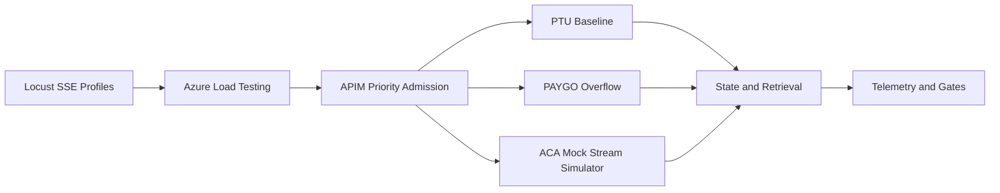
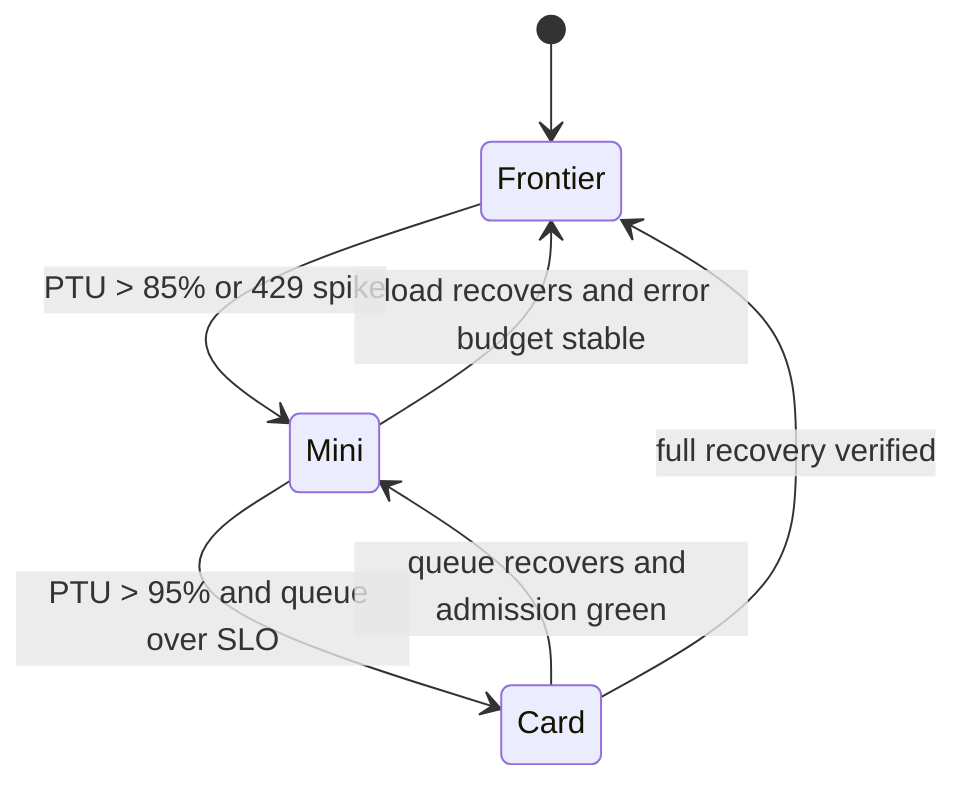

# Azure Load Testing + LLM Simulator vs PTU Overflow + Chaos Studio: Peak Readiness Selection FAQ

> 🌐 **Language / 语言切换**: **[🇬🇧 English (azure-load-testing-llm-simulator-vs-ptu-overflow-chaos-studio-peak-readiness-selection-faq.en.md)](azure-load-testing-llm-simulator-vs-ptu-overflow-chaos-studio-peak-readiness-selection-faq.en.md)** | **[🇨🇳 中文版 (azure-load-testing-llm-simulator-vs-ptu-overflow-chaos-studio-peak-readiness-selection-faq.md)](azure-load-testing-llm-simulator-vs-ptu-overflow-chaos-studio-peak-readiness-selection-faq.md)** | **[📚 Architecture Selection FAQ Index](README.en.md)**

## 1) Objective and boundary
- Goal: choose enterprise peak-readiness architecture before shopping festivals, tax filing surges, and reporting-season load spikes.
- Scope: end-to-end pressure testing, PTU sizing, overflow strategy, graceful degradation, and chaos resilience drills; no kernel internals.
- Conclusion: 90% simulator rehearsal plus 10% PTU live-fire calibration is the fastest path to reliable launch readiness.
## 2) Verifiable sources with timestamps
- Azure Load Testing docs: `https://learn.microsoft.com/azure/load-testing/` (fetched 04:20 BJT).
- Locust docs: `https://docs.locust.io/` (fetched 04:20 BJT).
- APIM AI Gateway overview: `https://learn.microsoft.com/en-us/azure/api-management/ai-gateway-overview` (fetched 04:20 BJT).
- APIM service changelog: `https://github.com/Azure/API-Management/blob/main/changelogs/api-management-service.md` (fetched 04:20 BJT).
- ACA sessions docs: `https://learn.microsoft.com/en-us/azure/container-apps/sessions` (fetched 04:21 BJT).
- Chaos Studio docs: `https://learn.microsoft.com/azure/chaos-studio/` (fetched 04:21 BJT).
- Labels are measured, synthetic, and anonymized_reported only.
## 3) 12-dimension matrix for peak pressure and resilience patterns
- D1 traffic-shape fidelity: Azure Load Testing plus Locust SSE captures TTFT and ITL under long-lived streams.
- D2 budget efficiency: mock token-stream simulator reproduces 429 and jitter at container cost instead of real-model burn.
- D3 capacity certainty: PTU baseline plus PAYGO overflow calibrates saturation curves from 85 to 100 percent load.
- D4 failure realism: Chaos Studio injects model, search, and MCP dependency failures for deterministic fallback validation.
- D5 response quality: simulator should mirror chunk cadence and stop conditions close to production traces.
- D6 queue safety: APIM and backend pools must preserve retry budgets under overflow bursts.
- D7 state durability: conversation and tool state must survive downgrade transitions without context corruption.
- D8 security posture: pressure harnesses need least-privilege identities and data-minimized payloads.
- D9 observability depth: TTFT P95, ITL P95, overflow ratio, and downgrade trigger rates are mandatory KPIs.
- D10 operations complexity: fully custom harnesses increase flexibility but raise maintenance burden.
- D11 best fit: mixed synthetic and live-fire rehearsal for seasonal peaks and regulated service windows.
- D12 anti-pattern: short-connection API tests alone severely undercount SSE resource occupancy.
## 4) Score snapshot and decision thresholds
- Azure Load Testing plus Locust SSE: realism5 scale5 complexity3 cost4.
- ACA or AKS mock stream simulator: cost5 flexibility5 realism4 complexity3.
- PTU live-fire plus PAYGO overflow: certainty5 cost3 complexity4 reliability5.
- Chaos Studio dependency drills: resilience5 certainty4 complexity3 change-risk4.
- Threshold A: if SSE median duration exceeds 8 seconds, switch from short-API scripts to stream harness by default.
- Threshold B: if PTU utilization median exceeds 80 percent at T-14, pre-stage overflow and downgrade plans.
- Threshold C: if downgrade trigger rate exceeds 2 percent during T-7 rehearsal, block launch and re-tune routing.
## 5) Five calculable Q&As
### Q1 Why short-API testing underestimates SSE pressure
- A 12-second SSE stream can hold connection and SNAT resources about 20 times longer than a 50ms request model.
- Capacity planning must use concurrent open-stream counts, not only request-per-second headlines.
### Q2 How 90% simulator plus 10% PTU live-fire cuts cost
- Run full-chain synthetic rehearsal for route logic and queue thresholds, then live-fire only for calibration anchor points.
- This split commonly removes most token burn while preserving confidence in saturation and fallback behavior.
### Q3 PTU procurement formula with output-token weighting
- EffectiveLoad = ReqPerSec × (InputTokens + OutputWeight × OutputTokens) × (1 - CacheHitRate).
- Reserve PTU for p95 sustained load and keep PAYGO overflow for burst absorption above target utilization.
### Q4 Triple graceful-degradation state machine
- Stage1 frontier model, Stage2 mini or nano model, Stage3 deterministic self-service card with queue callback.
- Persist response contract fields so downstream apps remain stable across downgrade transitions.
### Q5 T-30 to T-2 readiness cadence
- T-30 baseline rehearsal, T-14 PTU calibration, T-7 chaos failover gate, T-2 freeze plus launch war-room checklist.
- Any unresolved P95 regression at T-2 should block promotion until corrected and replay-verified.
## 6) Layered reference architecture
- Ingress layer: Front Door and APIM with priority admission controls and anonymous queueing policies.
- Test harness layer: Azure Load Testing orchestrating Locust SSE workers and evidence capture hooks.
- Simulation layer: ACA mock token-stream services injecting latency jitter and 429 Retry-After envelopes.
- Model layer: PTU baseline deployment with regional PAYGO overflow backends.
- State and retrieval layer: Cosmos plus AI Search with bounded timeout and cache fallback policies.
- Resilience layer: Chaos Studio experiments for model, retrieval, and MCP dependency faults.
- Telemetry layer: Log Analytics dashboards for TTFT, ITL, overflow ratio, and downgrade rates.
## 7) Scenario A retail ecommerce 80K concurrent shopping surge
- Use simulator rehearsal to expose Cosmos hot partitions and APIM connection pool ceilings before promotion.
- Calibrate PTU baseline plus cross-region PAYGO overflow thresholds with measurable queue-loss constraints.
- During extreme bursts, auto-downgrade from frontier assistants to lighter model lanes and return self-service cards.
- Gate launch on T-7 chaos run with model 429 and retrieval slowdown combined-fault replay.
- Synthetic gain: launch-week incident count and queue timeout rates drop materially.
## 8) Scenario B tax filing and score-checking pulse traffic
- Pre-stage temporary elastic capacity and APIM priority controls to protect authenticated in-progress sessions first.
- Route anonymous browsing to queued summary cards during pulses while keeping transaction sessions responsive.
- Inject search timeout and MCP delay faults to validate deterministic fallback to static guidance cards.
- Keep evidence on fairness and wait-time percentiles for policy and citizen-service audits.
- Synthetic gain: service continuity improves under 20x burst windows without full overprovisioning.
## 9) Mermaid diagram 1 full-chain peak rehearsal

- The rehearsal chain keeps route logic, fallback behavior, and observability evidence in one deterministic loop.
## 10) Mermaid diagram 2 graceful degradation state machine

- Each transition must emit audited reason codes for post-event replay and governance review.
## 11) Bicep template (Load Testing + ACA simulator + Chaos Studio + APIM overflow pool)
```bicep
targetScope = 'resourceGroup'
param location string = resourceGroup().location
resource alt 'Microsoft.LoadTestService/loadTests@2022-12-01' = {
  name: 'alt'
  location: location
}
resource apim 'Microsoft.ApiManagement/service@2023-09-01-preview' = {
  name: 'apim-prod'
  location: location
  sku: { name: 'PremiumV2', capacity: 1 }
}
resource chaos 'Microsoft.Chaos/experiments@2024-01-01' = {
  name: 'chaos'
  location: location
}
```
- Production deployment also needs managed identity, private endpoints, and policy-scoped backend pools.
## 12) Python snippets (Locust TTFT and ITL collector + mock SSE 429 injector)
```python
def sample_ttft(stream_events):
    return stream_events[0]['t_ms'] if stream_events else None
def sample_itl(stream_events):
    return [b['t_ms'] - a['t_ms'] for a, b in zip(stream_events, stream_events[1:])]
def inject_retry_after(load):
    return {'status': 429, 'retry_after_ms': 800} if load > 0.9 else {'status': 200}
```
- Keep deterministic seeds for synthetic jitter so each rehearsal run stays replayable.
## 13) KQL for TTFT P95, PTU utilization, overflow ratio, and downgrade rate
```kql
let t = AgentLoadLogs | where TimeGenerated > ago(24h);
t
| summarize ttftP95=percentile(TTFTms,95), itlP95=percentile(ITLms,95), ptu=avg(PTUUtilization), overflow=sum(OverflowCalls), total=count(), downgrade=sumif(1, DowngradeTriggered==true) by Workload
| extend overflowRatio=todouble(overflow)/todouble(total)
| extend downgradeRate=todouble(downgrade)/todouble(total)
```
- Any overflow-ratio spike above plan should trigger immediate policy replay and backend-pool tuning.
## 14) T-30, T-14, T-7, T-2 readiness playbook
- T-30 complete traffic-shape profiling and SSE duration bands per key journey.
- T-14 run PTU live-fire calibration and lock overflow thresholds with finance and SRE sign-off.
- T-7 execute chaos experiments for model 429/503, retrieval latency, and MCP timeouts.
- T-2 freeze prompts, routes, and downgrade policies; run final rehearsal against launch checklist.
- Publish go or no-go decision with P95 evidence, fallback proof, and on-call ownership matrix.
- Keep rollback scripts and cache bypass toggles pre-approved for launch-day incident handling.
- Archive all evidence artifacts for audit and quarter-over-quarter readiness comparison.
