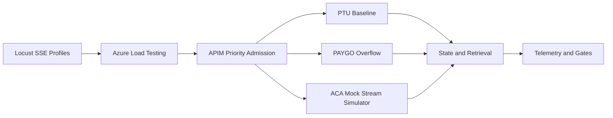
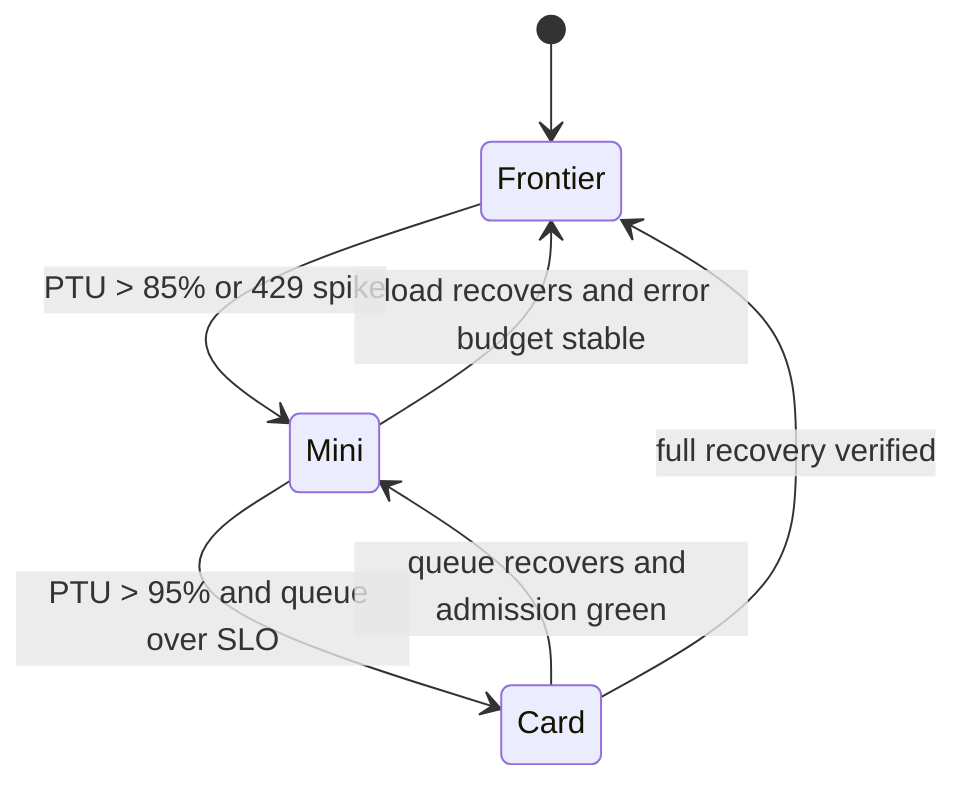

# Azure Load Testing + LLM 仿真靶场 vs PTU 溢出 + Chaos Studio：洪峰就绪选型 FAQ

> 🌐 **Language / 语言切换**: **[🇨🇳 中文版 (azure-load-testing-llm-simulator-vs-ptu-overflow-chaos-studio-peak-readiness-selection-faq.md)](azure-load-testing-llm-simulator-vs-ptu-overflow-chaos-studio-peak-readiness-selection-faq.md)** | **[🇬🇧 English (azure-load-testing-llm-simulator-vs-ptu-overflow-chaos-studio-peak-readiness-selection-faq.en.md)](azure-load-testing-llm-simulator-vs-ptu-overflow-chaos-studio-peak-readiness-selection-faq.en.md)** | **[📚 返回架构选型指南目录](README.md)**

## 1) 研究目标与边界
- 目标：面向大促、春运、财报季、集中申报前的企业级智能体洪峰就绪架构选型。
- 范围：全链路压测、PTU容量核定、溢出策略、有损降级与混沌演练；不讨论底层内核细节。
- 结论：90%仿真演练+10%实弹PTU标定是上线前性价比最高的稳态路径。
## 2) 可验证来源与时间戳
- Azure Load Testing：`https://learn.microsoft.com/azure/load-testing/`（抓取 04:20 BJT）。
- Locust：`https://docs.locust.io/`（抓取 04:20 BJT）。
- APIM AI Gateway：`https://learn.microsoft.com/en-us/azure/api-management/ai-gateway-overview`（抓取 04:20 BJT）。
- APIM changelog：`https://github.com/Azure/API-Management/blob/main/changelogs/api-management-service.md`（抓取 04:20 BJT）。
- ACA Sessions：`https://learn.microsoft.com/en-us/azure/container-apps/sessions`（抓取 04:21 BJT）。
- Chaos Studio：`https://learn.microsoft.com/azure/chaos-studio/`（抓取 04:21 BJT）。
- 指标标签统一为 measured、synthetic、anonymized_reported。
## 3) 四类洪峰压测与韧性方案 12 维矩阵
- 维度1流量保真：Azure Load Testing + Locust SSE 能真实采集 TTFT 与 ITL。
- 维度2预算效率：Mock Token-Stream 靶场可低成本复现429与抖动分布。
- 维度3容量确定性：PTU基线+PAYGO溢出可标定85%到100%饱和曲线。
- 维度4故障真实度：Chaos Studio 可注入模型、检索、MCP依赖故障。
- 维度5输出质量：仿真分块节奏需贴近生产chunk与停止条件。
- 维度6队列安全：APIM与后端池需在洪峰下维持重试预算可控。
- 维度7状态耐受：降级切换时会话与工具状态必须无损承接。
- 维度8安全约束：压测负载需要最小权限与最小数据暴露。
- 维度9观测深度：TTFT P95、ITL P95、溢出比、降级率必须入门禁。
- 维度10运维复杂度：自建高自由度同时提高维护门槛。
- 维度11最佳场景：季节性高峰与政企关键窗口优先混合演练方案。
- 维度12反模式：仅做短连接压测会严重低估SSE资源占用。
## 4) 评分与决策阈值
- Azure Load Testing + Locust SSE：保真5、规模5、复杂度3、成本4。
- ACA/AKS Mock Stream 仿真靶场：成本5、灵活5、保真4、复杂度3。
- PTU实弹+PAYGO溢出：确定性5、成本3、复杂度4、可靠性5。
- Chaos Studio 依赖故障演练：韧性5、确定性4、复杂度3、变更风险4。
- 阈值A：若SSE中位时长超过8秒，默认切换流式压测模型。
- 阈值B：若T-14时PTU利用率中位超过80%，必须预置溢出与降级。
- 阈值C：若T-7演练降级触发率超过2%，禁止上线并回炉调参。
## 5) 五组可复算 Q&A
### Q1 为什么短连接压测会低估SSE压力
- 12秒SSE会话对连接池与SNAT占用可达50ms短请求模型的约20倍。
- 容量模型应以并发开放流数量而非仅RPS做核心约束。
### Q2 90%仿真+10%实弹如何省预算
- 全链路逻辑与阈值在仿真场完成，PTU实弹只用于关键校准点锚定。
- 该拆分可显著降低Token开销同时保留饱和与降级曲线可信度。
### Q3 计入输出Token权重的PTU采购公式
- EffectiveLoad = 请求速率 × (输入Token + 输出权重×输出Token) × (1-缓存命中率)。
- 以p95持续负载采购PTU，突发流量由PAYGO溢出池吸收。
### Q4 三级有损优雅降级状态机
- 第一级前沿模型，第二级mini或nano，第三级确定性自助卡片与回呼队列。
- 降级过程需保持响应契约字段不变，确保下游系统稳定。
### Q5 T-30到T-2作战节奏
- T-30基线建模，T-14容量标定，T-7混沌闸门，T-2冻结与总复盘。
- 任一P95回归若未闭环，T-2必须阻断上线。
## 6) 分层参考架构
- 入口层：Front Door + APIM 优先级准入与匿名排队策略。
- 压测层：Azure Load Testing 编排 Locust SSE worker 与证据采集。
- 仿真层：ACA Mock Token-Stream 注入延迟抖动与429 Retry-After。
- 模型层：PTU基线部署 + 多区域PAYGO溢出后端池。
- 状态检索层：Cosmos + AI Search 超时边界与缓存回退。
- 韧性层：Chaos Studio 注入模型、检索、MCP依赖故障。
- 观测层：Log Analytics 汇总TTFT、ITL、溢出比与降级率。
## 7) 场景A：全渠道零售电商 8万并发大促护航
- 先用仿真靶场定位Cosmos热分区与APIM连接上限，再进入实弹标定。
- 通过PTU基线+跨区PAYGO溢出阈值保证洪峰期队列损失可控。
- 极端峰值自动从前沿模型降级到轻量模型并回退自助退货卡片。
- T-7必须通过模型429与检索慢查询组合故障混沌演练。
- synthetic收益：上线周超时告警与排队超时事件显著下降。
## 8) 场景B：个税汇算/查分/缴费20倍脉冲政务平台
- 预置短期弹性容量并用APIM优先保障已实名办理中的关键会话。
- 匿名浏览高峰统一下发排队摘要卡，保障交易办理链路可用。
- 注入检索超时与MCP延迟故障，验证可确定性回退静态指南卡。
- 输出公平性与等待时长分位证据，满足监管与审计复核。
- synthetic收益：20倍脉冲下连续服务能力明显提升。
## 9) Mermaid 图1：全链路洪峰演练

- 该链路把路由策略、降级行为与可观测证据串成单一闭环。
## 10) Mermaid 图2：有损优雅降级状态机

- 每次状态迁移都必须落库原因码以支持复盘与审计。
## 11) Bicep 模板（Load Testing + ACA仿真 + Chaos + APIM溢出池）
```bicep
targetScope = 'resourceGroup'
param location string = resourceGroup().location
resource alt 'Microsoft.LoadTestService/loadTests@2022-12-01' = {
  name: 'alt'
  location: location
}
resource apim 'Microsoft.ApiManagement/service@2023-09-01-preview' = {
  name: 'apim-prod'
  location: location
  sku: { name: 'PremiumV2', capacity: 1 }
}
resource chaos 'Microsoft.Chaos/experiments@2024-01-01' = {
  name: 'chaos'
  location: location
}
```
- 生产落地仍需补齐托管身份、私网端点、后端池策略与密钥治理。
## 12) Python：Locust TTFT/ITL 采集 + Mock SSE 429 注入
```python
def sample_ttft(stream_events):
    return stream_events[0]['t_ms'] if stream_events else None
def sample_itl(stream_events):
    return [b['t_ms'] - a['t_ms'] for a, b in zip(stream_events, stream_events[1:])]
def inject_retry_after(load):
    return {'status': 429, 'retry_after_ms': 800} if load > 0.9 else {'status': 200}
```
- 合成抖动必须固定随机种子，确保每轮演练可重放可对比。
## 13) KQL：TTFT P95/PTU利用率/溢出比/降级率
```kql
let t = AgentLoadLogs | where TimeGenerated > ago(24h);
t
| summarize ttftP95=percentile(TTFTms,95), itlP95=percentile(ITLms,95), ptu=avg(PTUUtilization), overflow=sum(OverflowCalls), total=count(), downgrade=sumif(1, DowngradeTriggered==true) by Workload
| extend overflowRatio=todouble(overflow)/todouble(total)
| extend downgradeRate=todouble(downgrade)/todouble(total)
```
- 溢出比异常上升需立即触发策略回放与后端池权重重整。
## 14) T-30 / T-14 / T-7 / T-2 落地作战图
- T-30：完成关键旅程流量形态与SSE时长分布建模。
- T-14：完成PTU实弹标定并锁定溢出阈值与预算上限。
- T-7：完成模型429/503、检索慢查、MCP超时的混沌演练闭环。
- T-2：冻结提示词、路由与降级策略并执行总彩排。
- 发布Go/No-Go决策时必须附带P95证据与回退证明。
- 预置回滚脚本与缓存旁路开关以应对上线日突发事件。
- 归档全部演练证据供季度复盘与审计抽查。
