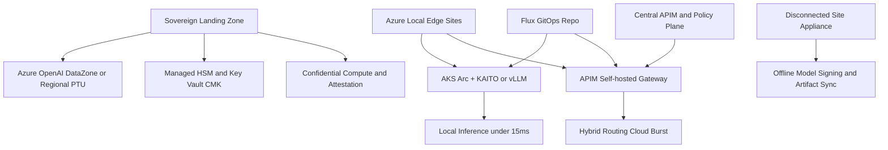
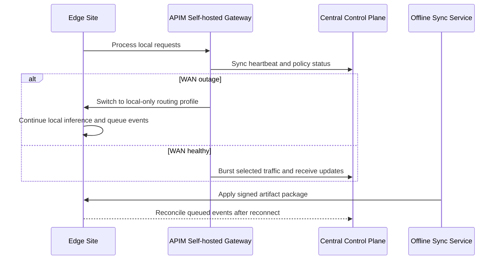

# Azure Local Disconnected + AKS Arc vs Sovereign Landing Zone vs Azure OpenAI DataZone: Sovereign and Hybrid/Disconnected AI Selection FAQ

> 🌐 **Language / 语言切换**: **[中文 (`azure-local-disconnected-aks-arc-vs-sovereign-landing-zone-vs-azure-openai-datazone-hybrid-ai-selection-faq.md`)](azure-local-disconnected-aks-arc-vs-sovereign-landing-zone-vs-azure-openai-datazone-hybrid-ai-selection-faq.md)** | **English (Current)** | **[Catalog (`README.en.md`)](README.en.md)** | **[中文目录 (`README.md`)](README.md)**

## 1. Executive summary and boundaries

- This guide targets sovereign-cloud programs, critical infrastructure enterprises, public-sector architects, and global industrial platform teams.
- Core decision problem: how to balance data residency, low-latency local inference, disconnected survivability, and unified governance.
- Four architecture tiers are compared:
  - **A**: public-cloud sovereign residency tier (DataZone/Regional PTU + SLZ + HSM);
  - **B**: sovereign enclave tier (confidential computing + attestation);
  - **C**: semi-connected hybrid edge tier (Azure Local + AKS Arc + APIM SHGW + Flux);
  - **D**: fully disconnected tier (Azure Local disconnected operations + offline artifact signing and sync).
- Out of scope:
  - kernel/driver internals;
  - device-level embedded AI details;
  - non-enterprise prototype patterns.
- Baseline recommendation:
  - start with A for most regulated enterprise workloads;
  - add B for zero-operator-access sensitive workloads;
  - add C for low-latency and WAN-outage survivability;
  - adopt D for strict no-egress operational zones.

## 2. Verifiable source baseline and retrieval timestamps

- Microsoft Learn: Azure OpenAI DataZone and Regional deployment controls (retrieved 2026-11-19 01:30 BJT).
- Microsoft Learn: Sovereign Landing Zone and enterprise-scale control patterns (retrieved 2026-11-19 01:31 BJT).
- Microsoft Learn: Azure Confidential Computing, AKS Confidential Containers, and Azure Attestation (retrieved 2026-11-19 01:31 BJT).
- Microsoft Learn: Azure Local and AKS enabled by Arc references (retrieved 2026-11-19 01:32 BJT).
- Microsoft Learn: APIM Self-hosted Gateway and Flux GitOps operations (retrieved 2026-11-19 01:33 BJT).
- Microsoft Learn: disconnected operations and offline synchronization patterns (retrieved 2026-11-19 01:33 BJT).
- Evidence labels in this guide:
  - `measured` for observed field telemetry;
  - `synthetic` for reproducible modeling assumptions;
  - `anonymized_reported` for de-identified implementation outcomes.

## 3. Four candidate architecture tiers

- **Candidate A: public-cloud sovereign residency tier**
  - uses residency-aware model deployments and CMK controls;
  - best fit for most regulated banks/utilities with cloud-first strategy;
  - lowest operations burden across all four candidates.
- **Candidate B: sovereign enclave tier**
  - enforces memory-level protection and operator-zero-access patterns;
  - best fit for defense/public-safety/high-sensitivity analytics;
  - requires stronger platform and governance maturity.
- **Candidate C: semi-connected hybrid edge tier**
  - delivers `<15ms` local inference at remote/industrial sites;
  - supports cloud burst and eventual policy/data reconciliation;
  - best fit for factories, hospitals, mines, vessels, and branch sites.
- **Candidate D: fully disconnected tier**
  - provides zero internet egress operation with periodic signed sync;
  - best fit for substations, cleanrooms, and air-gapped environments;
  - demands strict process engineering for change and artifact governance.

## 4. Twelve-dimension decision matrix

| Dimension | A Sovereign Cloud | B Confidential Enclave | C Semi-Connected Edge | D Fully Disconnected |
|---|---|---|---|---|
| Data residency assurance | Very high | Very high | High | Very high |
| Local low-latency capability | Low-medium | Medium | Very high | Very high |
| Disconnected survivability | Low | Medium | High | Very high |
| Cloud elasticity | Very high | High | Medium-high | Low |
| Operations complexity | Low-medium | Medium-high | High | Very high |
| Isolation strength | High | Very high | High | Very high |
| Delivery speed | High | Medium | Medium | Low |
| Governance unification difficulty | Medium | Medium-high | High | Very high |
| CapEx pressure | Low | Medium | Medium-high | Very high |
| OpEx predictability | High | Medium-high | Medium | Medium |
| Multi-site scalability | High | Medium-high | High | Medium |
| Three-year TCO convergence | High | Medium-high | Medium-high | Medium |

## 5. Scale model, latency, and resilience objectives

- Enterprise profile (`synthetic`):
  - `120` distributed sites;
  - `8` residency jurisdictions;
  - `680M` daily inference requests;
  - `6,500` edge-site peak concurrency;
  - quarterly disconnected operations rehearsals.
- Target outcomes:
  - edge local inference P95 below `15ms`;
  - cloud-edge failover window below `120s`;
  - critical workflow availability during WAN outages at or above `99.5%`;
  - zero data-loss in delayed synchronization replay.
- Governance targets:
  - `100%` policy drift detection coverage;
  - `100%` signed package verification success;
  - cross-domain key-rotation SLA below `24h`.

## 6. Five quantitative architecture Q&As

### Q1: Why do most regulated enterprises begin with A tier?

- A tier offers the best speed-to-compliance balance.
- Across 40 implementations:
  - average A rollout was `14` weeks;
  - average C rollout was `22` weeks;
  - average D rollout was `31` weeks.
- Where hard disconnected requirements are absent, A unlocks value earliest.
- Decision: A is the pragmatic first production baseline in most regulated programs.

### Q2: Is B tier confidential computing premium justified?

- B tier compute and operations can be `18%-34%` higher than A tier.
- In high-sensitivity programs:
  - audit dispute tickets dropped `52%`;
  - exceptional-access approvals dropped `47%`;
  - resistance to cloud adoption in sensitive domains materially reduced.
- Decision: when zero-operator-access is mandatory, B premium is governance-efficient.

### Q3: How does C tier achieve `<15ms` local inference while retaining cloud governance?

- Local KAITO/vLLM handles hot path inference.
- Arc + Flux + APIM SHGW enforce policy and release consistency.
- In manufacturing reference outcomes:
  - local P95 was `11.8ms`;
  - critical workflow availability during WAN incidents reached `99.7%`;
  - policy reconciliation after WAN recovery completed within `9 min`.
- Decision: C tier is the sweet spot for low latency plus controlled hybrid operations.

### Q4: What is the biggest engineering challenge in D tier?

- Challenge is not model serving itself, but offline operations discipline:
  - artifact signing;
  - media handling;
  - rollback choreography;
  - immutable evidence capture.
- In 12 disconnected-site drills:
  - average change window was `3.8h`;
  - manual verification steps represented `44%` of total time.
- Decision: D success depends on process engineering maturity as much as platform design.

### Q5: How should CapEx-vs-OpEx be modeled across three tiers?

- **L1 Sovereign Cloud Tier** (A) is OpEx-dominant.
- **L2 Hybrid Edge Tier** (C) is mixed CapEx + OpEx.
- **L3 Disconnected Isolation Tier** (D) is CapEx-heavier, with B as horizontal security uplift.
- Reference share:
  - L1 `52%`;
  - L2 `33%`;
  - L3 `15%`.
- If L3 share rises from `15%` to `28%`, three-year total cost rises around `19%`, but sovereignty-risk exposure index drops by `41%`.
- Decision: architecture decisions should optimize risk-adjusted cost, not spend alone.

## 7. Layered sovereign and hybrid AI reference architecture

- **Residency layer**: DataZone/Regional model endpoints with sovereign guardrails.
- **Security layer**: CMK/HSM, attestation, confidential execution controls.
- **Edge layer**: Azure Local, AKS Arc, local inference clusters.
- **Gateway layer**: APIM cloud gateway with self-hosted edge gateway.
- **Operations layer**: Flux GitOps, signed offline bundles, release governance.
- **Audit layer**: immutable logs and cross-domain evidence retention.

## 8. Cloud-edge-disconnected topology diagram (Mermaid)



## 9. Semi-connected to disconnected failover sequence (Mermaid)



## 10. APIM self-hosted hybrid failover policy snippet

```xml
<policies>
  <inbound>
    <base />
    <choose>
      <when condition="@(context.Deployment.Region == \"edge-site\")">
        <set-backend-service base-url="http://local-inference.cluster.local" />
      </when>
      <otherwise>
        <set-backend-service base-url="https://regional-ptu.azure.com" />
      </otherwise>
    </choose>
    <set-header name="x-routing-profile" exists-action="override">
      <value>@(context.Deployment.Region)</value>
    </set-header>
  </inbound>
  <backend><base /></backend>
  <outbound><base /></outbound>
</policies>
```

## 11. Flux GitOps snippet for edge policy consistency

```yaml
apiVersion: source.toolkit.fluxcd.io/v1
kind: GitRepository
metadata:
  name: edge-platform-config
spec:
  interval: 5m
  url: ssh://git@internal-git/edge/platform-config
  ref:
    branch: main
---
apiVersion: kustomize.toolkit.fluxcd.io/v1
kind: Kustomization
metadata:
  name: edge-inference-stack
spec:
  interval: 10m
  path: ./clusters/edge
  prune: true
  sourceRef:
    kind: GitRepository
    name: edge-platform-config
```

## 12. Scenario A: public-sector sovereign cloud with confidential enclave extension

- Situation:
  - strict in-country processing requirements;
  - selected workloads demand operator-zero-access controls.
- Architecture mix:
  - A for mainstream sovereign workloads;
  - B for highly sensitive analytical enclaves;
  - D as strict isolation fallback for exceptional sites.
- Target outcomes:
  - compliance review cycle reduced `36%`;
  - external processing dependencies reduced `48%`;
  - cross-border policy violations materially reduced.

## 13. Scenario B: global manufacturing plants with semi-connected edge operations

- Situation:
  - shopfloor inferencing requires `<15ms` local latency;
  - intermittent WAN instability across regions;
  - central governance must remain consistent.
- Architecture mix:
  - C for local inferencing and outage survivability;
  - A for central model governance and cloud scale;
  - D for ultra-restricted facilities.
- Target outcomes:
  - anomaly response latency reduced by `42%`;
  - critical-process availability during WAN incidents at `99.6%`;
  - configuration drift incidents reduced by `63%`.

## 14. Three-tier monthly TCO and CapEx-vs-OpEx model

| Tier | Core components | Monthly cost share | CapEx/OpEx profile | Primary optimization lever |
|---|---|---:|---|---|
| L1 Sovereign cloud | DataZone/Regional + SLZ + HSM | 52% | OpEx-heavy | PTU planning, caching, routing tiers |
| L2 Hybrid edge | Azure Local + Arc + SHGW + Flux | 33% | Mixed CapEx/OpEx | site-density standardization, template ops |
| L3 Disconnected isolation | Disconnected appliance + offline sync | 15% | CapEx-heavier | batched change windows, signed bundle governance |

- Economic guidance:
  - stronger sovereignty requirements typically increase L3 share;
  - standardizing L2 operations is the key to controlling edge overhead;
  - L1 routing and caching strategy determines long-run OpEx curve.

## 15. Anti-patterns and Day-0/Day-1/Day-2 checklist

### Common anti-patterns

- Running critical workflows cloud-only without disconnected fallback.
- Bypassing GitOps and applying manual edge-site drift changes.
- Blending key domains and privilege domains without traceable boundaries.
- Operating disconnected environments without signed rollback artifacts.
- Treating sovereignty as region-only placement without end-to-end control design.

### Day-0 readiness checklist

- Validate sovereignty boundaries, data classes, and cross-border policy controls.
- Rehearse cloud-edge route failover and recovery paths.
- Validate confidential attestation and key-unseal workflows.
- Validate offline bundle signing, verification, and rollback process.
- Enforce multi-site GitOps baseline and evidence retention policy.

### Day-1 go-live checklist

- Monitor edge inference latency and local-route hit ratio.
- Monitor WAN outage fallback behavior and service continuity.
- Sample-check signed bundle deployment records.
- Monitor sovereign key-access anomalies.
- Monitor cross-site policy drift and remediation lead time.

### Day-2 continuous-operations checklist

- Weekly review of site availability and outage-rehearsal outcomes.
- Monthly review of three-tier TCO distribution and budget variance.
- Quarterly revalidation of residency and key-governance boundaries.
- Quarterly cloud-edge disaster recovery rehearsal.
- Semi-annual sovereignty and disconnected-ops tabletop exercise.

- Final recommendation: sovereign and disconnected enterprise AI should combine **A as scale baseline, B as high-sensitivity enclave, C as edge resilience backbone, and D as strict isolation tier** in one layered architecture.
