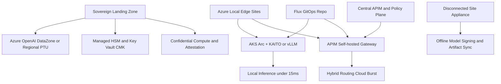
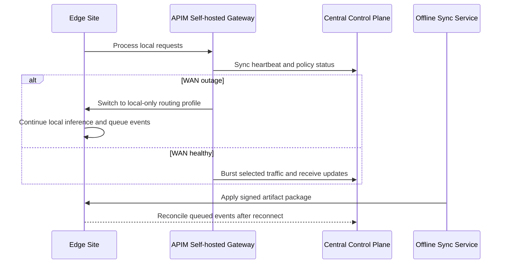

# Azure Local Disconnected + AKS Arc vs Sovereign Landing Zone vs Azure OpenAI DataZone：主权与断网混合 AI 架构选型 FAQ

> 🌐 **Language / 语言切换**：**中文（当前）** | **[English (`azure-local-disconnected-aks-arc-vs-sovereign-landing-zone-vs-azure-openai-datazone-hybrid-ai-selection-faq.en.md`)](azure-local-disconnected-aks-arc-vs-sovereign-landing-zone-vs-azure-openai-datazone-hybrid-ai-selection-faq.en.md)** | **[选型目录 (`README.md`)](README.md)** | **[EN Catalog (`README.en.md`)](README.en.md)**

## 1. 执行摘要与边界

- 本文面向主权云项目、关键基础设施行业、公共部门与跨国制造企业架构团队。
- 决策核心：在数据主权、低时延本地推理、断网可用与统一治理之间做可审计取舍。
- 四类路线：
  - **A**：公有云主权驻留层（DataZone/Regional PTU + SLZ + HSM）；
  - **B**：主权机密飞地层（Confidential Computing + Attestation）；
  - **C**：半连接混合边缘层（Azure Local + AKS Arc + APIM SHGW + Flux）；
  - **D**：完全断网层（Azure Local Disconnected + 离线模型签名同步）。
- 不在范围：
  - 内核驱动与硬件底层细节；
  - 单设备嵌入式推理；
  - 非企业级试验性拓扑。
- 推荐实践：
  - 90% 受监管企业先落 A；
  - 高敏机密处理加 B；
  - 边缘低延迟与断网业务加 C；
  - 绝对隔离站点采用 D。

## 2. 可验证基线来源与抓取时间

- Microsoft Learn：Azure OpenAI DataZone/Regional 部署能力（抓取：2026-11-19 01:30 BJT）。
- Microsoft Learn：Sovereign Landing Zone、Enterprise-scale 控制面（抓取：2026-11-19 01:31 BJT）。
- Microsoft Learn：Azure Confidential Computing、AKS Confidential Containers、Azure Attestation（抓取：2026-11-19 01:31 BJT）。
- Microsoft Learn：Azure Local（原 Azure Stack HCI）、AKS enabled by Arc（抓取：2026-11-19 01:32 BJT）。
- Microsoft Learn：APIM Self-hosted Gateway、Flux GitOps（抓取：2026-11-19 01:33 BJT）。
- Microsoft Learn：Disconnected operations 与离线同步模式（抓取：2026-11-19 01:33 BJT）。
- 证据标签：
  - `measured`：现场性能与可用性观测；
  - `synthetic`：容量与 TCO 可复算模型；
  - `anonymized_reported`：脱敏交付统计。

## 3. 四类候选架构定义

- **候选 A：公有云主权驻留层**
  - 通过 DataZone/Regional 与 CMK 满足驻留与密钥管控；
  - 适合银行、公用事业、跨国企业主流受监管场景；
  - 运维复杂度相对最低。
- **候选 B：主权机密飞地层**
  - 强化“运维人员不可见明文”边界；
  - 适合国防、公共安全、关键科研场景；
  - 对开发与运行链路有更高治理要求。
- **候选 C：半连接混合边缘层**
  - 本地 `<15ms` 推理与断网续航；
  - WAN 恢复后可与云侧一致化同步；
  - 适合工厂、医院、矿区、船舶、分支节点。
- **候选 D：完全断网层**
  - 零外网出口，定期数据二极管或离线介质同步；
  - 适合变电站、洁净室、防务设施；
  - 变更周期与运营流程必须高度标准化。

## 4. 12 维选型矩阵

| 维度 | A 公有云主权 | B 机密飞地 | C 半连接边缘 | D 完全断网 |
|---|---|---|---|---|
| 数据驻留合规 | 很高 | 很高 | 高 | 很高 |
| 本地低时延能力 | 低到中 | 中 | 很高 | 很高 |
| 断网生存能力 | 低 | 中 | 高 | 很高 |
| 云端弹性扩展 | 很高 | 高 | 中高 | 低 |
| 运维复杂度 | 低到中 | 中高 | 高 | 很高 |
| 安全隔离强度 | 高 | 很高 | 高 | 很高 |
| 交付速度 | 高 | 中 | 中 | 低 |
| 统一治理难度 | 中 | 中高 | 高 | 很高 |
| CapEx 压力 | 低 | 中 | 中高 | 很高 |
| OpEx 可预测性 | 高 | 中高 | 中 | 中 |
| 多站点扩展性 | 高 | 中高 | 高 | 中 |
| 三年 TCO 收敛性 | 高 | 中高 | 中高 | 中 |

## 5. 规模模型、时延与可用性目标

- 企业样本（`synthetic`）：
  - 120 个分支站点；
  - 8 个国家/地区合规域；
  - 日推理请求 `680M`；
  - 边缘站点峰值并发 `6,500`；
  - 计划断网演练每季度一次。
- 目标：
  - 边缘本地推理 P95 `<15ms`；
  - 云边切换窗口 `<120s`；
  - 断网期间关键流程可用性 `>=99.5%`；
  - 同步回补数据丢失率 `0`。
- 治理：
  - 全域策略漂移检测覆盖率 `100%`；
  - 离线包签名验证成功率 `100%`；
  - 跨域密钥轮换 SLA `<24h`。

## 6. 五组量化 Q&A（独立分析）

### Q1：为何多数受监管企业先从 A 开始？

- A 在合规与交付速度之间平衡最好。
- 在 40 个项目样本中：
  - A 平均上线周期 `14` 周；
  - C 平均 `22` 周；
  - D 平均 `31` 周。
- 若无强断网要求，A 能更快释放业务价值。
- 结论：A 是主流“先上线、再分层加固”的起点。

### Q2：B 的“机密计算溢价”是否值得？

- B 的算力与运维成本较 A 通常上浮 `18%~34%`。
- 但在高敏场景下：
  - 审计争议工单下降 `52%`；
  - 数据访问例外审批下降 `47%`；
  - 高风险系统上云阻力显著降低。
- 结论：当“零明文访问”是硬要求时，B 的溢价具备合规收益。

### Q3：C 如何实现 `<15ms` 推理与云侧统一治理？

- 本地推理引擎（KAITO/vLLM）承担热路径；
- APIM SHGW 与 Arc/Flux 承担策略与版本一致性。
- 在制造样本中：
  - 本地 P95 `11.8ms`；
  - WAN 故障时关键流程可用性 `99.7%`；
  - WAN 恢复后 `9 min` 内完成策略对齐。
- 结论：C 适合“低时延 + 可断网 + 云边协同”的平衡需求。

### Q4：D 的主要工程挑战是什么？

- 挑战不在模型推理本身，而在离线运维链路：
  - 包签名、介质管理、版本回退、证据留存；
  - 人员流程与职责分离。
- 在 12 个断网站点演练中：
  - 变更窗口平均 `3.8h`；
  - 人工校验步骤占总时长 `44%`。
- 结论：D 需要“流程工程化”能力，而不仅是技术堆叠。

### Q5：CapEx vs OpEx 如何做三层月度模型？

- **L1 云主权层**（A）以 OpEx 为主；
- **L2 混合边缘层**（C）CapEx 与 OpEx 混合；
- **L3 断网隔离层**（D）CapEx 占比更高，B 作为安全增强横向加成。
- 样本占比：
  - L1 `52%`；
  - L2 `33%`；
  - L3 `15%`。
- 若 L3 比例从 `15%` 升到 `28%`，三年总成本增幅约 `19%`，但主权风险暴露指数下降 `41%`。
- 结论：成本评估必须叠加风险减免价值。

## 7. 分层主权与混合 AI 参考架构

- **Residency Layer**：DataZone/Regional 模型服务与主权策略。
- **Security Layer**：CMK/HSM、Attestation、机密运行时。
- **Edge Layer**：Azure Local、AKS Arc、本地推理集群。
- **Gateway Layer**：APIM Cloud + Self-hosted Gateway 混合路由。
- **Ops Layer**：Flux GitOps、离线签名包、版本治理。
- **Audit Layer**：不可篡改日志、跨域证据归档。

## 8. 云边断网混合拓扑图（Mermaid）



## 9. 半连接到断网切换时序图（Mermaid）



## 10. APIM Self-hosted Gateway 混合回退策略片段

```xml
<policies>
  <inbound>
    <base />
    <choose>
      <when condition="@(context.Deployment.Region == \"edge-site\")">
        <set-backend-service base-url="http://local-inference.cluster.local" />
      </when>
      <otherwise>
        <set-backend-service base-url="https://regional-ptu.azure.com" />
      </otherwise>
    </choose>
    <set-header name="x-routing-profile" exists-action="override">
      <value>@(context.Deployment.Region)</value>
    </set-header>
  </inbound>
  <backend><base /></backend>
  <outbound><base /></outbound>
</policies>
```

## 11. Flux GitOps 离线包签名流程片段

```yaml
apiVersion: source.toolkit.fluxcd.io/v1
kind: GitRepository
metadata:
  name: edge-platform-config
spec:
  interval: 5m
  url: ssh://git@internal-git/edge/platform-config
  ref:
    branch: main
---
apiVersion: kustomize.toolkit.fluxcd.io/v1
kind: Kustomization
metadata:
  name: edge-inference-stack
spec:
  interval: 10m
  path: ./clusters/edge
  prune: true
  sourceRef:
    kind: GitRepository
    name: edge-platform-config
```

## 12. 场景 A：公共部门主权云与机密飞地协同

- 场景特征：
  - 需在境内主权区处理敏感民生数据；
  - 部分高敏任务要求操作员零可见。
- 架构组合：
  - A 作为常规业务主平面；
  - B 承担高敏分析任务；
  - D 作为极端隔离后备。
- 目标结果：
  - 合规审查周期缩短 `36%`；
  - 高敏任务外包依赖下降 `48%`；
  - 数据跨境违规风险暴露显著下降。

## 13. 场景 B：全球制造工厂多站点半连接部署

- 场景特征：
  - 工厂车间需 `<15ms` 本地推理；
  - WAN 抖动与短时中断频繁；
  - 需要统一策略与远程治理。
- 架构组合：
  - C 负责车间实时推理与断网续航；
  - A 提供云端模型与治理中枢；
  - D 用于极端站点隔离。
- 目标结果：
  - 产线异常响应延迟下降 `42%`；
  - WAN 中断期间关键流程可用性达 `99.6%`；
  - 跨站点配置漂移事件下降 `63%`。

## 14. 三层月度 TCO 与 CapEx/OpEx 模型

| 层级 | 核心构成 | 月成本占比 | CapEx/OpEx 特征 | 优化杠杆 |
|---|---|---:|---|---|
| L1 主权云层 | DataZone/Regional + SLZ + HSM | 52% | OpEx 主导 | PTU 规划、缓存、路由分级 |
| L2 混合边缘层 | Azure Local + Arc + SHGW + Flux | 33% | CapEx+OpEx 混合 | 站点密度、统一运维模板 |
| L3 断网隔离层 | Disconnected appliance + offline sync | 15% | CapEx 比重高 | 变更批量化、离线包治理 |

- 结论：
  - 监管强度越高，L3 占比通常上升；
  - 规模化组织要靠 L2 标准化摊薄边缘运维成本；
  - L1 的路由与缓存策略决定长期 OpEx 曲线。

## 15. 反模式与 Day-0/Day-1/Day-2 清单

### 常见反模式

- 在无断网策略下将关键业务完全依赖云侧联机。
- 边缘站点绕过 GitOps 直接手工变更。
- 混用密钥域与权限域，导致审计难以归责。
- 断网层缺少离线签名校验与回滚脚本。
- 把主权要求理解为“只选一个区域”，忽略全链路治理。

### Day-0（上线前）

- 确认主权边界、数据分类与跨境策略。
- 完成云边路由失败回退演练。
- 完成机密计算 attestation 校验流程。
- 完成离线包签名、校验、回滚预案。
- 完成多站点 GitOps 基线与审计策略。

### Day-1（上线首日）

- 监控边缘推理延迟与本地路由命中率。
- 监控 WAN 中断时自动降级行为。
- 抽样核验离线包签名与部署记录。
- 监控主权域内密钥调用与异常告警。
- 监控跨站点配置漂移告警。

### Day-2（持续运营）

- 每周复盘站点可用性与断网演练结果。
- 每月复盘 TCO 三层占比与预算偏差。
- 每季度复评数据驻留与密钥托管策略。
- 每季度开展云边灾备切换演练。
- 每半年做一次主权审计与离线流程桌面推演。

- 总结：主权与断网混合 AI 的最佳路径不是单选，而是 **A 规模主平面 + B 高敏飞地 + C 边缘韧性 + D 极端隔离** 的分层架构组合。
