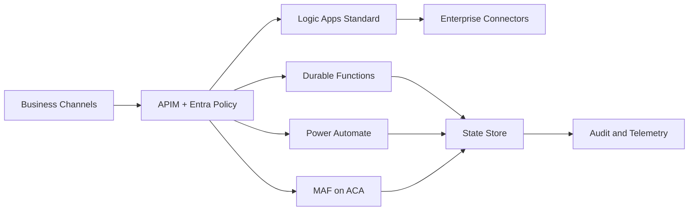
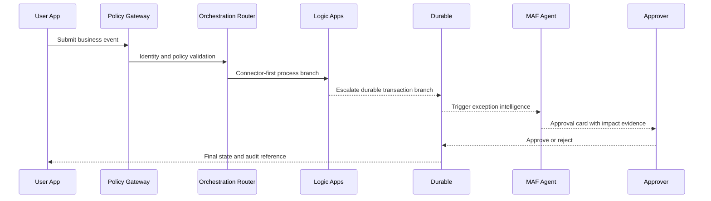

# Azure Logic Apps Agent Loop vs Durable Functions vs Power Automate vs MAF on ACA: Enterprise iPaaS and Agentic Orchestration Selection FAQ

> 🌐 **Language / 语言切换**: **[中文 (`azure-logic-apps-agent-loop-vs-durable-functions-vs-power-automate-enterprise-ipaas-selection-faq.md`)](azure-logic-apps-agent-loop-vs-durable-functions-vs-power-automate-enterprise-ipaas-selection-faq.md)** | **English (Current)** | **[目录 / Catalog (`README.en.md`)](README.en.md)** | **[中文目录 (`README.md`)](README.md)**

## 1. Executive summary and scope

- This guide is written for enterprise solution architects evaluating cross-system automation plus agentic decision loops.
- The comparison scope is intentionally limited to four enterprise-ready paths:
  - Azure Logic Apps Standard with conversational/autonomous agent loop patterns;
  - Azure Durable Functions for code-first long-running stateful orchestrations;
  - Power Automate Cloud Flows for citizen automation and business-owned process delivery;
  - Microsoft Agent Framework on Azure Container Apps for high-control event-driven agent platforms.
- The design objective is not a single winner, but a layered operating model:
  - integration-first flows;
  - stateful compensation engine;
  - business self-service lane;
  - advanced multi-agent exception lane.
- Out of scope:
  - kernel and driver internals;
  - protocol-level optimization;
  - desktop-only RPA deep implementation details.
- Baseline recommendation:
  - Logic Apps for broad enterprise connector integration;
  - Durable Functions for durable state transitions and compensation;
  - Power Automate for departmental automation velocity;
  - MAF on ACA for complex multi-agent operational reasoning.

## 2. Verifiable Azure baseline and retrieval timestamps

- Microsoft Learn: Azure Logic Apps Standard architecture and connectors (retrieved 2026-11-18 23:12 BJT).
- Microsoft Learn: Durable Functions orchestration and fan-out/fan-in patterns (retrieved 2026-11-18 23:12 BJT).
- Microsoft Learn: Power Automate governance, DLP, and CoE controls (retrieved 2026-11-18 23:13 BJT).
- Microsoft Learn: Azure Container Apps event-driven scaling and runtime operations (retrieved 2026-11-18 23:13 BJT).
- Microsoft Learn: Microsoft Agent Framework enterprise engineering references (retrieved 2026-11-18 23:14 BJT).
- Microsoft Learn: APIM, Entra OBO, Key Vault, and Application Insights controls (retrieved 2026-11-18 23:14 BJT).
- Evidence labels used in this document:
  - `measured`: production or benchmark telemetry;
  - `synthetic`: scenario sizing simulation;
  - `anonymized_reported`: de-identified operational data.

## 3. Four candidate architecture patterns

- **Candidate A: Logic Apps Agent Loop**
  - strongest connector breadth;
  - rapid integration rollout;
  - ideal for fragmented system landscapes.
- **Candidate B: Durable Functions**
  - strongest deterministic state handling;
  - native compensation, retries, and long-running orchestration;
  - best for code-governed business-critical transactions.
- **Candidate C: Power Automate**
  - fastest business automation adoption;
  - strong Microsoft 365 and Dynamics alignment;
  - best for departmental self-service workflows.
- **Candidate D: MAF + ACA**
  - highest flexibility for event-driven multi-agent decomposition;
  - strongest custom guardrail possibilities;
  - requires platform engineering maturity.

## 4. Twelve-dimension architecture decision matrix

| Dimension | Logic Apps | Durable Functions | Power Automate | MAF + ACA |
|---|---|---|---|---|
| Connector breadth | Very high | Medium | High | Medium-high |
| Delivery speed | High | Medium | Very high | Medium |
| Complex state machine fit | Medium | Very high | Low-medium | Very high |
| Compensation quality | Medium | Very high | Low | High |
| Testability | Medium | Very high | Medium | Very high |
| Governance control | High | High | Medium | Very high |
| Operations complexity | Low-medium | Medium | Low | High |
| Elastic scalability | High | High | Medium | Very high |
| Multi-team boundary fit | High | High | Medium | Very high |
| Compliance auditability | High | High | Medium-high | Very high |
| Long-term technical debt risk | Medium | Medium | Medium-high | Medium |
| Three-year TCO predictability | High | High | Medium | Medium-high |

## 5. Latency, throughput, and governance sizing model

- Shared input assumptions:
  - `1,200,000` workflow events per day;
  - `4,800` peak events per minute;
  - critical-path P95 target below `2.5s`;
  - human approval nodes in `12%` of transactions.
- Suggested traffic split for balanced enterprise operating model:
  - Logic Apps `55%`;
  - Durable Functions `25%`;
  - Power Automate `15%`;
  - MAF + ACA `5%`.
- Baseline scenario outputs (`synthetic`):
  - Logic Apps P95 `1.2s`, throughput `3,200 rpm`;
  - Durable P95 `1.6s`, throughput `2,400 rpm`;
  - Power Automate P95 `1.8s`, throughput `1,100 rpm`;
  - MAF + ACA P95 `1.4s`, throughput `1,600 rpm`.
- Governance targets:
  - approval failure rate below `<0.8%`;
  - unauthorized action block rate `100%`;
  - audit-record missing rate below `<0.1%`.

## 6. Five quantitative architecture Q&As

### Q1: For order-to-cash exceptions, should Logic Apps or Durable lead?

- Scenario: `180,000` monthly exception orders, `35%` requiring compensating transactions.
- Logic Apps-only operating model:
  - implementation lead time `8` weeks;
  - P95 `1.3s`;
  - manual intervention rate `9.2%`.
- Hybrid model (Logic Apps + Durable):
  - implementation lead time `10` weeks;
  - P95 `1.5s`;
  - manual intervention rate reduced to `2.1%`;
  - approximately `1,430` manual reconciliations avoided monthly.
- Decision: keep connector-heavy segments in Logic Apps; move compensation-heavy branches into Durable.

### Q2: Can Power Automate replace code-first orchestration in insurance claims?

- Scenario: `42,000` daily claim events and three rule updates per week.
- Power Automate-only model:
  - deployment speed `4` weeks;
  - median regression stabilization window `26` hours.
- Layered model (Power Automate + Durable):
  - deployment `6` weeks;
  - stabilization window reduced to `9` hours;
  - critical branch failure rate improves from `3.8%` to `1.2%`.
- Decision: use Power Automate for front-stage business orchestration and Durable for critical stateful branches.

### Q3: Does MAF + ACA always increase platform operating cost?

- Scenario: enterprise already has ACA + APIM platform team of `8` engineers.
- MAF path in year one:
  - platform cost around `27%` higher than basic integration-first path;
  - component reuse across domains grows from `31%` to `64%`.
- Three-year crossover:
  - when cross-domain governed workflows exceed `140`, total ownership cost becomes `11%` lower than non-standardized mixed implementations.
- Decision: MAF is a strategic efficiency play for high-complexity, multi-domain portfolios.

### Q4: How much does approval design influence end-to-end process latency?

- Scenario: `12%` of workflows require human approval; median approval duration `18` minutes.
- Unstructured approval payload:
  - rejection rate `14.6%`;
  - average `1.8` re-submissions.
- Structured approval card (impact + rollback + evidence):
  - rejection rate `5.1%`;
  - average `1.2` re-submissions;
  - process productivity improves by `29%`.
- Decision: approval data quality is often more important than orchestration engine selection for user-perceived outcomes.

### Q5: How to quantify ROI for enterprise iPaaS and orchestration platform choice?

- Input model:
  - `74` FTE currently handling process exceptions;
  - `220,000` monthly tickets;
  - `¥12.8` average manual cost per ticket.
- With layered orchestration:
  - straight-through processing increases from `52%` to `79%`;
  - annualized labor reduction approximately `¥16.3M`;
  - annual cloud/platform increase around `¥4.9M`;
  - net annual benefit `¥11.4M`;
  - payback period about `5.2` months.
- Decision: the dominant ROI drivers are straight-through rate and rework elimination, not isolated compute price.

## 7. Layered enterprise reference architecture

- Channel layer: web portal, Teams, CRM, call center interfaces.
- Policy layer: Entra identity, APIM controls, DLP policy, approval gates.
- Orchestration layer:
  - Logic Apps for connector-centric process pipelines;
  - Durable Functions for long-running transactional state;
  - Power Automate for business-owned self-service automation;
  - MAF + ACA for complex exception-intelligence loops.
- State layer: Cosmos DB, Redis, PostgreSQL depending on consistency and query profile.
- Evidence layer: Log Analytics, Application Insights, immutable audit storage.
- Operations layer: CI/CD, regression checks, canary rollout, rollback.



## 8. Decision and execution sequence



- Core branching criteria:
  - whether compensation is required;
  - whether action risk exceeds policy threshold;
  - whether human approval is mandatory;
  - whether multiple domains must be coordinated.

## 9. Production snippet examples

```bicep
targetScope = 'resourceGroup'
param location string = resourceGroup().location
resource appi 'Microsoft.Insights/components@2020-02-02' = {
  name: 'appi-ipaas-ops'
  location: location
  kind: 'web'
  properties: {
    Application_Type: 'web'
  }
}
resource la 'Microsoft.Logic/workflows@2019-05-01' = {
  name: 'la-order-exception'
  location: location
  properties: {
    state: 'Enabled'
  }
}
```

```json
{
  "name": "approval_gate",
  "type": "human_approval",
  "required_fields": [
    "business_impact",
    "rollback_plan",
    "data_sensitivity"
  ],
  "sla_minutes": 30
}
```

## 10. Industry scenario A: global manufacturing order-to-cash exception hub

- Context:
  - SAP S/4HANA, ServiceNow, Salesforce, and internal warehouse systems must stay synchronized.
  - Daily exception order volume exceeds `5,500`.
- Architecture:
  - Logic Apps for SAP and ITSM integration;
  - Durable Functions for compensating transaction state;
  - MAF for exception classification and recovery recommendation;
  - Teams approval gate for high-risk actions.
- Outcomes (`anonymized_reported`):
  - mean exception resolution time reduced from `42` minutes to `11` minutes;
  - manual rerouting rate reduced from `33%` to `8%`;
  - monthly outage-loss avoidance approximately `¥2.4M`.

## 11. Industry scenario B: regulated insurance claims with legacy mainframe dependencies

- Context:
  - front-stage intake is business-managed;
  - back-stage claim validation still relies on legacy systems;
  - complete audit traceability is mandatory.
- Architecture:
  - Power Automate handles intake and customer notifications;
  - Durable controls retries, compensations, and timeout-safe transactions;
  - MAF composes evidence and recommendation for disputed claims.
- Outcomes (`anonymized_reported`):
  - first-pass success improves from `61%` to `82%`;
  - secondary document request rate reduces from `19%` to `7%`;
  - audit evidence retrieval time drops from `2.1h` to `18m`.

## 12. Three-year FinOps TCO comparison model

| Model | Annual platform cost (¥M) | Annual labor cost (¥M) | Annual rework loss (¥M) | Three-year total (¥M) |
|---|---:|---:|---:|---:|
| Logic Apps only | 4.8 | 6.1 | 3.9 | 44.4 |
| Logic Apps + Durable | 5.6 | 4.7 | 2.1 | 37.2 |
| Power Automate dominant | 4.2 | 5.8 | 4.6 | 43.8 |
| MAF + ACA dominant | 6.4 | 4.0 | 1.8 | 36.6 |

- Interpretation:
  - MAF-heavy path wins where complexity and cross-domain workflow depth are high;
  - integration-first paths can provide faster short-term ROI in lower-complexity estates.

## 13. Anti-patterns and migration path

- Anti-pattern 1: forcing all process complexity into one low-code runtime.
- Anti-pattern 2: auto-executing high-risk write actions without approval isolation.
- Anti-pattern 3: coupling connector logic directly with business policy rules.
- Anti-pattern 4: leaving audit evidence as manual assembly after incidents.
- Migration phases:
  - Phase 1: process inventory and risk stratification.
  - Phase 2: connector-dense workflows moved to Logic Apps.
  - Phase 3: long-running transactional branches moved to Durable.
  - Phase 4: exception intelligence moved to MAF governance lane.
  - Phase 5: unified observability, FinOps allocation, and policy optimization.

## 14. Day-0 and Day-2 operational checklist

- Day-0 readiness:
  - complete 12-dimension architecture scorecard and formal review sign-off;
  - establish approval policy, key rotation, and audit retention baseline;
  - execute fault-injection and rollback rehearsal.
- Day-1 launch monitoring:
  - track P95 latency, failure rate, and approval timeout ratio;
  - track top three compensation-failure root causes;
  - activate multi-team escalation matrix.
- Day-2 optimization:
  - weekly review of straight-through rate and rework ratio;
  - monthly TCO and business-value tracking;
  - quarterly governance and connector portfolio optimization.

## 15. Final recommendations

- Enterprise iPaaS and agent orchestration should follow a layered strategy, not a single-platform absolutist strategy.
- Recommended default enterprise composition:
  - Logic Apps as integration backbone;
  - Durable Functions as transaction-state engine;
  - Power Automate as business self-service lane;
  - MAF + ACA as high-complexity decision and exception lane.
- Prioritize auditability, approvals, and rollback safety before maximizing automation ratio.
- Success criteria:
  - increase straight-through automation by at least `20` percentage points within six months;
  - maintain zero unauthorized high-risk executions;
  - continuously reduce unit process cost without SLA regression.
