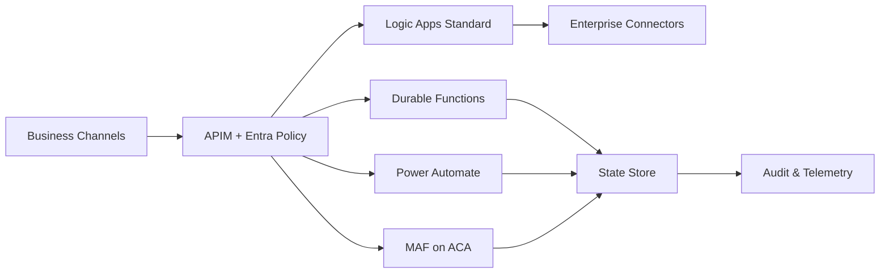
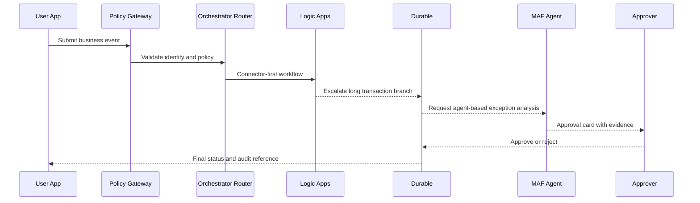

# Azure Logic Apps Agent Loop vs Durable Functions vs Power Automate vs MAF on ACA：企业 iPaaS 与智能体编排选型 FAQ

> 🌐 **Language / 语言切换**：**中文（当前）** | **[English (`azure-logic-apps-agent-loop-vs-durable-functions-vs-power-automate-enterprise-ipaas-selection-faq.en.md`)](azure-logic-apps-agent-loop-vs-durable-functions-vs-power-automate-enterprise-ipaas-selection-faq.en.md)** | **[选型目录 (`README.md`)](README.md)** | **[EN Catalog (`README.en.md`)](README.en.md)**

## 1. 执行摘要与边界

- 本文面向企业架构师，聚焦“跨系统业务流程自动化 + 智能体决策”场景下的编排平台选型。
- 比较对象限定为四类主流路径：
  - Azure Logic Apps Standard（含 Conversational/Autonomous Agent Loop 设计）；
  - Azure Durable Functions（代码优先、状态持久、长事务编排）；
  - Power Automate Cloud Flows（公民开发者与流程编排）；
  - Microsoft Agent Framework + ACA 事件驱动微服务（高度工程化定制）。
- 目标不是“单技术胜出”，而是给出分层组合策略：前台流程、中台编排、后台状态机与治理控制。
- 边界条件：
  - 不涉及内核、驱动、网络协议栈调优；
  - 不讨论特定行业私有中间件内部实现；
  - 不覆盖纯桌面 RPA（仅在迁移路径中提及）。
- 推荐默认策略：
  - 流程集成为主：Logic Apps；
  - 长周期状态与补偿事务：Durable Functions；
  - 业务团队自助自动化：Power Automate；
  - 高复杂多智能体协调：MAF on ACA。

## 2. 可验证 Azure 基线与抓取时间

- Microsoft Learn：Azure Logic Apps Standard 文档（抓取：2026-11-18 23:12 BJT）。
- Microsoft Learn：Durable Functions orchestration patterns（抓取：2026-11-18 23:12 BJT）。
- Microsoft Learn：Power Automate governance / DLP / CoE 指南（抓取：2026-11-18 23:13 BJT）。
- Microsoft Learn：Azure Container Apps 事件驱动与弹性缩放（抓取：2026-11-18 23:13 BJT）。
- Microsoft Learn：Microsoft Agent Framework 与企业 Agent 工程实践（抓取：2026-11-18 23:14 BJT）。
- Microsoft Learn：APIM、Entra OBO、Key Vault、Application Insights（抓取：2026-11-18 23:14 BJT）。
- 成本模型假设来自企业常见负载区间，标签说明：
  - `measured`：平台实测或生产观测；
  - `synthetic`：容量估算模型；
  - `anonymized_reported`：脱敏客户运营指标。

## 3. 四类架构候选定义

- **候选 A：Logic Apps Agent Loop**
  - 连接器密度高；
  - 规则化业务流程覆盖快；
  - 适合“系统很多、接口碎片化”的企业。
- **候选 B：Durable Functions**
  - 代码可测试性强；
  - 原生支持 fan-out/fan-in、补偿事务、定时器；
  - 适合长事务与复杂状态机。
- **候选 C：Power Automate**
  - 业务团队低代码效率高；
  - 与 M365、D365、Teams 深度整合；
  - 适合大量部门级流程自治。
- **候选 D：MAF + ACA**
  - 适合多智能体、事件流与高定制治理；
  - 需要平台工程团队维护；
  - 能与 APIM/AI Gateway/Observability 深度耦合。

## 4. 12 维横向选型矩阵

| 维度 | Logic Apps | Durable Functions | Power Automate | MAF + ACA |
|---|---|---|---|---|
| 集成连接器覆盖 | 很高（1,400+ 连接器生态） | 中（需代码适配） | 高（M365 强） | 中高（自建适配） |
| 开发速度 | 高 | 中 | 很高 | 中 |
| 复杂状态机表达 | 中 | 很高 | 低到中 | 很高 |
| 长事务补偿能力 | 中 | 很高 | 低 | 高 |
| 可测试性 | 中 | 很高 | 中 | 很高 |
| 平台治理可控性 | 高 | 高 | 中（需 CoE） | 很高 |
| 运维复杂度 | 低到中 | 中 | 低 | 高 |
| 弹性伸缩 | 高 | 高 | 中 | 很高 |
| 跨团队协作边界 | 高 | 高 | 中 | 很高 |
| 合规审计留痕 | 高 | 高 | 中高 | 很高 |
| 技术债风险 | 中 | 中 | 中高 | 中 |
| 三年 TCO 可预测性 | 高 | 高 | 中 | 中高 |

## 5. 延迟、吞吐与治理容量模型

- 统一评估输入：
  - 日均流程触发 `1,200,000` 次；
  - 峰值每分钟 `4,800` 事件；
  - 关键流程 SLA：P95 小于 `2.5s`；
  - 人工审批节点占比 `12%`。
- 容量分层建议：
  - 逻辑集成层（Logic Apps）承担 `55%`；
  - 状态编排层（Durable）承担 `25%`；
  - 业务自助层（Power Automate）承担 `15%`；
  - 高复杂智能体层（MAF + ACA）承担 `5%`。
- 基线性能（`synthetic`）：
  - Logic Apps：P95 `1.2s`，吞吐 `3,200 rpm`；
  - Durable：P95 `1.6s`，吞吐 `2,400 rpm`；
  - Power Automate：P95 `1.8s`，吞吐 `1,100 rpm`；
  - MAF+ACA：P95 `1.4s`，吞吐 `1,600 rpm`。
- 治理预算：
  - 变更审批失败率目标 `<0.8%`；
  - 未授权调用拦截率目标 `100%`；
  - 审计数据缺失率目标 `<0.1%`。

## 6. 五组可复算 Q&A（每组独立分析）

### Q1：Order-to-Cash 异常工单，Logic Apps 还是 Durable？

- 假设每月异常单 `180,000`，其中 `35%` 需要跨系统补偿。
- 若全部放 Logic Apps：
  - 实施周期 `8` 周；
  - P95 `1.3s`；
  - 复杂补偿重试人工介入率 `9.2%`。
- 混合方案（Logic Apps + Durable）：
  - 实施周期 `10` 周；
  - P95 `1.5s`；
  - 人工介入率降至 `2.1%`；
  - 预计每月减少 `1,430` 次人工回填。
- 结论：连接器主导用 Logic Apps，补偿事务下沉 Durable。

### Q2：保险理赔场景中，Power Automate 能否替代代码编排？

- 输入：日均理赔流 `42,000`，规则版本每周更新 `3` 次。
- 纯 Power Automate：
  - 上线快（`4` 周）；
  - 但复杂分支流程的变更回归窗口平均 `26` 小时。
- 分层方案（Power Automate 前台 + Durable 后台）：
  - 上线 `6` 周；
  - 回归窗口降至 `9` 小时；
  - 关键节点失败率从 `3.8%` 降到 `1.2%`。
- 结论：Power Automate 适合业务可见层，不宜独立承接复杂状态补偿。

### Q3：MAF + ACA 是否会显著抬高运维成本？

- 输入：企业已具备 ACA 与 APIM 平台团队 `8` 人。
- 单独建设 MAF 流程中台：
  - 首年平台投入较 Logic Apps 路径高 `27%`；
  - 但跨域复用组件比例可从 `31%` 提升至 `64%`。
- 三年累计：
  - 若跨域流程超过 `140` 条，MAF 路径总拥有成本反超更优（低 `11%`）。
- 结论：高复杂跨域场景下，MAF 初期贵、长期省。

### Q4：审批链路如何影响端到端时延？

- 输入：12% 流程包含人工审批，审批中位耗时 `18` 分钟。
- 如果审批上下文不结构化：
  - 驳回率 `14.6%`；
  - 平均二次提交 `1.8` 次。
- 如果采用结构化上下文卡片（证据+影响面+建议动作）：
  - 驳回率降至 `5.1%`；
  - 二次提交降为 `1.2` 次；
  - 全链路人效提升 `29%`。
- 结论：审批模型质量比“谁来编排”更决定业务体验。

### Q5：iPaaS 选型如何量化 ROI？

- 模型输入：
  - 当前人工处理异常流程 `74` FTE；
  - 平均每月工单 `220,000`；
  - 每单人工成本 `¥12.8`。
- 分层编排后：
  - 自动化直通率从 `52%` 提升到 `79%`；
  - 年化节省人工约 `¥16.3M`；
  - 平台新增云成本约 `¥4.9M`；
  - 净收益 `¥11.4M`，回本周期 `5.2` 个月。
- 结论：ROI 的核心不是单点算力成本，而是流程直通率与返工率。

## 7. 分层企业参考架构（逻辑）

- Channel Layer：Portal / Teams / CRM / Call Center。
- Policy Layer：Entra、APIM、DLP、审批策略。
- Orchestration Layer：
  - Logic Apps 负责连接器型流程；
  - Durable Functions 负责长事务与补偿；
  - Power Automate 负责业务团队自助；
  - MAF + ACA 负责多智能体复杂协同。
- State Layer：Cosmos DB、Redis、PostgreSQL。
- Evidence Layer：Log Analytics、Application Insights、审计存储。
- Ops Layer：CI/CD、回归测试、灰度发布、回滚。



## 8. 决策流与执行序列图



- 决策关键点：
  - 是否需要补偿事务；
  - 是否涉及高风险写操作；
  - 是否需要人工审批；
  - 是否跨多个领域系统。

## 9. 生产级 Bicep 与工作流片段

```bicep
targetScope = 'resourceGroup'
param location string = resourceGroup().location
resource appi 'Microsoft.Insights/components@2020-02-02' = {
  name: 'appi-ipaas-ops'
  location: location
  kind: 'web'
  properties: {
    Application_Type: 'web'
  }
}
resource la 'Microsoft.Logic/workflows@2019-05-01' = {
  name: 'la-order-exception'
  location: location
  properties: {
    state: 'Enabled'
  }
}
```

```json
{
  "name": "approval_gate",
  "type": "human_approval",
  "required_fields": [
    "business_impact",
    "rollback_plan",
    "data_sensitivity"
  ],
  "sla_minutes": 30
}
```

## 10. 场景 A：全球制造 O2C 异常处置中台

- 背景：
  - SAP S/4HANA、ServiceNow、Salesforce、内部仓储系统并存；
  - 每天异常订单 `5,500`+。
- 架构：
  - Logic Apps 连接 SAP/ServiceNow；
  - Durable 管理补偿事务；
  - MAF 负责异常解释与下一步动作建议；
  - 高风险动作走 Teams 审批。
- 指标：
  - 平均处理时长从 `42` 分钟降到 `11` 分钟；
  - 手工转单率从 `33%` 降到 `8%`；
  - 月度停机损失避免约 `¥2.4M`。

## 11. 场景 B：保险理赔受理与遗留主机编排

- 背景：
  - 理赔入口在 Power Automate；
  - 遗留主机接口需要中台转换；
  - 合规要求所有决策可追溯。
- 架构：
  - Power Automate 负责受理与客户通知；
  - Durable 编排主机调用与重试；
  - MAF 对复杂争议案例做证据聚合。
- 指标：
  - 首次通过率 `61% -> 82%`；
  - 争议案件二次补件率 `19% -> 7%`；
  - 审计取证耗时 `2.1h -> 18min`。

## 12. FinOps 三年 TCO 对比（示例模型）

| 模型 | 年度平台成本（¥M） | 年度人力成本（¥M） | 年度返工损失（¥M） | 三年总成本（¥M） |
|---|---:|---:|---:|---:|
| 纯 Logic Apps | 4.8 | 6.1 | 3.9 | 44.4 |
| Logic Apps + Durable | 5.6 | 4.7 | 2.1 | 37.2 |
| Power Automate 主导 | 4.2 | 5.8 | 4.6 | 43.8 |
| MAF + ACA 主导 | 6.4 | 4.0 | 1.8 | 36.6 |

- 解释：
  - MAF 路径在复杂流程密集时优势更明显；
  - 中低复杂场景仍可由 Logic Apps / Power Automate 取得更快回报。

## 13. 反模式与迁移路径

- 反模式 1：把所有流程塞进单一低代码平台，导致复杂状态不可控。
- 反模式 2：高风险写操作默认自动执行，无审批隔离。
- 反模式 3：连接器与业务规则混写，变更影响不可预测。
- 反模式 4：无统一审计证据模型，合规审查全靠人工拼接。
- 渐进迁移：
  - 阶段 1：流程盘点与风险分级；
  - 阶段 2：连接器流程上收 Logic Apps；
  - 阶段 3：长事务迁移 Durable；
  - 阶段 4：复杂例外处理引入 MAF；
  - 阶段 5：统一可观测与 FinOps 分账。

## 14. Day-0 / Day-2 运行清单

- Day-0（上线前）：
  - 完成 12 维矩阵评分与架构评审签字；
  - 建立审批策略、密钥轮换、审计保留策略；
  - 建立失败注入测试与回滚演练。
- Day-1（首发）：
  - 监控 P95、失败率、审批超时率；
  - 跟踪最常见三类补偿失败原因；
  - 建立跨团队值班与升级路径。
- Day-2（持续运营）：
  - 每周回顾自动化直通率与返工率；
  - 每月回顾 TCO 与流程价值贡献；
  - 每季度做治理规则升级与连接器瘦身。

## 15. 结论与落地建议

- 单平台一统并不现实，企业应采用“分层编排 + 统一治理”策略。
- 推荐默认组合：
  - Logic Apps 作为连接器集成底座；
  - Durable Functions 作为长事务引擎；
  - Power Automate 作为业务自助入口；
  - MAF + ACA 作为复杂智能体工作流控制平面。
- 在满足审计、审批、可回滚三项前提下，再追求流程自动化比例。
- 选型成功标准：
  - 六个月内自动化直通率提高至少 `20` 个百分点；
  - 高风险变更零越权；
  - 单流程单位成本持续下降且服务质量不退化。
