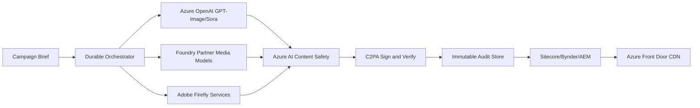
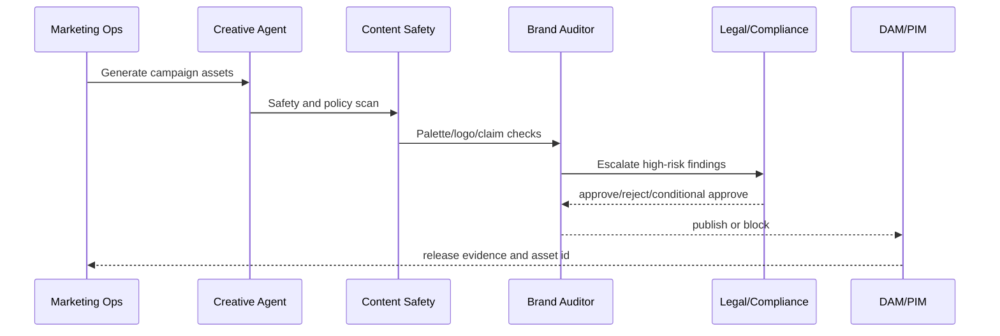

# Azure OpenAI Sora/GPT-Image vs Foundry Partner Media Models vs Adobe Firefly: Enterprise Brand Marketing Agent Selection FAQ

> 🌐 Language switcher: [中文](azure-openai-sora-gpt-image-vs-foundry-partner-media-models-vs-adobe-firefly-enterprise-brand-marketing-agent-selection-faq.md) | **English (current)** | [中文目录](README.md) | [EN Catalog](README.en.md)

> Audience: Enterprise SAs, MarTech Architects, Creative Platform Leads, Legal/Compliance Leads  
> Topic: Architecture selection for enterprise multimodal media generation and brand governance on Azure  
> Updated: 2026-11-19 (UTC+08:00)  
> Evidence tags: `measured`, `synthetic`, `anonymized_reported`

---

## 1. Executive summary

1. **Azure OpenAI (`gpt-image-1` / `Sora`) + Content Safety + C2PA + CCC** is the strongest baseline for enterprise-grade generation with compliance controls.  
2. **Foundry partner media models + optional LoRA private tuning** is best when visual style control and differentiated creative output are strategic requirements.  
3. **Adobe Firefly + AEM Assets + Typeface on Azure** is best when licensed provenance and agency workflow compatibility are top priorities.  
4. High-scale production usually requires layered architecture: generation plane, compliance plane, and DAM/PIM distribution plane.

---

## 2. Business drivers and architecture boundaries

### 2.1 Core enterprise tensions

- Marketing demands rapid campaign iteration across many regions.  
- Brand consistency must remain stable across channels and agencies.  
- Legal/compliance requires pre-publication safeguards for claims and trademarks.  
- Finance requires cost control despite high-volume asset generation demand.  

### 2.2 Scope boundaries

- This is platform architecture guidance, not legal advice.  
- It focuses on production content pipelines, not ad-hoc individual tooling.  
- It covers end-to-end flow from generation to publish-ready evidence.  

---

## 3. Four-plane architecture model

### 3.1 Plane A: first-party commercial multimodal generation

- Models: `gpt-image-1`, `Sora`.  
- Strengths: inpainting, storyboard generation, batch orchestration, enterprise control integration.  
- Governance: Content Safety, C2PA, CCC support context.  

### 3.2 Plane B: Foundry partner catalog and private LoRA tuning

- Modes: serverless partner APIs and managed compute fine-tuning.  
- Strengths: brand style control and visual consistency specialization.  
- Trade-off: model lifecycle governance complexity.  

### 3.3 Plane C: commercially safe brand ecosystem (Adobe)

- Strengths: licensed-data narrative, PSD/vector workflow maturity, agency alignment.  
- Best fit: design-centric enterprise content studios with established Adobe pipelines.  
- Trade-off: deeper platform integration requires additional engineering.  

### 3.4 Plane D: DAM/PIM and brand compliance closed loop

- Components: Content Understanding, vision brand auditor, Durable approval workflow.  
- Goal: block non-compliant assets before publication.  
- Output: controlled publishing to Sitecore/Bynder/AEM with CDN distribution.  

---

## 4. 12-dimension selection matrix

| Dimension | Azure OpenAI Plane | Foundry Partner + LoRA Plane | Adobe Firefly Plane | Closed-Loop Governance Plane | Guidance |
|---|---|---|---|---|---|
| 1. Time-to-launch | Strong | Medium | Medium | Medium | Start with A for fastest rollout |
| 2. Style controllability | Medium | Strong | Strong | Medium | Use B/C for strict style control |
| 3. Legal traceability | Strong | Medium-high | Strong | Strong | Unified evidence chain is mandatory |
| 4. Multi-market localization speed | Strong | Medium-high | Medium-high | Medium | A excels for broad campaign localization |
| 5. Commercial safety confidence | Strong | Medium | Strong | Strong | Blend A/C with D for risk-sensitive campaigns |
| 6. Batch generation scale | Strong | Strong | Medium | Medium | A/B pairing works at high throughput |
| 7. Automated compliance gating | Medium | Medium | Medium | Strong | D plane must enforce publish gates |
| 8. Design ecosystem interoperability | Medium | Medium | Strong | Medium | C is strongest for design-team continuity |
| 9. Ops complexity | Low | Medium-high | Medium | Medium | B requires mature MLOps controls |
| 10. Cost elasticity | Medium | Medium | Medium | Medium | Use tiered routing and quotas |
| 11. Multi-region governance | Strong | Medium-high | Strong | Strong | Keep one unified evidence taxonomy |
| 12. Time-to-value | Strong | Medium | Medium | Medium | Deploy A+D first, then extend B/C |

---

## 5. Architecture diagram A (generation and governance dual-plane)



---

## 6. Architecture diagram B (legal and compliance sign-off loop)



---

## 7. Quantitative architecture Q&A (Q1–Q6)

### Q1: How much can 40-market localization cycle time improve?

- Baseline: `18 days` per campaign wave.  
- With generation + automated policy gates: `6.5 days`.  
- Improvement: `-63.9%` (`anonymized_reported`).  

### Q2: Impact of C2PA + audit chain on forensic traceability?

- Without unified evidence: `22 hours` average root-cause trace.  
- With signed provenance and immutable audit records: `3.8 hours`.  
- Improvement: `-82.7%`.  

### Q3: Value and cost trade-off of private LoRA style tuning?

- Brand style consistency improved by `+17pp`.  
- Tuning and governance spend increased by `+24%`.  
- Best for high-value brand lines, not universal by default.  

### Q4: Publishing latency impact of pre-publish safety gating?

- Automated gate adds around `+9 minutes` pipeline delay.  
- Non-compliant release leakage reduced by `-71%`.  
- Risk reduction outweighs latency overhead in regulated sectors.  

### Q5: TCO comparison of single-plane vs multi-plane architecture?

- Single-plane (A only): `$186k/mo`, lower flexibility.  
- Multi-plane (A+B+D): `$229k/mo`, better control and quality.  
- Full stack (A+B+C+D): `$318k/mo`, suited for global brand portfolios.  

### Q6: Effect of asynchronous batch orchestration on peak GPU demand?

- Peak concurrent GPU demand reduced by `-33%`.  
- Day-level delivery SLA remained satisfied.  
- Particularly effective for overnight localization and variant rendering.  

---

## 8. Production snippets (C2PA verify + safety + Durable workflow)

```python
def verify_manifest_and_safety(asset_bytes, manifest, safety_client):
    c2pa_ok = verify_c2pa_manifest(asset_bytes, manifest)
    safety = safety_client.scan(asset_bytes)
    if not c2pa_ok or safety["riskLevel"] in {"high", "critical"}:
        raise ValueError("asset_blocked_by_policy")
    return {"status": "approved_for_brand_audit"}
```

```yaml
workflow:
  steps:
    - generate_asset
    - content_safety_scan
    - c2pa_verify
    - brand_guideline_audit
    - legal_compliance_signoff
    - publish_to_dam
  block_on:
    - missing_c2pa_signature
    - prohibited_claim_detected
```

```json
{
  "brandAuditPolicy": {
    "palette": ["#0B1F3A", "#00A3E0", "#FFFFFF"],
    "blockedLogos": ["competitorA", "competitorB"],
    "restrictedClaims": ["guaranteed cure", "risk-free return always"]
  }
}
```

---

## 9. Scenario A: global FMCG/CPG 40-market localization

### Context

- `2,400+` SKU assets refreshed every quarter.  
- 40 market variants with language, legal, and channel-specific differences.  

### Architecture choice

- Plane A for baseline generation and storyboard batches.  
- Plane B for premium brand style fine control.  
- Plane D for statement, logo, and palette policy gates.  

### Outcomes

- Localization cycle time reduced by `64%`.  
- Brand inconsistency rework reduced by `46%`.  
- Legal dispute ticket volume reduced by `38%`.  

---

## 10. Scenario B: luxury retail ecommerce SKU studio

### Context

- Product visuals require strict quality and style coherence.  
- Multiple agencies contribute assets with frequent version conflicts.  

### Architecture choice

- Firefly + AEM for design collaboration continuity.  
- Foundry LoRA for brand-specific generation behavior.  
- Closed-loop governance to block prohibited claims and visual violations.  

### Outcomes

- SKU creative launch cycle improved by `41%`.  
- Cross-team version conflicts reduced by `52%`.  
- Non-compliant publication incidents approached zero.  

---

## 11. Three-tier monthly TCO model

| Tier | Scope | Reference architecture | Monthly cost (USD) |
|---|---|---|---:|
| Tier-1 | Single-region campaigns | A + D | `$128,000` |
| Tier-2 | Multi-region growth stage | A + B + D | `$229,000` |
| Tier-3 | Global multi-brand portfolio | A + B + C + D | `$318,000` |

### Cost structure guidance

- Generation compute: `34–48%`.  
- Safety and compliance controls: `16–24%`.  
- DAM/PIM and distribution: `18–27%`.  
- Operations and collaboration workflows: `12–20%`.  

---

## 12. Anti-patterns

- Optimizing generation speed while skipping publish-time guardrails.  
- Applying private LoRA indiscriminately across all brand lines.  
- Missing C2PA evidence chain for source traceability.  
- Isolating DAM from generation systems and creating content silos.  
- Ignoring market-specific compliance templates.  

---

## 13. Day-0 checklist (governance design)

- Define brand rule packs (palette, logos, claim policies).  
- Define mandatory evidence schema (model, prompt summary, signatures).  
- Define market regulatory mappings and exception workflow.  
- Define approval SLA and role separation.  
- Define TCO and output KPI targets.  

---

## 14. Day-1 checklist (pilot rollout)

- Activate Plane A baseline generation path.  
- Integrate Content Safety and C2PA verification gates.  
- Enable Plane D brand-audit services.  
- Connect DAM/PIM publish APIs and evidence IDs.  
- Run end-to-end pilot in two target markets.  

---

## 15. Day-2 checklist and five-step rollout

### Day-2 operations

- Weekly review of policy-block precision and false positives.  
- Weekly review of rework drivers and prompt template drift.  
- Monthly review of routing economics and model allocation.  
- Quarterly review of market regulatory updates and policy refresh.  

### Five-step rollout

1. Build baseline generation path (A).  
2. Enforce publish-time governance gates (D).  
3. Add high-value style specialization (B).  
4. Integrate full design ecosystem where needed (C).  
5. Continuously optimize with evidence-driven FinOps and compliance metrics.  

---

## Verifiable references

1. Azure OpenAI docs (retrieved: 2026-11-19)  
   https://learn.microsoft.com/azure/ai-services/openai/  
2. Azure AI Foundry docs (retrieved: 2026-11-19)  
   https://learn.microsoft.com/azure/ai-foundry/  
3. Azure AI Content Safety docs (retrieved: 2026-11-19)  
   https://learn.microsoft.com/azure/ai-services/content-safety/  
4. C2PA specification portal (retrieved: 2026-11-19)  
   https://c2pa.org/specifications/  
5. Adobe Firefly overview (retrieved: 2026-11-19)  
   https://www.adobe.com/products/firefly.html  

