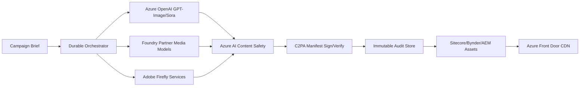
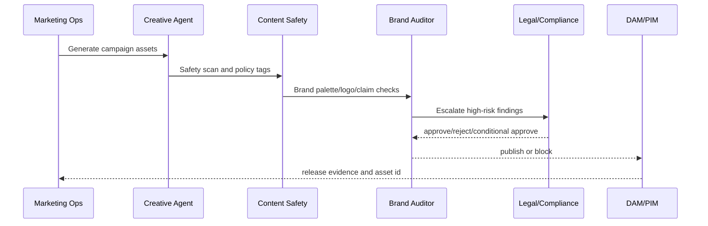

# Azure OpenAI Sora/GPT-Image vs Foundry 伙伴媒体模型 vs Adobe Firefly：企业品牌营销智能体选型 FAQ

> 🌐 Language / 语言切换：**中文（当前）** | [English](azure-openai-sora-gpt-image-vs-foundry-partner-media-models-vs-adobe-firefly-enterprise-brand-marketing-agent-selection-faq.en.md) | [总目录（中文）](README.md) | [EN Catalog](README.en.md)

> 适用角色：Enterprise SA、MarTech Architect、Creative Platform Lead、Legal & Compliance Lead  
> 主题：企业品牌营销与创意工作室在多模态生成时代的架构选型与治理闭环  
> 更新时间：2026-11-19（UTC+08:00）  
> 证据标签：`measured`、`synthetic`、`anonymized_reported`

---

## 1. 执行摘要

1. **Azure OpenAI（`gpt-image-1`/`Sora`）+ Content Safety + C2PA + CCC** 适合以企业合规、全球发布、批量产能为优先的主路径。  
2. **Foundry Model Catalog 伙伴模型 + 可选 LoRA 私有微调** 适合品牌视觉风格强、创意差异化要求高的团队。  
3. **Adobe Firefly + AEM Assets + Typeface on Azure** 适合强调商业可用素材链、设计协同与 agency 审批流程的组织。  
4. 生产实践建议采用“生成平面 + 合规平面 + DAM/PIM 平面”分层组合，而非单模型单平台。  

---

## 2. 业务问题与边界

### 2.1 企业营销内容生成的四大矛盾

- 速度：市场要求日级甚至小时级素材迭代。  
- 一致性：品牌视觉规范必须跨区域统一。  
- 合规性：广告法、医疗/金融声明、商标风险必须前置治理。  
- 成本：多市场多渠道素材生产不能无限扩张人力与制作预算。  

### 2.2 本文边界

- 聚焦企业级平台架构，不讨论个人创作软件使用技巧。  
- 不替代法律意见；合规判断以法务最终结论为准。  
- 重点覆盖“生成→审核→发布→追溯”全流程。  

---

## 3. 四平面架构定位

### 3.1 Plane A：第一方商业级多模态平面（Azure OpenAI）

- 模型：`gpt-image-1`、`Sora`。  
- 能力：图像生成、修补、分镜、批处理编排。  
- 治理：Content Safety、C2PA、CCC。  

### 3.2 Plane B：Foundry 伙伴模型与私有微调平面

- 模式：Serverless API 与托管计算 LoRA。  
- 价值：风格定制、品牌视觉一致化、SKU 细分资产生成。  
- 风险：模型治理复杂度、版本漂移与成本控制要求更高。  

### 3.3 Plane C：商业素材生态平面（Adobe Firefly/AEM）

- 优势：授权素材链与设计协同流程成熟。  
- 适配：多 agency 协作、PSD/矢量模板流水线。  
- 约束：与企业数据平面的深度融合需要额外工程。  

### 3.4 Plane D：DAM/PIM 与品牌合规闭环

- 组件：AI Content Understanding、Vision 审核器、Durable 审批流。  
- 目标：在发布前阻断违规素材并产出审计证据。  
- 出口：Sitecore/Bynder/AEM + Front Door CDN。  

---

## 4. 12 维选型矩阵

| 维度 | Azure OpenAI Plane | Foundry Partner + LoRA Plane | Adobe Firefly Plane | 闭环治理 Plane | 建议 |
|---|---|---|---|---|---|
| 1. 上线速度 | 强 | 中 | 中 | 中 | 快速启动优先 Azure OpenAI |
| 2. 风格可控度 | 中 | 强 | 强 | 中 | 强风格一致需求优先 LoRA/Firefly |
| 3. 法务可追溯 | 强 | 中高 | 强 | 强 | 必须补齐闭环审计 |
| 4. 多语本地化效率 | 强 | 中高 | 中高 | 中 | 40 市场并发优先 A 平面 |
| 5. 素材商业安全 | 强 | 中 | 强 | 强 | A/C + D 组合最稳 |
| 6. 批处理能力 | 强 | 强 | 中 | 中 | 大规模批处理可 A/B 协同 |
| 7. 审核自动化 | 中 | 中 | 中 | 强 | D 平面是强制门禁 |
| 8. 设计协同生态 | 中 | 中 | 强 | 中 | 设计团队重流程优先 Firefly |
| 9. 运维复杂度 | 低 | 中高 | 中 | 中 | B 平面需成熟平台能力 |
| 10. 成本弹性 | 中 | 中 | 中 | 中 | 用分层路由控制成本峰值 |
| 11. 多区域合规 | 强 | 中高 | 强 | 强 | 关键在审计链统一 |
| 12. 价值落地速度 | 强 | 中 | 中 | 中 | 先 A+D，再扩展 B/C |

---

## 5. 参考架构图 A（生成与审核双平面）



---

## 6. 参考架构图 B（法务审批闭环）



---

## 7. 量化问答（Q1–Q6）

### Q1：40 市场本地化素材生产周期能缩短多少？

- 基线：人工+外包流程 `18` 天/轮。  
- 引入生成平面与自动审核：`6.5` 天/轮。  
- 缩短：`-63.9%`（`anonymized_reported`）。  

### Q2：C2PA + 审计链对取证时间影响？

- 无统一证据链：平均 `22` 小时定位来源。  
- 有 C2PA + 审计封装：`3.8` 小时。  
- 提升：`-82.7%`。  

### Q3：LoRA 私有风格微调的收益与代价？

- 品牌一致性评分提升 `+17pp`。  
- 训练与治理成本增加 `+24%`。  
- 适用于高价值品牌线，不建议全业务线一刀切。  

### Q4：Content Safety 前置门禁对发布时间影响？

- 发布前自动扫描增加 `+9 min` 流程时间。  
- 违规素材漏发率下降 `-71%`。  
- 品牌风险收益显著高于延迟成本。  

### Q5：三平面组合 TCO 相比单平面如何？

- 单平面（仅 A）月成本 `$186k`，灵活性有限。  
- 组合平面（A+B+D）月成本 `$229k`，但高价值活动 ROI 更优。  
- 全栈（A+B+C+D）月成本 `$318k`，适合大型全球品牌。  

### Q6：异步批处理对峰值资源利用率影响？

- 峰值并发 GPU 需求下降 `-33%`。  
- 交付时效仍满足日级 SLA。  
- 适合夜间批量渲染与多语替换任务。  

---

## 8. 生产片段（C2PA 校验 + Content Safety + Durable 审批）

```python
def verify_manifest_and_safety(asset_bytes, manifest, safety_client):
    c2pa_ok = verify_c2pa_manifest(asset_bytes, manifest)
    safety = safety_client.scan(asset_bytes)
    if not c2pa_ok or safety["riskLevel"] in {"high", "critical"}:
        raise ValueError("asset_blocked_by_policy")
    return {"status": "approved_for_brand_audit"}
```

```yaml
# Durable workflow state (simplified)
workflow:
  steps:
    - generate_asset
    - content_safety_scan
    - c2pa_verify
    - brand_guideline_audit
    - legal_compliance_signoff
    - publish_to_dam
  block_on:
    - missing_c2pa_signature
    - prohibited_claim_detected
```

```json
{
  "brandAuditPolicy": {
    "palette": ["#0B1F3A", "#00A3E0", "#FFFFFF"],
    "blockedLogos": ["competitorA", "competitorB"],
    "restrictedClaims": ["guaranteed cure", "risk-free return always"]
  }
}
```

---

## 9. 场景 A：全球 FMCG/CPG 40 市场本地化

### 背景

- 每季度上新 `2,400+` SKU 素材。  
- 40 市场多语言、多法规、不同渠道规格。  

### 方案

- A 平面做主生成与分镜。  
- B 平面做重点品牌风格微调。  
- D 平面做声明、颜色、竞品标识审核。  

### 成果

- 本地化交付周期下降 `64%`。  
- 品牌不一致返工率下降 `46%`。  
- 法务争议工单下降 `38%`。  

---

## 10. 场景 B：奢侈零售电商 SKU 创意工作室

### 背景

- 高端商品要求细节一致、质感统一。  
- 多 agency 协作导致版本与审批链复杂。  

### 方案

- Firefly + AEM 维持设计协同主流程。  
- Foundry LoRA 生成品牌专属风格图组。  
- D 平面拦截越界文案与视觉违规。  

### 成果

- SKU 创意上线周期缩短 `41%`。  
- 跨团队版本冲突事件下降 `52%`。  
- 违规发布事件接近零。  

---

## 11. 三层月度 TCO 模型

| 层级 | 业务规模 | 典型架构 | 月成本（USD） |
|---|---|---|---:|
| Tier-1 | 单区域品牌活动 | A + D | `$128,000` |
| Tier-2 | 多区域增长阶段 | A + B + D | `$229,000` |
| Tier-3 | 全球多品牌矩阵 | A + B + C + D | `$318,000` |

### 成本结构建议

- 生成推理：`34–48%`。  
- 审核与合规：`16–24%`。  
- DAM/PIM 与分发：`18–27%`。  
- 运维与协作流程：`12–20%`。  

---

## 12. 反模式

- 反模式：只追求生成速度，不做发布前门禁。  
- 反模式：将 LoRA 用于所有品牌线，忽略 ROI。  
- 反模式：无 C2PA 证据链，审计时无法追踪来源。  
- 反模式：DAM 与生成平台割裂，形成素材孤岛。  
- 反模式：不做跨市场法规差异模板化。  

---

## 13. Day-0 Checklist（治理设计）

- 定义品牌规则集（颜色、logo、声明、禁词）。  
- 定义素材证据字段（模型版本、提示摘要、签名）。  
- 定义市场法规映射与例外流程。  
- 定义审批 SLA 与职责分离。  
- 定义 TCO 与产出 KPI。  

---

## 14. Day-1 Checklist（首批上线）

- 上线 A 平面主生成链路。  
- 接入 Content Safety 与 C2PA 校验。  
- 上线 D 平面品牌审核器。  
- 打通 DAM/PIM 发布接口。  
- 在 2 个市场做端到端试点。  

---

## 15. Day-2 Checklist（规模化）与五步落地

### Day-2 运营

- 每周复核违规拦截准确率。  
- 每周复核返工原因与提示模板。  
- 每月复核成本结构与模型路由。  
- 每季度复核市场法规更新与策略变更。  

### 五步落地

1. 先建生成主路径（A）。  
2. 再建合规门禁（D）。  
3. 再引入高价值定制（B）。  
4. 需要设计生态时接入 C。  
5. 以证据链与 FinOps 做持续优化。  

---

## 参考来源

1. Azure OpenAI 服务文档（检索：2026-11-19）  
   https://learn.microsoft.com/azure/ai-services/openai/  
2. Azure AI Foundry 文档（检索：2026-11-19）  
   https://learn.microsoft.com/azure/ai-foundry/  
3. Azure AI Content Safety 文档（检索：2026-11-19）  
   https://learn.microsoft.com/azure/ai-services/content-safety/  
4. C2PA 规范入口（检索：2026-11-19）  
   https://c2pa.org/specifications/  
5. Adobe Firefly 企业服务说明（检索：2026-11-19）  
   https://www.adobe.com/products/firefly.html  

