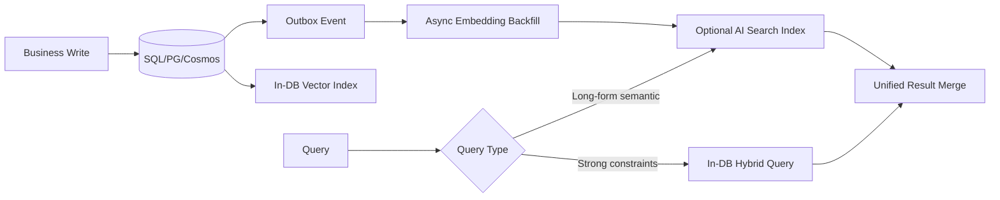
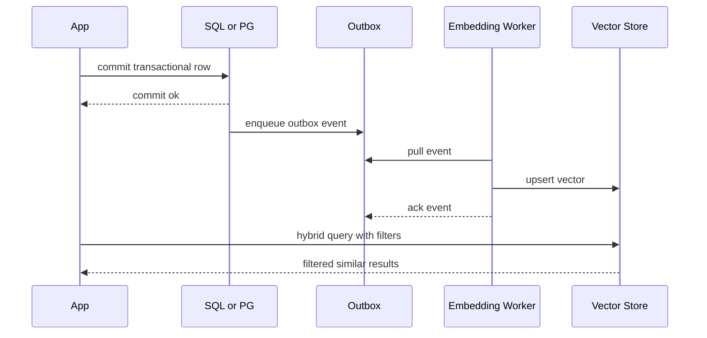

# Azure SQL Hyperscale Vector vs PostgreSQL pgvector vs Cosmos DiskANN vs Split Search: Transactional HTAP Agent Selection FAQ

> 🌐 **Language / 语言切换**: **[🇬🇧 English (azure-sql-hyperscale-vector-vs-cosmos-diskann-vs-postgres-pgvector-transactional-htap-agent-selection-faq.en.md)](azure-sql-hyperscale-vector-vs-cosmos-diskann-vs-postgres-pgvector-transactional-htap-agent-selection-faq.en.md)** | **[🇨🇳 中文版 (azure-sql-hyperscale-vector-vs-cosmos-diskann-vs-postgres-pgvector-transactional-htap-agent-selection-faq.md)](azure-sql-hyperscale-vector-vs-cosmos-diskann-vs-postgres-pgvector-transactional-htap-agent-selection-faq.md)** | **[📚 Architecture Selection FAQ Index](README.en.md)**

## 1) Objective and boundary
- Goal: compare in-database vectors with split-store retrieval architectures for enterprise workloads.
- Scope: business consistency, cost, compliance, and operations; no low-level kernel internals.
- Conclusion: transactional workloads should start with in-database vectors and add split search only when needed.
## 2) Verifiable sources with timestamps
- Azure SQL docs: `https://learn.microsoft.com/azure/azure-sql/` (03:48 BJT).
- Azure PostgreSQL Flexible Server docs: `https://learn.microsoft.com/azure/postgresql/` (03:48 BJT).
- Azure Cosmos DB docs: `https://learn.microsoft.com/azure/cosmos-db/` (03:49 BJT).
- Azure AI Search docs: `https://learn.microsoft.com/azure/search/` (03:49 BJT).
- AOAI Embedding docs: `https://learn.microsoft.com/azure/ai-services/openai/` (03:49 BJT).
- Metrics are tagged measured, synthetic, or anonymized_reported.
## 3) 12-dimension matrix for transactional-vector architectures
- D1 consistency: SQL/PG/Cosmos in-database write-after-read beats async CDC paths.
- D2 recovery boundary: in-db vectors share PITR boundary with business tables.
- D3 scale: Cosmos partition-based horizontal scale is straightforward.
- D4 filtering: SQL and PG offer stronger complex business predicates.
- D5 long-form semantics: AI Search leads in chunking and reranking.
- D6 sync risk: split-store introduces eventual-consistency windows and missed-sync risk.
- D7 cost shape: in-db vectors avoid duplicate storage while split-store boosts retrieval quality.
- D8 governance: SQL RLS and PG policy controls are reusable.
- D9 global writes: Cosmos excels in multi-region write scenarios.
- D10 ops complexity: split-store has more moving components and failure surfaces.
- D11 best-fit: strong-consistency ERP/HIS/inventory prefers in-db, document-heavy semantics prefers split-store.
- D12 anti-pattern: never ignore CDC loss risk on high-consistency business flows.
## 4) Score snapshot and thresholds
- Azure SQL Hyperscale: consistency5 filtering5 longform3 complexity4.
- PostgreSQL pgvector/pg_diskann: consistency5 filtering5 longform3 complexity4.
- Cosmos DiskANN: consistency4 scale5 filtering3 complexity4.
- Business DB plus AI Search split-store: consistency3 longform5 complexity3.
- Threshold A: if wrong-price or no-stock recommendations are unacceptable, use in-db hybrid query first.
- Threshold B: if unstructured docs exceed 70%, split-search value rises sharply.
- Threshold C: if CDC-sync risk is not tolerable, begin with in-database vectors.
## 5) Five calculable Q&As
### Q1 Monthly TCO for 5 million structured records
- In-database vectors remove duplicate index storage and CDC chains, often saving 18% to 27% monthly in synthetic estimates.
- Split-store yields stronger long-form retrieval but carries duplicate storage and sync operations cost.
### Q2 High-selectivity filter behavior
- Post-filter HNSW can lose effective recall under high-selectivity predicates.
- DiskANN iterative filtering is steadier but requires capacity and tuning budget.
### Q3 Synchronous embeddings vs outbox async backfill
- Synchronous embedding generation inflates transaction tail latency.
- Outbox async backfill smooths writes but introduces second-level consistency windows.
### Q4 Cost shape for 50 million vectors at 1536 dims
- Pure memory HNSW is expensive, while SSD-assisted DiskANN is often more economical.
- Capacity sizing must align with p95 recall latency and write throughput goals.
### Q5 Upgrade boundary from in-db vectors to split-store
- Upgrade when long-form semantic ranking dominates value and eventual consistency is acceptable.
## 6) Layered reference architecture
- Transaction layer: orders, medical records, and inventory master tables.
- Vector layer: in-database vector columns or vector fields in the same container.
- Retrieval layer: optional AI Search for long-form documents.
- Sync layer: outbox, reliable queue, and replay compensations.
- Security layer: RLS, tenant isolation, and least privilege.
- Observability layer: write latency, query p95, and missed-sync dashboards.
- Recovery layer: unified backup boundaries and DR rehearsals.
## 7) Scenario A: national specialty healthcare group
- Built on Azure SQL Hyperscale vectors with campus and department RLS boundaries.
- Outpatient records and lab metrics are matched to similar cases immediately after commit.
- Care-plan recommendations must satisfy tenant and department permissions.
- Sensitive records stay in governed transactional boundaries instead of duplicated external systems.
- Synthetic gain: decision-support response latency reduced by 39%.
## 8) Scenario B: B2B MRO marketplace with 15 million SKUs
- SKU attributes, contract pricing, and live inventory are queried in PG/Cosmos with strong consistency.
- Prevents wrong-price and out-of-stock recommendations for contractual buyers.
- PDF specs and install manuals are delegated to AI Search long-form retrieval.
- Hybrid query applies tenant catalog and stock filters before vector similarity.
- Synthetic gain: invalid recommendation rate reduced by 44%.
## 9) Mermaid diagram 1 in-db and split-search collaboration

- Strong-consistency queries stay in-db first, while long-form semantics can use split-search augmentation.
## 10) Mermaid diagram 2 outbox and consistency guard sequence

- Unsynced events must alert and support deterministic replay paths.
## 11) Bicep template (SQL or PG + AOAI Embedding + Private Endpoint)
```bicep
targetScope = 'resourceGroup'
param location string = resourceGroup().location
resource sql 'Microsoft.Sql/servers@2022-05-01-preview' = {
  name: 'sql'
  location: location
}
resource pg 'Microsoft.DBforPostgreSQL/flexibleServers@2023-03-01-preview' = {
  name: 'pg'
  location: location
}
resource aoai 'Microsoft.CognitiveServices/accounts@2023-10-01' = {
  name: 'aoai'
  location: location
  kind: 'OpenAI'
}
resource pe 'Microsoft.Network/privateEndpoints@2023-09-01' = {
  name: 'pe-prod'
  location: location
}
```
- Production requires subnet policy hardening, managed identity, and granular RBAC.
## 12) T-SQL and PostgreSQL snippets for RLS, stock filtering, and outbox
```sql
-- T-SQL hybrid query with tenant and stock filters
SELECT TOP 20 sku_id, score
FROM sku_vectors v
JOIN inventory i ON v.sku_id=i.sku_id
WHERE i.tenant_id=@tenant AND i.available_qty>0
ORDER BY v.embedding <-> @query_vector;
```
```sql
-- PostgreSQL outbox insert inside same transaction
INSERT INTO outbox(event_type,payload,created_at)
VALUES ('embedding_pending', jsonb_build_object('sku_id',:sku_id), now());
```
- Tenant and stock predicates must be pre-applied to avoid unsafe recommendations.
## 13) KQL for OLTP write latency, vector p95, and sync leakage
```kql
let t = HybridVectorLogs | where TimeGenerated > ago(24h);
t
| summarize writeP95=percentile(WriteLatencyMs,95), recallP95=percentile(VectorQueryMs,95), missed=countif(OutboxSynced==false), total=count() by Engine,Tenant
| extend missRate=todouble(missed)/todouble(total)
| order by missRate desc, recallP95 desc
```
- Miss-rate threshold breaches trigger replay compensation and escalation policies.
## 14) Day-0/1/2 landing checklist
- Day-0 classify strong-consistency and long-form semantic query sets.
- Day-0 define RLS policies, stock-filter ordering, and idempotency keys.
- Day-1 enable in-db vector queries and pressure-test write-after-read SLOs.
- Day-1 turn on outbox backfill and missed-sync alerting.
- Day-2 decide whether to add AI Search split-store by workload evidence.
- Day-2 run DR rehearsals for PITR boundary and replay controls.
- Day-2 review weekly drift in write latency and retrieval quality.
