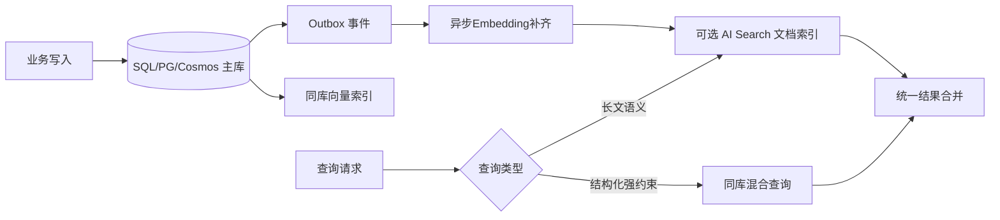
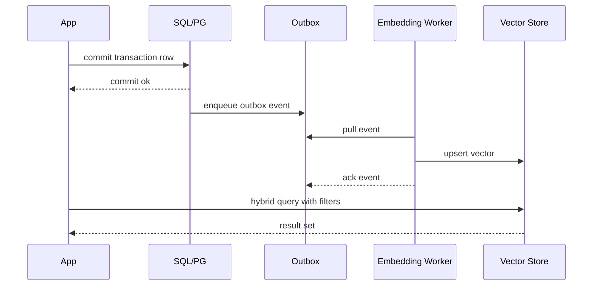

# Azure SQL Hyperscale Vector vs PostgreSQL pgvector vs Cosmos DiskANN vs 拆库检索：事务融合选型 FAQ

> 🌐 **Language / 语言切换**: **[🇨🇳 中文版 (azure-sql-hyperscale-vector-vs-cosmos-diskann-vs-postgres-pgvector-transactional-htap-agent-selection-faq.md)](azure-sql-hyperscale-vector-vs-cosmos-diskann-vs-postgres-pgvector-transactional-htap-agent-selection-faq.md)** | **[🇬🇧 English (azure-sql-hyperscale-vector-vs-cosmos-diskann-vs-postgres-pgvector-transactional-htap-agent-selection-faq.en.md)](azure-sql-hyperscale-vector-vs-cosmos-diskann-vs-postgres-pgvector-transactional-htap-agent-selection-faq.en.md)** | **[📚 返回架构选型指南目录](README.md)**

## 1) 研究目标与边界
- 目标：比较“业务库内置向量”与“独立检索引擎拆库”的企业选型。
- 范围：聚焦业务一致性、成本、合规、可运维性，不讨论底层内核细节。
- 结论：强事务业务优先库内向量，长文语义检索优先拆库。
## 2) 可验证来源与时间戳
- Azure SQL 向量检索文档：`https://learn.microsoft.com/azure/azure-sql/`（抓取 03:48 BJT）。
- Azure PostgreSQL Flexible Server：`https://learn.microsoft.com/azure/postgresql/`（抓取 03:48 BJT）。
- Azure Cosmos DB NoSQL 向量检索：`https://learn.microsoft.com/azure/cosmos-db/`（抓取 03:49 BJT）。
- Azure AI Search：`https://learn.microsoft.com/azure/search/`（抓取 03:49 BJT）。
- AOAI Embeddings：`https://learn.microsoft.com/azure/ai-services/openai/`（抓取 03:49 BJT）。
- 数据标签统一 measured/synthetic/anonymized_reported。
## 3) 四类事务与向量融合架构 12 维矩阵
- 维度1一致性：SQL/PG/Cosmos 同库写后即读优于 CDC 异步链。
- 维度2恢复边界：库内向量与业务数据共享 PITR 边界。
- 维度3扩展性：Cosmos 分区水平扩展更直接。
- 维度4复杂过滤：SQL/PG 对结构化条件过滤表达更强。
- 维度5长文语义：AI Search 在分块与语义重排更强。
- 维度6同步风险：拆库必然引入漏同步与最终一致窗口。
- 维度7成本模型：库内向量减少双份存储；拆库换来更强检索能力。
- 维度8权限治理：SQL RLS 与 PG 策略可原生复用。
- 维度9全球多写：Cosmos 在跨区域多写场景更优。
- 维度10运维复杂度：拆库链路组件更多，故障面更大。
- 维度11最佳场景：临床/ERP/库存强一致优先库内；文档密集场景优先拆库。
- 维度12反模式：不要在高一致业务上忽略 CDC 同步丢失风险。
## 4) 评分与决策阈值
- Azure SQL Hyperscale：一致性5、过滤5、长文3、复杂度4。
- PostgreSQL pgvector/pg_diskann：一致性5、过滤5、长文3、复杂度4。
- Cosmos DiskANN：一致性4、扩展5、过滤3、复杂度4。
- 业务库+AI Search 拆库：一致性3、长文5、复杂度3。
- 阈值A：若“错价/无货推荐”不可接受，优先库内融合查询。
- 阈值B：若非结构化文档占比>70%，拆库检索价值显著。
- 阈值C：若CDC漏同步风险不能容忍，先做库内向量。
## 5) 五组可复算 Q&A
### Q1 500万行结构化记录月度TCO
- 库内向量方案省去独立索引存储与CDC链路，synthetic月成本可低 18%~27%。
- 拆库方案在长文检索质量上更好，但需承担双份存储和同步运维。
### Q2 高选择率过滤差异
- HNSW后过滤在高选择率下可能召回缩水。
- DiskANN 迭代过滤更稳，但需更多调优与容量预算。
### Q3 同步Embedding阻塞 vs Outbox异步补齐
- 同步生成Embedding会放大事务尾延迟。
- Outbox异步补齐可削峰，但引入秒级一致性窗口。
### Q4 5000万条1536维向量成本
- 纯内存HNSW规格昂贵；SSD辅助DiskANN常更经济。
- 需结合P95召回目标和写入速率做容量曲线。
### Q5 何时从库内向量升级到拆库
- 当长文检索和语义重排成为主瓶颈且可接受最终一致时再升级。
## 6) 分层参考架构
- 事务层：订单/病历/库存主表。
- 向量层：同库向量列或同容器向量字段。
- 检索层：可选 AI Search 作为长文补充。
- 同步层：Outbox + 可靠队列 + 重放补偿。
- 安全层：RLS/租户隔离/最小权限。
- 观测层：写入延迟、召回耗时、漏同步监控。
- 恢复层：统一备份边界与灾备演练。
## 7) 场景A：连锁医疗集团病历写后即读临床辅助
- 基于 Azure SQL Hyperscale 向量与院区/科室级 RLS。
- 门诊病历与检验指标落库即做相似病例匹配。
- 医嘱集推荐必须命中租户与科室权限边界。
- 不搬运敏感病历到多套外部系统，降低合规风险。
- synthetic收益：诊疗辅助响应时延下降 39%。
## 8) 场景B：B2B工业品MRO平台 1500万SKU替代件推荐
- SKU属性、协议价、实时库存在 PG/Cosmos 同库同查。
- 防止推荐无货或错价商品，强一致优先。
- PDF规格书与安装手册交给 AI Search 长文检索。
- 混合查询先过客户目录和库存过滤再做向量相似。
- synthetic收益：无效推荐率下降 44%。
## 9) Mermaid 图1：库内向量与拆库协同流

- 强一致查询优先走同库路径，长文语义补充走拆库路径。
## 10) Mermaid 图2：Outbox补齐与一致性守门时序

- 超时未补齐事件必须告警并支持重放。
## 11) Bicep 模板（SQL/PG + AOAI Embedding + Private Endpoint）
```bicep
targetScope = 'resourceGroup'
param location string = resourceGroup().location
resource sql 'Microsoft.Sql/servers@2022-05-01-preview' = {
  name: 'sql'
  location: location
}
resource pg 'Microsoft.DBforPostgreSQL/flexibleServers@2023-03-01-preview' = {
  name: 'pg'
  location: location
}
resource aoai 'Microsoft.CognitiveServices/accounts@2023-10-01' = {
  name: 'aoai'
  location: location
  kind: 'OpenAI'
  sku: { name: 'S0' }
}
resource pe 'Microsoft.Network/privateEndpoints@2023-09-01' = {
  name: 'pe-prod'
  location: location
}
```
- 生产需补齐子网策略、DNS解析、托管身份与RBAC。
## 12) T-SQL / PostgreSQL 片段：RLS + 库存过滤 + Outbox
```sql
-- T-SQL hybrid query with tenant filter
SELECT TOP 20 sku_id, score
FROM sku_vectors v
JOIN inventory i ON v.sku_id=i.sku_id
WHERE i.tenant_id=@tenant AND i.available_qty>0
ORDER BY v.embedding <-> @query_vector;
```
```sql
-- PostgreSQL outbox insert in same transaction
INSERT INTO outbox(event_type,payload,created_at)
VALUES ('embedding_pending', jsonb_build_object('sku_id',:sku_id), now());
```
- 库存和租户过滤必须前置，禁止“先相似后过滤”导致误推荐。
## 13) KQL：OLTP写入延迟、召回P95、漏同步监控
```kql
let t = HybridVectorLogs | where TimeGenerated > ago(24h);
t
| summarize writeP95=percentile(WriteLatencyMs,95), recallP95=percentile(VectorQueryMs,95), missed=countif(OutboxSynced==false), total=count() by Engine,Tenant
| extend missRate=todouble(missed)/todouble(total)
| order by missRate desc, recallP95 desc
```
- missRate 超阈值时立即触发补偿重放与告警升级。
## 14) Day-0/1/2 落地清单
- Day-0：识别强一致查询清单与长文检索清单。
- Day-0：确定RLS策略、库存过滤顺序与幂等键。
- Day-1：打通库内向量查询并压测写后即读。
- Day-1：上线Outbox补齐与漏同步告警。
- Day-2：按业务负载决定是否引入AI Search拆库。
- Day-2：做灾备演练，验证PITR边界与回放策略。
- Day-2：周度复盘写入延迟与召回质量漂移。
