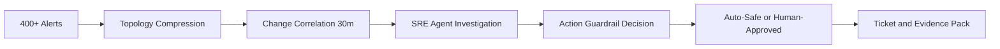
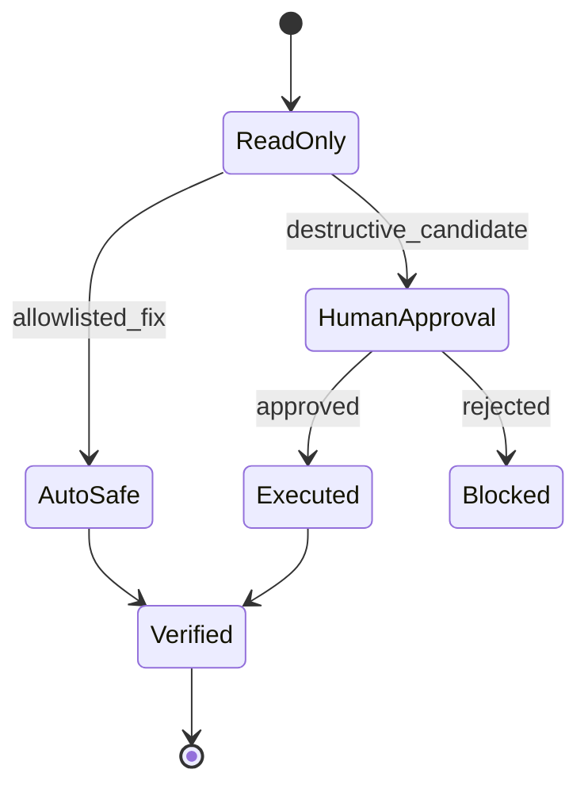

# Azure SRE Agent vs Monitor+Logic Apps Runbook: Enterprise AIOps and Safe Self-Healing Selection FAQ

> 🌐 **Language / 语言切换**: **[🇬🇧 English (azure-sre-agent-vs-monitor-aio-alerts-vs-logic-apps-runbook-autonomous-cloud-ops-selection-faq.en.md)](azure-sre-agent-vs-monitor-aio-alerts-vs-logic-apps-runbook-autonomous-cloud-ops-selection-faq.en.md)** | **[🇨🇳 中文版 (azure-sre-agent-vs-monitor-aio-alerts-vs-logic-apps-runbook-autonomous-cloud-ops-selection-faq.md)](azure-sre-agent-vs-monitor-aio-alerts-vs-logic-apps-runbook-autonomous-cloud-ops-selection-faq.md)** | **[📚 Architecture Selection FAQ Index](README.en.md)**

## 1) Objective and boundary
Goal: establish enterprise cloud-native incident-response AIOps/SRE layered selection baseline.
Scope: alert-storm compression, change-correlated root cause, remediation guardrails, ITSM closure, and on-call fatigue reduction.
Exclusion: no deep low-level kernel, driver, or syscall internals.
Conclusion: deterministic runbooks plus agent deep investigation plus human-approved risky actions is the stable mainstream path.
## 2) Verifiable sources with timestamps
- Azure SRE Agent / Azure Monitor / AppLens docs (05:07 BJT)。
- Log Analytics / KQL diagnostics docs (05:07 BJT)。
- Logic Apps / Automation Runbook docs (05:08 BJT)。
- Azure Resource Graph and Activity Log docs (05:08 BJT)。
- ServiceNow/PagerDuty incident integration references (05:08 BJT)。
- GitHub deployment change events and release audit references (05:09 BJT)。
- SRE postmortem and on-call operations best practices (05:09 BJT)。
Evidence labels: measured/synthetic/anonymized_reported.
## 3) Four operations architectures and 12-dimension matrix
- A: Azure SRE Agent managed 7x24 investigation and closure.
- B: Monitor alerts plus Logic Apps/Runbook deterministic remediation.
- C: ServiceNow/PagerDuty workflow collaboration and triage copilot.
- D: Foundry/MAF custom multi-agent operations platform.
- Dimension 1 alert-storm compression capability.
- Dimension 2 depth for unknown long-tail root-cause reasoning.
- Dimension 3 action safety and permission blast-radius control.
- Dimension 4 speed of release-change correlation.
- Dimension 5 ticket auto-enrichment and handoff efficiency.
- Dimension 6 MTTD/MTTI/MTTR improvement magnitude.
- Dimension 7 on-call workload impact.
- Dimension 8 policy auditability and evidence retention.
- Dimension 9 multi-cloud/hybrid-cloud extensibility complexity.
- Dimension 10 cost structure (managed fee, platform maintenance, labor).
- Dimension 11 post-incident automation quality.
- Dimension 12 organizational rollout complexity and change resistance.
## 4) Three-tier action guardrails and latency budget
- Read-Only: default Reader scope for evidence collection and root-cause hypothesis only.
- Auto-Safe: allowlisted actions execute automatically, such as pod rolling restart and replica scaling.
- Human-Approved: destructive actions require Teams-card approval before execution.
- Alert storms first run topology compression to avoid processing 400+ alerts one by one.
- Auto-correlate latest 30-minute release changes and Activity Log events.
- Unknown hard incidents are escalated to SRE Agent deep-investigation path.
- Each action is written into audit trail and mapped into incident evidence pack.
- Postmortem is auto-generated and bound to recurrence-prevention regression checks.
## 5) Five calculable Q&As
### Q1 How to reduce MTTI from 42 minutes to 3.5 minutes during alert storms
- Compress alerts and correlate changes before action decisions to sharply reduce misdiagnosis.
- High-risk actions must stay human-approved for controllability and accountability.
- Persist outcomes into executable regression checks for sustained recurrence reduction.
### Q2 Why operations agents must not run with default Contributor/Owner privileges
- Compress alerts and correlate changes before action decisions to sharply reduce misdiagnosis.
- High-risk actions must stay human-approved for controllability and accountability.
- Persist outcomes into executable regression checks for sustained recurrence reduction.
### Q3 How to split known-pattern runbooks and unknown-incident deep investigation optimally
- Compress alerts and correlate changes before action decisions to sharply reduce misdiagnosis.
- High-risk actions must stay human-approved for controllability and accountability.
- Persist outcomes into executable regression checks for sustained recurrence reduction.
### Q4 How to automate blameless postmortem and recurrence-prevention checks
- Compress alerts and correlate changes before action decisions to sharply reduce misdiagnosis.
- High-risk actions must stay human-approved for controllability and accountability.
- Persist outcomes into executable regression checks for sustained recurrence reduction.
### Q5 How to quantify ROI from on-call fatigue reduction and outage-loss avoidance across 100 core systems
- Compress alerts and correlate changes before action decisions to sharply reduce misdiagnosis.
- High-risk actions must stay human-approved for controllability and accountability.
- Persist outcomes into executable regression checks for sustained recurrence reduction.
## 6) Layered reference architecture (Cloud SRE)
- Observability layer: Azure Monitor metrics/logs and baseline alerts.
- Diagnostics layer: Log Analytics, AppLens, Resource Graph, and AKS diagnostics.
- Correlation layer: release changes, ARM activity logs, and topology dependency fusion.
- Decision layer: SRE Agent reasoning plus deterministic runbook policy engine.
- Execution layer: Auto-Safe remediation and Human-Approved actions.
- Collaboration layer: Teams plus ServiceNow/PagerDuty ticket closure.
- Governance layer: least privilege, audit trails, policy replay, and compliance reporting.
- Learning layer: postmortem automation and regression-check library.
## 7) Scenario A: global game publisher multi-region alert storm compression
- Automatically correlate image deployments with slow-query spikes to locate root-cause chain fast.
- Generate evidence brief in seconds and deliver to on-call Teams channel.
- Offer one-click rollback to previous release with human approval required.
- Auto-Safe path performs non-destructive scaling and cache warming first.
- Materially shortens overnight incident triage and recovery duration.
## 8) Scenario B: integrated logistics group multi-cloud ITSM-linked troubleshooting
- SRE Agent integrates with ServiceNow CMDB to auto-enrich tickets within 90 seconds.
- Auto-attach golden-signal snapshots, AppLens findings, and remediation proposals.
- Cross-cloud incidents are triaged through one consolidated on-call console.
- Destructive actions keep approval gates to prevent accidental blast-radius expansion.
- Establishes standard flow of automated evidence, human decision, and closure postmortem.
## 9) Mermaid diagram 1: alert-storm compression and root-cause enrichment flow

- Compressing first and diagnosing second reduces noise and improves localization accuracy.
## 10) Mermaid diagram 2: three-tier action-permission state machine

- Permission state machine is the core fuse that prevents automation from harming production.
## 11) Bicep template (least-privilege MI + action group + approval flow)
```bicep
targetScope = 'resourceGroup'
param location string = resourceGroup().location
resource law 'Microsoft.OperationalInsights/workspaces@2023-09-01' = {
  name: 'law-prod'
  location: location
}
resource ag 'Microsoft.Insights/actionGroups@2023-01-01' = {
  name: 'ag'
  location: 'global'
}
```
- Production setup should also include UAMI RBAC, private egress, and approval-audit retention policy.
## 12) Three-tier guardrail JSON and Teams approval callback snippets
```json
{
  "permissions_tier": ["Read-Only","Auto-Safe","Human-Approved"],
  "auto_safe_actions": ["aks_rollout_restart","scale_out_replicas"],
  "human_approval_actions": ["db_rollback","route_change"]
}
```
```python
def approve_and_execute(action_id, approved):
    return execute_action(action_id) if approved else "blocked"
```
- Limiting auto-executable actions to low-risk allowlists is foundational for safe automation rollout.
## 13) KQL: alert compression, MTTI-MTTR trend, and unauthorized-write interception audit
```kql
let t = CloudSreOpsLogs | where TimeGenerated > ago(30d);
t
| summarize alertCompression=avg(todouble(AlertCompressionRate)), mtti=avg(todouble(MTTI_Minutes)), mttr=avg(todouble(MTTR_Minutes)), blockedUnauthorizedWrites=sum(toint(UnauthorizedWriteBlocked)) by ServiceDomain
| order by mtti desc
```
- Tracking compression and MTTI/MTTR together reveals whether policies are truly improving reliability.
## 14) Five-step rollout guide (Good fit vs Not for)
- Step 1: establish default Reader stance and three-tier action catalog first.
- Step 2: codify known incidents into deterministic runbooks first.
- Step 3: enable change correlation and topology-based alert compression pipeline.
- Step 4: introduce SRE Agent for unknown complex incident investigations.
- Step 5: use postmortem regression checks to continuously reduce recurrence.
- Good fit: high dependency complexity, heavy overnight on-call pressure, frequent change velocity.
- Not for: low-complexity monoliths where manual troubleshooting cost is negligible.
