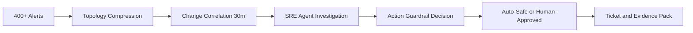
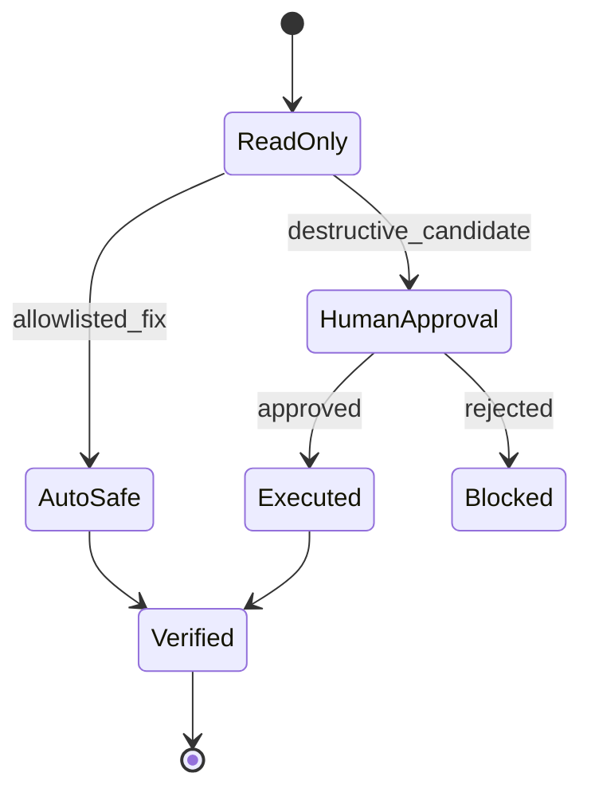

# Azure SRE Agent vs Monitor+Logic Apps Runbook：企业 AIOps 与安全自愈选型 FAQ

> 🌐 **Language / 语言切换**: **[🇨🇳 中文版 (azure-sre-agent-vs-monitor-aio-alerts-vs-logic-apps-runbook-autonomous-cloud-ops-selection-faq.md)](azure-sre-agent-vs-monitor-aio-alerts-vs-logic-apps-runbook-autonomous-cloud-ops-selection-faq.md)** | **[🇬🇧 English (azure-sre-agent-vs-monitor-aio-alerts-vs-logic-apps-runbook-autonomous-cloud-ops-selection-faq.en.md)](azure-sre-agent-vs-monitor-aio-alerts-vs-logic-apps-runbook-autonomous-cloud-ops-selection-faq.en.md)** | **[📚 返回架构选型指南目录](README.md)**

## 1) 研究目标与边界
目标：构建企业云原生故障处置 AIOps/SRE 分层选型基线。
范围：告警风暴收敛、变更关联根因、自愈动作围栏、工单闭环与值班减负。
排除：不展开底层内核、驱动或系统调用级实现细节。
结论：确定性 Runbook + Agent 深调 + 人工审批高危动作是主流稳态路径。
## 2) 可验证来源与时间戳
- Azure SRE Agent / Azure Monitor / AppLens 文档（05:07 BJT）。
- Log Analytics / KQL 诊断文档（05:07 BJT）。
- Logic Apps / Automation Runbook 文档（05:08 BJT）。
- Azure Resource Graph 与 Activity Log 文档（05:08 BJT）。
- ServiceNow/PagerDuty 工单集成参考（05:08 BJT）。
- GitHub Deployment 变更事件与发布审计参考（05:09 BJT）。
- SRE Postmortem 与值班运营最佳实践（05:09 BJT）。
证据标签：measured/synthetic/anonymized_reported。
## 3) 四类运维架构与 12 维横向矩阵
- A: Azure SRE Agent 全托管 7x24 调查与闭环。
- B: Monitor 告警 + Logic Apps/Runbook 确定性自愈。
- C: ServiceNow/PagerDuty 流程协同与排障副驾。
- D: Foundry/MAF 自建多智能体运维中台。
- 维度1 告警风暴收敛能力。
- 维度2 未知长尾故障根因推理深度。
- 维度3 动作安全性与权限爆炸半径控制。
- 维度4 与发布变更关联速度。
- 维度5 工单自动富化与交接效率。
- 维度6 MTTD/MTTI/MTTR 改善幅度。
- 维度7 运维团队值班负荷变化。
- 维度8 策略可审计性与合规证据留存。
- 维度9 多云/混合云扩展难度。
- 维度10 成本结构（托管费、平台维护、人力）。
- 维度11 故障复盘自动化质量。
- 维度12 组织落地复杂度与变更阻力。
## 4) 三级动作围栏与延迟预算
- Read-Only：默认 Reader 权限，仅采证与根因假设输出。
- Auto-Safe：白名单动作自动执行，如 Pod 滚动重启、副本扩容。
- Human-Approved：破坏性动作必须 Teams 卡片审批后执行。
- 告警风暴场景先做拓扑收敛，避免 400+ 告警逐条处理。
- 自动关联最近 30 分钟发布变更与 Activity Log。
- 未知疑难故障转交 SRE Agent 深度调查链路。
- 每次动作写入审计流水并映射到工单证据包。
- Postmortem 自动生成并绑定防复发回归检测项。
## 5) 五组可复算 Q&A
### Q1 告警风暴如何把 MTTI 从 42 分钟压到 3.5 分钟
- 先压缩告警与变更关联，再进入动作决策，能显著降低误判。
- 高风险动作必须保持人工审批，确保可控可追责。
- 将结果沉淀为可执行回归检测，可持续压低复发率。
### Q2 为什么不能给运维智能体默认 Contributor/Owner
- 先压缩告警与变更关联，再进入动作决策，能显著降低误判。
- 高风险动作必须保持人工审批，确保可控可追责。
- 将结果沉淀为可执行回归检测，可持续压低复发率。
### Q3 已知套路与未知疑难如何分工最优
- 先压缩告警与变更关联，再进入动作决策，能显著降低误判。
- 高风险动作必须保持人工审批，确保可控可追责。
- 将结果沉淀为可执行回归检测，可持续压低复发率。
### Q4 无指责复盘与防复发检测如何自动闭环
- 先压缩告警与变更关联，再进入动作决策，能显著降低误判。
- 高风险动作必须保持人工审批，确保可控可追责。
- 将结果沉淀为可执行回归检测，可持续压低复发率。
### Q5 百套系统值班倦怠与停机损失 ROI 如何测算
- 先压缩告警与变更关联，再进入动作决策，能显著降低误判。
- 高风险动作必须保持人工审批，确保可控可追责。
- 将结果沉淀为可执行回归检测，可持续压低复发率。
## 6) 分层参考架构（Cloud SRE）
- 观测层：Azure Monitor 指标日志与告警基线。
- 诊断层：Log Analytics、AppLens、Resource Graph、AKS 诊断。
- 关联层：发布变更、ARM 活动日志与拓扑依赖融合。
- 决策层：SRE Agent 推理与 Runbook 确定性策略引擎。
- 执行层：Auto-Safe 自愈动作与 Human-Approved 审批动作。
- 协同层：Teams、ServiceNow/PagerDuty 工单闭环。
- 治理层：最小权限、审计留痕、策略回放与合规报表。
- 学习层：Postmortem 自动化与回归检测库。
## 7) 场景A：全球游戏发行商多区域告警风暴压缩
- 自动关联镜像发布与慢查询飙升，快速定位根因链。
- 秒级生成证据简报并推送值班 Teams 群。
- 提供“一键回滚上一版本”但需人工审批确认。
- Auto-Safe 路径先做无损扩容与缓存预热。
- 显著缩短凌晨事故定位和恢复时间。
## 8) 场景B：综合物流集团多云 ITSM 联动排障
- SRE Agent 与 ServiceNow CMDB 打通，工单 90 秒内自动富化。
- 自动挂载黄金指标快照、AppLens 结论和修复建议。
- 跨云故障统一在单一值班台完成排障决策。
- 破坏性动作保留审批门槛，避免误操作扩大事故。
- 形成“自动采证+人工决断+闭环复盘”标准流程。
## 9) Mermaid 图1：告警风暴收敛与根因富化流

- 先收敛再诊断能降低噪声干扰并提升定位准确度。
## 10) Mermaid 图2：三级动作权限状态机

- 权限状态机是防止自动化误伤生产环境的核心保险丝。
## 11) Bicep 模板（MI 最小权限 + Action Group + 审批流）
```bicep
targetScope = 'resourceGroup'
param location string = resourceGroup().location
resource law 'Microsoft.OperationalInsights/workspaces@2023-09-01' = {
  name: 'law-prod'
  location: location
}
resource ag 'Microsoft.Insights/actionGroups@2023-01-01' = {
  name: 'ag'
  location: 'global'
}
```
- 实际生产还需补齐 UAMI RBAC、私网出口与审批审计留存周期策略。
## 12) 三级围栏 JSON 与 Teams 审批回调片段
```json
{
  "permissions_tier": ["Read-Only","Auto-Safe","Human-Approved"],
  "auto_safe_actions": ["aks_rollout_restart","scale_out_replicas"],
  "human_approval_actions": ["db_rollback","route_change"]
}
```
```python
def approve_and_execute(action_id, approved):
    return execute_action(action_id) if approved else "blocked"
```
- 把“可自动执行动作”限制在低风险白名单，是自动化落地前提。
## 13) KQL：告警压缩率/MTTI-MTTR/越权拦截审计
```kql
let t = CloudSreOpsLogs | where TimeGenerated > ago(30d);
t
| summarize alertCompression=avg(todouble(AlertCompressionRate)), mtti=avg(todouble(MTTI_Minutes)), mttr=avg(todouble(MTTR_Minutes)), blockedUnauthorizedWrites=sum(toint(UnauthorizedWriteBlocked)) by ServiceDomain
| order by mtti desc
```
- 同步观察压缩率与 MTTI/MTTR 曲线，能判断策略是否真的提升稳定性。
## 14) 五步落地指南（Good fit vs Not for）
- 步骤1：先建立 Reader 默认与三级围栏动作目录。
- 步骤2：把已知故障优先固化为确定性 Runbook。
- 步骤3：启用变更关联与告警拓扑收敛管道。
- 步骤4：再引入 SRE Agent 深度调查未知疑难。
- 步骤5：用 Postmortem 回归检测持续降低复发率。
- Good fit：多服务依赖、夜间值班压力高、变更频繁企业。
- Not for：单体低复杂系统且人工排障成本极低场景。
