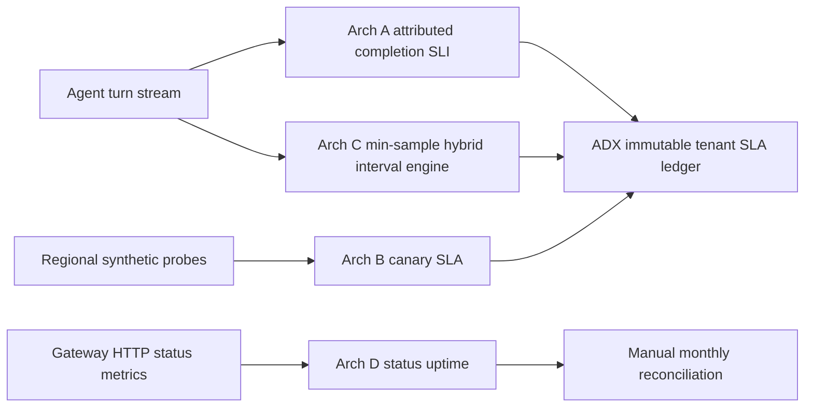
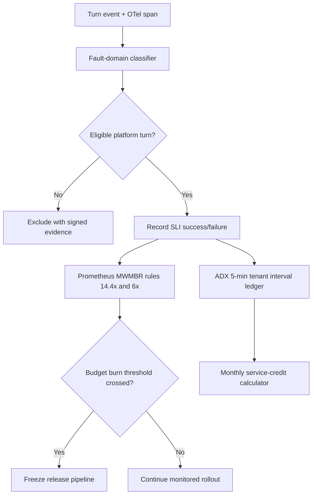
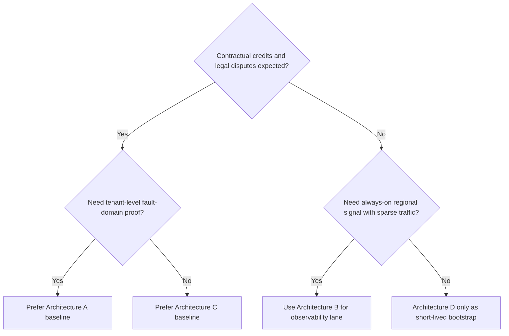

# B2B Agent Contractual SLA Selection FAQ: Fault-Attributed MWMBR + ADX Credit Ledger vs Synthetic Canary vs HTTP Uptime
> **Applies to**: enterprise B2B AI SaaS vendors, regulated managed-agent providers, and internal Tier-0 AI platforms with contractual availability obligations.
> **Decision pressure**: align legal SLA language, SRE error-budget control, and invoice-grade service-credit calculations without unfair fault attribution.
> **Core objective**: design a provable turn-completion SLI and service-credit engine that withstands procurement, legal, and customer dispute review.

## 1. Executive summary
- Contractual AI-agent SLAs fail when platform telemetry is not aligned with business completion semantics.
- `HTTP 200` header success is insufficient for streaming SSE/WebSocket terminal outcome accounting.
- Customer-owned connector failures must not burn platform-responsible contractual budgets.
- Sparse low-volume tenants can generate statistically false interval breach classifications.
- Architecture A gives strongest legal-grade attribution and operational control loops.
- Architecture B gives strong always-on regional signal but weak tenant-isolated outage visibility.
- Architecture C balances low-volume fairness with reproducible interval math and dispute defensibility.
- Architecture D has lowest startup effort but highest long-term credit leakage and dispute toil.
- Multi-window multi-burn-rate gates provide earlier and safer release control than single-threshold alarms.
- Immutable ADX tenant ledgers reduce finance/SRE/legal reconciliation friction.
- Active-active topology only improves contractual SLA if downstream dependencies are also redundant.
- Selection should be made jointly by SRE, platform engineering, finance, and legal governance.

## 2. Applicability and explicit non-goals
- Scope includes contractual monthly SLA commitments such as `99.9%` and `99.95%`.
- Scope includes service-credit tiers such as `10%`, `25%`, and `50%` invoice credits.
- Scope includes turn-completion SLIs and fault-domain taxonomy with signed attribution evidence.
- Scope includes MWMBR gates (`14.4x` and `6x`) with automated deployment freeze integration.
- Scope is distinct from latency-hedging and degradation-ring runtime traffic steering in section 3.1.
- Scope is distinct from token chargeback/showback FinOps unit economics in section 3.7.
- Scope is distinct from multi-region failover drill design patterns in section 3.8.
- Scope excludes legal contract drafting language itself.
- Scope excludes generic customer-support workflow tooling selection.

## 3. Scenario and failure physics
- Streaming responses can flush `HTTP 200` within `80ms` then fail terminally after `14s`.
- Shared-responsibility boundaries blur when customer-hosted MCP/SAP connectors return `504`.
- Tenant-level sparse traffic can distort interval percentages (`1/2` failures appear as `50%` downtime).
- Platform teams need fault-attributed, tenant-specific, immutable evidence for credit adjudication.
- Release gates must react quickly to real budget burn while avoiding alert fatigue.
- Monthly credit computation must be deterministic and auditable.
- Architecture decisions must preserve both customer trust and vendor gross margin.

## 4. Four architecture candidates
- **Architecture A**: fault-domain-attributed turn-completion SLI + MWMBR + ADX immutable SLA ledger.
- **Architecture B**: continuous synthetic golden-path canary probes.
- **Architecture C**: hybrid minimum-sample real traffic windows with synthetic fallback.
- **Architecture D**: gateway HTTP status uptime with manual monthly credit adjustment.
- A prioritizes attribution correctness and contractual defensibility.
- B prioritizes constant synthetic observability regardless of tenant traffic.
- C prioritizes fairness for sparse tenants plus reproducible interval logic.
- D prioritizes short-term implementation speed at the cost of long-term governance quality.

## 5. Architecture A details (attributed completion SLI + MWMBR + ADX ledger)
- SLI uses terminal `turn.completed` semantics, not header-only gateway success.
- Responsibility taxonomy separates `platform_fault`, `foundry_upstream`, `customer_dependency`, and `client_invalid`.
- Eligibility filter computes SLA only across platform-responsible eligible turns.
- Signed boundary evidence supports exclusion of customer-side timeout and quota failures.
- Managed Prometheus records short and long burn windows for proactive policy gates.
- Deployment freeze triggers can integrate with GitHub Actions or Argo workflows.
- ADX stores immutable tenant-month slices for invoice and dispute reconciliation.
- Architecture A best fits high-value B2B contracts with strong legal scrutiny.

## 6. Architecture B details (continuous synthetic canary SLA)
- Regional probes run every `60s` against deterministic golden-path scenarios.
- Synthetic availability can be computed continuously even with zero tenant traffic.
- Probe standardization simplifies cross-region comparability.
- Detection blind spots remain for tenant-isolated key/index/shard regressions.
- Synthetic success may diverge from real tenant experience under noisy-neighbor contention.
- Probe design and maintenance still require disciplined fixture governance.
- Strong for baseline platform health trend detection and broad regression alerts.
- Weak as sole source for contractual tenant credit adjudication.

## 7. Architecture C details (minimum-sample hybrid interval model)
- Real tenant windows are used only when `N >= N_min` (for example `N >= 10` in `5-minute` slices).
- When volume is sparse, assigned-stamp canary health backfills the interval state.
- This avoids low-volume false breaches while retaining customer-visible accountability.
- KQL interval math can be reproduced and shared in disputes.
- Model aligns with hyperscaler-style interval interpretation patterns.
- Requires clear tenant-stamp mapping governance and versioned backfill policy.
- Strong compromise between legal fairness and operational simplicity.
- Often selected when tenant volume distribution is highly uneven.

## 8. Architecture D details (HTTP status uptime + manual adjustment)
- Uses gateway `5xx` ratio as primary monthly uptime indicator.
- Simple to implement and explain at day-1.
- Misses mid-stream SSE/WebSocket aborts that never surface as `5xx`.
- Cannot reliably separate customer dependency faults from platform faults.
- Manual finance/SRE/legal monthly reconciliation creates high recurring toil.
- Credit overpayment and underpayment risk both increase over time.
- Poor fit for large enterprise portfolios with strict contractual enforcement.
- Useful only as transitional baseline while moving to attributed completion SLIs.

## 9. Twelve-dimension architecture comparison matrix
| Dimension | Architecture A | Architecture B | Architecture C | Architecture D |
|---|---|---|---|---|
| Contract defensibility | Highest | Medium | High | Low |
| Streaming terminal correctness | Highest | Medium | High | Lowest |
| Fault attribution precision | Highest | Low | High | Lowest |
| Sparse-tenant fairness | High | Medium | Highest | Low |
| Operational automation depth | Highest | Medium | High | Low |
| Release-gate readiness | Highest | Medium | High | Low |
| Finance reconciliation effort | Lowest | Medium | Low | Highest |
| Customer dispute reproducibility | Highest | Medium | Highest | Low |
| Day-1 implementation speed | Medium | High | Medium | Highest |
| Day-2 governance complexity | Medium-high | Medium | Medium-high | High |
| Cost predictability at scale | High | Medium | High | Low |
| Gross-margin protection | Highest | Medium | High | Lowest |

## 10. Four-architecture topology overview


## 11. Fault attribution, MWMBR gate, and monthly credit ledger flow


## 12. SA decision tree


### Q1. Composite serial vs active-active parallel SLA math and margin implications
- Serial dependency chains multiply availability and reduce top-line achievable SLA.
- `SLA_serial = Π A_i` sets hard upper bound when dependencies are serially critical.
- Active-active improves stamp availability as `1 - (1 - A_stamp)^2`.
- Promising `99.95%` while a required single-region dependency is `99.9%` creates structural loss risk.
- Legal commitments must be constrained by weakest non-redundant dependency.
- Margin planning should include expected credit payout under realistic incident distributions.
- Contract language should tie exclusions to measurable attributed evidence.
- SRE and finance should co-own modeled worst-case payout envelopes.
- Overpromised SLA tiers can erase ARR margin even with low incident frequency.

### Q2. Streaming SSE/WebSocket terminal-frame SLI contract design
- Header-level success does not guarantee user-visible completion success.
- SLI event should be emitted only on terminal `turn.completed` state.
- Terminal failure categories should include stream abort, timeout, and malformed chunk termination.
- Gateway 2xx counters should be treated as transport-level, not contractual success truth.
- Session correlation IDs must bind header spans to terminal completion records.
- This prevents false-green accounting from early header flushes.
- Contractual reports must declare completion semantics explicitly.
- Client SDKs should expose completion receipts for tenant-side verification.
- This contract is foundational for fair monthly credit computation.

### Q3. Cryptographic fault-domain attribution proof for exclusion acceptance
- Customer-side connector failures require signed boundary evidence for exclusion.
- Proxy or sidecar should sign timeout/quota evidence with non-repudiation metadata.
- Evidence bundle should include tenant, turn, connector, timestamp, and policy hash.
- Legal/procurement acceptance improves when evidence is immutable and replayable.
- Exclusion policy must be deterministic and version-controlled.
- Platform faults must remain non-excludable under same evidence model.
- Random audit sampling should validate classifier and signature correctness.
- Evidence retention policy should match contract dispute windows.
- This pattern reduces ambiguous blame and unplanned credit leakage.

### Q4. MWMBR (`14.4x`, `6x`) PromQL and automated release freeze gates
- Short-window burn detects acute regressions quickly.
- Long-window burn detects sustained budget erosion.
- Combining windows lowers false positives while preserving fast mitigation.
- Triggered freezes should stop risky deploy paths automatically.
- Manual override requires controlled approval and post-incident justification.
- Burn alerts should map directly to runbook actions and ownership.
- Gate telemetry should be attached to deployment records.
- SLO policy updates should be versioned with change-control.
- This creates a reliable feedback loop from reliability to release velocity.

### Q5. Production ADX 5-minute hybrid SLA and tiered service-credit calculator
- Eligibility filtering must happen before interval availability computation.
- Hybrid rule applies real traffic when `N >= N_min`, otherwise synthetic fallback.
- Monthly SLA should be computed from interval outcomes, not raw request averages.
- Tiered credits should map cleanly to policy thresholds.
- Query output must be immutable and customer-shareable.

```kusto
let n_min = 10;
let intervals = TurnLedger
| summarize
    eligible = countif(is_eligible_platform == true),
    success = countif(is_eligible_platform == true and turn_completed == true)
  by tenant_id, bin(timestamp, 5m), stamp_id;
let with_rate = intervals
| join kind=leftouter StampCanary on stamp_id, timestamp
| extend avail = iif(eligible >= n_min, todouble(success) / eligible, canary_availability);
with_rate
| summarize monthly_sla = avg(avail) by tenant_id, month = startofmonth(timestamp)
| extend credit_tier = case(monthly_sla < 0.990, "50%", monthly_sla < 0.995, "25%", monthly_sla < 0.999, "10%", "0%");
```

```promql
(
  sum(rate(platform_eligible_turn_failures_total[5m])) /
  sum(rate(platform_eligible_turn_total[5m]))
) / (1 - 0.999)
```

```json
{
  "service_credit_policy": {
    "target_sla": 0.999,
    "tiers": [
      { "if_monthly_sla_lt": 0.999, "credit": "10%" },
      { "if_monthly_sla_lt": 0.995, "credit": "25%" },
      { "if_monthly_sla_lt": 0.990, "credit": "50%" }
    ]
  }
}
```

### Q6. Three-year financial exposure and ops TCO across 25, 250, and 2,000 tenants
- Financial exposure depends on both true outage rate and attribution precision.
- Manual models accumulate legal and SRE overhead non-linearly with tenant count.
- Attributed automated ledgers reduce dispute hours and over-credit leakage.
- Hybrid models help sparse tenants while preserving fairness.

| Tenant count | Architecture A | Architecture B | Architecture C | Architecture D |
|---|---:|---:|---:|---:|
| 25 | \$0.70M–\$1.20M | \$0.80M–\$1.40M | \$0.75M–\$1.30M | \$0.95M–\$1.70M |
| 250 | \$5.60M–\$9.10M | \$6.40M–\$10.30M | \$5.90M–\$9.60M | \$8.40M–\$13.90M |
| 2,000 | \$33.00M–\$52.00M | \$38.00M–\$60.00M | \$35.00M–\$55.00M | \$61.00M–\$96.00M |

| Tenant count | Typical reduction in misattributed credit payouts with fault-attributed ledgers | Typical reduction in monthly dispute handling effort |
|---|---:|---:|
| 25 | 28%–44% | 22%–35% |
| 250 | 39%–57% | 34%–52% |
| 2,000 | 48%–66% | 43%–61% |

- Legal-grade attribution quality directly influences gross-margin protection.
- MWMBR gate quality influences incident frequency and payout tails.
- Finance should review exposure deltas quarterly with updated incident data.

## 13. Day-0 rollout checklist
- Define contractual SLI semantics around terminal turn completion.
- Implement responsibility taxonomy and signed fault-domain evidence schema.
- Build eligible-turn filters and exclusion policy contract mapping.
- Configure Prometheus MWMBR recording and alert rules.
- Integrate release-freeze automation into deployment systems.
- Stand up ADX immutable tenant interval ledgers.
- Implement monthly credit query outputs and approval workflow.
- Publish customer-facing SLA methodology documentation.

## 14. Day-2 operations checklist
- Audit classifier drift and evidence-signature verification success rates.
- Review MWMBR alert precision and freeze false-positive rates.
- Track sparse-tenant interval fairness metrics and fallback correctness.
- Validate tenant-stamp mapping integrity after topology changes.
- Rehearse dispute-report generation and legal evidence export.
- Compare synthetic and real-traffic SLA divergence trends.
- Tune runbooks for stream-terminal failure categories.
- Recalculate payout-exposure models quarterly.

## 15. Good fit versus not for
| Category | Guidance |
|---|---|
| ✅ Good fit | Enterprise B2B contracts with invoice-backed SLA credits and procurement/legal scrutiny. |
| ✅ Good fit | Platforms needing tenant-level fault attribution and reproducible dispute evidence. |
| ✅ Good fit | Organizations with mature SRE release gating and finance governance. |
| ⛔ Not for | Internal non-contract workloads where service credits are irrelevant. |
| ⛔ Not for | Teams unwilling to run attribution pipelines and immutable ledgers. |
| ⛔ Not for | Environments that accept manual monthly spreadsheet reconciliation. |

## 16. Five-step implementation guide
1. Define terminal completion SLI and eligible-turn contractual boundary rules.
2. Implement signed fault-domain attribution and immutable evidence storage.
3. Deploy MWMBR recording rules and automated release freeze controls.
4. Build ADX interval and monthly service-credit computation pipelines.
5. Operationalize dispute playbooks with recurring governance reviews.

## 17. Quarterly governance metric pack
- Track terminal completion success rate for eligible turns.
- Track header-success vs terminal-failure false-green ratio.
- Track fault-domain classifier precision and recall by category.
- Track signed-evidence verification success and rejection counts.
- Track excluded-turn percentage by exclusion reason.
- Track sparse-tenant fallback invocation frequency.
- Track synthetic vs real interval divergence by tenant cohort.
- Track MWMBR short-window and long-window alert rates.
- Track release-freeze trigger counts and override rates.
- Track average freeze duration and incident containment effect.
- Track monthly SLA percentile distribution across tenants.
- Track service-credit payout totals by tier.
- Track misattributed credit correction volume.
- Track dispute count, resolution time, and legal-hours consumption.
- Track ADX ledger query latency and completeness checks.
- Track telemetry loss incidents affecting contractual computation.
- Track policy version drift between contract and runtime enforcement.
- Track customer portal SLA-report generation success rate.
- Track platform fault recurrence linked to release cohorts.
- Track tenant-specific hotspot dependencies causing repeated exclusions.
- Track audit finding count related to SLA evidence controls.
- Track gross-margin variance attributable to SLA payout deltas.
- Track on-call toil spent on contractual SLA incidents.
- Track confidence score of monthly credit close process.
- Track effective exclusion acceptance rate in customer dispute outcomes.
- Track median time from burn alert to mitigation rollout completion.
- Track post-freeze rollback success ratio without follow-up incidents.
- Track SLI contract mismatch defects found in SDK versions.
- Track synthetic probe fixture drift and correction lead time.
- Track tenant communication latency after SLA-impacting incidents.
- Track credit ledger backfill frequency and root-cause categories.
- Track manual intervention rate in monthly credit approval workflow.
- Track legal review reopen rate for previously closed SLA cases.
- Track quarterly calibration error between predicted and actual credit tiers.
- Track three-year exposure forecast error versus actuals.
- Maintain architecture decision records for all SLA policy changes.

## 18. Provenance
- `anonymized_reported`: formulas, attribution controls, and financial exposure ranges are synthesized from anonymized enterprise contractual-SLA programs with reproducible assumptions.
